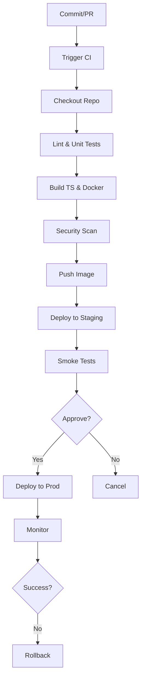

<!-- Generated by Groq via GitHub Actions -->
<!-- Topic ID: T187 -->
<!-- Category: DevOps / Infrastructure -->
<!-- Generated at UTC: 2026-11-08T07:37:35.040978+00:00 -->

# CI/CD

## 1. What problem does this solve?

| What | Why it matters | Consequence of not using it | Real‑world appearance |
|------|----------------|-----------------------------|-----------------------|
| **Manual, error‑prone deployments** | Every hand‑rolled script or “copy‑paste” step can introduce subtle bugs, missing files, or wrong environment variables. | Production outages, security holes, and wasted developer time. | Deploy scripts in legacy monoliths, ad‑hoc `scp` commands. |
| **Inconsistent builds** | Different developers may have different local tool versions, leading to “works on my machine” bugs. | Hard to reproduce failures, long debugging cycles. | CI pipelines that run on a single, controlled environment. |
| **Slow feedback loop** | Developers wait minutes or hours for a build to finish before knowing if their change broke something. | Low morale, more bugs in production. | Continuous integration systems that run tests on every push. |
| **Lack of traceability** | No record of who deployed what and when, making audits impossible. | Compliance violations, difficulty in rollback. | Version‑controlled deployment manifests, GitOps. |

In a typical backend stack (Node.js/TS, FastAPI, PostgreSQL, Redis, etc.) CI/CD is the glue that turns code commits into reliable, repeatable, and auditable releases.

---

## 2. Mental model

### Analogy: The Factory Assembly Line

| Factory | CI/CD |
|---------|-------|
| **Raw materials** (source code) | **Build** (compile, bundle) |
| **Quality inspector** (unit tests, lint) | **Quality gate** (CI jobs) |
| **Packaging** (Docker image) | **Artifact** (image, binary) |
| **Shipping** (delivery trucks) | **Deployment** (CD jobs) |
| **Quality control at destination** (smoke tests) | **Post‑deployment checks** |

Just as a factory ensures every product meets standards before shipping, CI/CD ensures every code change passes automated checks before it reaches users.

### Engineering model

1. **Trigger** – a commit or PR pushes code into the pipeline.
2. **Build & Test** – compile, lint, unit, integration, and security scans.
3. **Artifact creation** – Docker image, npm package, or binary.
4. **Promotion** – move the artifact through environments (dev → staging → prod).
5. **Deployment** – apply manifests, run migrations, perform canary/blue‑green.
6. **Observability** – logs, metrics, alerts to confirm success or rollback.

---

## 3. Deep explanation

### Internals

- **Pipeline** – a directed acyclic graph (DAG) of jobs/stages.
- **Jobs** – isolated execution units (e.g., `npm test`, `docker build`).
- **Artifacts** – files produced by jobs that are passed downstream.
- **Environments** – logical deployment targets (dev, staging, prod) with distinct secrets and config.
- **Promotion** – moving an artifact from one environment to the next, often gated by manual approval or automated tests.

### Important terminology

| Term | Definition |
|------|------------|
| **CI (Continuous Integration)** | Automated building and testing on every commit. |
| **CD (Continuous Delivery)** | Automated promotion of a build to a target environment, but still requires a manual trigger for production. |
| **Continuous Deployment** | CD that automatically pushes to production after passing all gates. |
| **Pipeline as Code** | The pipeline definition lives in source control (e.g., `.github/workflows/ci.yml`). |
| **Rollback** | Reverting to a previous stable artifact. |
| **Canary** | Deploying a new version to a small subset of traffic before full rollout. |
| **Blue/Green** | Maintaining two identical environments; switch traffic between them. |
| **Feature Flags** | Runtime toggles to enable/disable features without redeploying. |

### Trade‑offs

| Factor | Fast, aggressive pipeline | Thorough, gated pipeline |
|--------|--------------------------|--------------------------|
| **Speed** | Quick feedback, high developer velocity. | Slower, but higher confidence. |
| **Complexity** | Simpler, fewer stages. | More stages, more maintenance. |
| **Risk** | Higher chance of breaking prod. | Lower risk, but may delay releases. |
| **Cost** | Fewer CI runner hours. | More compute, storage. |

### Failure modes

- **Flaky tests** → false positives/negatives.
- **Environment drift** → differences between CI and prod.
- **Secrets leakage** → hard‑coded credentials.
- **Image vulnerabilities** → unscanned Docker layers.
- **Race conditions** → concurrent deployments corrupt state.

### Limitations

- **Not all deployments are fully automatable** (e.g., manual database migrations that require human approval).
- **CI/CD tools can become a single point of failure** if not replicated.
- **Complexity grows with microservices** – each service may need its own pipeline or shared pipeline with matrix jobs.

### Where it fits in a backend architecture

```
┌───────────────────────┐
│  Source Control (Git) │
└────────────┬──────────┘
             │
             ▼
┌───────────────────────┐
│   CI/CD Pipeline      │
│  (GitHub Actions,     │
│   GitLab CI, Jenkins) │
└────────────┬──────────┘
             │
             ▼
┌───────────────────────┐
│  Artifact Registry    │
│  (Docker Hub, ECR)    │
└────────────┬──────────┘
             │
             ▼
┌───────────────────────┐
│  Kubernetes Cluster   │
│  (Helm, Kustomize)    │
└───────────────────────┘
```

It sits between code and infrastructure, orchestrating the flow of artifacts and ensuring that every deployment is repeatable and auditable.

---

## 4. How it works

1. **Commit** – Developer pushes code to `main` or opens a PR.
2. **Trigger** – CI system detects the push and starts the pipeline.
3. **Checkout** – Pipeline checks out the repository.
4. **Lint & Test** – Run `npm run lint`, `npm test`, `jest`, `eslint`.
5. **Build** – Compile TypeScript (`tsc`), bundle, and build Docker image.
6. **Scan** – Run security scanners (Snyk, Trivy) on the image.
7. **Publish Artifact** – Push Docker image to registry.
8. **Deploy to Staging** – Apply Kubernetes manifests via `kubectl` or Helm.
9. **Smoke Tests** – Run integration tests against the staging environment.
10. **Approve** – Manual or automated approval gate.
11. **Deploy to Production** – Promote image, perform canary or blue‑green.
12. **Monitor** – Observe logs, metrics, and alerts; rollback if needed.



---

## 5. Practical implementation

Below is a minimal GitHub Actions workflow that demonstrates the core CI/CD steps for a TypeScript/Node.js project.

```yaml
# .github/workflows/ci-cd.yml
name: CI/CD

on:
  push:
    branches: [ main ]
  pull_request:

jobs:
  build-test:
    runs-on: ubuntu-latest
    steps:
      - uses: actions/checkout@v4

      # Cache npm dependencies for faster builds
      - name: Cache node_modules
        uses: actions/cache@v3
        with:
          path: ~/.npm
          key: ${{ runner.os }}-node-${{ hashFiles('package-lock.json') }}
          restore-keys: |
            ${{ runner.os }}-node-

      - name: Install dependencies
        run: npm ci

      - name: Lint
        run: npm run lint

      - name: Unit tests
        run: npm test -- --coverage

      - name: Build TypeScript
        run: npm run build

      - name: Build Docker image
        run: |
          docker build -t myorg/myapp:${{ github.sha }} .
          echo ${{ secrets.DOCKER_PASSWORD }} | docker login -u ${{ secrets.DOCKER_USERNAME }} --password-stdin
          docker push myorg/myapp:${{ github.sha }}

  deploy-staging:
    needs: build-test
    runs-on: ubuntu-latest
    environment: staging
    steps:
      - name: Checkout
        uses: actions/checkout@v4

      - name: Deploy to Staging
        run: |
          kubectl config use-context staging
          helm upgrade --install myapp ./helm/myapp \
            --set image.tag=${{ github.sha }} \
            --namespace myapp

  deploy-prod:
    needs: deploy-staging
    runs-on: ubuntu-latest
    environment:
      name: production
      url: https://api.myapp.com
    if: github.ref == 'refs/heads/main'
    steps:
      - name: Checkout
        uses: actions/checkout@v4

      - name: Deploy to Production (Canary)
        run: |
          kubectl config use-context prod
          helm upgrade --install myapp ./helm/myapp \
            --set image.tag=${{ github.sha }} \
            --set canary.enabled=true \
            --namespace myapp
```

**Key points**

- `needs:` ensures jobs run in order.
- `environment:` ties the job to GitHub’s protected environments (approval gate).
- Docker login uses secrets stored in GitHub.
- Helm is used for declarative Kubernetes deployments.
- The `canary.enabled` flag can be used in the Helm chart to deploy a small percentage of traffic to the new version.

---

## 6. Production considerations

| Concern | What to watch for | Mitigations |
|---------|-------------------|-------------|
| **Scalability** | Long build times, many parallel jobs. | Cache dependencies, use matrix builds, shard tests. |
| **Reliability** | Pipeline failures, flaky tests. | Retry logic, test isolation, health checks. |
| **Security** | Secrets exposure, vulnerable images. | Store secrets in vaults, use image scanning, least privilege. |
| **Observability** | Missing logs, no metrics. | Emit structured logs, integrate with Prometheus/ELK. |
| **Performance** | Slow deployments, high latency. | Blue/green or canary to minimize downtime. |
| **Error handling** | Unhandled exceptions in CI scripts. | Use `set -e`, exit codes, notify Slack/Teams. |
| **Resource usage** | CI runner costs. | Use self‑hosted runners, limit concurrency. |
| **Operational concerns** | Pipeline drift, outdated dependencies. | Version lock, automated dependency updates (Dependabot). |
| **Failure recovery** | Broken deployments. | Automated rollback, feature flags. |
| **Deployment considerations** | Traffic routing, database migrations. | Use Helm hooks for migrations, canary traffic split. |

---

## 7. Common mistakes

| Mistake | Why it’s bad |
|---------|--------------|
| **Running tests only in CI** | Developers think tests pass locally but fail in CI due to environment differences. |
| **Hard‑coding secrets** | Secrets leak into logs or images; violates least privilege. |
| **No caching** | Every build downloads all dependencies, wasting time and bandwidth. |
| **Skipping security scans** | Vulnerable packages or images make it to prod. |
| **Over‑complex pipelines** | Hard to maintain, hard to debug, increases risk of mis‑configuration. |
| **Ignoring pipeline metrics** | Missed failures, no visibility into build health. |
| **Deploying without rollback strategy** | Manual rollback is slow and error‑prone. |
| **Not using environment isolation** | Staging and prod share secrets/config, leading to accidental leaks. |

---

## 8. Senior engineer perspective

### Design decisions at scale

1. **Pipeline tool** – GitHub Actions vs GitLab CI vs Jenkins vs CircleCI.  
   *Trade‑off:* Vendor lock‑in vs community support vs feature set.

2. **Artifact registry** – Docker Hub, ECR, GCR, or self‑hosted Harbor.  
   *Trade‑off:* Cost, compliance, network latency.

3. **Deployment strategy** – Blue/green, canary, or feature‑flag driven.  
   *Trade‑off:* Complexity vs risk mitigation.

4. **Infrastructure as Code** – Helm, Kustomize, Terraform.  
   *Trade‑off:* Declarative vs imperative, version control, drift prevention.

5. **Matrix builds** – Run tests across Node.js versions, OSes, or database versions.  
   *Trade‑off:* Build time vs coverage.

### Bottlenecks

- **Build time** – can be mitigated with caching, incremental builds, or distributed runners.
- **Network** – pulling large images or dependencies can stall pipelines.
- **Secrets management** – slow secret retrieval can delay deployments.

### Failure scenarios

- **Broken tests** – pipeline stops, but manual override may still deploy if not gated.
- **Image vulnerabilities** – can be caught by scanning, but may still slip through if misconfigured.
- **Database migration failures** – can lock the service; need to run migrations in a safe, reversible way.

### Monitoring

- Pipeline metrics (duration, success rate) via GitHub Actions API or external dashboards.
- Deployment health via Kubernetes readiness probes and Prometheus alerts.
- Alerting on failed rollbacks or canary failures.

### Cost/performance

- CI runner costs scale with concurrency; consider self‑hosted runners for predictable workloads.
- Artifact storage costs grow with image size; use deduplication and retention policies.

### When NOT to use

- **Very small projects** – manual deployment may be simpler and cheaper.
- **Highly regulated environments** – may require manual approval steps that cannot be fully automated.
- **Legacy monoliths** – refactoring to CI/CD may be too costly relative to benefits.

---

## 9. Interview questions

1. **Beginner** – *What is Continuous Integration and why is it important?*  
   *Answer:* CI is the practice of automatically building and testing code on every commit. It catches integration bugs early, provides fast feedback, and ensures that the codebase remains in a deployable state.

2. **Beginner** – *Explain the difference between Continuous Delivery and Continuous Deployment.*  
   *Answer:* Continuous Delivery automates everything up to production but requires a manual approval before the final push. Continuous Deployment automatically pushes every successful build to production without human intervention.

3. **Senior** – *How would you design a CI/CD pipeline for a microservices architecture that includes services written in Node.js, Python, and Go?*  
   *Answer:* Use a single pipeline with matrix jobs per language, shared caching layers, and a common artifact registry. Each service has its own deployment job that pulls the image and applies its Helm chart. Use a shared secret store (e.g., Vault) and enforce environment isolation.

4. **Senior** – *Describe how to implement a blue‑green deployment in Kubernetes using Helm and GitOps.*  
   *Answer:* Maintain two identical Helm releases (`blue` and `green`). Deploy the new version to the inactive release, run smoke tests, then switch the Ingress or service selector to point to the new release. GitOps tools (ArgoCD, Flux) watch the Git repo for changes and apply them automatically, ensuring declarative state.

5. **Scenario/Debugging** – *A pipeline fails on deployment because an environment variable is missing. How would you debug and fix this?*  
   *Answer:*  
   - Inspect the pipeline logs to see the exact error message.  
   - Verify that the secret is stored in the CI system’s secret store.  
   - Check that the environment (e.g., `staging`) is correctly configured to inject the secret.  
   - Add a debug step that prints the environment variables (mask secrets).  
   - Once identified, add the missing secret or correct the key name, then re‑run the pipeline.

---

## 10. Hands‑on task

**Goal:** Add a GitHub Actions workflow that performs a canary deployment to a staging Kubernetes cluster.

**Steps**

1. Create a `helm/` directory with a simple chart for your Node.js app.  
2. Add a `ci-cd.yml` file in `.github/workflows/` that:
   - Builds the Docker image.
   - Pushes it to Docker Hub.
   - Deploys to staging using Helm.
   - Runs a smoke test against the staging URL.
3. Configure a GitHub environment named `staging` with a required approval gate.
4. Commit and push; observe the pipeline run and verify the app is reachable at the staging URL.

**What to learn**

- Pipeline ordering (`needs:`).
- Environment protection and approvals.
- Helm chart templating (`values.yaml`).
- Canary traffic split via `--set canary.enabled=true`.

---

## 11. Quick revision

- **CI** – automated build & test on every commit.  
- **CD** – automated promotion of artifacts to environments.  
- **Pipeline** – DAG of jobs/stages.  
- **Artifacts** – Docker images, binaries, test reports.  
- **Environments** – dev, staging, prod with distinct secrets.  
- **Rollback** – revert to previous artifact on failure.  
- **Canary** – small traffic slice to new version.  
- **Blue/Green** – two identical environments, switch traffic.  
- **Secrets** – store in vaults, never hard‑code.  
- **Caching** – speed up builds, reduce bandwidth.  
- **Observability** – logs, metrics, alerts for pipeline and deployments.  
- **Governance** – version lock, approval gates, audit trails.  
- **Cost** – CI runner usage, artifact storage, compute for deployments.  
- **Common pitfalls** – flaky tests, missing secrets, no rollback.

---

## 12. References

- https://docs.github.com/en/actions  
- https://docs.gitlab.com/ee/ci/  
- https://kubernetes.io/docs/concepts/cluster-administration/rolling-update/  
- https://docs.docker.com/engine/reference/commandline/build/  
- https://docs.docker.com/registry/  
- https://docs.snyk.io/ci-cd  
- https://docs.aws.amazon.com/codebuild/  
- https://docs.aws.amazon.com/codepipeline/  
- https://docs.microsoft.com/en-us/azure/devops/pipelines/  
- https://helm.sh/docs/intro/quickstart/  
- https://argoproj.github.io/argo-cd/  
- https://fluxcd.io/docs/  

---
