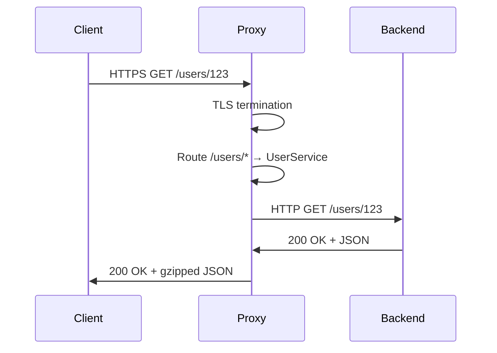

<!-- Generated by Groq via GitHub Actions -->
<!-- Topic ID: T188 -->
<!-- Category: DevOps / Infrastructure -->
<!-- Generated at UTC: 2026-11-08T07:37:35.040978+00:00 -->

# Reverse proxy

## 1. What problem does this solve?

A reverse proxy sits between clients and one or more backend services.  
It forwards incoming HTTP(S) requests to the appropriate backend and returns the response.

**Why is this needed?**

| Problem | Impact | Real‑world example |
|---------|--------|--------------------|
| **Single entry point** | Clients hit a single domain (`api.example.com`) instead of many (`auth.internal`, `users.internal`, etc.). | Public API gateway for a microservice architecture. |
| **Load balancing** | Distributes traffic across multiple instances of a service. | Nginx balancing a cluster of FastAPI workers. |
| **SSL termination** | Offloads TLS handshake from backend services. | HTTPS termination at Nginx, backend runs HTTP. |
| **Security isolation** | Hides internal network topology, applies WAF rules, rate limits. | Protecting a PostgreSQL‑backed service from direct exposure. |
| **Caching & compression** | Reduces load on backends and improves latency. | Edge caching of static assets. |
| **Protocol translation** | Supports HTTP/2, gRPC, WebSocket upgrades. | Proxying a gRPC service behind an HTTP/1.1 client. |

If a reverse proxy is not used, each backend must expose its own public endpoint, leading to:

- Complex DNS and firewall rules.
- Repeated TLS configuration on every service.
- No central place for rate limiting or logging.
- Harder to evolve routing logic without redeploying services.

## 2. Mental model

**Analogy:**  
Think of a reverse proxy as a *post office* for your web services.  
Customers (browsers) send letters (HTTP requests) to the post office address.  
The post office reads the address on the envelope, routes the letter to the correct department (backend service), and then delivers the reply back to the customer.

**Engineering model:**  
- **Client** → **Reverse Proxy** → **Backend Service**  
The proxy receives the request, decides which backend to forward to, rewrites headers if needed, and streams the response back.

## 3. Deep explanation

### Internals

1. **Listener** – Binds to a public IP/port (e.g., 443 for HTTPS).  
2. **Router** – Matches request path/host to a backend pool.  
3. **Load Balancer** – Chooses an instance from the pool (round‑robin, least‑conn, etc.).  
4. **Proxy Engine** – Forwards the request, handles keep‑alive, TLS termination, WebSocket upgrades.  
5. **Response Handler** – Streams the backend response back, possibly caching or compressing.

### Important terminology

| Term | Meaning |
|------|---------|
| **Upstream** | Backend service(s) the proxy forwards to. |
| **Health check** | Periodic probe to ensure an upstream is alive. |
| **Sticky session** | Route all requests from a client to the same upstream. |
| **Connection pooling** | Reuse TCP connections to upstreams. |
| **TLS termination** | Proxy decrypts TLS, forwards plaintext. |
| **WebSocket upgrade** | HTTP `Upgrade: websocket` handled transparently. |

### Trade‑offs

| Decision | Pros | Cons |
|----------|------|------|
| **TLS termination at proxy** | Offloads CPU, central cert management. | Backend sees unencrypted traffic; must trust proxy. |
| **Caching at proxy** | Faster responses, lower backend load. | Cache invalidation complexity. |
| **Sticky sessions** | Keeps session state local. | Imbalanced load, single‑point failure. |
| **HTTP/2 vs HTTP/1.1** | Multiplexing, header compression. | Some backends may not support HTTP/2. |

### Failure modes

- **Proxy crash** → All traffic lost until restart.  
- **Backend unresponsive** → Proxy may time out or return 502/504.  
- **Misconfigured routing** → Requests go to wrong service.  
- **TLS mis‑setup** → Clients get SSL errors.  

### Limitations

- **Stateful protocols** (e.g., gRPC with long‑lived streams) require careful handling.  
- **Dynamic routing** (e.g., feature flags) may need runtime reconfiguration.  
- **Zero‑downtime deployments** can be tricky if the proxy holds connections.

### Where it fits

```
Client
  │
  ▼
┌───────────────────────┐
│  Reverse Proxy (Nginx)│
│  ├─ TLS termination   │
│  ├─ Routing           │
│  ├─ Load balancing    │
│  └─ Caching/Compression│
└───────────────────────┘
  │
  ▼
┌───────────────┐   ┌───────────────┐
│  Auth Service │   │  User Service │
│  (FastAPI)    │   │  (Node.js)    │
└───────────────┘   └───────────────┘
```

### Interaction with related concepts

- **API Gateway**: Often a specialized reverse proxy with auth, rate limiting, and schema validation.  
- **Service Mesh**: Adds sidecar proxies for intra‑cluster traffic; reverse proxy is the entry point.  
- **CDN**: Edge reverse proxies cache static content globally.

## 4. How it works

1. Client sends HTTPS request to `api.example.com/users/123`.  
2. Nginx receives the request, terminates TLS.  
3. Nginx matches the path `/users/*` to the `user-service` upstream pool.  
4. Load balancer selects an instance (e.g., `10.0.0.5:3000`).  
5. Nginx forwards the request over HTTP to the chosen instance.  
6. Backend processes and streams response back to Nginx.  
7. Nginx compresses (gzip) and returns the response to the client.



## 5. Practical implementation

### Node.js reverse proxy with `http-proxy`

```ts
// proxy.ts
import http from 'http';
import httpProxy from 'http-proxy';

const proxy = httpProxy.createProxyServer({
  // Keep the original host header
  changeOrigin: true,
  // Optional: log errors
  onError(err, req, res) {
    console.error('Proxy error:', err);
    res.writeHead(502, { 'Content-Type': 'text/plain' });
    res.end('Bad Gateway');
  },
});

const server = http.createServer((req, res) => {
  // Simple path‑based routing
  if (req.url?.startsWith('/users')) {
    proxy.web(req, res, { target: 'http://localhost:3001' });
  } else if (req.url?.startsWith('/auth')) {
    proxy.web(req, res, { target: 'http://localhost:3002' });
  } else {
    res.writeHead(404);
    res.end('Not found');
  }
});

server.listen(8080, () => {
  console.log('Reverse proxy listening on http://localhost:8080');
});
```

**Key lines**

- `changeOrigin: true` rewrites the `Host` header so the backend sees the correct host.  
- `onError` handles upstream failures gracefully.  
- Routing logic can be extracted to a config file for production.

### Docker Compose example

```yaml
# docker-compose.yml
services:
  proxy:
    build: ./proxy
    ports:
      - "443:443"   # HTTPS
      - "80:80"     # HTTP
    depends_on:
      - users
      - auth

  users:
    image: node:20-alpine
    working_dir: /app
    volumes:
      - ./users:/app
    command: ["node", "server.js"]
    expose:
      - "3001"

  auth:
    image: node:20-alpine
    working_dir: /app
    volumes:
      - ./auth:/app
    command: ["node", "server.js"]
    expose:
      - "3002"
```

Add an Nginx container for TLS termination if needed.

## 6. Production considerations

| Concern | Recommendation |
|---------|----------------|
| **Scalability** | Use a dedicated load balancer (e.g., Nginx, HAProxy, Envoy). Scale horizontally; keep stateless. |
| **Reliability** | Enable health checks; use graceful shutdown; keep a small connection pool. |
| **Security** | Centralize TLS certs; enforce HSTS; use CSP headers; rate limit; WAF integration. |
| **Observability** | Log request/response headers, latency, status codes. Export metrics (Prometheus) and traces (OpenTelemetry). |
| **Performance** | Keep keep‑alive connections; enable HTTP/2; compress responses; use connection pooling. |
| **Error handling** | Return meaningful 502/504; fallback to cached content if available. |
| **Resource usage** | Monitor CPU/memory; avoid large buffers; use streaming. |
| **Operational concerns** | Automate cert renewal (Let's Encrypt), rolling updates, zero‑downtime deployments. |
| **Failure recovery** | Circuit breakers; retry logic; graceful degradation. |
| **Deployment** | Use container orchestration (K8s) with Ingress controllers; separate dev/test/prod configs. |

## 7. Common mistakes

| Mistake | Why it’s problematic |
|---------|----------------------|
| **Hard‑coding backend URLs** | Breaks when services move; hard to test. |
| **Not handling TLS termination** | Exposes backend to the internet; performance hit. |
| **Ignoring keep‑alive** | Creates new TCP connections per request, high overhead. |
| **No health checks** | Traffic sent to dead instances → 502/504. |
| **Over‑caching** | Stale data served; cache invalidation hard. |
| **Using `proxy_set_header Host $host;` incorrectly** | Backend sees wrong host, breaking virtual hosts. |
| **Not limiting request size** | Open to DoS via huge payloads. |
| **Not setting `X-Forwarded-For`** | Backend loses client IP for logging/auth. |

## 8. Senior engineer perspective

At scale, a reverse proxy becomes a **critical infrastructure component**. Design decisions include:

- **Architecture**: Choose between a monolithic proxy (Nginx) vs. a service‑mesh sidecar (Envoy).  
- **Traffic routing**: Implement dynamic routing (e.g., via Consul or Kubernetes Ingress).  
- **Bottlenecks**: CPU for TLS, memory for connection pools, disk for logs.  
- **Failure scenarios**: Proxy overload → request timeouts; mis‑configured health checks → traffic to dead nodes.  
- **Monitoring**: Collect per‑backend latency, error rates, connection counts.  
- **Cost/performance**: Running a dedicated proxy VM vs. using managed Ingress.  
- **When NOT to use**: For simple single‑service deployments, a lightweight reverse proxy may add unnecessary complexity.

## 9. Interview questions

1. **Beginner**: *What is a reverse proxy and why would you use one?*  
   *Answer*: A server that forwards client requests to backend services, providing a single entry point, load balancing, SSL termination, and security isolation.

2. **Intermediate**: *Explain how a reverse proxy can handle WebSocket connections.*  
   *Answer*: It upgrades the HTTP connection (`Upgrade: websocket`) and streams data bidirectionally between client and backend, preserving the TCP stream.

3. **Senior**: *How would you design a reverse proxy for a microservices architecture that requires zero‑downtime deployments and high availability?*  
   *Answer*: Use a load balancer with health checks, keep‑alive connections, graceful draining of connections, rolling updates, and a separate TLS termination layer. Integrate with service discovery for dynamic routing.

4. **Senior**: *What metrics would you monitor on a reverse proxy and why?*  
   *Answer*: Request latency, error rates (4xx/5xx), upstream health, connection counts, CPU/memory usage, cache hit/miss ratios—these indicate performance, reliability, and capacity.

5. **Scenario/Debugging**: *A client receives a 502 Bad Gateway after a recent deployment. What steps would you take to diagnose the issue?*  
   *Answer*: Check proxy logs for errors, verify backend health checks, ensure backend is listening on expected port, confirm TLS certs, inspect network connectivity, and review recent config changes.

## 10. Hands‑on task

**Task**: Add a caching layer to the existing Node.js reverse proxy that caches GET responses for 60 seconds.

**Steps**:

1. Install `node-cache` (`npm i node-cache`).  
2. Wrap the proxy logic to check the cache before forwarding.  
3. Store responses (status, headers, body) in the cache keyed by request URL.  
4. Invalidate cache on POST/PUT/DELETE to the same path.  
5. Verify that repeated GETs return the cached response and that a POST clears the cache.

## 11. Quick revision

- Reverse proxy forwards client requests to backend services.  
- Provides single entry point, load balancing, TLS termination, security isolation.  
- Common implementations: Nginx, HAProxy, Envoy, custom Node.js proxy.  
- Key concepts: upstream, health checks, sticky sessions, keep‑alive, WebSocket upgrade.  
- Failure modes: proxy crash, backend unavailability, misrouting.  
- Production concerns: scalability, reliability, security, observability, performance.  
- Senior‑level design: dynamic routing, zero‑downtime, service mesh integration.  
- Typical metrics: latency, error rates, connection counts, cache hit ratio.  
- Common mistakes: hard‑coding URLs, missing health checks, no TLS termination, ignoring keep‑alive.

## 12. References

- [Nginx Reverse Proxy Documentation](https://nginx.org/en/docs/http/ngx_http_proxy_module.html)  
- [HAProxy Documentation](https://www.haproxy.org/documentation.html)  
- [Envoy Proxy Docs](https://www.envoyproxy.io/docs/envoy/latest/)  
- [Node.js http-proxy](https://github.com/http-party/node-http-proxy)  
- [OpenTelemetry for Node.js](https://opentelemetry.io/docs/instrumentation/node/)  
- [Prometheus Node Exporter](https://prometheus.io/docs/guides/node-exporter/)  
- [Let’s Encrypt](https://letsencrypt.org/)  

---
