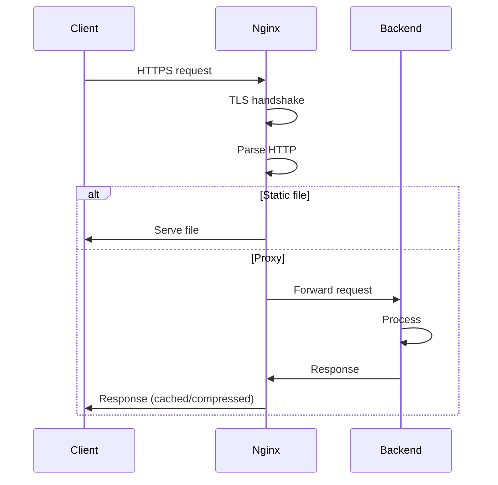

<!-- Generated by Groq via GitHub Actions -->
<!-- Topic ID: T189 -->
<!-- Category: DevOps / Infrastructure -->
<!-- Generated at UTC: 2026-11-08T18:25:48.479091+00:00 -->

# Nginx

## 1. What problem does this solve?

**Motivation**  
When building a modern web service you usually have:

- A **frontend** (React/Next.js) that needs static assets (JS, CSS, images).
- One or more **backend APIs** (Node.js/Express, FastAPI, etc.).
- **Databases** (PostgreSQL, MongoDB) and **caches** (Redis).
- **Security** (TLS, rate limiting, IP filtering).
- **Scalability** (horizontal scaling, load balancing).
- **Observability** (metrics, logs, tracing).

A single process that does all of this is hard to maintain, hard to scale, and often a performance bottleneck.  
**Nginx** is a lightweight, high‑performance HTTP server that acts as a *reverse proxy* and *load balancer* in front of your application servers. It solves several problems at once:

1. **Efficient request handling** – handles thousands of concurrent connections with a small memory footprint.
2. **Static asset delivery** – serves static files directly, bypassing your application code.
3. **TLS termination** – decrypts HTTPS traffic so your backend can run on plain HTTP.
4. **Load balancing** – distributes requests across multiple backend instances.
5. **Health checks & graceful failover** – removes unhealthy backends from rotation.
6. **Caching & compression** – reduces load on backends and speeds up clients.
7. **Security hardening** – rate limiting, IP whitelisting/blacklisting, header manipulation.

**Why it matters**  
Without a reverse proxy you would expose your application servers directly to the internet, which is risky and inefficient. You would also lose the ability to scale horizontally, cache static content, and terminate TLS cleanly.

**Consequences of not using Nginx**  
- Higher latency (application servers must handle TLS and static files).
- Increased resource usage (each backend must serve static files).
- Harder to roll out zero‑downtime deployments.
- Poor security posture (no centralized rate limiting or IP filtering).

**Real‑world appearance**  
- **Monoliths**: Nginx serves static assets and proxies API calls to a single Node.js process.
- **Microservices**: Nginx front‑ends a cluster of services, load‑balancing and routing based on URL paths.
- **Hybrid**: Nginx + CDN (e.g., Cloudflare) for edge caching.

---

## 2. Mental model

**Analogy – The Traffic Cop**  
Imagine a busy intersection where cars (HTTP requests) come from all directions. A traffic cop (Nginx) directs each car to the correct lane (backend service), stops cars that are going the wrong way, and ensures that the intersection never gets jammed. The cop also checks that each car has a valid ticket (TLS certificate) before letting it through.

**Engineering model**  
- **Listener** – Nginx listens on one or more IP/port combinations (e.g., `80`, `443`).
- **Worker processes** – Each worker is an event‑driven process that can handle many connections concurrently.
- **Modules** – Built‑in modules (HTTP, stream, mail) and third‑party modules add functionality.
- **Configuration blocks** – `http`, `server`, `location`, `upstream` – declarative rules that map incoming requests to actions (proxy, serve static, rewrite, etc.).

---

## 3. Deep explanation

### Internals
- **Event‑driven architecture** – Uses `epoll`/`kqueue`/`IOCP` to monitor sockets; a single worker can handle thousands of connections.
- **Worker processes** – By default one worker per CPU core (`worker_processes auto`). Workers share the same configuration and can be restarted without dropping connections.
- **Connection pooling** – Keeps persistent connections to upstream servers (`keepalive` directive).
- **Cache** – `proxy_cache` stores responses in memory or on disk.

### Important terminology
| Term | Meaning |
|------|---------|
| **Reverse proxy** | Forwards client requests to backend servers. |
| **Load balancer** | Distributes requests across multiple backends. |
| **Upstream** | Group of backend servers defined in `upstream` block. |
| **Health check** | Periodic request to determine if an upstream is alive. |
| **Proxy pass** | Directive that forwards a request to an upstream. |
| **Keepalive** | Reuses TCP connections to upstreams. |
| **Cache key** | Unique identifier for cached responses. |
| **SSL termination** | Decrypting TLS at the proxy, passing plain HTTP downstream. |

### Trade‑offs
- **Single‑threaded workers** → low memory, but CPU‑bound tasks (e.g., heavy compression) can block the event loop.
- **Static file serving** → fastest path, but requires careful cache‑control headers to avoid stale content.
- **Proxying** → adds a hop, but gives you TLS, load balancing, and routing flexibility.
- **Caching** → reduces backend load but increases memory/disk usage and requires cache invalidation strategy.

### Failure modes
- **Misconfigured upstream** → 502/504 errors.
- **TLS misconfiguration** → clients see certificate errors.
- **Cache poisoning** → stale or incorrect data served.
- **Worker crash** → temporary loss of service until restarted.
- **Resource exhaustion** → too many workers or connections can exhaust file descriptors.

### Limitations
- Not a full application server – cannot execute arbitrary code.
- Requires careful tuning for high‑throughput workloads (e.g., `worker_rlimit_nofile`, `worker_connections`).
- Limited built‑in support for WebSocket upgrades (though it works well with proper configuration).

### Where it fits in a backend architecture
```
Client
  │
  ├─► Nginx (reverse proxy, TLS termination, caching)
  │          │
  │          ├─► Load Balancer → Upstream group
  │          │          │
  │          │          ├─► Node.js/Express
  │          │          ├─► FastAPI
  │          │          └─► Other services
  │
  └─► CDN (optional)
```

### Interaction with related concepts
- **Docker/Kubernetes** – Nginx can run as a sidecar or ingress controller.
- **CI/CD** – Zero‑downtime deployments via `nginx -s reload`.
- **Observability** – `stub_status`, `prometheus` exporter, access logs.
- **Security** – `http_basic_auth`, `limit_req_zone`, `deny`/`allow`.

---

## 4. How it works

### Step‑by‑step flow

1. **Client → Nginx**  
   Client opens a TCP connection to Nginx on port 443 (HTTPS).
2. **TLS handshake**  
   Nginx decrypts the TLS layer using its certificate.
3. **Request parsing**  
   Nginx parses the HTTP request and matches it against the `server`/`location` blocks.
4. **Routing decision**  
   - If the request matches a static file location → serve file directly.  
   - Else → forward to an `upstream` via `proxy_pass`.
5. **Upstream selection**  
   Nginx selects a backend server using the configured load‑balancing algorithm (round‑robin, least‑conn, etc.).
6. **Proxy request**  
   Nginx opens a TCP connection to the chosen backend (reusing keepalive if available) and forwards the request.
7. **Backend response**  
   Backend processes the request, returns an HTTP response.
8. **Nginx receives response**  
   Nginx may cache the response (`proxy_cache`) and/or compress it (`gzip`).
9. **Response to client**  
   Nginx sends the (possibly cached/compressed) response back to the client over the original TLS connection.



---

## 5. Practical implementation

### 5.1 Nginx configuration (reverse proxy + static assets)

```nginx
# /etc/nginx/conf.d/app.conf
worker_processes auto;
events { worker_connections 10240; }

http {
    # Enable gzip compression
    gzip on;
    gzip_types text/css application/javascript application/json;

    # Caching static assets
    location ~* \.(js|css|png|jpg|jpeg|gif|svg)$ {
        root /usr/share/nginx/html;
        expires 30d;
        add_header Cache-Control "public, max-age=2592000";
    }

    # Proxy API requests
    upstream api_backend {
        server 127.0.0.1:3000 max_fails=3 fail_timeout=30s;
        server 127.0.0.1:3001 max_fails=3 fail_timeout=30s;
    }

    server {
        listen 80;
        listen 443 ssl;
        server_name api.example.com;

        ssl_certificate /etc/ssl/certs/example.crt;
        ssl_certificate_key /etc/ssl/private/example.key;

        # Health check for upstreams
        location /healthz {
            proxy_pass http://api_backend;
            proxy_set_header Host $host;
            proxy_set_header X-Real-IP $remote_addr;
            proxy_set_header X-Forwarded-For $proxy_add_x_forwarded_for;
            proxy_set_header X-Forwarded-Proto $scheme;
            proxy_read_timeout 5s;
            proxy_connect_timeout 5s;
        }

        # API proxy
        location /api/ {
            proxy_pass http://api_backend;
            proxy_http_version 1.1;
            proxy_set_header Upgrade $http_upgrade;
            proxy_set_header Connection "upgrade";
            proxy_set_header Host $host;
            proxy_set_header X-Real-IP $remote_addr;
            proxy_set_header X-Forwarded-For $proxy_add_x_forwarded_for;
            proxy_set_header X-Forwarded-Proto $scheme;
            proxy_cache_bypass $http_upgrade;
            proxy_read_timeout 60s;
            proxy_connect_timeout 10s;
            proxy_send_timeout 10s;
        }
    }
}
```

### 5.2 Node.js Express API (two instances)

```ts
// src/server.ts
import express from 'express';
import { createServer } from 'http';

const app = express();
app.get('/api/hello', (req, res) => {
  res.json({ message: 'Hello from instance ' + process.env.PORT });
});

const server = createServer(app);
const port = process.env.PORT || 3000;
server.listen(port, () => {
  console.log(`API listening on port ${port}`);
});
```

### 5.3 Docker Compose

```yaml
# docker-compose.yml
version: '3.8'
services:
  nginx:
    image: nginx:1.27
    volumes:
      - ./nginx/app.conf:/etc/nginx/conf.d/app.conf:ro
      - ./public:/usr/share/nginx/html:ro
    ports:
      - "80:80"
      - "443:443"
    depends_on:
      - api1
      - api2

  api1:
    build: .
    environment:
      - PORT=3000
    command: npm run start

  api2:
    build: .
    environment:
      - PORT=3001
    command: npm run start
```

Run `docker compose up --build`.  
Nginx will load‑balance `/api/` requests between `api1` and `api2`, serve static files from `public`, and terminate TLS.

---

## 6. Production considerations

| Concern | What to do |
|---------|------------|
| **Scalability** | Use `worker_processes auto`, tune `worker_connections`, run multiple Nginx instances behind a DNS round‑robin or external load balancer. |
| **Reliability** | Enable `keepalive` to upstreams, use `max_fails`/`fail_timeout`, configure `proxy_next_upstream` for retries. |
| **Security** | Use strong TLS ciphers, enable `http2`, set `add_header X-Frame-Options SAMEORIGIN`, `add_header X-Content-Type-Options nosniff`. |
| **Observability** | Enable `stub_status`, expose Prometheus metrics (`nginx-prometheus-exporter`), collect access logs with structured JSON. |
| **Performance** | Enable `gzip`, use `proxy_cache`, set appropriate `client_body_buffer_size`, use `proxy_cache_valid`. |
| **Error handling** | Define custom error pages (`error_page 502 /502.html;`), use `proxy_intercept_errors`. |
| **Resource usage** | Monitor `worker_processes`, `worker_connections`, file descriptor limits (`worker_rlimit_nofile`). |
| **Operational concerns** | Use `nginx -s reload` for zero‑downtime config changes, keep config in version control, use `include` for modularity. |
| **Failure recovery** | Configure health checks, use `proxy_next_upstream` to retry, set `proxy_read_timeout`. |
| **Deployment** | Use Docker/Kubernetes Ingress, keep TLS secrets in secrets store, use CI/CD pipeline to push new images and reload Nginx. |

---

## 7. Common mistakes

| Mistake | Why it’s problematic |
|---------|----------------------|
| **Using Nginx as an application server** | It cannot execute business logic; leads to performance bottlenecks. |
| **Not configuring keepalive** | Creates a new TCP connection per request, increasing latency and resource usage. |
| **Misconfiguring `proxy_pass`** | Missing trailing slash can cause double slashes or missing path segments. |
| **Over‑caching dynamic content** | Stale data served; use cache keys that include query strings or vary headers. |
| **Hard‑coding IPs in `upstream`** | Fails when services are dynamic (e.g., Kubernetes). |
| **Ignoring TLS best practices** | Weak ciphers expose clients to downgrade attacks. |
| **Not setting `client_max_body_size`** | Large uploads may be silently dropped or cause 413 errors. |
| **Using `proxy_set_header Host $host` incorrectly** | Some backends rely on the original host; mis‑setting can break routing. |

---

## 8. Senior engineer perspective

### Architecture decisions
- **Ingress vs. Service Mesh** – Choose Nginx Ingress for simplicity or a service mesh (Istio, Linkerd) for richer traffic control.
- **Zero‑downtime deployments** – Use `nginx -s reload` or `nginx -s stop` with graceful shutdown.
- **TLS termination** – Decide whether to terminate at Nginx or keep TLS to backends (end‑to‑end encryption).
- **Caching strategy** – Cache static assets at edge, dynamic API responses at Nginx or CDN.

### Trade‑offs
- **Single‑point of failure** – Nginx must be highly available (multiple replicas, health checks).
- **CPU vs. memory** – Enabling gzip and caching consumes CPU; tune `worker_processes` accordingly.
- **Complexity vs. control** – More directives (rate limiting, auth) increase config complexity.

### Bottlenecks
- **Worker processes** – Too few workers → high latency; too many → OS limits on file descriptors.
- **Disk I/O** – Disk‑based cache can become a bottleneck under heavy load.

### Failure scenarios
- **Backend crash** → Nginx returns 502/504; ensure `proxy_next_upstream` retries.
- **TLS mis‑config** → Clients get certificate errors; monitor with SSL Labs or automated checks.
- **Cache poisoning** → Use `proxy_cache_valid` and `proxy_cache_bypass` to control caching.

### Monitoring
- **Prometheus metrics** (`nginx_status`, `nginx_exporter`).
- **Access logs** – JSON format for log aggregation.
- **Health checks** – `/healthz` endpoints exposed to load balancer.

### Cost/performance
- **CPU** – Gzip and caching can be CPU‑heavy; consider offloading to a CDN.
- **Memory** – Caching uses RAM; monitor `proxy_cache` usage.

### When NOT to use
- **Micro‑services with internal service discovery** – A service mesh may be more appropriate.
- **High‑throughput streaming** – Nginx can handle WebSockets but may not be optimal for large media streams; consider dedicated streaming servers.

---

## 9. Interview questions

1. **Beginner/Intermediate**  
   *Question:* What is the role of Nginx in a typical web application stack?  
   *Answer:* It acts as a reverse proxy, load balancer, TLS terminator, static file server, and can provide caching and compression.

2. **Beginner/Intermediate**  
   *Question:* How does Nginx handle multiple simultaneous connections?  
   *Answer:* Nginx uses an event‑driven, non‑blocking architecture with a small number of worker processes, each handling many connections via `epoll`/`kqueue`.

3. **Senior‑level**  
   *Question:* Explain how you would configure Nginx for zero‑downtime deployments of a Node.js API.  
   *Answer:* Use `nginx -s reload` to reload the config without dropping connections; keep the same PID, use `worker_processes` with `worker_rlimit_nofile` tuned, and ensure upstream health checks so new instances are ready before traffic is routed.

4. **Senior‑level**  
   *Question:* Describe the trade‑offs between using Nginx as a reverse proxy versus a service mesh for inter‑service communication.  
   *Answer:* Nginx is lightweight, easier to configure, and great for HTTP traffic, but lacks fine‑grained traffic control, mutual TLS, and observability features that a service mesh provides. Service mesh adds overhead and complexity but offers richer policies.

5. **Scenario/Debugging**  
   *Question:* You have a Node.js API behind Nginx, but clients intermittently receive 502 errors. What steps would you take to debug?  
   *Answer:*  
   - Check Nginx error logs for `502` entries.  
   - Verify upstream health checks (`proxy_next_upstream`).  
   - Inspect backend logs for crashes or timeouts.  
   - Test connectivity from Nginx host to backend (`curl -I http://127.0.0.1:3000/api/hello`).  
   - Ensure `proxy_read_timeout` is sufficient.  
   - Look for resource exhaustion (CPU, memory, file descriptors).  
   - If using Docker, check container restart policies and logs.

---

## 10. Hands‑on task

**Goal:** Build a Dockerized Nginx reverse proxy that serves a simple Next.js frontend and a FastAPI backend, with TLS termination, gzip, and basic health checks.

**Steps:**

1. Create a Next.js app (`pages/index.tsx`) that fetches data from `/api/hello`.
2. Create a FastAPI app (`main.py`) that returns JSON at `/api/hello`.
3. Write an Nginx config that:
   - Serves static files from the Next.js build directory.
   - Proxies `/api/` to the FastAPI container.
   - Enables gzip and sets caching headers for static assets.
   - Exposes a `/healthz` endpoint that proxies to FastAPI `/health`.
4. Build Docker images for Next.js, FastAPI, and Nginx.
5. Use Docker Compose to orchestrate the three services.
6. Test:
   - Access the frontend at `http://localhost`.
   - Verify `/api/hello` works through Nginx.
   - Check that `/healthz` returns 200.
   - Inspect Nginx logs for any errors.

**Deliverables:**  
- `docker-compose.yml`  
- `nginx.conf`  
- Minimal Next.js and FastAPI code.  
- README with test instructions.

---

## 11. Quick revision

- Nginx is a reverse proxy, load balancer, TLS terminator, static file server, and cache.
- Uses an event‑driven, non‑blocking architecture; one worker per CPU core.
- `upstream` blocks define backend groups; `proxy_pass` forwards requests.
- `keepalive` reuses connections to backends.
- `proxy_cache` stores responses; `gzip` compresses them.
- Health checks (`proxy_next_upstream`) keep traffic on healthy backends.
- TLS termination moves encryption to the edge; use strong ciphers.
- Zero‑downtime reloads via `nginx -s reload`.
- Common pitfalls: missing keepalive, wrong `proxy_pass` syntax, over‑caching dynamic content.
- In production: tune `worker_processes`, `worker_connections`, enable Prometheus metrics, use structured logs.
- When scaling: consider multiple Nginx replicas, use external load balancer or DNS round‑robin.
- For microservices: Nginx Ingress vs. service mesh depends on feature needs.

---

## 12. References

- https://nginx.org/en/docs/  
- https://nginx.org/en/docs/http/ngx_http_proxy_module.html  
- https://nginx.org/en/docs/http/ngx_http_upstream_module.html  
- https://nginx.org/en/docs/http/ngx_http_gzip_module.html  
- https://nginx.org/en/docs/http/ngx_http_cache.html  
- https://www.nginx.com/blog/understanding-nginx-configuration/  
- https://www.nginx.com/blog/zero-downtime-deployments-with-nginx/  
- https://www.nginx.com/blog/nginx-prometheus-exporter/  
- https://docs.docker.com/compose/  
- https://fastapi.tiangolo.com/  
- https://nextjs.org/docs/getting-started

---
