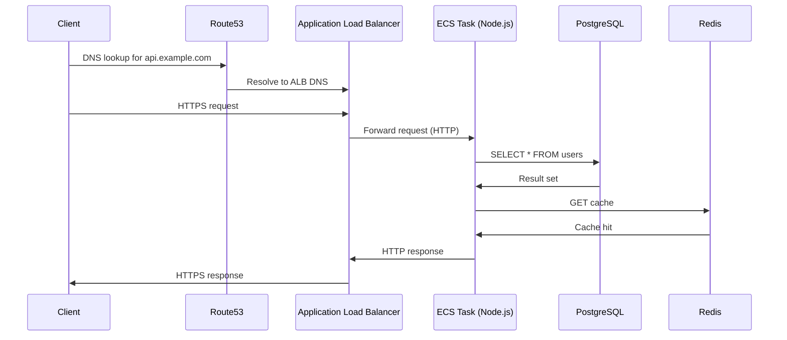

<!-- Generated by Groq via GitHub Actions -->
<!-- Topic ID: T190 -->
<!-- Category: DevOps / Infrastructure -->
<!-- Generated at UTC: 2026-11-08T18:25:48.479091+00:00 -->

# Cloud networking

## 1. What problem does this solve?

| What | Why it matters | Consequence of not using it | Real‑world appearance |
|------|----------------|-----------------------------|-----------------------|
| **Isolation** – keeping services in a private network so they can’t be reached from the public internet unless explicitly exposed | Prevents accidental data leaks, reduces attack surface | Public‑facing database, accidental exposure of internal APIs | A PostgreSQL instance in a private subnet, only reachable by application servers |
| **Controlled connectivity** – routing traffic between subnets, to the internet, or to other VPCs | Enables micro‑service communication, external API calls, and data transfer | Services can’t talk to each other or to external services | A FastAPI backend calling an AI inference service in another VPC |
| **Security** – firewalls (security groups, network ACLs) and encryption in transit | Protects data and services from unauthorized access | Data breaches, DDoS attacks | A Next.js front‑end served through an Application Load Balancer (ALB) |
| **Scalability & reliability** – load balancers, NAT gateways, and multiple AZs | Handles traffic spikes, provides failover | Service outages, slow responses | A Node.js API behind an ALB with targets spread across 3 AZs |
| **Observability** – flow logs, metrics | Helps diagnose network issues | Hard to debug connectivity problems | VPC Flow Logs capturing traffic between services |

Without cloud networking, your backend would be a single, exposed VM or a set of containers with no clear boundaries, making it impossible to enforce security, scale, or monitor traffic.

---

## 2. Mental model

### Analogy – A city

| Cloud concept | City component | Why it helps |
|---------------|----------------|--------------|
| **VPC** | Entire city | Keeps all roads, buildings, and utilities isolated from other cities |
| **Subnets** | Neighborhoods | Separate residential, commercial, and industrial zones |
| **Route tables** | Traffic lights & signs | Direct traffic flow between neighborhoods |
| **Internet Gateway (IGW)** | Port of the city | Allows cars to enter/exit the city |
| **NAT Gateway** | Toll booth | Lets residents (private instances) access the outside world without exposing themselves |
| **Security Group** | Building firewalls | Controls which cars can enter a building |
| **Network ACL** | City‑wide traffic rules | Enforces rules on all roads entering a neighborhood |
| **Load Balancer** | Traffic dispatcher | Distributes incoming cars to multiple parking lots (instances) |
| **VPC Endpoint** | Private highway | Lets cars travel directly to a destination (e.g., S3) without going through the city’s main roads |

### Precise engineering model

* **VPC** – A logically isolated virtual network in the cloud, defined by a CIDR block (e.g., 10.0.0.0/16).  
* **Subnets** – Segments of the VPC’s CIDR, each in a single Availability Zone (AZ). Public subnets have a route to an IGW; private subnets route to a NAT gateway or VPC endpoint.  
* **Route tables** – Define how packets are forwarded. Each subnet is associated with a route table.  
* **Internet Gateway (IGW)** – A horizontally scaled, redundant component that allows traffic to/from the internet.  
* **NAT Gateway / NAT Instance** – Provides outbound internet access for private subnets while keeping them unreachable from the internet.  
* **Security Groups** – Stateful, virtual firewalls attached to ENIs (Elastic Network Interfaces).  
* **Network ACLs** – Stateless, subnet‑level firewalls.  
* **Load Balancers (ALB/NLB)** – Distribute incoming traffic to targets (EC2, ECS, Lambda).  
* **VPC Endpoints** – Private connections to AWS services (S3, DynamoDB, etc.) without traversing the internet.  
* **Peering / Transit Gateway** – Connects multiple VPCs or accounts.  
* **VPN / Direct Connect** – Securely connects on‑premises networks to a VPC.

---

## 3. Deep explanation

### Internals

1. **IP addressing** – Each VPC gets a CIDR; subnets carve out smaller CIDRs.  
2. **Elastic Network Interfaces (ENIs)** – Attach to instances; each ENI gets an IP from the subnet.  
3. **Routing** – Packets are forwarded based on destination IP and the route table.  
4. **Stateful vs stateless** – Security groups remember established connections; ACLs evaluate each packet independently.  
5. **NAT** – Translates private IPs to a public IP (NAT gateway) or a single IP (NAT instance).  
6. **Load balancer health checks** – Periodically ping targets; only healthy targets receive traffic.

### Important terminology

| Term | Definition |
|------|------------|
| **CIDR** | Classless Inter-Domain Routing – notation for IP ranges (e.g., 10.0.0.0/16). |
| **Availability Zone (AZ)** | Physically separate data center within a region. |
| **Elastic IP** | Static public IP that can be reassigned. |
| **Target Group** | Set of instances or IPs that a load balancer forwards to. |
| **VPC Endpoint** | Private connection to a service; can be interface (AWS PrivateLink) or gateway. |
| **Transit Gateway** | Central hub for inter‑VPC and on‑prem connectivity. |

### Trade‑offs

| Decision | Pros | Cons |
|----------|------|------|
| **Public vs Private subnets** | Public subnets can receive inbound traffic directly. | Exposes resources; higher attack surface. |
| **NAT Gateway vs NAT Instance** | Managed, highly available, auto‑scales. | Higher cost; limited throughput per gateway. |
| **Security Group vs Network ACL** | Stateful, easier to manage per instance. | ACLs provide subnet‑level filtering; useful for broad rules. |
| **ALB vs NLB** | HTTP/HTTPS routing, host/path based routing. | Slightly higher latency; NLB supports TCP/UDP. |
| **VPC Endpoint vs Public API** | No data transfer over internet; lower latency. | Limited to supported services; extra setup. |

### Failure modes

* **Misconfigured route tables** – Instances can’t reach the internet or each other.  
* **Security group mis‑rules** – Blocked traffic or open ports.  
* **NAT gateway failure** – Outbound traffic stops; use multiple AZs.  
* **Load balancer mis‑health‑checks** – Traffic sent to unhealthy instances.  
* **VPC endpoint mis‑policy** – Denied access to S3 or DynamoDB.  

### Limitations

* **IP exhaustion** – 16‑bit subnet mask gives 65k IPs; careful planning needed.  
* **Cross‑region limits** – Peering is region‑specific; use Transit Gateway for multi‑region.  
* **Throughput limits** – NAT gateway max 45 Gbps; NLB 100 Gbps per AZ.  
* **Cost** – Data transfer, NAT gateways, VPC endpoints add to bill.  

### Where it fits in a backend architecture

```
Client (browser) → ALB (public subnet) → ECS/Fargate (private subnet) → 
    • FastAPI (Node.js) → PostgreSQL (private subnet) 
    • Redis (private subnet) 
    • AI inference service (different VPC via peering)
```

* ALB receives HTTPS traffic, terminates TLS, forwards to ECS tasks.  
* ECS tasks are in private subnets, communicate with databases via VPC endpoints or direct IPs.  
* All traffic between services stays inside the VPC unless explicitly routed out.

### Interaction with related concepts

* **IAM** – Controls who can modify networking resources.  
* **Auto Scaling** – Adds/removes instances; load balancer updates target groups automatically.  
* **Service Mesh (e.g., Istio)** – Adds fine‑grained traffic control on top of networking.  
* **Observability** – VPC Flow Logs, CloudWatch metrics, and X‑Ray trace network hops.

---

## 4. How it works

### Step‑by‑step flow for a client request

1. **Client** sends HTTPS request to `api.example.com`.  
2. **Route 53** resolves `api.example.com` to the ALB’s DNS name.  
3. **ALB** receives the request in a public subnet, terminates TLS.  
4. **ALB** forwards the request to a target group (ECS tasks) in private subnets.  
5. **Target** processes the request, queries PostgreSQL via private IP.  
6. **PostgreSQL** responds; data flows back through the same path.  
7. **ALB** sends the response back to the client.

#### Mermaid diagram



---

## 5. Practical implementation

Below is a minimal Node.js script that:

1. Creates a VPC with public & private subnets.  
2. Sets up a NAT gateway for outbound traffic.  
3. Creates a security group allowing inbound HTTPS.  
4. Deploys an ALB in the public subnet and registers an ECS task in the private subnet.

> **Prerequisites**  
> * AWS credentials configured (`AWS_ACCESS_KEY_ID`, `AWS_SECRET_ACCESS_KEY`)  
> * `npm i @aws-sdk/client-ec2 @aws-sdk/client-elasticloadbalancingv2 @aws-sdk/client-ecs @aws-sdk/client-iam`

```ts
// cloud-networking.ts
import {
  EC2Client,
  CreateVpcCommand,
  CreateSubnetCommand,
  CreateInternetGatewayCommand,
  AttachInternetGatewayCommand,
  CreateRouteTableCommand,
  CreateRouteCommand,
  AssociateRouteTableCommand,
  CreateNatGatewayCommand,
  CreateSecurityGroupCommand,
  AuthorizeSecurityGroupIngressCommand,
  CreateVpcEndpointCommand,
} from "@aws-sdk/client-ec2";
import {
  ElasticLoadBalancingV2Client,
  CreateLoadBalancerCommand,
  CreateTargetGroupCommand,
  RegisterTargetsCommand,
} from "@aws-sdk/client-elasticloadbalancingv2";
import { ECSClient, CreateClusterCommand, RegisterTaskDefinitionCommand, RunTaskCommand } from "@aws-sdk/client-ecs";

const region = "us-east-1";
const ec2 = new EC2Client({ region });
const elb = new ElasticLoadBalancingV2Client({ region });
const ecs = new ECSClient({ region });

async function main() {
  // 1️⃣ Create VPC
  const vpc = await ec2.send(
    new CreateVpcCommand({
      CidrBlock: "10.0.0.0/16",
      TagSpecifications: [{ ResourceType: "vpc", Tags: [{ Key: "Name", Value: "demo-vpc" }] }],
    })
  );
  const vpcId = vpc.Vpc?.VpcId!;
  console.log("VPC:", vpcId);

  // 2️⃣ Create public & private subnets (one AZ for brevity)
  const subnetPub = await ec2.send(
    new CreateSubnetCommand({
      VpcId: vpcId,
      CidrBlock: "10.0.1.0/24",
      AvailabilityZone: `${region}a`,
      TagSpecifications: [{ ResourceType: "subnet", Tags: [{ Key: "Name", Value: "public-subnet" }] }],
    })
  );
  const subnetPriv = await ec2.send(
    new CreateSubnetCommand({
      VpcId: vpcId,
      CidrBlock: "10.0.2.0/24",
      AvailabilityZone: `${region}a`,
      TagSpecifications: [{ ResourceType: "subnet", Tags: [{ Key: "Name", Value: "private-subnet" }] }],
    })
  );
  const pubSubnetId = subnetPub.Subnet?.SubnetId!;
  const privSubnetId = subnetPriv.Subnet?.SubnetId!;
  console.log("Subnets:", pubSubnetId, privSubnetId);

  // 3️⃣ Internet Gateway & route to public subnet
  const igw = await ec2.send(
    new CreateInternetGatewayCommand({
      TagSpecifications: [{ ResourceType: "internet-gateway", Tags: [{ Key: "Name", Value: "demo-igw" }] }],
    })
  );
  const igwId = igw.InternetGateway?.InternetGatewayId!;
  await ec2.send(new AttachInternetGatewayCommand({ InternetGatewayId: igwId, VpcId: vpcId }));

  const rtPub = await ec2.send(
    new CreateRouteTableCommand({
      VpcId: vpcId,
      TagSpecifications: [{ ResourceType: "route-table", Tags: [{ Key: "Name", Value: "public-rt" }] }],
    })
  );
  const rtPubId = rtPub.RouteTable?.RouteTableId!;
  await ec2.send(
    new CreateRouteCommand({
      RouteTableId: rtPubId,
      DestinationCidrBlock: "0.0.0.0/0",
      GatewayId: igwId,
    })
  );
  await ec2.send(new AssociateRouteTableCommand({ SubnetId: pubSubnetId, RouteTableId: rtPubId }));

  // 4️⃣ NAT Gateway for private subnet
  const eip = await ec2.send(
    new CreateNatGatewayCommand({
      AllocationId: "eipalloc-xxxxxxxx", // pre‑created Elastic IP
      SubnetId: pubSubnetId,
    })
  );
  const natId = eip.NatGateway?.NatGatewayId!;

  const rtPriv = await ec2.send(
    new CreateRouteTableCommand({
      VpcId: vpcId,
      TagSpecifications: [{ ResourceType: "route-table", Tags: [{ Key: "Name", Value: "private-rt" }] }],
    })
  );
  const rtPrivId = rtPriv.RouteTable?.RouteTableId!;
  await ec2.send(
    new CreateRouteCommand({
      RouteTableId: rtPrivId,
      DestinationCidrBlock: "0.0.0.0/0",
      NatGatewayId: natId,
    })
  );
  await ec2.send(new AssociateRouteTableCommand({ SubnetId: privSubnetId, RouteTableId: rtPrivId }));

  // 5️⃣ Security Group for ALB (allow HTTPS)
  const sg = await ec2.send(
    new CreateSecurityGroupCommand({
      GroupName: "alb-sg",
      Description: "Allow HTTPS",
      VpcId: vpcId,
    })
  );
  const sgId = sg.GroupId!;
  await ec2.send(
    new AuthorizeSecurityGroupIngressCommand({
      GroupId: sgId,
      IpPermissions: [
        {
          IpProtocol: "tcp",
          FromPort: 443,
          ToPort: 443,
          IpRanges: [{ CidrIp: "0.0.0.0/0" }],
        },
      ],
    })
  );

  // 6️⃣ Create ALB
  const alb = await elb.send(
    new CreateLoadBalancerCommand({
      Name: "demo-alb",
      Subnets: [pubSubnetId],
      SecurityGroups: [sgId],
      Scheme: "internet-facing",
      Type: "application",
      IpAddressType: "ipv4",
    })
  );
  const albArn = alb.LoadBalancers?.[0].LoadBalancerArn!;

  // 7️⃣ Target group (private subnet)
  const tg = await elb.send(
    new CreateTargetGroupCommand({
      Name: "demo-tg",
      Protocol: "HTTP",
      Port: 80,
      VpcId: vpcId,
      TargetType: "ip",
    })
  );
  const tgArn = tg.TargetGroups?.[0].TargetGroupArn!;

  // 8️⃣ Register a dummy target (replace with real IPs)
  await elb.send(
    new RegisterTargetsCommand({
      TargetGroupArn: tgArn,
      Targets: [{ Id: "10.0.2.10", Port: 80 }], // IP of ECS task
    })
  );

  console.log("ALB ARN:", albArn);
  console.log("Target Group ARN:", tgArn);
}

main().catch(console.error);
```

> **Notes**  
> * Replace `eipalloc-xxxxxxxx` with a real Elastic IP allocation ID.  
> * The script omits error handling for brevity; production code should retry on throttling.  
> * For ECS tasks, you’d register the task’s ENI IP or use `instance` target type.

---

## 6. Production considerations

| Concern | What to do |
|---------|------------|
| **Scalability** | Deploy NAT gateways in each AZ; use ALB with cross‑AZ load balancing; place services in multiple AZs. |
| **Reliability** | Enable VPC flow logs; use multiple NAT gateways; configure health checks; use `cross-zone-load-balancing` on ALB. |
| **Security** | Use least‑privilege SG rules; enable VPC endpoints for S3/DynamoDB; restrict SG inbound to known CIDRs; enable encryption in transit (TLS). |
| **Observability** | CloudWatch metrics for ALB, NAT, EC2; VPC Flow Logs; X‑Ray for request tracing; set up alerts on high latency or error rates. |
| **Performance** | Keep subnets small to avoid IP exhaustion; use NLB for TCP/UDP heavy traffic; use interface VPC endpoints for low‑latency access to AWS services. |
| **Error handling** | Retry on transient network errors; use circuit breakers in services; failover to secondary AZ. |
| **Resource usage** | Tag resources for cost allocation; monitor NAT gateway data transfer costs; delete unused subnets/IGWs. |
| **Operational concerns** | Automate VPC provisioning via IaC (Terraform, CloudFormation); version control network config; use IAM roles for least‑privilege. |
| **Failure recovery** | Backup route tables; use CloudFormation stack rollback; keep NAT gateway in multiple AZs. |
| **Deployment considerations** | Use blue/green deployments for ALB target groups; keep SG rules immutable; use immutable infrastructure for VPC components. |

---

## 7. Common mistakes

| Mistake | Why it’s bad |
|---------|--------------|
| **Leaving database in a public subnet** | Exposes DB to the internet; high risk of data breach. |
| **Using a single NAT gateway** | Single point of failure; throughput bottleneck. |
| **Mis‑configuring SG rules (e.g., `0.0.0.0/0` on all ports)** | Opens entire service to the world; invites attacks. |
| **Not associating a route table with a subnet** | Subnet becomes isolated; no traffic flows. |
| **Using private IPs in a public subnet without IGW** | Instances can’t reach the internet; outbound API calls fail. |
| **Ignoring AZ distribution** | All instances in one AZ; no failover. |
| **Over‑provisioning subnets** | IP waste; harder to manage. |
| **Not enabling VPC Flow Logs** | Hard to debug connectivity issues. |

---

## 8. Senior engineer perspective

### Design decisions at scale

| Decision | Considerations |
|----------|----------------|
| **VPC CIDR sizing** | Reserve /20 per environment; avoid overlapping with on‑prem. |
| **Subnet segmentation** | Separate by function (app, db, cache, infra) and AZ. |
| **NAT strategy** | Use managed NAT gateways per AZ; consider NAT instances for cost control. |
| **Load balancer type** | ALB for HTTP/HTTPS with path routing; NLB for TCP/UDP or high throughput. |
| **VPC endpoints** | Use interface endpoints for private link to internal services; gateway endpoints for S3/DynamoDB. |
| **Peering vs Transit Gateway** | Transit Gateway for many VPCs; peering for simple two‑VPC setups. |
| **Service mesh** | Add Istio/Linkerd for fine‑grained traffic control, mutual TLS, and observability. |
| **Security** | Zero‑trust SGs; use IAM roles for service access; enable encryption at rest and in transit. |
| **Cost** | NAT gateways cost per hour + data transfer; consider using a single NAT per AZ if traffic is low. |
| **Monitoring** | CloudWatch metrics + custom dashboards; set up alerts on high latency, error rates, or SG changes. |
| **Disaster recovery** | Multi‑region replication; cross‑region VPC peering; automated backups. |

### When NOT to use the approach

* Small, single‑instance dev environments – a simple EC2 with public IP may suffice.  
* Stateless micro‑services that never need outbound internet – can skip NAT.  
* Low‑traffic sites where cost of NAT gateways outweighs benefits.  

---

## 9. Interview questions

| Level | Question | Key answer points |
|-------|----------|-------------------|
| Beginner | What is a VPC and why do we use it? | Private virtual network; isolation; control over IP ranges; security. |
| Beginner | How does a NAT gateway differ from a NAT instance? | Managed vs self‑hosted; high availability; throughput limits; cost. |
| Senior | Explain how you would design a multi‑AZ VPC for a high‑traffic API. | Public & private subnets per AZ; IGW per VPC; NAT gateways per AZ; ALB with cross‑zone LB; SGs per service; VPC endpoints. |
| Senior | What are the trade‑offs between using an Application Load Balancer and a Network Load Balancer? | HTTP/HTTPS routing vs TCP/UDP; latency; target type; cost; health checks. |
| Scenario | A client reports intermittent 504 Gateway Timeout errors from the API. What steps would you take to debug the issue? | Check ALB health checks; inspect target group status; review VPC Flow Logs; verify SG rules; monitor NAT gateway metrics; look for AZ failures; check CloudWatch logs of backend. |

---

## 10. Hands‑on task

**Build a secure, scalable API gateway**

1. **Create a VPC** with:
   * 2 public subnets (AZ a & b)  
   * 2 private subnets (AZ a & b)  
   * NAT gateways in each public subnet  
2. **Deploy an ALB** in the public subnets, listening on HTTPS.  
3. **Create a target group** pointing to an ECS Fargate service running a simple Node.js/Express API.  
4. **Add a VPC endpoint** for S3 and configure the API to read/write a file in a bucket.  
5. **Enable VPC Flow Logs** and CloudWatch dashboards to monitor traffic.  
6. **Write a small script** that triggers the API and verifies that the file appears in S3.  

> **Deliverables**  
> * Terraform or CloudFormation files (or the Node.js script) that can be applied to create the infrastructure.  
> * A README explaining how to run the script and verify the setup.  

---

## 11. Quick revision

- **VPC** – isolated virtual network with CIDR.  
- **Subnets** – split VPC into AZ‑specific segments; public vs private.  
- **Route tables** – control packet forwarding; IGW for public, NAT for private.  
- **Internet Gateway** – entry/exit point for internet traffic.  
- **NAT Gateway** – outbound internet for private subnets; one per AZ.  
- **Security Groups** – stateful, instance‑level firewalls.  
- **Network ACLs** – stateless, subnet‑level rules.  
- **ALB/NLB** – distribute incoming traffic; ALB supports HTTP/HTTPS routing.  
- **VPC Endpoints** – private connections to AWS services; reduce data transfer costs.  
- **Peering / Transit Gateway** – connect multiple VPCs or accounts.  
- **Observability** – VPC Flow Logs, CloudWatch metrics, X‑Ray.  
- **Best practice** – keep databases in private subnets, use SGs over ACLs for most cases, deploy NAT per AZ, enable flow logs.  

---

## 12. References

- [Amazon VPC Documentation](https://docs.aws.amazon.com/vpc/latest/userguide/what-is-amazon-vpc.html)  
- [Security Groups](https://docs.aws.amazon.com/vpc/latest/userguide/VPC_SecurityGroups.html)  
- [Network ACLs](https://docs.aws.amazon.com/vpc/latest/userguide/vpc-network-acls.html)  
- [NAT Gateways](https://docs.aws.amazon
