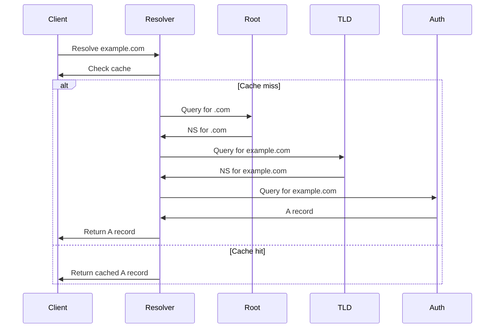

<!-- Generated by Groq via GitHub Actions -->
<!-- Topic ID: T191 -->
<!-- Category: DevOps / Infrastructure -->
<!-- Generated at UTC: 2026-11-09T08:15:07.824311+00:00 -->

# DNS

## 1. What problem does this solve?

**Motivation**  
When you type `https://api.example.com` into a browser, the browser must translate that human‑readable name into an IP address that the network can route to. Without a system that maps names to addresses, every service would have to be hard‑coded with numeric IPs, making deployment, scaling, and maintenance a nightmare.

**What problem exists**  
- *Name resolution*: Converting domain names (`example.com`) into IP addresses (`93.184.216.34`).  
- *Dynamic infrastructure*: In cloud or container environments, IPs change frequently (e.g., autoscaling pods).  
- *Load distribution*: Balancing traffic across multiple instances.  
- *Service discovery*: Microservices need to find each other without hard‑coding addresses.

**Why the problem matters**  
- **Reliability**: If a name can’t be resolved, the request fails.  
- **Scalability**: Manual IP updates don’t scale.  
- **Security**: DNS can be spoofed; proper validation is essential.  
- **Performance**: DNS lookups add latency; caching mitigates this.

**What happens if DNS is not used**  
- Services would need static IPs → impossible to autoscale or migrate.  
- Configuration drift: every deployment would require manual updates.  
- Increased operational overhead and risk of outages.

**Where DNS appears in real backend systems**  
- HTTP clients resolving API endpoints.  
- Load balancers routing traffic to backend pods.  
- Kubernetes Service objects exposing internal DNS names.  
- Email delivery (MX records).  
- CDN edge routing (CNAMEs).  

---

## 2. Mental model

**Analogy**  
Think of DNS as a phone book for the internet. You look up a person’s name to find their phone number. The phone book (DNS server) stores the mapping, and your phone (client) uses it to dial the correct line (IP address).

**Engineering model**  
- **Resolver**: The client’s DNS library (e.g., Node’s `dns` module).  
- **Recursive query**: The resolver asks authoritative servers until it gets the answer.  
- **Authoritative server**: Holds the definitive records for a domain.  
- **Caching**: Resolvers cache answers for the TTL period to reduce load and latency.  
- **Record types**: A (IPv4), AAAA (IPv6), CNAME (alias), MX (mail), SRV (service), TXT (text).

---

## 3. Deep explanation

### Internals
1. **Query types** – `A`, `AAAA`, `CNAME`, `MX`, `TXT`, `SRV`, etc.  
2. **Recursive vs. iterative** – Recursive resolvers (ISP, cloud provider) walk the hierarchy; iterative resolvers (e.g., `dig @ns1.example.com`) return the next hop.  
3. **Zone files** – Text representation of DNS records stored on authoritative servers.  
4. **Name servers** – `NS` records point to authoritative servers for a zone.  
5. **TTL** – Time‑to‑live dictates how long a record can be cached.  

### Important terminology
- **Root servers** – 13 authoritative servers (`a.root-servers.net`, …).  
- **TLD servers** – Top‑level domain servers (`.com`, `.org`).  
- **Authoritative server** – Holds the zone data.  
- **Resolver** – Client-side component that performs lookups.  
- **Cache** – Temporary storage of DNS responses.  
- **NXDOMAIN** – Non‑existent domain error.  
- **CNAME** – Canonical name alias.  
- **SRV** – Service locator (used by SIP, XMPP, etc.).  

### Trade‑offs
| Aspect | Trade‑off |
|--------|-----------|
| **Caching** | Faster lookups vs. stale data if TTL too long. |
| **Security** | DNSSEC adds integrity but increases complexity. |
| **Scalability** | Distributed authoritative zones reduce single‑point failure but require coordination. |
| **Latency** | Recursive resolvers reduce round‑trips but add their own latency. |

### Failure modes
- **Cache poisoning** – Malicious responses inserted into cache.  
- **DNS amplification attacks** – Small query → large response.  
- **NXDOMAIN** – Misconfigured zone or typo.  
- **TTL exhaustion** – Very short TTLs cause excessive traffic.  
- **Recursive resolver outage** – Clients can’t resolve names.  

### Limitations
- **No built‑in authentication** (unless DNSSEC).  
- **Limited record size** – 512 bytes over UDP (EDNS0 extends this).  
- **Propagation delay** – Changes may take time to propagate due to TTL.  

### Where it fits in a backend architecture
- **Service discovery**: Microservices query DNS to find peers.  
- **Load balancing**: Round‑robin A records or CNAMEs to load balancers.  
- **CDN**: CNAMEs point to edge nodes.  
- **Ingress controllers**: Use DNS to expose services externally.  

### Interaction with related concepts
- **HTTP**: The `Host` header is resolved via DNS.  
- **TLS**: Server Name Indication (SNI) uses DNS names.  
- **Container orchestration**: Kubernetes provides internal DNS for services.  
- **CI/CD**: Automated deployments update DNS records (e.g., Route 53).  

---

## 4. How it works

1. **Client initiates query** (e.g., `dig example.com`).  
2. **Resolver checks local cache** – if hit and TTL valid, return.  
3. **If miss** – send query to a recursive resolver (ISP or public).  
4. **Recursive resolver** queries root servers → TLD servers → authoritative servers.  
5. **Authoritative server** returns the record.  
6. **Recursive resolver caches** the answer for TTL.  
7. **Response returned to client**.  



---

## 5. Practical implementation

### 5.1 Resolving a hostname in Node.js

```ts
// dns-resolve.ts
import { resolve4, resolve6, lookup } from 'dns/promises';

async function demo() {
  // IPv4
  const ipv4 = await resolve4('example.com');
  console.log('IPv4:', ipv4);

  // IPv6
  const ipv6 = await resolve6('example.com');
  console.log('IPv6:', ipv6);

  // Generic lookup (returns first record)
  const { address, family } = await lookup('example.com');
  console.log(`Address: ${address} (IPv${family})`);
}

demo().catch(console.error);
```

> **Note**: `dns/promises` is available from Node 14+.  
> The resolver uses the system’s configured DNS servers (e.g., `/etc/resolv.conf`).

### 5.2 Building a simple DNS server with `dns2`

```ts
// dns-server.ts
import { Packet, createServer } from 'dns2';

const server = createServer({
  udp: true,
  handle: async (request, send, rinfo) => {
    const [question] = request.questions;
    console.log(`Received query for ${question.name}`);

    // Very naive: always return 127.0.0.1 for any A query
    if (question.type === Packet.TYPE.A) {
      const response = Packet.createResponseFromRequest(request);
      response.answers.push({
        name: question.name,
        type: Packet.TYPE.A,
        class: Packet.CLASS.IN,
        ttl: 300,
        address: '127.0.0.1',
      });
      send(response);
    } else {
      // Unsupported type
      const response = Packet.createResponseFromRequest(request);
      response.header.rcode = Packet.RCODE.NXDOMAIN;
      send(response);
    }
  },
});

server.listen({ udp: 5353 });
console.log('DNS server listening on 127.0.0.1:5353');
```

> **How to test**  
> ```bash
> dig @127.0.0.1 -p 5353 example.local
> ```

### 5.3 Using DNS for service discovery in a microservice

```ts
// service-discovery.ts
import { lookup } from 'dns/promises';

async function getServiceEndpoint(serviceName: string) {
  // In Kubernetes, services expose DNS names like svc.namespace.svc.cluster.local
  const fqdn = `${serviceName}.default.svc.cluster.local`;
  const { address } = await lookup(fqdn);
  return `http://${address}:8080`;
}

(async () => {
  const url = await getServiceEndpoint('orders');
  console.log('Orders service URL:', url);
})();
```

---

## 6. Production considerations

| Concern | What to watch for | Mitigation |
|---------|-------------------|------------|
| **Scalability** | Recursive resolvers can become bottlenecks. | Use multiple resolvers, load‑balance, or deploy local caching resolvers. |
| **Reliability** | DNS outages propagate to all services. | Deploy redundant authoritative servers, use multiple DNS providers. |
| **Security** | DNS spoofing, cache poisoning. | Enable DNSSEC, use DNS over TLS/HTTPS, validate responses. |
| **Observability** | Hard to trace DNS failures. | Log queries, expose metrics (query count, cache hit ratio). |
| **Performance** | Latency from recursive queries. | Cache aggressively, use local resolvers, shorten TTLs for dynamic services. |
| **Error handling** | NXDOMAIN, SERVFAIL. | Retry with alternative resolvers, fallback to static IPs if critical. |
| **Resource usage** | DNS servers consume CPU/memory. | Monitor load, scale horizontally, use efficient caching libraries. |
| **Deployment** | Zone file changes need propagation. | Use automated DNS APIs (Route 53, Cloudflare), respect TTLs. |

---

## 7. Common mistakes

| Mistake | Why it’s problematic |
|---------|----------------------|
| **Ignoring TTL** | Over‑caching leads to stale data; under‑caching increases traffic. |
| **Using CNAME at apex** | Some DNS providers disallow CNAME at root; can break services. |
| **Hard‑coding IPs** | Breaks autoscaling and dynamic IP assignment. |
| **Not handling NXDOMAIN** | Leads to silent failures; should surface errors to users. |
| **Using UDP only** | UDP can be spoofed; use DNS over TLS/HTTPS for sensitive environments. |
| **Over‑short TTLs** | Causes DNS amplification attacks and high query rates. |
| **Not configuring DNSSEC** | Leaves system vulnerable to spoofing. |
| **Relying on local cache only** | Misses updates when services change IPs. |

---

## 8. Senior engineer perspective

### Scaling DNS
- **Authoritative zones**: Split large domains into sub‑zones to distribute load.  
- **Anycast**: Deploy authoritative servers globally to reduce latency.  
- **Load‑balanced recursive resolvers**: Use multiple resolvers behind a load balancer.  

### Design decisions
- **Record types**: Prefer `SRV` for service discovery over `A` + load balancer.  
- **TTL strategy**: Short TTLs for dynamic services, long TTLs for static ones.  
- **DNSSEC**: Enable if you control the zone; weigh overhead vs. security.  
- **Monitoring**: Track query latency, cache hit ratio, error rates.  

### Bottlenecks & failure scenarios
- **Recursive resolver saturation**: Mitigate with caching and parallelism.  
- **Authoritative server failure**: Use anycast or multiple data centers.  
- **Propagation delays**: Plan for TTL when rolling out changes.  

### Cost/performance
- **Cloud DNS**: Pay per query; consider caching to reduce cost.  
- **Self‑hosted**: Lower cost but requires operational overhead.  

### When NOT to use DNS
- **Internal-only services**: Use direct IP or service registry if DNS adds unnecessary latency.  
- **High‑frequency dynamic routing**: If IP changes every second, consider service mesh or API gateway instead of DNS.  

---

## 9. Interview questions

1. **Beginner** – *What is the purpose of the `A` record in DNS?*  
   *Answer*: Maps a hostname to an IPv4 address.

2. **Beginner** – *Explain the difference between recursive and iterative DNS queries.*  
   *Answer*: Recursive queries are handled by the resolver which walks the hierarchy; iterative queries return the next server to query.

3. **Senior** – *How would you design a highly available DNS infrastructure for a global SaaS platform?*  
   *Answer points*: Anycast authoritative servers, split zones, redundant resolvers, DNSSEC, monitoring, automated zone updates, use of CDNs.

4. **Senior** – *Describe a scenario where DNS cache poisoning could compromise a system and how you would mitigate it.*  
   *Answer points*: Attackers insert malicious records into cache → traffic hijacked; mitigation: DNSSEC, secure resolvers, use of DNS over TLS/HTTPS, validate signatures.

5. **Scenario/Debugging** – *Your microservice fails to resolve `orders.default.svc.cluster.local` intermittently. What steps would you take to diagnose and fix the issue?*  
   *Answer points*: Check Kubernetes DNS pods, verify `CoreDNS` logs, test with `dig`, inspect TTLs, ensure service is running, look for network policies blocking DNS, consider increasing DNS resolution timeout.  

---

## 10. Hands‑on task

**Task**: Build a local DNS cache proxy in Node.js that forwards queries to a public resolver but caches responses for 60 seconds.  
1. Use the `dns2` library to create a UDP server.  
2. Store responses in an in‑memory map keyed by `(name, type)`.  
3. On cache hit, return cached answer.  
4. On miss, forward to `8.8.8.8`, store the response, and return it.  
5. Add a `/metrics` HTTP endpoint that reports cache hit ratio.  

*Deliverable*: A single `dns-cache.ts` file and a `README.md` explaining how to run and test it.

---

## 11. Quick revision

- DNS translates names → IPs; essential for any networked service.  
- **Key record types**: A, AAAA, CNAME, MX, SRV, TXT.  
- **Resolvers**: Client‑side components that perform lookups.  
- **Authoritative servers**: Hold zone data; answer queries definitively.  
- **TTL**: Controls caching duration; balance freshness vs. load.  
- **Recursive vs. iterative**: Recursive handles the whole lookup chain.  
- **DNSSEC**: Adds cryptographic validation.  
- **Common pitfalls**: Ignoring TTL, hard‑coding IPs, using CNAME at apex.  
- **Production**: Use caching resolvers, monitor latency/hits, enable DNSSEC, consider anycast.  
- **Node.js**: `dns/promises` for lookups; `dns2` for servers.  

---

## 12. References

- [Node.js DNS module](https://nodejs.org/api/dns.html)  
- [dns2 – A DNS server/client library for Node.js](https://github.com/miekg/dns2)  
- [RFC 1035 – Domain Names - Implementation and Specification](https://www.ietf.org/rfc/rfc1035.txt)  
- [RFC 4035 – DNS Security (DNSSEC)](https://www.ietf.org/rfc/rfc4035.txt)  
- [Google Public DNS](https://developers.google.com/speed/public-dns)  
- [Cloudflare DNS](https://developers.cloudflare.com/dns/)  
- [Kubernetes DNS (CoreDNS)](https://kubernetes.io/docs/tasks/administer-cluster/coredns/)  

---
