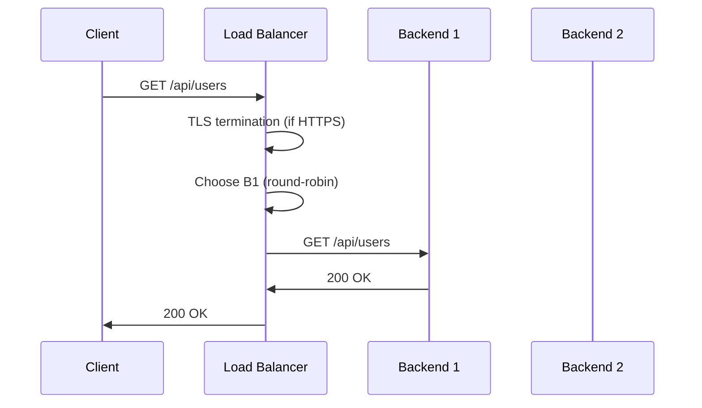

<!-- Generated by Groq via GitHub Actions -->
<!-- Topic ID: T192 -->
<!-- Category: DevOps / Infrastructure -->
<!-- Generated at UTC: 2026-11-09T08:15:07.824311+00:00 -->

# Load balancers

## 1. What problem does this solve?

- **What problem exists**  
  In a production backend you usually run multiple instances of a service (for high availability, horizontal scaling, or multi‑region deployment). A single client request can hit any instance, but you want to keep traffic distributed evenly, avoid overloading one node, and keep the system responsive.

- **Why the problem matters**  
  * **Performance** – A single instance can become a bottleneck if it receives too many requests.  
  * **Reliability** – If one instance crashes, the whole service becomes unavailable unless traffic is redirected.  
  * **Cost** – Under‑utilized instances waste resources; over‑utilized ones may need to be upgraded.

- **What happens if this concept is not used**  
  * Requests may pile up on a single node → latency spikes, timeouts.  
  * A single failure can bring down the whole API surface.  
  * Autoscaling becomes ineffective because the load is not visible to the scheduler.

- **Where this concept appears in real backend systems**  
  * Cloud providers expose load balancers (AWS ELB/ALB, GCP Load Balancing, Azure LB).  
  * In Kubernetes, the `Ingress` controller or `Service` of type `LoadBalancer` acts as a load balancer.  
  * On‑premise setups often use Nginx, HAProxy, or F5 appliances.

---

## 2. Mental model

### Analogy  
Imagine a **post office** with many mailboxes (backend servers). A clerk (the load balancer) receives incoming mail (HTTP requests) and decides which mailbox to drop each letter into. The clerk’s job is to:

1. **Distribute** the letters evenly so no mailbox gets overloaded.  
2. **Check** that a mailbox is open before dropping a letter.  
3. **Keep track** of which letters have already been sent to a particular mailbox if the recipient needs continuity (sticky sessions).

### Engineering model  
A load balancer sits **in front of** a pool of identical service instances. It receives every client request, decides which instance should handle it based on a **routing algorithm** (round‑robin, least‑connections, IP hash, etc.), and forwards the request. It also performs **health checks** to keep the pool healthy and may terminate TLS or do HTTP/2 multiplexing.

---

## 3. Deep explanation

| Topic | Explanation |
|-------|-------------|
| **Internals** | A load balancer is usually a reverse proxy that accepts client connections, performs optional TLS termination, then forwards the request to a backend over HTTP/HTTPS or TCP. It maintains a **backend pool** and a **routing table**. |
| **Important terminology** | *Round‑robin*, *least‑connections*, *IP hash*, *sticky session*, *health check*, *failover*, *session persistence*, *TLS termination*, *HTTP/2 multiplexing*, *backend pool*, *target group*. |
| **Trade‑offs** | *Round‑robin* is simple but ignores current load. *Least‑connections* adapts to load but needs state. *Sticky sessions* preserve state but reduce elasticity. |
| **Failure modes** | *Backend crash* → request fails; *network partition* → backend unreachable; *DNS cache* → stale IPs; *TLS mis‑configuration* → handshake failures. |
| **Limitations** | Load balancers cannot magically scale a single instance; they only distribute traffic. They also add a single point of failure unless redundant. |
| **Where it fits** | In a typical microservice stack: client → API gateway / load balancer → service instances → database / cache. The load balancer sits between the gateway and the service pool. |
| **Interaction with related concepts** | *Auto‑scaling* relies on health checks to add/remove instances. *CDN* sits in front of the load balancer for static assets. *Service mesh* (e.g., Istio) can replace or augment load balancing with richer routing. |

---

## 4. How it works

1. **Client sends request** to the load balancer’s public IP/hostname.  
2. **TLS termination (optional)**: LB decrypts the request if it’s HTTPS.  
3. **Routing decision**: LB selects a backend from its pool using its algorithm.  
4. **Health check verification**: LB ensures the chosen backend is healthy.  
5. **Forward request**: LB forwards the request (over HTTP/2 or TCP).  
6. **Backend processes** and sends response back to LB.  
7. **LB returns response** to the client (re‑encrypts if TLS was terminated).  
8. **Metrics & logging**: LB records latency, status codes, backend health.



---

## 5. Practical implementation

Below is a minimal **Node.js** load balancer using the `http-proxy` library. It forwards requests to a pool of backends and performs simple health checks.

```ts
// lb.ts
import http from 'http';
import httpProxy from 'http-proxy';
import { setInterval } from 'timers';

const backends = [
  { url: 'http://localhost:4001', healthy: true },
  { url: 'http://localhost:4002', healthy: true },
];

const proxy = httpProxy.createProxyServer({});

// Simple round‑robin index
let idx = 0;

// Health‑check: ping /health on each backend every 5s
setInterval(() => {
  backends.forEach((b) => {
    http.get(`${b.url}/health`, (res) => {
      b.healthy = res.statusCode === 200;
    }).on('error', () => {
      b.healthy = false;
    });
  });
}, 5000);

// Create HTTP server
const server = http.createServer((req, res) => {
  // Pick next healthy backend
  const healthyBackends = backends.filter(b => b.healthy);
  if (!healthyBackends.length) {
    res.writeHead(503);
    return res.end('Service unavailable');
  }
  const target = healthyBackends[idx % healthyBackends.length].url;
  idx++;

  proxy.web(req, res, { target }, (err) => {
    console.error('Proxy error', err);
    res.writeHead(502);
    res.end('Bad gateway');
  });
});

server.listen(3000, () => {
  console.log('Load balancer listening on :3000');
});
```

### Backend example (FastAPI)

```py
# backend.py
from fastapi import FastAPI
import uvicorn

app = FastAPI()

@app.get("/health")
def health():
    return {"status": "ok"}

@app.get("/api/users")
def users():
    return [{"id": 1, "name": "Alice"}]

if __name__ == "__main__":
    uvicorn.run(app, host="0.0.0.0", port=4001)
```

Run two instances on ports 4001 and 4002, then start the LB on 3000. The LB will distribute traffic and skip unhealthy backends.

---

## 6. Production considerations

| Concern | What to watch for |
|---------|-------------------|
| **Scalability** | Use a stateless LB (e.g., Nginx, HAProxy) behind a CDN. Scale LB horizontally if it becomes a bottleneck. |
| **Reliability** | Deploy LB in a highly available pair (active‑passive or active‑active). Use health checks and graceful draining. |
| **Security** | Terminate TLS at the LB to offload CPU. Use HSTS, OCSP stapling. Restrict backend ports to internal network. |
| **Observability** | Expose metrics (latency, request count, error rate) via Prometheus. Log backend responses and health check results. |
| **Performance** | Prefer HTTP/2 or gRPC multiplexing. Keep connection keep‑alive. Avoid unnecessary TLS renegotiation. |
| **Error handling** | Return 502/503 appropriately. Implement retries or circuit breakers upstream. |
| **Resource usage** | Monitor CPU/memory of LB; it can become a bottleneck if not sized correctly. |
| **Operational concerns** | Automate deployment with IaC (Terraform, CloudFormation). Use rolling updates. |
| **Failure recovery** | Configure graceful shutdown, draining connections, and automatic failover to healthy backends. |
| **Deployment** | Use container orchestration (K8s Ingress) or managed LB services. Ensure consistent configuration across environments. |

---

## 7. Common mistakes

| Mistake | Why it’s problematic |
|---------|----------------------|
| **No health checks** | Unhealthy instances keep receiving traffic → 5xx errors. |
| **Using sticky sessions on stateless services** | Reduces elasticity; a single node failure kills all sessions. |
| **Terminating TLS on LB but not on backends** | Exposes backend ports to the internet; potential security risk. |
| **Hard‑coding backend IPs** | Fails when scaling or migrating to cloud; DNS or service discovery needed. |
| **Ignoring connection limits** | Too many open connections can exhaust LB resources. |
| **Over‑relying on round‑robin for uneven workloads** | Some requests are heavier; load imbalance occurs. |
| **Not monitoring latency** | Latency spikes go unnoticed until SLA breaches. |
| **Deploying LB as a single instance** | Creates a single point of failure. |

---

## 8. Senior engineer perspective

### What changes at scale?

- **Architecture decisions**  
  * Choose a **managed LB** (AWS ALB, GCP LB) vs. self‑hosted (Nginx, HAProxy).  
  * Decide between **Layer 4 (TCP)** vs. **Layer 7 (HTTP)** load balancing based on protocol needs.  
  * Integrate with **service discovery** (Consul, Kubernetes DNS) instead of static config.

- **Trade‑offs**  
  * Managed LB offers high availability and auto‑scaling but less control over routing logic.  
  * Self‑hosted LB gives fine‑grained control but requires ops overhead.

- **Bottlenecks**  
  * The LB itself can become a bottleneck if it processes all traffic. Use **horizontal scaling** or **edge caching**.  
  * TLS termination can consume CPU; consider hardware acceleration or offloading to a CDN.

- **Failure scenarios**  
  * Network partition between LB and backends → failover to healthy nodes.  
  * LB crash → traffic loss; mitigate with active‑active or multiple LB instances.

- **Monitoring**  
  * Collect **request latency percentiles**, **error rates**, **backend health status**, and **connection counts**.  
  * Set alerts for **high 5xx rates** or **backend unavailability**.

- **Cost/performance**  
  * Managed LB pricing scales with traffic; self‑hosted LB can be cheaper but requires more ops.  
  * Evaluate **data transfer costs** when LB terminates TLS and forwards unencrypted traffic.

- **When NOT to use**  
  * For **single‑instance** services or very low traffic, a simple reverse proxy may suffice.  
  * If you need **advanced routing** (e.g., canary deployments), a service mesh or API gateway might be better.

---

## 9. Interview questions

1. **Beginner/Intermediate**  
   *Question:* What is the difference between a round‑robin and least‑connections load‑balancing algorithm?  
   *Answer points:*  
   - Round‑robin: cycles through backends regardless of current load.  
   - Least‑connections: picks the backend with the fewest active connections.  
   - Use case: round‑robin for stateless, evenly sized requests; least‑connections for variable load.

2. **Beginner/Intermediate**  
   *Question:* Why do we need health checks in a load balancer?  
   *Answer points:*  
   - Detect unhealthy or crashed backends.  
   - Prevent traffic from being sent to nodes that cannot respond.  
   - Maintain high availability and SLA compliance.

3. **Senior-level**  
   *Question:* How would you design a load‑balancing layer for a globally distributed microservice that needs to support both HTTP/2 and gRPC?  
   *Answer points:*  
   - Use a Layer 7 LB that supports HTTP/2 and gRPC (e.g., Envoy, Nginx).  
   - Deploy LB in each region; use DNS or a global CDN to route to nearest region.  
   - Implement consistent hashing or session affinity if needed.  
   - Offload TLS at LB; use mutual TLS for backend security.

4. **Senior-level**  
   *Question:* Explain how you would monitor and alert on load‑balancer performance in a Kubernetes cluster.  
   *Answer points:*  
   - Expose Prometheus metrics from Ingress controller (request count, latency, error rates).  
   - Use Grafana dashboards for latency percentiles.  
   - Set alerts for high 5xx rates, backend health failures, or connection saturation.  
   - Correlate with pod metrics to identify bottlenecks.

5. **Scenario/Debugging**  
   *Question:* A client reports intermittent 502 errors from the API. The load balancer logs show “backend unreachable” for one of the nodes. What steps would you take to diagnose and fix the issue?  
   *Answer points:*  
   - Verify backend health check endpoint is reachable and returning 200.  
   - Check network connectivity between LB and backend (firewall, security groups).  
   - Inspect backend logs for crashes or resource exhaustion.  
   - Ensure backend port is open only internally.  
   - If the node is unhealthy, drain traffic and replace the instance.  
   - Update LB configuration if backend IP changed.

---

## 10. Hands‑on task

**Task:** Build a simple load‑balanced API with two Node.js backends and a TypeScript load balancer.

1. Create two FastAPI or Express services listening on ports 4001 and 4002.  
2. Add a `/health` endpoint that returns 200.  
3. Implement the `lb.ts` load balancer from section 5.  
4. Run all three services (two backends + LB) using Docker Compose.  
5. Use `curl -X GET http://localhost:3000/api/users` repeatedly and observe that requests alternate between backends.  
6. Stop one backend and confirm the LB stops routing to it after the next health‑check cycle.  
7. Add a simple Prometheus exporter to the LB and expose metrics.  

---

## 11. Quick revision

- Load balancer sits **in front of** a pool of service instances.  
- **Routing algorithms:** round‑robin, least‑connections, IP hash, sticky sessions.  
- **Health checks** keep the pool healthy; unhealthy nodes are excluded.  
- **TLS termination** offloads CPU and centralizes certificate management.  
- **Layer 4 vs. Layer 7**: TCP vs. HTTP routing.  
- **Observability:** expose latency, error rates, backend health.  
- **Common pitfalls:** no health checks, hard‑coded IPs, ignoring TLS security.  
- **Scalability:** use managed LB or scale LB horizontally; consider CDN for static assets.  
- **Failure recovery:** graceful draining, active‑active LB, circuit breakers.  
- **Monitoring:** Prometheus metrics, Grafana dashboards, alerting on 5xx rates.  
- **When not to use:** single‑instance services or very low traffic; use a simple reverse proxy instead.

---

## 12. References

- [Nginx Load Balancing](https://nginx.org/en/docs/http/ngx_http_upstream_module.html)  
- [HAProxy Load Balancing](https://www.haproxy.org/documentation/hapee/1.8/ha-proxy-configuration.html)  
- [AWS Application Load Balancer](https://docs.aws.amazon.com/elasticloadbalancing/latest/application/introduction.html)  
- [Google Cloud Load Balancing](https://cloud.google.com/load-balancing/docs)  
- [Kubernetes Ingress](https://kubernetes.io/docs/concepts/services-networking/ingress/)  
- [http-proxy](https://github.com/http-party/node-http-proxy)  
- [FastAPI Health Check](https://fastapi.tiangolo.com/tutorial/health-check/)  

---
