<!-- Generated by Groq via GitHub Actions -->
<!-- Topic ID: T193 -->
<!-- Category: DevOps / Infrastructure -->
<!-- Generated at UTC: 2026-11-09T23:05:43.721531+00:00 -->

# CDN

## 1. What problem does this solve?

**Motivation**

When a user requests a static asset (image, CSS, JS, video, etc.) from a web application, the request normally travels from the client → edge of the internet → your origin server (e.g., a Node.js or FastAPI instance) → back to the client. This round‑trip introduces latency, consumes bandwidth, and can overwhelm the origin during traffic spikes.

**Problems that exist**

- **High latency**: A single hop to a distant origin can add 50–200 ms, which hurts perceived performance.
- **Bandwidth cost**: Every request pulls data from the origin, incurring egress charges on cloud providers.
- **Scalability limits**: A sudden surge (e.g., a viral post) can saturate the origin’s network or CPU, causing timeouts.
- **Reliability**: If the origin is down, all static assets fail, even if the dynamic API is healthy.

**Why it matters**

- **User experience**: Faster asset delivery keeps users engaged and reduces bounce rates.
- **Cost**: Cloud providers charge per GB transferred; offloading to a CDN reduces egress.
- **Security**: CDNs can provide TLS termination, DDoS protection, and WAF rules.
- **Compliance**: Some regulations require data to stay within certain regions; CDNs can enforce that.

**Consequences of not using a CDN**

- Every asset request hits the origin, increasing load and cost.
- Users in distant regions experience slower page loads.
- The origin becomes a single point of failure for static content.

**Real‑world appearance**

- A Next.js app serving images from `/public` via a CDN.
- A FastAPI backend delivering static PDFs through a CDN.
- A React SPA’s JavaScript bundle cached in a CDN edge node.

---

## 2. Mental model

**Analogy**

Think of a CDN as a *global library network*. The library (origin) holds all books (assets). Instead of every reader traveling to the main library, the network has local branches (edge nodes) that keep copies of popular books. When a reader requests a book, they go to the nearest branch, get it instantly, and the main library stays free for new acquisitions.

**Engineering model**

- **Origin**: Your application server or storage bucket (S3, GCS, etc.).
- **Edge nodes**: Distributed servers that cache content closer to users.
- **Cache key**: URL + query string + headers that determine uniqueness.
- **Cache control**: TTL, ETag, Last‑Modified, etc., dictate how long the edge keeps a copy.
- **Invalidation**: Explicit or automatic cache purging when content changes.

---

## 3. Deep explanation

### Internals

1. **Request routing**: DNS resolves the CDN domain to the nearest edge node (via Anycast).
2. **Cache lookup**: Edge checks if the requested URL is cached.
3. **Cache miss**: Edge forwards the request to the origin, stores the response, and returns it to the client.
4. **Cache hit**: Edge serves the cached response directly.
5. **Cache invalidation**: Either time‑based (TTL) or explicit purge API.

### Important terminology

| Term | Meaning |
|------|---------|
| **Cache‑Control** | HTTP header controlling caching behavior (`max-age`, `no-cache`, etc.). |
| **ETag / Last‑Modified** | Validation tokens for conditional requests. |
| **Purging / Invalidation** | Removing or refreshing cached objects. |
| **Origin Pull** | Edge fetches from origin on miss. |
| **Origin Push** | Origin proactively pushes content to edge (rare). |
| **Anycast** | IP routing that sends traffic to the nearest node. |
| **Cache‑Hit Ratio** | % of requests served from cache. |

### Trade‑offs

| Aspect | Pull CDN | Push CDN |
|--------|----------|----------|
| **Complexity** | Simple to set up; origin handles all content. | Requires build pipeline integration. |
| **Freshness** | Depends on TTL; stale content until TTL expires. | Can push immediately after build. |
| **Cost** | Lower storage cost; higher egress on cache misses. | Higher storage cost; lower egress. |
| **Control** | Fine‑grained per‑resource headers. | Bulk control via push rules. |

### Failure modes

- **Cache stampede**: Many concurrent misses overwhelm the origin.
- **Stale content**: Long TTLs or missing invalidation lead to outdated assets.
- **Misconfigured headers**: `no-store` or missing `Cache‑Control` cause every request to hit origin.
- **Edge node failure**: Rare, but can be mitigated with Anycast redundancy.

### Limitations

- **Dynamic content**: CDNs are not suited for per‑user personalized data unless using edge functions.
- **Large binary uploads**: CDN may not support multipart uploads; use origin directly.
- **Strict compliance**: Some data must stay in a specific region; CDN may cache elsewhere unless region‑restricted.

### Where it fits in backend architecture

```
Client
  │
  ▼
DNS → CDN Edge (Anycast)
  │
  ├─► Cache Hit → Response
  │
  └─► Cache Miss → Origin Pull
          │
          ▼
     Origin Server (Node.js / FastAPI)
          │
          ▼
     Storage (S3 / GCS / DB)
```

- The CDN sits between the client and the origin.
- It can also integrate with edge functions (e.g., Cloudflare Workers) for lightweight logic.

### Interaction with related concepts

- **CDN + CloudFront**: AWS integration with S3 origins.
- **CDN + Edge Functions**: Serverless logic at the edge (e.g., authentication).
- **CDN + API Gateway**: API responses can be cached for idempotent endpoints.
- **CDN + CI/CD**: Automate cache purging after deployments.

---

## 4. How it works

1. **DNS resolution**: Client resolves `cdn.example.com` → nearest edge IP.
2. **Edge request**: Edge receives HTTP request.
3. **Cache lookup**: Edge checks if URL + relevant headers exist in cache.
4. **Cache hit**: Edge returns cached response, sets `Age` header.
5. **Cache miss**:
   - Edge forwards request to origin (`https://api.example.com`).
   - Origin processes request, returns response with caching headers.
   - Edge stores response in cache (respecting TTL).
   - Edge returns response to client.
6. **Cache invalidation**:
   - On content update, origin sends purge request to CDN or sets short TTL.
   - Edge removes stale entry; next request triggers miss.

```mermaid
sequenceDiagram
    participant C as Client
    participant D as DNS
    participant E as CDN Edge
    participant O as Origin Server
    participant S as Storage

    C->>D: Resolve cdn.example.com
    D->>C: Return nearest edge IP
    C->>E: GET /assets/logo.png
    E->>E: Check cache
    alt Cache Hit
        E->>C: 200 OK (cached)
    else Cache Miss
        E->>O: GET /assets/logo.png
        O->>S: Retrieve file
        S-->>O: File data
        O-->>E: 200 OK + Cache‑Control
        E-->>C: 200 OK
    end
```



---

## 5. Practical implementation

Below is a minimal Node.js/TypeScript example that serves static assets via a CDN and demonstrates cache‑control headers.

```ts
// src/server.ts
import express from 'express';
import path from 'path';
import helmet from 'helmet';

const app = express();
const PORT = process.env.PORT ?? 3000;

// 1️⃣ Security headers
app.use(helmet());

// 2️⃣ Serve static assets with long cache TTL
app.use(
  '/static',
  express.static(path.join(__dirname, '..', 'public'), {
    maxAge: '30d', // 30 days
    immutable: true, // tells browsers the file won't change
    setHeaders: (res, filePath) => {
      // Add ETag for validation
      res.setHeader('ETag', `${filePath}-${Date.now()}`);
    },
  })
);

// 3️⃣ API endpoint (example)
app.get('/api/hello', (_req, res) => {
  res.json({ message: 'Hello, world!' });
});

app.listen(PORT, () => {
  console.log(`Server listening on http://localhost:${PORT}`);
});
```

**How to use a CDN**

1. Deploy the above server to a cloud provider (e.g., AWS ECS, GCP Cloud Run).
2. Create a CDN distribution (e.g., CloudFront, Cloudflare CDN) pointing to the server’s domain.
3. Configure the CDN to cache `/static/*` with a long TTL.
4. Update your application to load assets from `https://cdn.example.com/static/...`.

**Cache invalidation example (AWS CloudFront)**

```ts
// src/invalidate.ts
import { CloudFrontClient, CreateInvalidationCommand } from '@aws-sdk/client-cloudfront';

const client = new CloudFrontClient({ region: 'us-east-1' });

async function invalidate(paths: string[]) {
  const params = {
    DistributionId: process.env.CLOUDFRONT_DISTRIBUTION_ID!,
    InvalidationBatch: {
      CallerReference: `${Date.now()}`,
      Paths: {
        Quantity: paths.length,
        Items: paths,
      },
    },
  };
  await client.send(new CreateInvalidationCommand(params));
  console.log('Invalidation requested for:', paths);
}

// Example: invalidate logo after upload
invalidate(['/static/logo.png']);
```

Run this script after uploading a new asset to ensure the CDN serves the fresh copy.

---

## 6. Production considerations

| Concern | What to watch for | Mitigation |
|---------|-------------------|------------|
| **Scalability** | Edge nodes handle millions of requests. | Use a CDN with global Anycast; set high TTLs. |
| **Reliability** | Cache stampedes, origin downtime. | Enable *stale-while-revalidate*; use fallback origin. |
| **Security** | TLS, DDoS, WAF. | Enforce HTTPS, enable CDN security features. |
| **Observability** | Cache hit ratio, latency. | Use CDN metrics dashboards; log cache status. |
| **Performance** | Latency, cache misses. | Optimize cache headers; use edge functions for dynamic logic. |
| **Error handling** | 5xx from origin. | Configure error pages; set `minTTL`. |
| **Resource usage** | Storage cost. | Purge unused assets; use compression. |
| **Operational concerns** | Invalidation latency. | Use short TTLs for frequently changing assets. |
| **Failure recovery** | Edge node failure. | Anycast redundancy; fallback to origin. |
| **Deployment** | Cache invalidation after deploy. | Automate purge in CI/CD pipeline. |

---

## 7. Common mistakes

| Mistake | Why it’s problematic |
|---------|----------------------|
| **Missing `Cache‑Control`** | Every request hits origin → high latency & cost. |
| **Using `no-store` on static assets** | Prevents caching; defeats CDN purpose. |
| **Short TTLs on immutable assets** | Causes unnecessary origin traffic. |
| **Not purging after updates** | Users see stale content. |
| **Ignoring `ETag`/`Last‑Modified`** | Misses conditional requests; wasted bandwidth. |
| **Over‑caching dynamic endpoints** | Users see stale data. |
| **Not configuring HTTPS** | Security warnings, DDoS exposure. |
| **Not monitoring hit ratio** | Missed optimization opportunities. |

---

## 8. Senior engineer perspective

### Architecture decisions

- **Edge vs. Origin**: Decide which assets to serve from CDN vs. origin (e.g., dynamic API responses).
- **Cache strategy**: `max-age`, `stale-while-revalidate`, `stale-if-error`.
- **Invalidation policy**: Automatic (short TTL) vs. manual (purge API).
- **Multi‑CDN**: Use two CDNs for redundancy or regional optimization.
- **Edge functions**: Offload auth or personalization to the edge.

### Trade‑offs

- **Cost vs. freshness**: Longer TTL reduces egress but risks stale content.
- **Complexity vs. control**: Push CDNs require build pipeline changes but give instant freshness.
- **Latency vs. security**: Some CDNs offer WAF; others may add a tiny extra hop.

### Bottlenecks

- **Origin bandwidth**: Cache misses still hit origin; ensure origin can handle peak traffic.
- **Invalidation latency**: Some CDNs take minutes to propagate; plan for that.

### Failure scenarios

- **Origin outage**: Edge should serve stale content if `stale-while-revalidate` is enabled.
- **Cache corruption**: Use signed URLs or tokenized paths to prevent tampering.

### Monitoring

- **Cache hit ratio**: Aim >90% for static assets.
- **Latency**: Edge latency vs. origin latency.
- **Error rates**: 5xx from origin or CDN.

### Cost/performance

- **Storage cost**: CDNs charge per GB stored; balance TTL vs. storage.
- **Egress cost**: CDNs often cheaper than origin egress; but check provider pricing.

### When NOT to use

- **Highly dynamic per‑user content**: Use origin or edge functions instead.
- **Strict compliance**: If data must stay in a single region, use region‑restricted CDN or origin only.
- **Large file uploads**: Use origin directly; CDNs may not support multipart uploads.

---

## 9. Interview questions

1. **Beginner**: *What is the purpose of the `Cache‑Control` header in CDN caching?*  
   *Answer*: It tells the CDN how long to keep an object in cache (`max-age`), whether it can serve stale content (`stale-while-revalidate`), and whether the object can be cached at all (`no-store`, `private`).

2. **Beginner**: *Explain the difference between a cache hit and a cache miss.*  
   *Answer*: A hit means the CDN already has the requested object and serves it directly. A miss means the CDN must fetch the object from the origin, store it, and then serve it.

3. **Senior**: *How would you design a CDN strategy for a SaaS application that serves both static assets and user‑specific PDFs?*  
   *Answer*: Static assets get long TTLs on the CDN. PDFs are dynamic; either keep them on the origin or use signed URLs with short TTLs and `Cache‑Control: no-store`. Consider edge functions for authentication.

4. **Senior**: *Describe a cache stampede scenario and how you would mitigate it.*  
   *Answer*: When many concurrent requests for a missing object overwhelm the origin. Mitigation: use a *stale‑while‑revalidate* policy, implement a distributed lock or a “single flight” pattern at the origin, or pre‑populate the cache during low traffic.

5. **Scenario/Debugging**: *A user reports that after deploying a new version of the site, they still see the old logo. What steps would you take to diagnose and fix the issue?*  
   *Answer*:  
   - Verify the CDN’s cache hit ratio for `/static/logo.png`.  
   - Check the `Cache‑Control` header on the origin response.  
   - Confirm that the CDN invalidation API was called (or TTL expired).  
   - If using signed URLs, ensure the new URL is generated.  
   - As a quick fix, purge the path via the CDN console or API.  

---

## 10. Hands‑on task

**Task**: Add a CDN layer to the existing Node.js/Express static server.

1. Deploy the server to a cloud provider (e.g., Render, Fly.io).
2. Create a CDN distribution (e.g., Cloudflare CDN) pointing to the deployed domain.
3. Configure the CDN to cache `/static/*` with a 30‑day TTL.
4. Add a script to automatically purge `/static/*` after each deployment.
5. Verify that the CDN serves the assets by checking the `Age` header and measuring latency with `curl -w`.

**Deliverables**:  
- Updated `server.ts` with proper cache headers.  
- CDN configuration screenshot.  
- Invalidation script (`invalidate.ts`).  
- README explaining the steps.

---

## 11. Quick revision

- CDN sits between client and origin, caching static assets at edge nodes.
- `Cache‑Control` dictates TTL, `no-store`, `private`, `public`.
- `ETag`/`Last‑Modified` enable conditional requests.
- **Cache hit**: served from edge; **miss**: fetched from origin.
- **Cache stampede**: many misses → origin overload; mitigate with `stale-while-revalidate`.
- **Invalidation**: purge API or short TTLs.
- **Security**: enforce HTTPS, use signed URLs, enable WAF.
- **Observability**: monitor hit ratio, latency, error rates.
- **Cost**: CDN reduces origin egress; storage cost depends on TTL.
- **Edge functions**: run lightweight logic (auth, personalization) at the edge.

---

## 12. References

- [MDN Web Docs – HTTP caching](https://developer.mozilla.org/en-US/docs/Web/HTTP/Caching)
- [AWS CloudFront Developer Guide](https://docs.aws.amazon.com/AmazonCloudFront/latest/DeveloperGuide/Introduction.html)
- [Cloudflare CDN Overview](https://developers.cloudflare.com/cdn/)
- [Fastly CDN Documentation](https://docs.fastly.com/)
- [CDN Edge Functions – Cloudflare Workers](https://developers.cloudflare.com/workers/)
- [Express static middleware docs](https://expressjs.com/en/api.html#express.static)
- [AWS SDK for JavaScript – CloudFront Invalidation](https://docs.aws.amazon.com/AWSJavaScriptSDK/v3/latest/clients/client-cloudfront/index.html)
