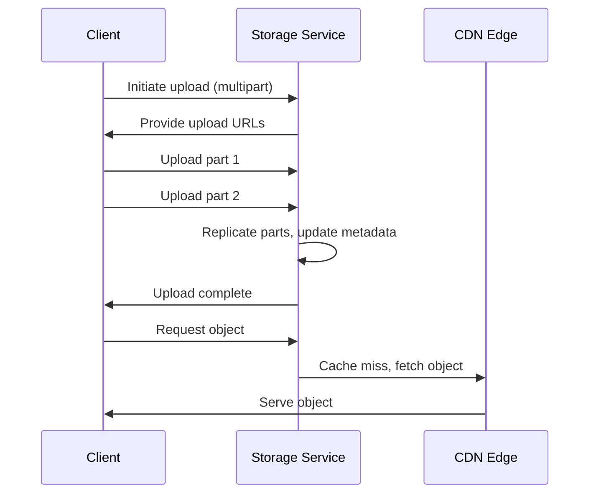

<!-- Generated by Groq via GitHub Actions -->
<!-- Topic ID: T194 -->
<!-- Category: DevOps / Infrastructure -->
<!-- Generated at UTC: 2026-11-09T23:05:43.721531+00:00 -->

# Object storage

## 1. What problem does this solve?

- **Problem**: Traditional file systems and relational databases are great for structured data, but they struggle with large, unstructured blobs (images, videos, backups, logs). Storing these blobs in a database inflates the database size, hurts query performance, and complicates backups.
- **Why it matters**: Modern web and AI backends routinely generate and serve terabytes of media, model checkpoints, and telemetry. Efficiently storing, retrieving, and scaling these assets is essential for cost‑effective, high‑throughput services.
- **What if we ignore it**: You’ll end up with a monolithic database that is slow, expensive to scale, and difficult to maintain. Backup windows widen, and you risk data loss if the database crashes.
- **Real‑world usage**:  
  - CDN backends (e.g., CloudFront + S3) store static assets.  
  - Video platforms store raw footage and transcoded clips.  
  - ML pipelines store training data and model artifacts.  
  - SaaS applications store user uploads (profile pictures, documents).

## 2. Mental model

**Analogy**: Think of object storage as a *digital locker* in a large, well‑organized warehouse.  
- **Locker**: Holds one item (an object).  
- **Warehouse**: Can hold millions of lockers, each identified by a unique key (object key).  
- **Access**: You can drop an item in or pull it out by key, without caring about where inside the warehouse it sits.

**Engineering model**:  
- **Objects**: Immutable blobs with metadata.  
- **Buckets**: Namespaces that group objects.  
- **Keys**: Unique identifiers within a bucket.  
- **Endpoints**: HTTP(S) URLs or SDK calls that perform CRUD on objects.  
- **Consistency**: Usually *eventual* or *read‑after‑write* guarantees, depending on provider.

## 3. Deep explanation

### Internals
- **Distributed storage**: Data is split into chunks, replicated across nodes for durability.  
- **Metadata service**: Keeps a map of key → location, often in a key‑value store.  
- **Erasure coding / RAID**: Protects against disk failures.  
- **Caching layer**: Frequently accessed objects may be cached in edge nodes or CDN.

### Important terminology
- **Bucket**: Top‑level namespace.  
- **Object key**: Path‑like identifier (e.g., `users/123/profile.jpg`).  
- **ETag / MD5**: Hash of the object for integrity checks.  
- **ACL / IAM**: Access control lists or identity‑based policies.  
- **Lifecycle rules**: Automatic transition to cheaper storage or deletion.  
- **Multipart upload**: Upload large objects in parallel parts.

### Trade‑offs
| Feature | Pros | Cons |
|---------|------|------|
| **Scalability** | Linear scaling by adding nodes | Requires sharding logic |
| **Consistency** | Strong (e.g., GCS) vs eventual (S3) | Strong consistency can hurt performance |
| **Cost** | Pay‑as‑you‑go, tiered storage | Frequent access to cold tiers can be expensive |
| **Latency** | Low for local regions | Cross‑region access adds latency |

### Failure modes
- **Network partitions**: May lead to stale reads.  
- **Node failures**: Replication ensures no data loss, but read latency may increase.  
- **Metadata loss**: If the metadata service crashes, you lose key‑location mapping.  
- **Object corruption**: Rare but possible; integrity checks mitigate.

### Limitations
- **No transactional guarantees** across objects.  
- **Large metadata overhead** for very small objects.  
- **Limited query capabilities**: You can’t run SQL‑like queries on object contents.

### Where it fits
- **Microservice architecture**: A dedicated “storage” service exposes REST/GraphQL endpoints.  
- **Event sourcing**: Store event payloads as objects.  
- **CI/CD pipelines**: Store build artifacts.  
- **AI**: Store training datasets, model checkpoints, and inference results.

### Interaction with related concepts
- **CDN**: Object storage often sits behind a CDN for low‑latency global access.  
- **Database**: Store object metadata (URL, size, hash) in a relational or NoSQL DB.  
- **Auth**: Use signed URLs or token‑based auth to secure access.  
- **Streaming**: Serve large objects via HTTP range requests or streaming APIs.

## 4. How it works

1. **Client** requests upload via SDK or REST.  
2. **Client** obtains a pre‑signed URL or initiates a multipart upload.  
3. **Client** streams data to the storage endpoint.  
4. **Storage backend** writes chunks to disks, replicates, and updates metadata.  
5. **Client** receives confirmation; object becomes immutable.  
6. **Client** can later fetch the object via a signed URL or public endpoint.  
7. **Optional**: CDN caches the object at edge locations.



## 5. Practical implementation

### TypeScript/Node.js example – uploading with AWS S3

```ts
import { S3Client, PutObjectCommand, GetObjectCommand } from "@aws-sdk/client-s3";
import { getSignedUrl } from "@aws-sdk/s3-request-presigner";
import { Readable } from "stream";

const s3 = new S3Client({ region: "us-east-1" });

/**
 * Upload a file buffer to S3.
 * @param bucket Bucket name
 * @param key Object key
 * @param buffer File data
 */
export async function uploadFile(
  bucket: string,
  key: string,
  buffer: Buffer
): Promise<void> {
  const cmd = new PutObjectCommand({
    Bucket: bucket,
    Key: key,
    Body: buffer,
    ContentType: "image/jpeg",
  });
  await s3.send(cmd);
}

/**
 * Generate a pre‑signed URL for downloading.
 * @param bucket Bucket name
 * @param key Object key
 * @param expiresIn Seconds until URL expires
 */
export async function getDownloadUrl(
  bucket: string,
  key: string,
  expiresIn = 3600
): Promise<string> {
  const cmd = new GetObjectCommand({
    Bucket: bucket,
    Key: key,
  });
  return await getSignedUrl(s3, cmd, { expiresIn });
}

/**
 * Example usage
 */
async function demo() {
  const bucket = "my-app-uploads";
  const key = "users/42/profile.jpg";
  const buffer = await fs.promises.readFile("local.jpg");

  await uploadFile(bucket, key, buffer);
  const url = await getDownloadUrl(bucket, key);
  console.log("Download URL:", url);
}
demo().catch(console.error);
```

**Key points**  
- `PutObjectCommand` writes the whole file; for >5 GB use multipart.  
- Signed URLs give time‑limited access without exposing credentials.  
- Metadata (`ContentType`) is stored automatically.

### Optional: Using a CDN (e.g., CloudFront) – just add a distribution that points to the bucket; the CDN will cache objects automatically.

## 6. Production considerations

| Concern | How to address |
|---------|----------------|
| **Scalability** | Use provider’s native scaling; for self‑hosted, shard by key prefix. |
| **Reliability** | Enable versioning, cross‑region replication, and lifecycle policies. |
| **Security** | Use IAM roles, bucket policies, signed URLs, encryption at rest (`SSE-S3`, `SSE-KMS`). |
| **Observability** | Enable request logging, metrics (bytes uploaded/downloaded), and alerts on failures. |
| **Performance** | Use multipart uploads for large files; enable CDN caching; choose appropriate storage class (e.g., S3 Standard vs IA). |
| **Error handling** | Retry with exponential backoff; handle `429 Too Many Requests` and `5xx` errors. |
| **Resource usage** | Monitor storage cost per GB; use lifecycle rules to move infrequently accessed data to cheaper tiers. |
| **Operational concerns** | Automate bucket lifecycle, policy updates, and key rotation. |
| **Failure recovery** | Keep backups of critical objects; use immutable buckets for compliance. |
| **Deployment** | Treat bucket creation as IaC (Terraform, CDK) to avoid manual drift. |

## 7. Common mistakes

| Mistake | Why it’s bad |
|---------|--------------|
| **Storing small blobs in DB** | Increases DB size, hurts query performance, complicates backups. |
| **Using public buckets for private data** | Exposes data to the world; no access control. |
| **Ignoring lifecycle policies** | Accumulates stale data, driving up costs. |
| **Not using signed URLs** | Clients can request any object if bucket is public. |
| **Uploading large files in one request** | May hit size limits; better to use multipart. |
| **Over‑optimizing for latency** | Ignoring regional placement can cause high egress costs. |
| **Assuming strong consistency** | Some providers are eventual; code must handle stale reads. |
| **Hard‑coding credentials** | Leads to credential leakage and hard‑to‑rotate secrets. |

## 8. Senior engineer perspective

### Architecture decisions
- **Provider vs self‑hosted**: Evaluate latency, compliance, and cost.  
- **Bucket layout**: Prefix‑based sharding vs single bucket; impacts parallelism.  
- **Access patterns**: Public CDN vs authenticated API; decide on signed URLs or IAM roles.  
- **Data lifecycle**: Define retention, archival, and deletion policies early.

### Trade‑offs
- **Strong vs eventual consistency**: Strong consistency simplifies logic but can reduce throughput.  
- **Cold vs hot storage**: Cold tiers save money but increase latency; balance based on access patterns.  
- **Edge caching**: CDN reduces egress but adds complexity (cache invalidation).

### Bottlenecks
- **Metadata service**: If centralized, can become a single point of failure.  
- **Network bandwidth**: Upload/download limits can throttle throughput.  
- **API rate limits**: Providers impose per‑second limits; design for back‑off.

### Failure scenarios
- **Cross‑region outage**: Use multi‑region replication.  
- **Credential compromise**: Rotate keys, use short‑lived tokens.  
- **Object corruption**: Enable integrity checks (ETag) and re‑upload if mismatched.

### Monitoring
- **Metrics**: `bytes_uploaded`, `bytes_downloaded`, `request_latency`, `error_rate`.  
- **Logs**: Access logs, audit logs.  
- **Alerts**: High error rate, storage cost thresholds, missing lifecycle transitions.

### Cost/performance
- **Cost per GB**: Compare S3 Standard vs IA vs Glacier.  
- **Egress**: CDN reduces egress from origin but adds cache miss costs.  
- **Compute**: Multipart uploads can be parallelized across workers.

### When NOT to use
- **Transactional workloads**: Need ACID guarantees; use a DB.  
- **Real‑time analytics on object contents**: Use a database or stream processing.  
- **Very small objects (<1 KB)**: Overhead may outweigh benefits; embed in DB.

## 9. Interview questions

1. **Beginner**: *What is the difference between a bucket and an object in S3?*  
   *Answer*: A bucket is a namespace/container; an object is a file stored inside a bucket, identified by a key.

2. **Beginner**: *Why do we use signed URLs instead of making a bucket public?*  
   *Answer*: Signed URLs grant time‑limited, authenticated access without exposing the bucket to the public internet.

3. **Senior**: *Explain how you would design an object storage system that supports both high‑throughput uploads and low‑latency reads for a global user base.*  
   *Answer*: Use a globally distributed CDN, region‑specific buckets with cross‑region replication, multipart uploads, and edge caching. Consider consistency models and rate limiting.

4. **Senior**: *Describe a scenario where eventual consistency could break your application logic and how you would mitigate it.*  
   *Answer*: If a user uploads a profile picture and immediately requests it, eventual consistency might return the old image. Mitigation: use read‑after‑write confirmation, or switch to a provider with strong consistency for that bucket.

5. **Scenario/Debugging**: *A user reports that their uploaded video is missing from the CDN after a few hours. What steps would you take to diagnose and fix the issue?*  
   *Answer*:  
   - Verify upload succeeded (check S3 logs, object existence).  
   - Check CDN cache invalidation rules; ensure the object is not purged.  
   - Inspect CDN logs for cache misses and origin errors.  
   - Confirm that the object’s ACL allows public read or that signed URLs are still valid.  
   - If the object is in a cold tier, ensure it’s transitioned to a hot tier before CDN fetch.  
   - Fix any misconfigurations and add monitoring for future incidents.

## 10. Hands‑on task

**Task**: Build a simple Express API that allows users to upload images and retrieve a signed download URL.

1. Create an Express server with `/upload` (POST) and `/download/:key` (GET).  
2. Use the AWS SDK to upload the file to S3.  
3. Generate a signed URL for `/download/:key` that expires in 5 minutes.  
4. Store the object key and metadata (size, MIME type) in a PostgreSQL table.  
5. Add a cron job that deletes objects older than 30 days and removes their DB entries.  

**Goal**: Demonstrate end‑to‑end object storage flow, metadata persistence, and lifecycle cleanup.

## 11. Quick revision

- Object storage stores immutable blobs identified by keys inside buckets.  
- Buckets are namespaces; keys are unique identifiers.  
- Use multipart uploads for >5 GB files.  
- Signed URLs provide secure, time‑limited access.  
- Lifecycle rules move data to cheaper tiers or delete it.  
- Consistency models vary: S3 is eventual; GCS is strong.  
- CDN front‑ends reduce latency and egress costs.  
- Security: IAM roles, bucket policies, SSE‑KMS.  
- Monitoring: track bytes, latency, error rates.  
- Common pitfalls: public buckets, no lifecycle, hard‑coded creds.  
- For high‑scale, consider sharding, multi‑region replication, and cost‑tiering.

## 12. References

- [AWS S3 Developer Guide](https://docs.aws.amazon.com/AmazonS3/latest/dev/Welcome.html)  
- [Google Cloud Storage Documentation](https://cloud.google.com/storage/docs)  
- [Azure Blob Storage Docs](https://learn.microsoft.com/en-us/azure/storage/blobs/)  
- [AWS SDK for JavaScript v3](https://docs.aws.amazon.com/AWSJavaScriptSDK/v3/latest/index.html)  
- [CDN best practices for object storage](https://aws.amazon.com/cloudfront/faqs/)  
- [S3 Lifecycle Configuration](https://docs.aws.amazon.com/AmazonS3/latest/userguide/lifecycle-configuration-examples.html)  

---
