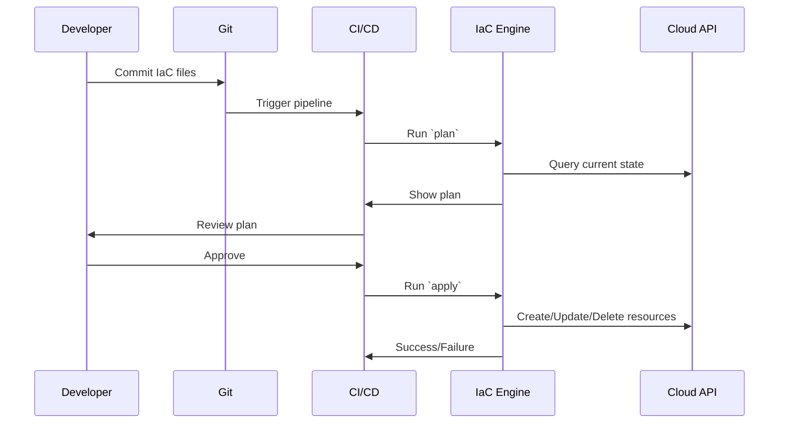

<!-- Generated by Groq via GitHub Actions -->
<!-- Topic ID: T196 -->
<!-- Category: DevOps / Infrastructure -->
<!-- Generated at UTC: 2026-11-10T08:34:02.480718+00:00 -->

# Infrastructure as Code

## 1. What problem does this solve?

| Problem | Why it matters | Consequence of not using IaC | Real‑world example |
|---------|----------------|------------------------------|--------------------|
| **Manual provisioning** | Human‑written scripts or console clicks are error‑prone and hard to repeat. | Inconsistent environments, “works on my machine” bugs, slow onboarding. | A dev spins up a PostgreSQL instance in the console, but forgets to enable backups. |
| **Lack of version control** | No audit trail of who changed what and when. | Hard to roll back, no traceability for compliance. | Production DB schema changes made directly in the console. |
| **Reproducibility** | You need to recreate identical environments for staging, testing, and production. | Tests run against a different config, leading to flaky CI. | Staging environment missing a Redis cache that production has. |
| **Collaboration** | Teams need a single source of truth for infrastructure. | Merge conflicts, duplicated effort, “I did it, you did it.” | Two teams independently create VPCs with different CIDR blocks. |
| **Automation & CI/CD** | Infrastructure changes should be part of the same pipeline as code. | Manual approvals, longer release cycles, increased risk of human error. | Deploying a new microservice without updating the load balancer config. |

> **Bottom line:** IaC turns infrastructure into declarative, versioned, auditable code that can be tested, reviewed, and deployed just like application code.

---

## 2. Mental model

### Analogy: Building a house

| Manual construction | IaC |
|----------------------|-----|
| You hand‑pick bricks, lay them one by one, and hope the walls stay straight. | You write a blueprint that describes the house’s shape, materials, and layout. A construction robot follows the blueprint to build the house exactly as specified. |

- **Blueprint = IaC configuration**  
- **Construction robot = IaC engine (Terraform, Pulumi, CloudFormation)**  
- **House = Cloud environment (VPC, DB, cache, etc.)**

### Engineering model

1. **Declarative description** – You declare *what* resources you want, not *how* to create them.  
2. **State tracking** – The IaC engine keeps a snapshot of the current cloud state.  
3. **Diff & plan** – It compares the desired state to the current state and produces a plan.  
4. **Apply** – The engine executes the plan, creating, updating, or deleting resources.  
5. **Idempotency** – Running the same config again produces no changes unless the desired state changed.

---

## 3. Deep explanation

### Internals

| Component | Role |
|-----------|------|
| **Provider** | SDK that talks to a cloud API (e.g., `aws`, `google`, `azure`). |
| **Resource** | A cloud object (S3 bucket, RDS instance, VPC). |
| **State file** | JSON/YAML that records the real‑world IDs and attributes of resources. |
| **Backend** | Where the state file lives (local disk, S3, Terraform Cloud). |
| **Modules** | Reusable, composable pieces of IaC. |
| **Workspaces** | Separate state files for different environments (dev, prod). |

### Important terminology

- **Declarative vs Imperative** – Declarative: “I want a bucket named `app-logs`.” Imperative: “Create bucket, then set ACL, then add lifecycle rule.”
- **Diff / Plan** – The set of changes that will be applied.  
- **Drift** – When the real world diverges from the state file (e.g., someone manually deletes a resource).  
- **Locking** – Prevents concurrent `apply` operations from corrupting state.  
- **Policy‑as‑Code** – Enforcing governance rules via code (e.g., Sentinel, Open Policy Agent).  

### Trade‑offs

| Factor | IaC | Manual |
|--------|-----|--------|
| **Learning curve** | Steeper (providers, state, modules) | Lower |
| **Vendor lock‑in** | Depends on provider (Terraform is multi‑cloud, Pulumi is language‑agnostic) | High (console UI) |
| **State management** | Requires careful handling (remote backend, locking) | None |
| **Speed of change** | Fast once set up (apply in seconds) | Slow (console clicks) |
| **Auditability** | Full history in VCS | Limited |

### Failure modes

- **State corruption** – Corrupted JSON → `apply` fails.  
- **Provider bugs** – API changes break modules.  
- **Concurrent modifications** – Two teams run `apply` simultaneously → race conditions.  
- **Drift** – Manual changes not reflected in state → future `apply` may delete or recreate resources.  

### Limitations

- **Dynamic resources** – Some cloud services expose only runtime data (e.g., IP addresses) that cannot be fully captured declaratively.  
- **Secrets** – Storing passwords in state files is risky; use secret managers or encrypted backends.  
- **Large‑scale state** – A single monolithic state file can become unwieldy; consider splitting by environment or service.  

### Where it fits in a backend architecture

```
┌───────────────────────┐
│  CI/CD Pipeline       │
│  (GitHub Actions,     │
│   GitLab CI, etc.)    │
└───────┬───────────────┘
        │
        ▼
┌───────────────────────┐
│  IaC Engine (Pulumi,   │
│  Terraform, CloudFormation) │
└───────┬───────────────┘
        │
        ▼
┌───────────────────────┐
│  Cloud Provider APIs  │
│  (AWS, GCP, Azure)    │
└───────────────────────┘
```

- IaC sits between the CI/CD pipeline and the cloud APIs.  
- It can be triggered automatically on code commits, or manually via `apply`.  
- It integrates with secrets managers (AWS Secrets Manager, HashiCorp Vault) and policy engines.

---

## 4. How it works



**Step‑by‑step flow**

1. **Write config** – Define resources in code (e.g., Pulumi TypeScript).  
2. **Initialize** – `pulumi login` or `terraform init` to set up provider plugins.  
3. **Plan** – `pulumi preview` / `terraform plan` shows diff.  
4. **Review** – Inspect plan, run tests, get approvals.  
5. **Apply** – `pulumi up` / `terraform apply` executes changes.  
6. **State update** – Engine writes new state to backend.  
7. **CI/CD integration** – Automate steps 3–6 in a pipeline.

---

## 5. Practical implementation

Below is a **Pulumi** example that provisions:

- An **AWS S3 bucket** for logs  
- A **Lambda function** that writes a message to the bucket on invocation  
- An **IAM role** for the Lambda

> **Prerequisites**: Node.js 20+, Pulumi CLI, AWS credentials configured.

```ts
// pulumi-typescript-demo/index.ts
import * as pulumi from "@pulumi/pulumi";
import * as aws from "@pulumi/aws";

// 1️⃣ Create an S3 bucket
const logBucket = new aws.s3.Bucket("app-logs", {
    bucket: "my-app-logs-2026",
    versioning: { enabled: true },
    lifecycleRules: [{
        enabled: true,
        expirationInDays: 30,
    }],
});

// 2️⃣ IAM role for Lambda
const lambdaRole = new aws.iam.Role("lambdaRole", {
    assumeRolePolicy: aws.iam.getPolicyDocument({
        statements: [{
            actions: ["sts:AssumeRole"],
            principals: [{ type: "Service", identifiers: ["lambda.amazonaws.com"] }],
        }],
    }).then(doc => doc.json),
});

new aws.iam.RolePolicyAttachment("lambdaBasicExecution", {
    role: lambdaRole.name,
    policyArn: aws.iam.ManagedPolicy.AWSLambdaBasicExecutionRole,
});

// 3️⃣ Lambda function
const lambda = new aws.lambda.Function("logWriter", {
    runtime: aws.lambda.NodeJS18dXRuntime,
    role: lambdaRole.arn,
    handler: "index.handler",
    code: new pulumi.asset.AssetArchive({
        "index.js": new pulumi.asset.StringAsset(`
            exports.handler = async () => {
                const AWS = require('aws-sdk');
                const s3 = new AWS.S3();
                const params = {
                    Bucket: process.env.BUCKET,
                    Key: 'log.txt',
                    Body: 'Hello from Lambda!',
                };
                await s3.putObject(params).promise();
                return { status: 'ok' };
            };
        `),
    }),
    environment: {
        variables: { BUCKET: logBucket.bucket },
    },
});

// 4️⃣ Export bucket name
export const bucketName = logBucket.bucket;
```

**Run it**

```bash
# 1️⃣ Install dependencies
npm install @pulumi/pulumi @pulumi/aws

# 2️⃣ Login to Pulumi backend (local or cloud)
pulumi login

# 3️⃣ Preview changes
pulumi preview

# 4️⃣ Apply
pulumi up
```

> **Key lines explained**  
> - `new aws.s3.Bucket(...)` – Declarative resource definition.  
> - `lambdaRole` – IAM role with trust policy for Lambda.  
> - `lambda` – Lambda function packaged as an asset archive.  
> - `environment.variables` – Passes the bucket name to the function.  

You can now invoke the Lambda manually or set up an S3 event trigger (add `aws.lambda.EventSourceMapping`).

---

## 6. Production considerations

| Concern | What to watch for | Mitigations |
|---------|-------------------|-------------|
| **Scalability** | Large state files → slow `plan`. | Split state per environment, use remote backends with locking. |
| **Reliability** | `apply` failures due to transient API errors. | Retry logic in CI, use `--parallelism` to control concurrency. |
| **Security** | Secrets in code or state. | Use Pulumi secrets (`pulumi encrypt`), or external secret managers. |
| **Observability** | Hard to see what changed. | Enable `pulumi logs`, integrate with CloudWatch/Stackdriver. |
| **Performance** | Long plan times for many resources. | Use modules, `terraform graph`, or `pulumi preview --diff`. |
| **Error handling** | Partial failures leave resources in limbo. | Wrap `apply` in CI steps that rollback on failure. |
| **Resource usage** | Over‑provisioning costs. | Use cost‑analysis tools (`pulumi cost-estimate`). |
| **Operational concerns** | State corruption, drift. | Regular `pulumi refresh`, versioned state backends, drift detection. |
| **Failure recovery** | State file lost. | Store state in S3/DB with encryption, enable versioning. |
| **Deployment considerations** | Blue‑green or canary deployments. | Use `pulumi up --target` or `terraform apply -target`. |

---

## 7. Common mistakes

| Mistake | Why it hurts |
|---------|--------------|
| **Hardcoding secrets** | Exposes credentials, violates least‑privilege. |
| **Ignoring drift** | Manual changes are overwritten or lost. |
| **Single monolithic state** | Hard to merge, slow plans, single point of failure. |
| **No version control for IaC** | No audit trail, hard to rollback. |
| **Skipping `plan` review** | Blindly applying changes can break prod. |
| **Using local state in a team** | Race conditions, lost updates. |
| **Not testing IaC changes** | Bugs in provider modules can cascade. |
| **Over‑provisioning** | Extra cost, security surface area. |

---

## 8. Senior engineer perspective

### At scale

- **Multi‑team, multi‑environment**: Use **workspaces** or **remote state backends** (e.g., S3 + DynamoDB lock).  
- **Governance**: Enforce **policy‑as‑code** (Sentinel, OPA) to block disallowed resources.  
- **Cost monitoring**: Integrate IaC with cost‑budget tools (AWS Cost Explorer, Pulumi Cost Estimator).  
- **Change management**: Use **feature flags** or **canary releases** to roll out infrastructure changes gradually.  
- **Observability**: Emit metrics for `plan` duration, `apply` success/failure, drift detection.  
- **Automation**: CI/CD pipelines should run `plan` on PR, auto‑approve for non‑critical changes, require manual approval for prod.  

### Design decisions

| Decision | Trade‑offs |
|----------|------------|
| **Terraform vs Pulumi** | Terraform: mature, multi‑cloud, declarative; Pulumi: language‑rich, imperative style, easier for JS/TS devs. |
| **Remote backend** | Centralized state, locking, but adds latency and requires credentials. |
| **Modules vs monolith** | Modules promote reuse but can hide complexity; monolith is simpler but harder to scale. |
| **Provider version pinning** | Prevents breaking changes but requires maintenance. |
| **Secrets handling** | Pulumi secrets vs external secret manager; trade‑off between convenience and security. |

### Bottlenecks

- **State file size** – Plan time grows linearly.  
- **API rate limits** – Cloud provider throttles can stall `apply`.  
- **Concurrent `apply`** – Without locking, state corruption occurs.  

### Failure scenarios

- **State file corruption** → Re‑import resources (`pulumi import`).  
- **Provider API changes** → Pin provider version, run `pulumi refresh`.  
- **Drift** → Run `pulumi refresh` and `pulumi up` to reconcile.  

### When NOT to use IaC

- **One‑off scripts** that run rarely and are not shared.  
- **Managed services that auto‑provision** (e.g., Firebase Hosting).  
- **Rapid prototyping** where the overhead outweighs benefits.  

---

## 9. Interview questions

| Level | Question | Key answer points |
|-------|----------|-------------------|
| **Beginner** | What is the difference between declarative and imperative IaC? | Declarative: describe *what* you want; Imperative: give step‑by‑step commands. |
| | How does Pulumi handle secrets? | Uses `pulumi encrypt`, stores encrypted in state; can integrate with external secret managers. |
| **Senior** | How would you design a multi‑environment IaC strategy for a large team? | Remote backend, workspaces, module reuse, policy‑as‑code, CI/CD integration, state locking. |
| | Explain how you would detect and remediate drift in a Terraform deployment. | Run `terraform plan` regularly, use `terraform refresh`, set up drift detection alerts, automate remediation. |
| **Scenario** | A production deployment fails after `pulumi up` because a required IAM policy was missing. How would you debug and fix this? | Check the `apply` logs, inspect the error message, verify the IAM policy definition, run `pulumi preview` again, use `pulumi refresh` to sync state, re‑apply. |

---

## 10. Hands‑on task

**Goal:** Create a Pulumi project that provisions an **AWS RDS PostgreSQL** instance and a **Redis** cache, then write a simple Node.js script that connects to both and performs a CRUD operation.

**Steps**

1. **Initialize Pulumi project**  
   ```bash
   pulumi new typescript
   ```
2. **Add AWS provider**  
   ```bash
   npm install @pulumi/aws
   ```
3. **Define resources** – In `index.ts`, create:
   - VPC with public subnet  
   - RDS PostgreSQL instance (multi‑AZ, encryption)  
   - ElastiCache Redis cluster  
4. **Export connection strings** – Use `pulumi.export`.  
5. **Write a Node.js script** (`client.js`) that:
   - Connects to PostgreSQL via `pg`  
   - Connects to Redis via `ioredis`  
   - Inserts a row, reads it back, deletes it.  
6. **Run**  
   ```bash
   pulumi up
   node client.js
   ```
7. **Cleanup**  
   ```bash
   pulumi destroy
   ```

**Deliverable:** A GitHub repo with `pulumi.yaml`, `index.ts`, and `client.js`. Include a README explaining how to run the task.

---

## 11. Quick revision

- IaC turns infrastructure into **declarative, versioned code**.  
- **State file** tracks real‑world resources; remote backends provide locking.  
- **Plan** shows diff; **Apply** executes changes idempotently.  
- **Provider** is the bridge to a cloud API.  
- **Modules** promote reuse; **workspaces** separate environments.  
- **Drift** occurs when real world diverges; detect with `refresh`.  
- **Secrets** should be encrypted or stored in a secret manager.  
- **Policy‑as‑Code** enforces governance rules.  
- **CI/CD** pipelines should run `plan` on PR, auto‑approve for safe changes.  
- **Scaling**: split state, use remote backend, lock, monitor plan times.  
- **Common pitfalls**: hardcoding secrets, ignoring drift, single monolithic state.  
- **Senior focus**: governance, cost, observability, multi‑team collaboration.

---

## 12. References

- Pulumi Docs – [https://www.pulumi.com/docs/](https://www.pulumi.com/docs/)  
- Terraform Docs – [https://www.terraform.io/docs](https://www.terraform.io/docs)  
- AWS CloudFormation – [https://docs.aws.amazon.com/AWSCloudFormation/latest/UserGuide/](https://docs.aws.amazon.com/AWSCloudFormation/latest/UserGuide/)  
- AWS Provider for Pulumi – [https://www.pulumi.com/docs/reference/pkg/aws/](https://www.pulumi.com/docs/reference/pkg/aws/)  
- Terraform Provider Docs – [https://registry.terraform.io/providers/hashicorp/aws/latest/docs](https://registry.terraform.io/providers/hashicorp/aws/latest/docs)  
- Pulumi Secrets – [https://www.pulumi.com/docs/intro/concepts/secrets/](https://www.pulumi.com/docs/intro/concepts/secrets/)  
- Terraform State – [https://www.terraform.io/docs/language/state/index.html](https://www.terraform.io/docs/language/state/index.html)  
- Pulumi Cost Estimator – [https://www.pulumi.com/docs/intro/concepts/cost-estimate/](https://www.pulumi.com/docs/intro/concepts/cost-estimate/)  

---
