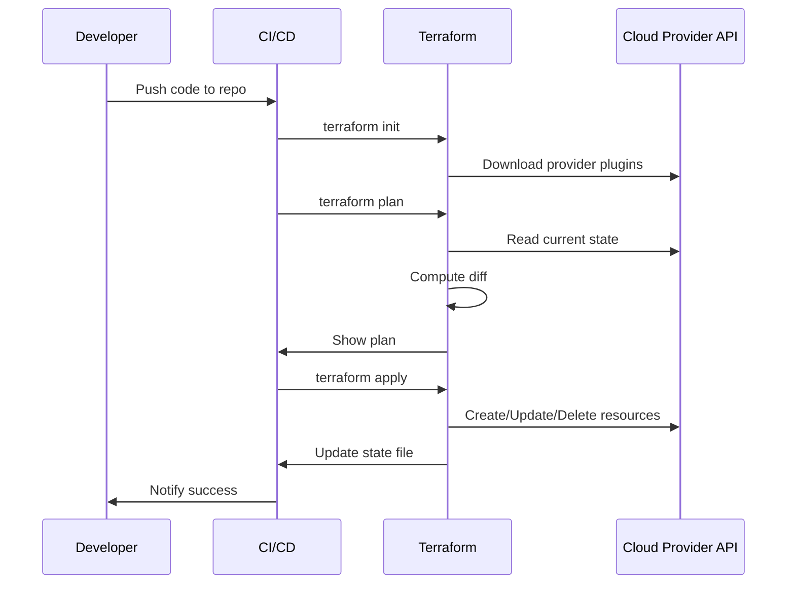

<!-- Generated by Groq via GitHub Actions -->
<!-- Topic ID: T197 -->
<!-- Category: DevOps / Infrastructure -->
<!-- Generated at UTC: 2026-11-10T20:32:23.366693+00:00 -->

# Terraform basics

## 1. What problem does this solve?

| What problem exists | Why it matters | Consequences of not using it | Real‑world appearance |
|---------------------|----------------|------------------------------|-----------------------|
| **Manual, ad‑hoc infrastructure provisioning** | Teams spend hours or days spinning up VMs, databases, networking, and then forget to document the exact configuration. | Inconsistent environments, “works on my machine” bugs, hard‑to‑reproduce failures. | Deploying a new microservice often requires a DevOps engineer to run a shell script that creates an EC2 instance, a security group, an RDS database, and a load balancer. |
| **Lack of version control for infrastructure** | Without code, you can’t track changes, roll back, or audit who changed what. | No audit trail, accidental destructive changes, compliance violations. | A production database is accidentally dropped because the DBA ran an `aws rds delete-db-instance` command without a rollback plan. |
| **Difficulty scaling teams** | When multiple developers need to provision the same resources, coordination is required to avoid clashes. | Resource conflicts, duplicated resources, wasted cost. | Two developers create overlapping VPCs in the same account, leading to IP conflicts. |
| **Hard to test and validate changes** | Without a declarative plan, you can’t see the impact before applying. | Unexpected downtime, security holes, cost overruns. | A new load balancer configuration is applied and immediately causes a 503 error. |

Terraform solves these by providing **Infrastructure as Code (IaC)**: a declarative, version‑controlled, reproducible way to describe and manage cloud resources.

---

## 2. Mental model

### Analogy  
Think of Terraform as a **blueprint for a house**.  
- **Blueprint** (Terraform configuration) tells the builder *what* the house should look like: rooms, doors, plumbing, wiring.  
- The **builder** (Terraform engine) reads the blueprint, compares it to the current state of the house, and decides what to build, modify, or tear down.  
- The **finished house** (deployed infrastructure) matches the blueprint exactly, unless someone changes the blueprint later.

### Precise engineering model  
- **Declarative**: You declare *desired* state (`resource "aws_instance" "web" { ... }`).  
- **Provider**: A plugin that knows how to translate your declarations into API calls to a cloud (AWS, GCP, Azure, etc.).  
- **State**: A snapshot of the current infrastructure that Terraform keeps to know what changes are needed.  
- **Plan**: Terraform computes a diff between desired state and current state, producing a plan of actions.  
- **Apply**: Terraform executes the plan, making API calls to create/update/delete resources.

---

## 3. Deep explanation

### Internals
- **Provider plugins**: Each cloud provider has a plugin that implements the Terraform Provider SDK.  
- **Resource schema**: Defines the attributes a resource accepts and how they map to API calls.  
- **Dependency graph**: Terraform builds a graph of resources to determine creation order.  
- **State file** (`terraform.tfstate`): JSON file storing resource IDs, attributes, and provider metadata.  
- **Remote state**: State can be stored in S3, Azure Blob, GCS, or Terraform Cloud for collaboration.  
- **Modules**: Reusable, composable units of configuration.  
- **Workspaces**: Separate state files for different environments (dev, prod).

### Important terminology
| Term | Meaning |
|------|---------|
| **Resource** | A single infrastructure object (e.g., `aws_instance`). |
| **Provider** | Plugin that communicates with an API. |
| **Module** | A folder containing Terraform files that can be reused. |
| **State** | Current snapshot of infrastructure. |
| **Plan** | Diff between desired and current state. |
| **Apply** | Execution of the plan. |
| **Destroy** | Reverse of apply, deletes resources. |
| **Interpolation** | Expression syntax (`${var.foo}`) to reference variables. |
| **Lifecycle** | Meta‑argument controlling create/update/delete behavior. |

### Trade‑offs
| Benefit | Trade‑off |
|---------|-----------|
| **Idempotence** | Requires careful state management; state corruption can break idempotence. |
| **Declarative** | Less control over step‑by‑step execution; sometimes you need imperative scripts. |
| **Provider coverage** | Not all services are supported; custom providers may be needed. |
| **State size** | Large state files can slow down `terraform plan`. |

### Failure modes
- **State drift**: Manual changes outside Terraform cause the state to diverge.  
- **Concurrent modifications**: Two teams apply changes simultaneously → race conditions.  
- **State corruption**: Corrupted state file leads to unpredictable behavior.  
- **Provider bugs**: Provider SDK bugs can cause incorrect API calls.  

### Limitations
- **Dynamic configuration**: Terraform is not ideal for highly dynamic, runtime‑generated resources.  
- **Secrets**: State files can contain sensitive data; must be encrypted and protected.  
- **Complexity**: Large monolithic configurations become hard to maintain; modules mitigate this.  

### Where it fits in a backend architecture
- **IaC layer**: Above the application code, below the cloud provider.  
- **CI/CD**: Terraform runs as part of pipelines (e.g., `terraform plan` on PR, `terraform apply` on merge).  
- **Observability**: State changes can be logged; Terraform Cloud provides run history.  
- **Security**: IAM roles for Terraform execution; secrets stored in Vault or SSM Parameter Store.

### Interaction with related concepts
- **CI/CD** → Terraform runs in pipelines.  
- **Secrets management** → Use environment variables or Vault.  
- **Infrastructure monitoring** → CloudWatch, Prometheus, etc., are created by Terraform.  
- **Cost management** → Terraform modules can enforce tags for cost allocation.

---

## 4. How it works



**Key steps**

1. **`terraform init`** – Downloads provider plugins and sets up backend.  
2. **`terraform plan`** – Reads the current state, builds dependency graph, and shows what changes will happen.  
3. **`terraform apply`** – Executes the plan, making API calls in the correct order.  
4. **State update** – After apply, Terraform writes the new state to local or remote backend.

---

## 5. Practical implementation

### 5.1. Terraform configuration (TypeScript‑friendly)

Create a folder `infra/` with the following files:

```hcl
# infra/main.tf
terraform {
  required_version = ">= 1.5"
  required_providers {
    aws = {
      source  = "hashicorp/aws"
      version = "~> 5.0"
    }
  }

  backend "s3" {
    bucket         = "my-terraform-state"
    key            = "prod/terraform.tfstate"
    region         = "us-east-1"
    dynamodb_table = "terraform-lock"
    encrypt        = true
  }
}

provider "aws" {
  region = var.aws_region
}

module "db" {
  source = "./modules/rds"
  db_name = "appdb"
  db_user = var.db_user
  db_pass = var.db_pass
}

output "db_endpoint" {
  value = module.db.endpoint
}
```

```hcl
# infra/variables.tf
variable "aws_region" {
  description = "AWS region"
  default     = "us-east-1"
}

variable "db_user" {
  description = "Database username"
}

variable "db_pass" {
  description = "Database password"
  sensitive   = true
}
```

```hcl
# infra/modules/rds/main.tf
resource "aws_db_instance" "postgres" {
  allocated_storage    = 20
  engine               = "postgres"
  engine_version       = "15.3"
  instance_class       = "db.t3.micro"
  name                 = var.db_name
  username             = var.db_user
  password             = var.db_pass
  skip_final_snapshot  = true
  publicly_accessible  = false
  vpc_security_group_ids = [aws_security_group.db.id]
}

resource "aws_security_group" "db" {
  name   = "${var.db_name}-sg"
  vpc_id = data.aws_vpc.default.id

  ingress {
    from_port   = 5432
    to_port     = 5432
    protocol    = "tcp"
    cidr_blocks = ["10.0.0.0/16"]
  }
}

output "endpoint" {
  value = aws_db_instance.postgres.endpoint
}
```

```hcl
# infra/modules/rds/variables.tf
variable "db_name" {}
variable "db_user" {}
variable "db_pass" {}
```

### 5.2. Node.js helper to run Terraform

```ts
// infra/run.ts
import { execSync } from 'child_process';
import { readFileSync } from 'fs';
import path from 'path';

const infraDir = path.resolve(__dirname);

function run(cmd: string) {
  console.log(`> ${cmd}`);
  execSync(cmd, { cwd: infraDir, stdio: 'inherit' });
}

function main() {
  // 1. Initialize
  run('terraform init');

  // 2. Plan
  run('terraform plan -out=tfplan');

  // 3. Apply
  run('terraform apply tfplan');
}

main();
```

> **Tip**: Store `db_pass` in an environment variable or use AWS Secrets Manager and reference it via `terraform.tfvars`.

---

## 6. Production considerations

| Concern | Recommendation |
|---------|----------------|
| **Scalability** | Use remote state (S3 + DynamoDB) to support multiple team members. |
| **Reliability** | Enable state locking (DynamoDB) to avoid concurrent apply races. |
| **Security** | Encrypt state, use IAM roles for Terraform, store secrets in Vault or SSM. |
| **Observability** | Use Terraform Cloud or Enterprise for run history, logs, and notifications. |
| **Performance** | Split large configurations into modules; use `terraform graph` to spot unnecessary dependencies. |
| **Error handling** | Wrap `terraform apply` in CI scripts that capture exit codes and send alerts. |
| **Resource usage** | Tag resources for cost allocation; enforce tagging via modules. |
| **Operational concerns** | Adopt version pinning for providers, lock Terraform version in CI. |
| **Failure recovery** | Keep backups of state; use `terraform state pull` and `terraform state push`. |
| **Deployment considerations** | Integrate with GitHub Actions or GitLab CI; use `terraform plan` as a PR check. |

---

## 7. Common mistakes

| Mistake | Why it’s problematic |
|---------|----------------------|
| Using **local state** in a team | Leads to state conflicts, lost changes, and accidental deletions. |
| Hard‑coding values instead of variables | Makes reuse hard and can leak secrets. |
| Ignoring provider version constraints | New provider releases can break your config. |
| Not using **workspaces** for env separation | Accidentally deploy dev resources to prod. |
| Running `terraform destroy` without review | Deletes all resources, causing downtime. |
| Storing secrets in plain text state | Exposes credentials if state is leaked. |
| Skipping `terraform plan` | You may apply unintended changes. |
| Not locking state (no DynamoDB table) | Concurrent applies can corrupt state. |

---

## 8. Senior engineer perspective

### What changes at scale

- **Governance**: Enforce module registry, version pinning, and policy‑as‑code (OPA, Sentinel).  
- **Multi‑team collaboration**: Use Terraform Cloud/Enterprise, workspaces, and remote state.  
- **Cost optimization**: Tagging, spot instances, reserved instances, and automated scaling.  
- **Security hardening**: IAM least‑privilege for Terraform, secrets vault integration, encryption at rest.  
- **Observability**: Export Terraform run logs to ELK/Prometheus; monitor drift.  
- **Automation**: CI/CD pipelines that run `plan` on PRs, auto‑apply on merge, and rollback on failure.  
- **Disaster recovery**: State backups, versioned state, and immutable infrastructure patterns.

### Design decisions

| Decision | Trade‑offs |
|----------|------------|
| **Use remote state + locking** | Adds latency but prevents corruption. |
| **Module boundaries** | Improves reuse but may hide complexity. |
| **Provider pinning** | Prevents breaking changes but requires maintenance. |
| **Automated drift detection** | Adds cost (monitoring) but ensures consistency. |
| **Immutable infra** | Reduces configuration drift but may increase deployment time. |

### When NOT to use Terraform

- **Highly dynamic, per‑request resources** (e.g., per‑user temporary containers) – use container orchestrators or serverless functions directly.  
- **Short‑lived, experimental prototypes** – a simple shell script may be faster.  
- **Legacy on‑prem environments** with no provider support – consider other IaC tools or manual ops.

---

## 9. Interview questions

1. **Beginner**: *What is the difference between `terraform plan` and `terraform apply`?*  
   *Answer*: `plan` shows a diff of what will change; `apply` actually executes the changes.

2. **Beginner**: *Why do we need a state file in Terraform?*  
   *Answer*: It records the current infrastructure so Terraform can compute diffs and know what to create/update/delete.

3. **Senior**: *Explain how Terraform handles resource dependencies and what happens if you delete a resource that others depend on.*  
   *Answer*: Terraform builds a dependency graph; deleting a resource that others depend on will either fail or cascade deletes based on the graph and lifecycle rules.

4. **Senior**: *Describe a strategy to manage secrets in Terraform without exposing them in the state file.*  
   *Answer*: Use environment variables, Vault, or SSM Parameter Store, and reference them via `data "aws_ssm_parameter"` or `terraform` `sensitive` variables; encrypt state and restrict access.

5. **Scenario/Debugging**: *You run `terraform apply` and it fails halfway, leaving some resources created and others not. How would you recover?*  
   *Answer*: Check the error, run `terraform plan` to see the current state, use `terraform apply` again to finish, or `terraform destroy` to clean up. Ensure state is not corrupted; if it is, restore from backup or use `terraform state` commands.

---

## 10. Hands‑on task

**Task**: Create a reusable Terraform module that provisions an **Amazon RDS PostgreSQL** instance with the following requirements:

1. Accepts `db_name`, `db_user`, `db_pass`, and `instance_class` as inputs.  
2. Creates a security group that allows inbound traffic only from a CIDR block passed as a variable.  
3. Outputs the endpoint, port, and database name.  
4. Deploy the module in a CI pipeline (GitHub Actions) that runs `terraform plan` on every PR and `terraform apply` on merge to `main`.  
5. Verify idempotency by running `terraform apply` twice and ensuring no changes on the second run.  
6. Store the state in an S3 bucket with DynamoDB locking.  

Document each step, including the GitHub Actions workflow file, and explain how you secured the `db_pass` variable.

---

## 11. Quick revision

- Terraform is **declarative IaC**: describe *desired* state, not imperative steps.  
- **Providers** translate config into API calls; each has its own schema.  
- **State** tracks current resources; remote state + locking is essential for teams.  
- **Plan** → **Apply**: always review the plan before applying.  
- **Modules** promote reuse; keep them small and versioned.  
- **Variables** vs. hard‑coded values; mark secrets as `sensitive`.  
- **Workspaces** separate environments; avoid accidental prod changes.  
- **Error handling**: use CI checks, capture exit codes, and rollback on failure.  
- **Security**: encrypt state, use IAM roles, store secrets in Vault/SSM.  
- **Observability**: Terraform Cloud run history, logs, and drift detection.  
- **Common pitfalls**: local state, missing locking, hard‑coded secrets, unpinned provider versions.

---

## 12. References

- Terraform Core Documentation: https://www.terraform.io/docs  
- Terraform Provider SDK: https://www.terraform.io/docs/plugin/sdk.html  
- AWS Provider Docs: https://registry.terraform.io/providers/hashicorp/aws/latest/docs  
- Terraform Cloud: https://www.terraform.io/cloud  
- Terraform State Management: https://www.terraform.io/docs/language/state/index.html  
- Terraform Modules: https://www.terraform.io/docs/language/modules/index.html  
- Terraform Workspaces: https://www.terraform.io/docs/language/state/workspaces.html  
- Terraform Remote State (S3 + DynamoDB): https://www.terraform.io/docs/language/settings/backends/s3.html  
- Terraform Best Practices: https://www.terraform.io/docs/language/best-practices/index.html  

---
