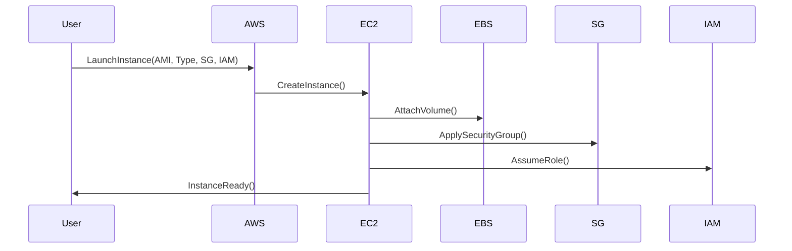

<!-- Generated by Groq via GitHub Actions -->
<!-- Topic ID: T198 -->
<!-- Category: Cloud Backend -->
<!-- Generated at UTC: 2026-11-10T20:32:23.366693+00:00 -->

# AWS EC2

## 1. What problem does this solve?

**Motivation**  
In modern cloud‑native stacks you often need a *compute* layer that can run arbitrary code, host a database, or serve a web application. While containers, serverless functions, and managed services cover many use cases, there are scenarios where you still need full control over the operating system, kernel, or custom networking.

**What problem exists?**  
- You need a virtual machine that behaves like a traditional server but lives in the cloud.  
- You want to run legacy binaries, custom kernel modules, or software that isn’t container‑friendly.  
- You need persistent storage that is tightly coupled to the VM (e.g., block‑level SSDs).  
- You require fine‑grained control over networking, security groups, or IAM roles that are not exposed by higher‑level services.

**Why the problem matters**  
Without a VM abstraction you would have to spin up physical hardware or rely on managed services that may not support your stack. This limits flexibility, can increase costs, and reduces control over performance tuning.

**What happens if this concept is not used?**  
- You might be forced to use containers or serverless, which could add overhead or limit access to low‑level features.  
- Legacy applications may fail to run or require costly refactoring.  
- You lose the ability to attach block storage or use custom AMIs.

**Where this concept appears in real backend systems**  
- Hosting a monolithic Node.js/Next.js app that needs a specific Node version.  
- Running a Python FastAPI service that requires a custom OpenSSL build.  
- Deploying a PostgreSQL cluster on EC2 instances for full control over tuning.  
- Running AI inference workloads that need GPU instances.

---

## 2. Mental model

**Simple analogy**  
Think of EC2 as a *virtual rental apartment* in a data‑center building.  
- The **apartment** (instance) gives you a private space with its own walls (network isolation).  
- You can choose the **furniture** (OS, runtime, libraries).  
- You control the **utilities** (CPU, memory, storage).  
- The building’s **security guard** (security groups, IAM roles) decides who can enter.

**Precise engineering model**  
- **Instance**: A virtual machine running a chosen AMI (Amazon Machine Image).  
- **Instance type**: Hardware configuration (vCPU, RAM, GPU, network performance).  
- **AMI**: Snapshot of OS + pre‑installed software.  
- **EBS volumes**: Persistent block storage attached to the instance.  
- **Security groups**: Virtual firewall rules.  
- **IAM role**: Permissions for the instance to call AWS APIs.  
- **Elastic IP / Public IP**: Network address for external access.  
- **User data**: Script that runs at boot for provisioning.

---

## 3. Deep explanation

### Internals
- **Hypervisor**: AWS uses Nitro Hypervisor, which offloads most VM functions to dedicated hardware, improving performance and security.  
- **Instance store**: Temporary local storage that disappears on stop/termination.  
- **EBS**: Network‑attached block storage; can be SSD (gp3, io1) or HDD (sc1, st1).  
- **Instance metadata service (IMDS)**: Provides instance‑specific data and temporary credentials.

### Important terminology
| Term | Meaning |
|------|---------|
| AMI | Amazon Machine Image – template for launching instances. |
| Instance type | Hardware profile (e.g., t3.micro, m5.large, g4dn.xlarge). |
| EBS | Elastic Block Store – persistent block storage. |
| Security group | Stateful virtual firewall. |
| IAM role | AWS credentials attached to an instance. |
| Elastic IP | Static public IP address. |
| Auto Scaling Group | Group of instances that can scale based on metrics. |
| Spot Instances | Discounted instances that can be interrupted. |
| Reserved Instances | Long‑term commitment for cost savings. |

### Trade‑offs
| Factor | EC2 | Alternatives |
|--------|-----|--------------|
| Control | Full OS control | Serverless: no OS control |
| Cost | Pay per hour | Serverless: pay per request |
| Performance | Near‑bare metal | Containers: slight overhead |
| Scalability | Manual or Auto Scaling | Fargate: managed scaling |
| Maintenance | You manage OS updates | Managed DB: AWS handles updates |

### Failure modes
- **Instance termination**: Data on instance store lost.  
- **EBS snapshot failure**: Corrupted snapshots can lead to data loss.  
- **Network ACL / SG misconfig**: Deny traffic or expose services.  
- **IAM role mis‑configuration**: Over‑privileged or under‑privileged access.  
- **Spot interruption**: Unexpected shutdowns; need graceful handling.

### Limitations
- **No built‑in autoscaling of CPU** – you must configure CloudWatch alarms and Auto Scaling policies.  
- **No serverless scaling** – scaling is at the instance level, not request level.  
- **Higher operational overhead** – patching, monitoring, backups.  
- **Cold start latency** – launching a new instance can take minutes.

### Where it fits in a backend architecture
- **Compute layer**: Runs application servers, background workers, or custom services.  
- **Database layer**: Host PostgreSQL, MongoDB, or Redis on EC2 for full control.  
- **AI inference**: GPU instances for ML models.  
- **Hybrid**: Combine EC2 with ECS/Fargate for containerized workloads.

### Interaction with related concepts
- **ECS/EKS**: EC2 instances can be worker nodes.  
- **RDS**: Managed database alternative; EC2 gives more control.  
- **S3**: Storage for static assets; EC2 can serve them via CloudFront.  
- **IAM**: Instance profiles grant permissions to access S3, DynamoDB, etc.  
- **VPC**: EC2 resides in a VPC; subnets, route tables, NAT gateways control traffic.

---

## 4. How it works

1. **Choose an AMI** – e.g., Amazon Linux 2, Ubuntu 22.04, or a custom image.  
2. **Select an instance type** – based on CPU, memory, GPU, network.  
3. **Configure storage** – attach EBS volumes; set mount points.  
4. **Set up security** – create security groups (allow SSH, HTTP, DB ports).  
5. **Assign IAM role** – e.g., `EC2S3Access` to read/write S3.  
6. **Launch instance** – via console, CLI, or SDK.  
7. **Provision** – run user‑data scripts or use configuration management (Ansible, Chef).  
8. **Expose services** – assign Elastic IP or use Application Load Balancer.  
9. **Monitor** – CloudWatch metrics, logs, alarms.  
10. **Scale** – add instances manually or via Auto Scaling Group.  



---

## 5. Practical implementation

### Example: Deploy a Node.js API on EC2

1. **Create a user‑data script** that installs Node, pulls code from GitHub, and starts the server.

```bash
#!/bin/bash
# user-data.sh
yum update -y
curl -sL https://rpm.nodesource.com/setup_20.x | bash -
yum install -y nodejs git
mkdir /home/ec2-user/app
cd /home/ec2-user/app
git clone https://github.com/yourorg/your-node-api.git .
npm ci
npm run build
# Start with PM2
npm install -g pm2
pm2 start dist/index.js --name api
pm2 startup systemd
pm2 save
```

2. **Launch instance via AWS CLI** (replace placeholders).

```bash
aws ec2 run-instances \
  --image-id ami-0c55b159cbfafe1f0 \
  --instance-type t3.medium \
  --key-name my-key \
  --security-group-ids sg-0abcd1234efgh5678 \
  --subnet-id subnet-0123456789abcdef0 \
  --iam-instance-profile Name=EC2S3Access \
  --user-data file://user-data.sh \
  --tag-specifications 'ResourceType=instance,Tags=[{Key=Name,Value=NodeAPI}]'
```

3. **Expose via Application Load Balancer** (ALB) – create target group pointing to the instance’s private IP, then attach to ALB listener on port 80/443.

4. **Configure health checks** – `/health` endpoint returning 200.

5. **Set up CloudWatch Logs** – install CloudWatch Agent to ship `/var/log/messages` and PM2 logs.

```bash
# Install CloudWatch Agent
yum install -y amazon-cloudwatch-agent
# Create config
cat > /opt/aws/amazon-cloudwatch-agent/etc/amazon-cloudwatch-agent.json <<EOF
{
  "logs": {
    "logs_collected": {
      "files": {
        "collect_list": [
          {
            "file_path": "/var/log/messages",
            "log_group_name": "/aws/ec2/nodeapi",
            "log_stream_name": "{instance_id}"
          },
          {
            "file_path": "/home/ec2-user/.pm2/pm2.log",
            "log_group_name": "/aws/ec2/nodeapi",
            "log_stream_name": "{instance_id}"
          }
        ]
      }
    }
  }
}
EOF
# Start agent
/opt/aws/amazon-cloudwatch-agent/bin/amazon-cloudwatch-agent-ctl -a fetch-config -m ec2 -c file:/opt/aws/amazon-cloudwatch-agent/etc/amazon-cloudwatch-agent.json -s
```

### Connecting to PostgreSQL on EC2

```ts
// db.ts
import { Pool } from 'pg';

const pool = new Pool({
  host: 'db.internal', // internal DNS
  port: 5432,
  user: process.env.PG_USER,
  password: process.env.PG_PASSWORD,
  database: process.env.PG_DB,
  ssl: { rejectUnauthorized: false } // if using self‑signed cert
});

export default pool;
```

Add security group rule to allow inbound traffic from the API instance’s security group on port 5432.

---

## 6. Production considerations

| Concern | How EC2 addresses it | Tips |
|---------|----------------------|------|
| **Scalability** | Auto Scaling Groups, Spot Fleet | Use CloudWatch alarms on CPU/Memory; mix on‑demand + spot. |
| **Reliability** | Multi‑AZ deployments, EBS snapshots | Enable EBS Multi‑AZ, schedule daily snapshots, use RDS for critical DBs. |
| **Security** | Security groups, IAM roles, VPC endpoints | Least‑privilege IAM, restrict SG to required ports, use VPC endpoints for S3. |
| **Observability** | CloudWatch metrics, logs, X-Ray | Instrument code, enable CloudWatch Agent, use X-Ray for tracing. |
| **Performance** | Instance type selection, EBS IOPS | Choose burstable vs dedicated; use gp3 with provisioned IOPS. |
| **Error handling** | Graceful shutdown hooks, retry logic | Handle SIGTERM to stop PM2 gracefully; use retry libraries. |
| **Resource usage** | Right‑size instances, spot usage | Monitor utilization; right‑size; use spot for non‑critical workloads. |
| **Operational concerns** | Patching, backups, monitoring | Use Systems Manager Patch Manager; automate backups. |
| **Failure recovery** | AMI snapshots, AMI rollbacks | Keep immutable AMIs; use immutable deployment pattern. |
| **Deployment considerations** | Blue/Green, immutable, canary | Use CodeDeploy or Terraform to deploy new AMIs. |

---

## 7. Common mistakes

| Mistake | Why it’s problematic |
|---------|----------------------|
| **Using instance store for DB data** | Data lost on stop/termination. |
| **Hard‑coding credentials in user‑data** | Credentials leaked; use IAM roles or Secrets Manager. |
| **Leaving SSH open to the world** | Security vulnerability. |
| **Ignoring EBS snapshot lifecycle** | Accumulated storage costs, potential data loss. |
| **Not using security groups for internal traffic** | Unnecessary exposure to the internet. |
| **Running unpatched OS** | Security holes. |
| **Over‑provisioning CPU** | Higher cost without performance benefit. |
| **Not using CloudWatch alarms** | Missed outages or performance degradation. |

---

## 8. Senior engineer perspective

### When used at scale
- **Design decisions**  
  - **Immutable infrastructure**: Build new AMIs for every release; avoid in‑place upgrades.  
  - **Infrastructure as Code**: Terraform or CloudFormation to version and audit changes.  
  - **Multi‑AZ**: Distribute instances across AZs for high availability.  
  - **Auto Scaling + Spot**: Combine on‑demand and spot to balance cost and reliability.  
  - **Service Mesh**: Use AWS App Mesh or Istio on EC2 for fine‑grained traffic control.

- **Trade‑offs**  
  - **Cost vs. control**: EC2 gives control but requires ops overhead.  
  - **Latency**: Bare‑metal performance vs. container overhead.  
  - **Operational complexity**: Patch management, scaling, monitoring.

- **Bottlenecks**  
  - **EBS IOPS**: Can throttle if not provisioned.  
  - **Network**: Outbound bandwidth limits on certain instance types.  
  - **CPU credits**: Burstable instances can be throttled.

- **Failure scenarios**  
  - **Instance termination**: Use Auto Scaling to replace.  
  - **EBS snapshot corruption**: Use multiple snapshots, test restores.  
  - **IAM mis‑configuration**: Implement least‑privilege and audit.

- **Monitoring**  
  - **Metrics**: CPU, memory, disk I/O, network.  
  - **Logs**: CloudWatch Logs, CloudTrail.  
  - **Tracing**: X-Ray for request flow.

- **Cost/performance**  
  - **Reserved Instances**: 1‑ or 3‑year commitments for steady workloads.  
  - **Savings Plans**: Flexible compute usage discounts.  
  - **Spot**: 70‑90% discount but may be interrupted.

- **When NOT to use EC2**  
  - **Highly dynamic, request‑level scaling**: Prefer Fargate or Lambda.  
  - **Managed database**: Use RDS or Aurora for PostgreSQL.  
  - **Stateless microservices**: Containers with ECS/EKS are easier to manage.  
  - **Short‑lived jobs**: Batch or Lambda.

---

## 9. Interview questions

1. **Beginner** – *What is an AMI and why is it important?*  
   *Answer:* An AMI is a template containing OS, software, and settings used to launch EC2 instances. It ensures consistent, repeatable deployments and can be versioned.

2. **Beginner** – *How do security groups differ from network ACLs?*  
   *Answer:* Security groups are stateful, applied per instance, and allow inbound/outbound rules. Network ACLs are stateless, applied per subnet, and require separate inbound/outbound rules.

3. **Senior** – *Explain how you would design an auto‑scaling group for a stateless Node.js API that must handle sudden traffic spikes while minimizing cost.*  
   *Answer:* Use a mix of on‑demand and spot instances, set scaling policies based on CPU/Memory thresholds, enable warm pools, use a target tracking policy, and configure health checks. Use a load balancer to distribute traffic.

4. **Senior** – *Describe a strategy to deploy a new version of an EC2‑based application without downtime.*  
   *Answer:* Immutable deployment: build a new AMI, launch a new ASG with the new AMI, run health checks, then shift traffic from the old ASG to the new one (blue/green). Use Route 53 or ALB to switch. Rollback if health checks fail.

5. **Scenario/Debugging** – *Your EC2 instance suddenly stops responding to HTTP requests, but the instance is still running. What steps would you take to diagnose and fix the issue?*  
   *Answer:*  
   - Check CloudWatch metrics: CPU, memory, network.  
   - SSH into instance; verify process is running (pm2 status).  
   - Inspect logs (pm2 logs, CloudWatch).  
   - Verify security group rules and network ACLs.  
   - Check for disk full (df -h).  
   - Look for recent updates or configuration changes.  
   - If stuck, restart the service or instance.  
   - If persistent, consider scaling or migrating to a new AMI.

---

## 10. Hands‑on task

**Task:**  
Create a simple “Hello, World!” Node.js API that runs on EC2, exposes `/hello`, and logs requests to CloudWatch Logs.

**Steps:**

1. Write `index.ts` that starts an Express server.  
2. Build Docker image and push to ECR (optional).  
3. Create a user‑data script that installs Node, pulls the repo, installs dependencies, and starts the server with PM2.  
4. Launch an EC2 instance (t3.micro) with the script.  
5. Verify the endpoint is reachable.  
6. Check CloudWatch Logs for request entries.  
7. (Optional) Add an Auto Scaling Group and observe scaling.

---

## 11. Quick revision

- EC2 = virtual machine in AWS; gives full OS control.  
- **AMI**: template for launching instances.  
- **Instance type**: hardware profile (vCPU, RAM, GPU).  
- **EBS**: persistent block storage; attach to instances.  
- **Security groups**: stateful firewall per instance.  
- **IAM role**: permissions for instance to call AWS APIs.  
- **User data**: script that runs on first boot for provisioning.  
- **Auto Scaling Group**: manages scaling based on metrics.  
- **Spot Instances**: discounted, interruptible compute.  
- **Reserved Instances**: long‑term cost savings.  
- **Immutable infra**: build new AMIs for every release.  
- **Monitoring**: CloudWatch metrics, logs, alarms.  
- **Common pitfalls**: leaving SSH open, using instance store for data, hard‑coding secrets.  

---

## 12. References

- https://docs.aws.amazon.com/AWSEC2/latest/UserGuide/what-is-amazon-ec2.html  
- https://docs.aws.amazon.com/AWSEC2/latest/UserGuide/instance-types.html  
- https://docs.aws.amazon.com/AWSEC2/latest/UserGuide/ebs-volumes.html  
- https://docs.aws.amazon.com/AWSEC2/latest/UserGuide/security-groups.html  
- https://docs.aws.amazon.com/AWSEC2/latest/UserGuide/iam-roles-for-amazon-ec2.html  
- https://docs.aws.amazon.com/AWSEC2/latest/UserGuide/user-data.html  
- https://docs.aws.amazon.com/autoscaling/ec2/userguide/what-is-amazon-ec2-auto-scaling.html  
- https://docs.aws.amazon.com/AWSEC2/latest/UserGuide/instance-resize.html  
- https://docs.aws.amazon.com/AWSEC2/latest/UserGuide/spot-instances.html  
- https://docs.aws.amazon.com/AWSEC2/latest/UserGuide/ReservedInstances.html  
- https://docs.aws.amazon.com/AmazonCloudWatch/latest/monitoring/WhatIsCloudWatch.html  
- https://docs.aws.amazon.com/AmazonCloudWatch/latest/logs/WhatIsCloudWatchLogs.html  
- https://docs.aws.amazon.com/AmazonCloudWatch/latest/monitoring/AlarmThatSendsEmail.html  
- https://docs.aws.amazon.com/AmazonCloudWatch/latest/monitoring/UsingCloudWatchLogs.html  
- https://docs.aws.amazon.com/AmazonCloudWatch/latest/monitoring/MonitoringEC2.html  
- https://docs.aws.amazon.com/AmazonCloudWatch/latest/monitoring/CloudWatch-Alarm-Examples.html  
- https://docs.aws.amazon.com/AmazonCloudWatch/latest/monitoring/UsingCloudWatchLogs.html  
- https://docs.aws.amazon.com/AmazonCloudWatch/latest/monitoring/CloudWatch-Alarm-Examples.html  

---
