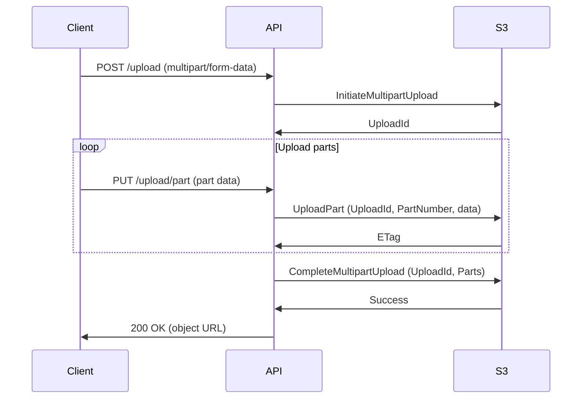

<!-- Generated by Groq via GitHub Actions -->
<!-- Topic ID: T199 -->
<!-- Category: Cloud Backend -->
<!-- Generated at UTC: 2026-11-11T07:55:04.129333+00:00 -->

# AWS S3

## 1. What problem does this solve?

| Problem | Why it matters | Consequence of not using S3 | Real‑world use |
|---------|----------------|-----------------------------|----------------|
| **Scalable object storage** | Applications need to store files (images, logs, backups) that grow beyond local disk or database limits. | Data loss, performance bottlenecks, hard‑to‑scale infrastructure. | User uploads, media libraries, data lake ingestion. |
| **Durability & availability** | 99.999999999 % durability guarantees that data survives hardware failures. | Frequent backups, manual replication, higher MTTR. | Static assets for websites, ML model artifacts. |
| **Global distribution** | Low‑latency access from anywhere via edge locations. | High latency, poor UX, need for custom CDN. | CDN‑backed static sites, multi‑region backups. |
| **Fine‑grained access control** | Need to expose files to specific users or services without exposing the entire bucket. | Security breaches, accidental data leaks. | Public image galleries, signed URLs for private downloads. |
| **Cost‑effective storage tiers** | Different data access patterns (hot, infrequent, archival). | Paying for hot storage for rarely accessed data. | Log retention, compliance archives. |

In a typical backend, S3 is the “file system” that lives outside the database, providing a durable, scalable, and cost‑effective place to keep blobs while the application logic lives in Node.js/Next.js, FastAPI, or other services.

---

## 2. Mental model

### Analogy
Think of S3 as a **cloud‑based warehouse**:

- **Buckets** are storage rooms.
- **Objects** are items in the warehouse, each with a unique key (like a SKU).
- **IAM policies** are the warehouse’s security guards and access cards.
- **Pre‑signed URLs** are temporary keys that let a customer walk in and pick an item without needing a full employee badge.

### Engineering model
- **Object** = immutable byte stream with metadata.
- **Key** = unique identifier within a bucket (no hierarchy, but prefixes can simulate folders).
- **Bucket** = namespace + region + lifecycle rules.
- **API** = RESTful endpoints (`PUT`, `GET`, `DELETE`, `HEAD`) plus SDK wrappers.
- **Consistency** = read‑after‑write for new objects; eventual consistency for overwrite/delete.

---

## 3. Deep explanation

### Internals
- **S3 stores objects in a distributed key‑value store** backed by SSDs across multiple AZs.
- **Multipart upload** splits large objects into parts, uploaded in parallel, then assembled atomically.
- **Versioning** keeps a history of object changes; each version has a unique `VersionId`.
- **Lifecycle rules** move objects between storage classes (Standard → IA → Glacier) automatically.

### Important terminology
| Term | Meaning |
|------|---------|
| **Bucket** | Namespace for objects, region‑specific. |
| **Object key** | Full path string; e.g., `images/2024/01/photo.png`. |
| **Storage class** | Cost/performance tier (Standard, IA, One Zone‑IA, Glacier, Deep Archive). |
| **ACL** | Access Control List; legacy per‑object permissions. |
| **Bucket policy** | JSON policy attached to a bucket, controlling access. |
| **Pre‑signed URL** | URL with embedded credentials, valid for a limited time. |
| **Event notifications** | S3 can trigger Lambda, SNS, SQS on object events. |

### Trade‑offs
| Feature | Pros | Cons |
|---------|------|------|
| **Multipart upload** | Faster for large files, resumable. | Extra API calls, complexity. |
| **Versioning** | Recover accidental deletes. | Extra storage cost, potential confusion. |
| **Lifecycle transitions** | Cost savings. | Transition latency (e.g., Glacier retrieval can take hours). |
| **Object locking** | Regulatory compliance. | Requires additional configuration, cannot be disabled. |

### Failure modes
- **Throttling**: Too many requests → 503/429. Mitigate with exponential backoff.
- **Eventual consistency**: Overwrites may not be immediately visible. Use `HEAD` to confirm.
- **Network partitions**: Client retries; S3 guarantees idempotent `PUT`/`GET`.
- **Bucket policy mis‑config**: Over‑permissive policies expose data.

### Limitations
- **Object size**: Max 5 TB per object; single‑part upload limited to 5 GB.
- **No server‑side encryption key rotation** (unless using SSE‑KMS).
- **No native relational features** (e.g., joins, transactions).
- **No built‑in CDN** (requires CloudFront).

### Where it fits
- **Static asset hosting**: Next.js `next/image` can serve from S3 via CloudFront.
- **File uploads**: FastAPI endpoint streams to S3 using `multipart/form-data`.
- **Data lake**: PostgreSQL or MongoDB writes metadata; S3 stores raw blobs.
- **Event‑driven pipelines**: S3 events trigger Lambda for transcoding or indexing.

### Interaction with related concepts
- **IAM**: Fine‑grained permissions for SDK clients.
- **CloudFront**: Edge caching, signed URLs for private content.
- **Lambda**: Serverless processing of uploaded files.
- **Kinesis / Kafka**: S3 can be a sink for streaming data.
- **Redis**: Cache pre‑signed URLs or metadata for quick lookup.

---

## 4. How it works



**Key steps**

1. **Initiate multipart upload** – get an `UploadId`.
2. **Upload parts** – each part can be parallelized; each returns an `ETag`.
3. **Complete upload** – S3 assembles parts atomically.
4. **Generate pre‑signed URL** – optional, for client‑direct uploads.

---

## 5. Practical implementation

### Node.js / TypeScript example – uploading a file with multipart support

```ts
import { S3Client, CreateMultipartUploadCommand, UploadPartCommand, CompleteMultipartUploadCommand } from "@aws-sdk/client-s3";
import fs from "fs";
import path from "path";

const s3 = new S3Client({ region: "us-east-1" });

async function uploadFile(filePath: string, bucket: string, key: string) {
  const fileSize = fs.statSync(filePath).size;
  const partSize = 5 * 1024 * 1024; // 5 MB
  const parts = Math.ceil(fileSize / partSize);

  // 1️⃣ Initiate
  const init = await s3.send(new CreateMultipartUploadCommand({
    Bucket: bucket,
    Key: key,
  }));
  const uploadId = init.UploadId!;

  const partETags: { PartNumber: number; ETag: string }[] = [];

  // 2️⃣ Upload parts
  for (let i = 0; i < parts; i++) {
    const start = i * partSize;
    const end = Math.min(start + partSize, fileSize);
    const buffer = Buffer.alloc(end - start);
    const fd = fs.openSync(filePath, "r");
    fs.readSync(fd, buffer, 0, buffer.length, start);
    fs.closeSync(fd);

    const part = await s3.send(new UploadPartCommand({
      Bucket: bucket,
      Key: key,
      UploadId: uploadId,
      PartNumber: i + 1,
      Body: buffer,
    }));
    partETags.push({ PartNumber: i + 1, ETag: part.ETag! });
  }

  // 3️⃣ Complete
  await s3.send(new CompleteMultipartUploadCommand({
    Bucket: bucket,
    Key: key,
    UploadId: uploadId,
    MultipartUpload: { Parts: partETags },
  }));

  console.log(`Uploaded ${key} to ${bucket}`);
}

// Usage
uploadFile(path.join(__dirname, "large-video.mp4"), "my-bucket", "videos/2024/large-video.mp4");
```

**Key points**

- `UploadPart` can be parallelized (e.g., using `Promise.all`).
- `ETag` is required for `CompleteMultipartUpload`.
- Handle `AbortMultipartUpload` on error to avoid orphaned parts.

### Generating a pre‑signed URL (client‑direct upload)

```ts
import { S3Client, PutObjectCommand, GetObjectCommand } from "@aws-sdk/client-s3";
import { getSignedUrl } from "@aws-sdk/s3-request-presigner";

const s3 = new S3Client({ region: "us-east-1" });

async function getUploadUrl(bucket: string, key: string, expiresIn = 3600) {
  const command = new PutObjectCommand({ Bucket: bucket, Key: key });
  return await getSignedUrl(s3, command, { expiresIn });
}

async function getDownloadUrl(bucket: string, key: string, expiresIn = 3600) {
  const command = new GetObjectCommand({ Bucket: bucket, Key: key });
  return await getSignedUrl(s3, command, { expiresIn });
}
```

> **Tip**: For large uploads, consider using the **S3 multipart upload** pre‑signed URLs (one per part) to let the client stream directly to S3 without passing through your server.

---

## 6. Production considerations

| Concern | Best practice |
|---------|---------------|
| **Scalability** | Use multipart upload for >100 MB files; enable **S3 Transfer Acceleration** for global uploads. |
| **Reliability** | Enable **S3 Versioning**; set up **Cross‑Region Replication (CRR)** for disaster recovery. |
| **Security** | - Use **IAM roles** with least privilege.<br>- Enable **Server‑Side Encryption (SSE‑S3 or SSE‑KMS).<br>- Use **Bucket Policies** to restrict access.<br>- Generate **pre‑signed URLs** instead of public buckets. |
| **Observability** | - Enable **CloudWatch metrics** (`AllRequests`, `BucketSizeBytes`).<br>- Log **S3 access logs** to CloudTrail or S3. |
| **Performance** | - Use **CloudFront** for caching static assets.<br>- Set **Cache-Control** headers on objects.<br>- Use **Multipart upload** for large files. |
| **Error handling** | - Implement **exponential backoff** and **retry** logic.<br>- Catch `NoSuchKey`, `AccessDenied`, `ThrottlingException`. |
| **Resource usage** | - Monitor **storage cost** per class.<br>- Use **Lifecycle policies** to transition to IA/Glacier. |
| **Operational concerns** | - Automate bucket creation with IaC (Terraform, CDK).<br>- Use **IAM roles** for Lambda/S3 interactions. |
| **Failure recovery** | - Keep **object versioning** enabled.<br>- Use **S3 Object Lock** for regulatory retention. |
| **Deployment** | - Use **S3 static website hosting** for front‑end assets.<br>- Deploy **Lambda@Edge** for custom logic. |

---

## 7. Common mistakes

| Mistake | Why it’s bad |
|---------|--------------|
| **Leaving buckets public** | Exposes all objects to the internet; data breach. |
| **Using ACLs instead of bucket policies** | ACLs are legacy, harder to audit, and can be overridden by bucket policies. |
| **Uploading huge files in a single request** | Exceeds 5 GB limit; causes timeouts. |
| **Not handling eventual consistency** | Reading immediately after overwrite may return stale data. |
| **Hard‑coding credentials** | Security risk; credentials can be leaked. |
| **Ignoring multipart upload for large files** | Slower uploads, higher failure probability. |
| **Not setting lifecycle rules** | Accumulating expensive Standard storage for infrequently accessed data. |
| **Using presigned URLs without expiration** | Unlimited access window; potential abuse. |

---

## 8. Senior engineer perspective

### Architecture decisions
- **Bucket per environment** (dev, staging, prod) vs. single bucket with prefixes.
- **Region selection**: proximity to primary compute, compliance requirements.
- **Cross‑Region Replication**: trade‑off between cost and DR latency.
- **Object Lock**: mandatory for certain regulated workloads.

### Trade‑offs
- **Standard vs. IA**: IA saves cost but adds 1‑2 hour retrieval latency for cold data.
- **SSE‑S3 vs. SSE‑KMS**: SSE‑KMS gives key rotation and audit logs but adds KMS API latency and cost.
- **Multipart vs. single‑part**: Multipart is more resilient but requires more API calls.

### Bottlenecks
- **Upload throughput**: limited by network bandwidth and S3 request rate (5 000 requests/sec per bucket).
- **Lambda concurrency**: if Lambda processes S3 events, consider reserved concurrency to avoid throttling.

### Failure scenarios
- **S3 outage**: Use **CRR** to a secondary region; fallback to local cache.
- **Throttling**: Implement request throttling and backoff; consider **S3 Transfer Acceleration** for high‑latency clients.

### Monitoring
- **Metrics**: `AllRequests`, `GetObject`, `PutObject`, `MultipartUpload`.
- **Alarms**: high `Error` rate, low `BucketSizeBytes` (possible data loss).
- **Logs**: Enable **S3 access logs** for forensic analysis.

### Cost/performance
- **Storage class selection**: Use **Analytics** to identify infrequently accessed objects.
- **Data transfer**: Use **CloudFront** to reduce egress costs.
- **Lifecycle**: Automate transitions to Glacier for archival.

### When NOT to use S3
- **Real‑time streaming**: S3 is not a streaming store; use Kinesis or Kafka.
- **Transactional data**: Use a database; S3 lacks ACID guarantees.
- **Low‑latency, high‑frequency writes**: S3 has higher latency than DynamoDB or Redis.

---

## 9. Interview questions

1. **Beginner** – *What is the difference between an S3 bucket and an object?*  
   *Answer:* A bucket is a namespace that holds objects; an object is a file (byte stream) stored in a bucket, identified by a unique key.

2. **Beginner** – *How do you generate a pre‑signed URL in Node.js?*  
   *Answer:* Use `@aws-sdk/s3-request-presigner`’s `getSignedUrl` with a `PutObjectCommand` or `GetObjectCommand`, specifying `expiresIn`.

3. **Senior** – *Explain how S3’s eventual consistency model affects application design.*  
   *Answer:* After a `PUT` or `DELETE`, the new state may not be immediately visible. Applications should use `HEAD` or `GET` with retries, or rely on S3 events for confirmation.

4. **Senior** – *What are the trade‑offs between SSE‑S3 and SSE‑KMS?*  
   *Answer:* SSE‑S3 is simpler and cheaper but offers no key rotation or audit logs. SSE‑KMS gives fine‑grained control, key rotation, and CloudTrail logging at the cost of KMS API latency and per‑request charges.

5. **Scenario/Debugging** – *Your application uploads large files to S3 but occasionally fails with “Request timeout” errors. What could be causing this and how would you fix it?*  
   *Answer:* Likely due to network throttling or insufficient multipart concurrency. Fix by increasing `partSize`/`concurrency`, implementing exponential backoff, or enabling Transfer Acceleration.

---

## 10. Hands‑on task

**Task:** Build a simple Next.js API route (`/api/upload`) that accepts a multipart file upload and streams it directly to S3 using multipart upload. The route should return a pre‑signed URL for the client to download the file.

**Steps**

1. Create a Next.js API route in `pages/api/upload.ts`.
2. Use `formidable` to parse the incoming multipart form.
3. Initiate a multipart upload with S3.
4. Stream each part to S3 as it arrives.
5. Complete the upload and generate a pre‑signed GET URL.
6. Return the URL in the JSON response.

**Bonus:** Add a `GET /api/download?key=...` route that returns a pre‑signed URL for downloading.

---

## 11. Quick revision

- S3 stores **immutable objects** in **buckets**; keys act like file paths.
- **Multipart upload** is required for >5 GB; improves speed and reliability.
- **Pre‑signed URLs** grant temporary, fine‑grained access without exposing IAM credentials.
- **Versioning** protects against accidental deletes; **Lifecycle rules** manage cost.
- **SSE‑S3** vs. **SSE‑KMS**: trade‑off between simplicity and key management.
- **Eventual consistency**: read-after-write may be stale; use `HEAD` or events.
- **Security**: least‑privilege IAM roles, bucket policies, encryption, and signed URLs.
- **Observability**: CloudWatch metrics, access logs, and CloudTrail.
- **Performance**: CloudFront caching, proper `Cache-Control`, and multipart uploads.
- **Failure handling**: exponential backoff, retries, and abort multipart on error.

---

## 12. References

- https://docs.aws.amazon.com/AmazonS3/latest/userguide/Welcome.html  
- https://docs.aws.amazon.com/AmazonS3/latest/API/Welcome.html  
- https://docs.aws.amazon.com/AmazonS3/latest/userguide/UsingMetadata.html  
- https://docs.aws.amazon.com/AmazonS3/latest/userguide/UsingBucketPolicies.html  
- https://docs.aws.amazon.com/AmazonS3/latest/userguide/UsingPresignedURLs.html  
- https://docs.aws.amazon.com/AmazonS3/latest/userguide/MultipartUpload.html  
- https://docs.aws.amazon.com/AmazonS3/latest/userguide/Versioning.html  
- https://docs.aws.amazon.com/AmazonS3/latest/userguide/StorageClasses.html  
- https://docs.aws.amazon.com/AmazonS3/latest/userguide/UsingObjectLock.html  
- https://docs.aws.amazon.com/AmazonS3/latest/userguide/TransferAcceleration.html
