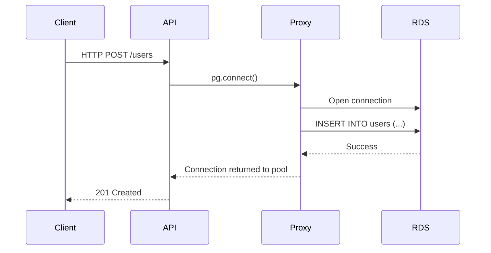

<!-- Generated by Groq via GitHub Actions -->
<!-- Topic ID: T200 -->
<!-- Category: Cloud Backend -->
<!-- Generated at UTC: 2026-11-11T07:55:04.129333+00:00 -->

# AWS RDS

## 1. What problem does this solve?

| Problem | Why it matters | Consequence of not using RDS | Real‑world use |
|---------|----------------|------------------------------|----------------|
| **Database as a service** | Managing a database (install, patch, backup, scaling) is operationally heavy. | You must run your own EC2 instance, handle OS updates, storage, backups, and failover. | Large SaaS platforms (e.g., Stripe, Shopify) need a reliable DB layer without a DBA team. |
| **High availability & durability** | Applications must stay online even if a node or AZ fails. | Downtime leads to lost revenue, bad UX, and SLA violations. | E‑commerce checkout, financial transactions. |
| **Scalable storage & compute** | Workloads grow; you need more IOPS or memory. | Manual resizing is error‑prone and can cause outages. | Analytics dashboards, real‑time analytics. |
| **Security & compliance** | Sensitive data must be encrypted, access controlled, and auditable. | Data breaches, non‑compliance penalties. | Healthcare, finance, GDPR‑protected data. |
| **Observability** | Need metrics, logs, and alerts for performance and health. | Hard to debug, hard to meet SLAs. | Mission‑critical services (e.g., payment gateways). |

In a typical backend, RDS sits behind your API servers, providing a managed PostgreSQL/MySQL/Oracle/MariaDB/SQL Server instance that can be scaled, patched, and backed up automatically.

---

## 2. Mental model

**Analogy – “The Database as a Cloud‑Hosted Kitchen”**

- **Chef (your application)**: prepares dishes (queries).
- **Kitchen (RDS)**: has all the appliances (storage, CPU, memory) and staff (DB engine) ready to cook.
- **Chef doesn’t need to own the kitchen**: no need to buy ovens, hire cooks, or clean up. The kitchen provider (AWS) handles it.
- **You can add more ovens (read replicas) or switch to a faster kitchen (Aurora) when demand grows.**

**Engineering model**

```
Client → API Server → RDS Proxy (optional) → RDS Instance
```

- **RDS Instance**: fully managed DB engine (PostgreSQL, MySQL, etc.).
- **RDS Proxy**: connection pooler that reduces the number of open DB connections, improves failover handling, and supports IAM auth.
- **API Server**: Node.js/Next.js or FastAPI that talks to the DB via a driver (pg, mysql2, etc.).

---

## 3. Deep explanation

### Internals

| Component | What it does |
|-----------|--------------|
| **DB Engine** | PostgreSQL, MySQL, MariaDB, Oracle, SQL Server, or Aurora (a MySQL/PostgreSQL‑compatible engine). |
| **Storage** | Managed SSD or magnetic storage, automatically replicated within an AZ. |
| **Compute** | EC2‑based instances (db.t3, db.m5, etc.) that host the DB engine. |
| **Parameter Group** | Set of engine‑specific configuration parameters. |
| **Security Group** | Network ACLs controlling inbound/outbound traffic. |
| **IAM Auth** | Optional authentication via AWS IAM roles. |
| **Snapshots** | Point‑in‑time backups stored in S3. |
| **Multi‑AZ** | Synchronous replication to a standby in another AZ for HA. |
| **Read Replicas** | Asynchronous replicas for read scaling. |
| **RDS Proxy** | Connection pooling, IAM auth, failover handling. |

### Important terminology

- **DB Instance** – the running database server.
- **DB Cluster** – a set of DB instances (primary + replicas) in Aurora.
- **Engine Version** – specific version of PostgreSQL/MySQL, etc.
- **Parameter Group** – configuration knobs (e.g., `max_connections`).
- **Snapshot** – backup image.
- **Multi‑AZ** – HA deployment.
- **Read Replica** – read‑only copy.
- **RDS Proxy** – managed connection pooler.

### Trade‑offs

| Feature | Pros | Cons |
|---------|------|------|
| **Multi‑AZ** | Automatic failover, high durability | Extra cost (standby instance), write latency |
| **Read Replicas** | Scale reads, reduce primary load | Replication lag, not for writes |
| **Aurora** | 5× performance, 15× storage efficiency | Vendor lock‑in, limited engine features |
| **RDS Proxy** | Fewer DB connections, IAM auth | Adds latency (~1–2 ms), extra cost |
| **Self‑managed DB on EC2** | Full control, custom extensions | Operational burden, no automatic backups |

### Failure modes

- **Instance failure** – Multi‑AZ automatically promotes standby.
- **AZ outage** – Multi‑AZ protects, but read replicas in same AZ fail.
- **Network partition** – Connection poolers help, but app may retry.
- **Parameter mis‑config** – e.g., `max_connections` too low → connection errors.
- **Snapshot corruption** – Rare, but can be mitigated with cross‑region snapshots.

### Limitations

- **Limited OS access** – cannot install custom binaries on the DB host.
- **Parameter restrictions** – some engine parameters are immutable.
- **Vendor lock‑in** – migrations to other cloud providers can be costly.
- **No sharding** – horizontal scaling requires manual sharding or Aurora Global DB.

### Where it fits

- **Microservice**: Each service owns its own RDS instance or cluster.
- **Monolith**: Single RDS instance shared across services (requires careful connection pooling).
- **Event‑driven**: RDS can be the source for change‑data capture (CDC) via AWS DMS or native logical replication.

### Interaction with related concepts

- **Caching (Redis)**: Cache hot data to reduce DB load.
- **Message queues (Kafka, SQS)**: Decouple writes from reads, use CDC for eventual consistency.
- **CI/CD**: Automate schema migrations (Flyway, Liquibase) against RDS.
- **Observability**: CloudWatch metrics (`CPUUtilization`, `FreeStorageSpace`, `ReadIOPS`, `WriteIOPS`), Enhanced Monitoring, RDS Performance Insights.

---

## 4. How it works



**Step‑by‑step flow**

1. **Client** sends an HTTP request to the API server.
2. **API server** obtains a connection from the pool (or RDS Proxy).
3. **Query** is executed against the RDS instance.
4. **RDS** processes the query, writes to disk, updates WAL, returns result.
5. **Connection** is returned to the pool for reuse.
6. **API** sends HTTP response back to the client.

---

## 5. Practical implementation

### 5.1. Setup

1. Create a PostgreSQL RDS instance (or Aurora PostgreSQL) in the AWS console.
2. Note the **endpoint**, **port**, **username**, **password**.
3. Add the instance’s security group to allow inbound traffic from your API server’s security group or IP.

### 5.2. Node.js example (TypeScript)

```ts
// src/db.ts
import { Pool } from 'pg';
import dotenv from 'dotenv';

dotenv.config(); // Loads .env

// Connection pool – 10 max connections, 30s idle timeout
export const pool = new Pool({
  host: process.env.RDS_HOST,
  port: Number(process.env.RDS_PORT) || 5432,
  database: process.env.RDS_DB,
  user: process.env.RDS_USER,
  password: process.env.RDS_PASSWORD,
  max: 10,
  idleTimeoutMillis: 30000,
  connectionTimeoutMillis: 2000,
});
```

```ts
// src/server.ts
import express from 'express';
import { pool } from './db';

const app = express();
app.use(express.json());

app.post('/users', async (req, res) => {
  const { name, email } = req.body;
  try {
    const result = await pool.query(
      'INSERT INTO users (name, email) VALUES ($1, $2) RETURNING id',
      [name, email]
    );
    res.status(201).json({ id: result.rows[0].id });
  } catch (err) {
    console.error('DB error', err);
    res.status(500).json({ error: 'Internal server error' });
  }
});

app.listen(3000, () => console.log('API listening on :3000'));
```

```dotenv
# .env
RDS_HOST=your-db-instance.xxxxx.us-east-1.rds.amazonaws.com
RDS_PORT=5432
RDS_DB=appdb
RDS_USER=admin
RDS_PASSWORD=SuperSecretPassword
```

> **Tip**: In production, use **IAM authentication** or **RDS Proxy** instead of plain passwords.

### 5.3. Using RDS Proxy

```ts
// src/db-proxy.ts
import { Pool } from 'pg';
import dotenv from 'dotenv';

dotenv.config();

export const pool = new Pool({
  host: process.env.RDS_PROXY_ENDPOINT,
  port: Number(process.env.RDS_PROXY_PORT) || 5432,
  database: process.env.RDS_DB,
  user: process.env.RDS_USER,
  password: process.env.RDS_PASSWORD, // or use IAM auth
  max: 20,
  idleTimeoutMillis: 30000,
});
```

Add the proxy endpoint to your environment and update the security group to allow traffic from the proxy.

---

## 6. Production considerations

| Concern | How to address |
|---------|----------------|
| **Scalability** | Use read replicas for read‑heavy workloads; scale instance class; consider Aurora Serverless for bursty traffic. |
| **Reliability** | Enable Multi‑AZ; configure automated backups; set up CloudWatch alarms for `FreeStorageSpace`, `CPUUtilization`. |
| **Security** | Use IAM authentication; enable encryption at rest (KMS) and in transit (SSL); restrict security groups; rotate credentials. |
| **Observability** | Enable Enhanced Monitoring; use Performance Insights; log queries with `log_min_duration_statement`. |
| **Performance** | Tune `max_connections`, `shared_buffers`, `work_mem`; use connection pooling; monitor `ReadLatency`, `WriteLatency`. |
| **Error handling** | Retry logic with exponential backoff; catch `ECONNRESET` and `ETIMEDOUT`. |
| **Resource usage** | Right‑size instance class; monitor IOPS; use provisioned IOPS if needed. |
| **Operational concerns** | Automate patching via maintenance windows; use CloudFormation/Terraform for infra as code. |
| **Failure recovery** | Test failover by stopping the primary; verify read replica promotion; have a disaster‑recovery plan (cross‑region snapshots). |
| **Deployment** | Use blue/green deployments; keep schema migrations idempotent; run migrations in a separate job. |

---

## 7. Common mistakes

| Mistake | Why it’s problematic |
|---------|----------------------|
| **Hardcoding credentials** | Exposes secrets; cannot rotate; violates security best practices. |
| **No connection pooling** | Each request opens a new DB connection → exhaustion of `max_connections`, high latency. |
| **Ignoring parameter groups** | Default parameters may not suit your workload (e.g., `max_connections` too low). |
| **Using Multi‑AZ without read replicas** | Still limited by single write node; reads may bottleneck. |
| **Not enabling encryption** | Data at rest is vulnerable; non‑compliant with many regulations. |
| **Skipping automated backups** | Data loss risk; recovery time objective (RTO) suffers. |
| **Over‑provisioning storage** | Higher cost; under‑utilized resources. |
| **Not monitoring performance metrics** | Latency spikes go unnoticed; SLA violations. |
| **Using RDS for highly write‑heavy workloads without sharding** | Write bottleneck; consider Aurora or NoSQL. |

---

## 8. Senior engineer perspective

### Architecture decisions

- **Engine choice**: PostgreSQL vs MySQL vs Aurora vs DynamoDB – depends on query patterns, ACID needs, and existing skill set.
- **Instance class**: Compute‑optimized vs memory‑optimized; consider burstable `t3` for dev, `m5`/`r5` for prod.
- **Multi‑AZ vs Single‑AZ**: Cost vs availability; for critical services, always Multi‑AZ.
- **Read replicas**: Number, placement (AZ), and whether to use Aurora Global DB for multi‑region reads.
- **RDS Proxy**: When to enable (high connection churn, IAM auth).
- **Backup strategy**: Retention period, cross‑region snapshots, point‑in‑time recovery.
- **Security**: IAM auth, KMS keys, VPC endpoints, encryption, least‑privilege IAM roles.

### Trade‑offs & bottlenecks

- **Write latency**: Multi‑AZ adds ~1–2 ms latency; read replicas add replication lag.
- **Connection limits**: `max_connections` limits concurrent queries; pool size must be tuned.
- **Cost**: Multi‑AZ + read replicas + larger instance = higher hourly rate.
- **Vendor lock‑in**: RDS features (parameter groups, snapshots) are AWS‑specific.

### Failure scenarios

- **AZ outage**: Multi‑AZ promotes standby; read replicas in same AZ fail.
- **Database corruption**: Use `pg_dump` or automated snapshots; test restore.
- **Security breach**: Rotate credentials, audit logs, enable IAM auth.

### Monitoring & alerting

- CloudWatch metrics: `CPUUtilization`, `FreeStorageSpace`, `ReadIOPS`, `WriteIOPS`, `DatabaseConnections`.
- Performance Insights: query plans, wait events.
- RDS Events: instance state changes, failovers, backup completions.

### Cost/performance considerations

- **Right‑size**: Use `rdsutil` or `aws rds describe-db-instances` to monitor CPU/memory.
- **Reserved Instances**: 1‑yr or 3‑yr for predictable workloads.
- **Aurora Serverless**: Auto‑scales for bursty traffic; cheaper for low‑average usage.

### When NOT to use RDS

- **Extremely high write throughput** (tens of thousands TPS) → consider Aurora or NoSQL.
- **Custom extensions** not supported by RDS (e.g., PostGIS on Aurora may need custom build).
- **Need for OS-level customizations** → use self‑managed DB on EC2 or containerized DB.
- **Cross‑region replication needs** beyond read replicas → use Aurora Global DB or DMS.

---

## 9. Interview questions

| Level | Question | Answer points |
|-------|----------|---------------|
| Beginner | What is AWS RDS? | Managed relational database service; supports PostgreSQL, MySQL, MariaDB, Oracle, SQL Server, Aurora. |
| Beginner | How does Multi‑AZ improve availability? | Synchronous replication to standby in another AZ; automatic failover; no manual promotion. |
| Senior | How would you design a highly available, read‑scalable PostgreSQL deployment on AWS? | Use Multi‑AZ primary, read replicas, RDS Proxy, connection pooling, parameter tuning, monitoring. |
| Senior | Explain how you would handle schema migrations in a CI/CD pipeline for an RDS PostgreSQL database. | Use migration tools (Flyway, Liquibase), lock table or use `pg_migrate`, run migrations in a separate job, test on staging, versioned migrations, rollback strategy. |
| Scenario | Your RDS instance suddenly goes down during peak traffic. What steps do you take to recover and minimize downtime? | 1. Check CloudWatch alarms; 2. Verify Multi‑AZ promotion; 3. If failover not automatic, manually promote standby; 4. Update DNS or load balancer target; 5. Verify connections; 6. Run health checks; 7. Post‑mortem and adjust maintenance windows. |

---

## 10. Hands‑on task

**Task**: Build a small “User Service” that

1. Creates an RDS PostgreSQL instance (or uses an existing one).
2. Implements a REST API (`POST /users`, `GET /users/:id`) in Node.js/Express.
3. Uses a connection pool (`pg.Pool`) and RDS Proxy if available.
4. Stores a `users` table with `id`, `name`, `email`, `created_at`.
5. Adds a CloudWatch alarm for `FreeStorageSpace < 10%`.
6. Writes a simple test script (Jest) that creates a user and fetches it.

**Deliverables**:

- `src/` with `db.ts`, `server.ts`.
- `Dockerfile` to run the service locally (using `psql` container for dev).
- `terraform/` or `cloudformation/` snippet that creates the RDS instance and security group.
- `README.md` with instructions to run locally and deploy to AWS.

---

## 11. Quick revision

- RDS = managed relational DB (PostgreSQL, MySQL, etc.).
- Multi‑AZ = HA via synchronous standby; automatic failover.
- Read replicas = asynchronous read scaling.
- RDS Proxy = connection pooling + IAM auth.
- Parameter groups = engine configuration knobs.
- Snapshots = point‑in‑time backups; cross‑region snapshots for DR.
- Security: IAM auth, encryption at rest (KMS), SSL, VPC security groups.
- Observability: CloudWatch metrics, Enhanced Monitoring, Performance Insights.
- Connection pooling: essential to avoid `max_connections` exhaustion.
- Scaling: right‑size instance, add read replicas, consider Aurora.
- Failure recovery: test failover, have cross‑region snapshots.
- Common mistakes: hardcoded creds, no pooling, no monitoring, no backups.

---

## 12. References

- [AWS RDS Documentation](https://docs.aws.amazon.com/rds/index.html)
- [RDS Proxy Documentation](https://docs.aws.amazon.com/rds/proxy/)
- [RDS Multi‑AZ](https://docs.aws.amazon.com/AmazonRDS/latest/UserGuide/Concepts.MultiAZ.html)
- [RDS Read Replicas](https://docs.aws.amazon.com/AmazonRDS/latest/UserGuide/USER_ReadRepl.html)
- [RDS Parameter Groups](https://docs.aws.amazon.com/AmazonRDS/latest/UserGuide/USER_WorkingWithParamGroups.html)
- [RDS Performance Insights](https://docs.aws.amazon.com/AmazonRDS/latest/UserGuide/USER_PerfInsights.html)
- [PostgreSQL on RDS](https://docs.aws.amazon.com/AmazonRDS/latest/UserGuide/CHAP_PostgreSQL.html)
- [Aurora Serverless](https://docs.aws.amazon.com/AmazonRDS/latest/AuroraUserGuide/aurora-serverless.html)
- [AWS RDS Backup and Restore](https://docs.aws.amazon.com/AmazonRDS/latest/UserGuide/USER_WorkingWithAutomatedBackups.html)
