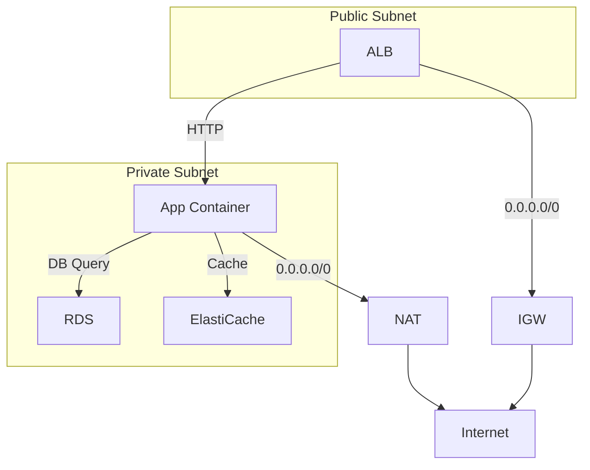

<!-- Generated by Groq via GitHub Actions -->
<!-- Topic ID: T201 -->
<!-- Category: Cloud Backend -->
<!-- Generated at UTC: 2026-11-12T08:33:12.035770+00:00 -->

# AWS VPC

## 1. What problem does this solve?

- **Isolation & Security**  
  In the cloud, many services share the same physical infrastructure. A VPC (Virtual Private Cloud) gives you a logically isolated network where you control IP ranges, subnets, routing, and access rules. Without it, your backend services would be exposed to the public internet or other tenants, increasing the attack surface.

- **Network Control**  
  You can decide which services talk to each other, how traffic flows, and whether it goes over the public internet or stays inside AWS. This is critical for compliance (PCI, HIPAA) and for protecting sensitive data like database credentials or AI model weights.

- **Hybrid & Multi‑Region Connectivity**  
  VPCs let you connect on‑premises data centers via VPN or Direct Connect, and inter‑region peering or Transit Gateway for multi‑region architectures. Without a VPC you cannot stitch together a global backend that spans multiple regions or on‑prem environments.

- **Impact of Not Using a VPC**  
  - All resources are reachable from the internet unless you manually restrict them, which is error‑prone.  
  - You lose fine‑grained control over routing, leading to higher latency and potential data leakage.  
  - Compliance audits will flag the lack of network segmentation.

- **Real‑world Appearance**  
  In a typical backend stack you’ll see:  
  - A VPC with public subnets for load balancers, private subnets for application servers, and isolated subnets for databases.  
  - Security groups acting as stateful firewalls.  
  - Route tables directing traffic between subnets and to the internet gateway.

---

## 2. Mental model

### Analogy  
Think of a VPC as a **private city** inside a larger country (AWS).  
- The **city limits** (CIDR block) define who can live there.  
- **Neighborhoods** (subnets) are zones for different purposes: residential (app servers), commercial (databases), industrial (batch jobs).  
- **Roads** (route tables) control how traffic moves between neighborhoods and to the outside world.  
- **Gatekeepers** (security groups and network ACLs) decide who can enter or leave each neighborhood.

### Precise Engineering Model  
- **VPC**: A virtual network with a CIDR block.  
- **Subnets**: Segments of the VPC CIDR, each in a single AZ.  
- **Route Tables**: Define how packets are forwarded.  
- **Internet Gateway (IGW)**: Provides internet access to public subnets.  
- **NAT Gateway/Instance**: Allows outbound internet traffic from private subnets.  
- **Security Groups**: Stateful, per‑resource firewall rules.  
- **Network ACLs**: Stateless, per‑subnet rules.  
- **Endpoints**: Private connections to AWS services (e.g., S3, DynamoDB) without traversing the public internet.

---

## 3. Deep explanation

### Internals
- **IP Addressing**: VPCs use IPv4 CIDR blocks (e.g., 10.0.0.0/16). Each subnet gets a non‑overlapping CIDR slice.  
- **Routing**: Each subnet is associated with a route table. The default route table routes `0.0.0.0/0` to the IGW (public) or to a NAT (private).  
- **DHCP Options**: Provide DNS servers, domain name, and NTP.  
- **Peering & Transit Gateway**: Connect VPCs across accounts or regions.  
- **Endpoints**: Interface or gateway endpoints for AWS services.

### Important Terminology
| Term | Meaning |
|------|---------|
| **CIDR** | Classless Inter-Domain Routing – IP range definition. |
| **AZ** | Availability Zone – isolated data center within a region. |
| **Route Table** | Table of destination CIDR → target (IGW, NAT, VPC peering). |
| **Security Group** | Instance‑level stateful firewall. |
| **Network ACL** | Subnet‑level stateless firewall. |
| **NAT Gateway** | Managed NAT service for outbound traffic from private subnets. |
| **VPC Endpoint** | Private connection to AWS services. |
| **Transit Gateway** | Central hub for inter‑VPC routing. |

### Trade‑offs
- **Public vs Private Subnets**  
  Public subnets expose resources to the internet; private subnets hide them but require NAT for outbound traffic.  
- **NAT Gateway vs NAT Instance**  
  NAT Gateway is managed, highly available, but incurs hourly and data‑out costs. NAT Instance gives more control but requires you to manage HA.  
- **Security Groups vs NACLs**  
  SGs are easier to manage and stateful; NACLs are more granular but stateless and can be error‑prone.  
- **Peering vs Transit Gateway**  
  Peering is simple but does not support transitive routing; Transit Gateway scales better for many VPCs.

### Failure Modes
- **Misconfigured Route Tables** → Traffic stuck in a subnet or exposed to the internet.  
- **Security Group Loops** → Two services can’t talk because each blocks the other.  
- **NAT Outage** → Private subnets lose internet connectivity.  
- **CIDR Overlap** → Peering fails if CIDR blocks overlap.

### Limitations
- **IPv4 Only** (unless you enable IPv6, which has its own quirks).  
- **Maximum 5 VPCs per region** (default limit; can request increase).  
- **Subnet size limits** (minimum /28).  
- **No built‑in load balancing** – you need ELB/ALB.

### Where it Fits
- **Application Layer**: ECS/EKS containers, EC2 instances, Lambda (VPC mode).  
- **Data Layer**: RDS, Aurora, DynamoDB (via VPC endpoints).  
- **Cache Layer**: ElastiCache (Redis/Memcached).  
- **AI/ML**: SageMaker endpoints, GPU instances.  
- **Observability**: CloudWatch logs, VPC Flow Logs, X-Ray.

### Interaction with Related Concepts
- **IAM**: Controls who can create VPCs and modify them.  
- **S3**: Access via VPC endpoints to avoid public internet.  
- **ECS/EKS**: Task definitions can specify subnets and security groups.  
- **Lambda**: VPC mode requires subnet and SG configuration.  
- **CI/CD**: Terraform/CloudFormation manage VPC resources.

---

## 4. How it works

1. **Create VPC** – define CIDR block.  
2. **Create Subnets** – split CIDR into public and private slices, each in a different AZ.  
3. **Attach Internet Gateway** – to VPC.  
4. **Create Route Tables** –  
   - Public RT: `0.0.0.0/0 → IGW`.  
   - Private RT: `0.0.0.0/0 → NAT Gateway`.  
5. **Associate Subnets** – public subnets with public RT, private with private RT.  
6. **Launch NAT Gateway** – in a public subnet.  
7. **Create Security Groups** –  
   - ALB SG: allow inbound HTTP/HTTPS, outbound all.  
   - App SG: allow inbound from ALB SG, outbound to DB SG.  
   - DB SG: allow inbound from App SG, outbound all.  
8. **Deploy Resources** – ALB in public subnet, ECS tasks in private subnet, RDS in private subnet.  
9. **Enable VPC Flow Logs** – for observability.  
10. **Optional** – Add VPC endpoints for S3, DynamoDB.



---

## 5. Practical implementation

Below is a minimal TypeScript example using the AWS SDK v3 to create a VPC, subnets, IGW, NAT, and route tables.  
Run with `ts-node` or compile to JavaScript.

```ts
// vpc-setup.ts
import {
  EC2Client,
  CreateVpcCommand,
  CreateSubnetCommand,
  CreateInternetGatewayCommand,
  AttachInternetGatewayCommand,
  CreateRouteTableCommand,
  CreateRouteCommand,
  AssociateRouteTableCommand,
  CreateNatGatewayCommand,
  CreateSecurityGroupCommand,
  AuthorizeSecurityGroupIngressCommand,
  AuthorizeSecurityGroupEgressCommand,
} from "@aws-sdk/client-ec2";

const client = new EC2Client({ region: "us-east-1" });

async function main() {
  // 1. VPC
  const vpc = await client.send(
    new CreateVpcCommand({
      CidrBlock: "10.0.0.0/16",
      TagSpecifications: [
        {
          ResourceType: "vpc",
          Tags: [{ Key: "Name", Value: "my-vpc" }],
        },
      ],
    })
  );
  const vpcId = vpc.Vpc?.VpcId!;
  console.log("VPC:", vpcId);

  // 2. Subnets
  const publicSubnet = await client.send(
    new CreateSubnetCommand({
      VpcId: vpcId,
      CidrBlock: "10.0.1.0/24",
      AvailabilityZone: "us-east-1a",
      TagSpecifications: [
        {
          ResourceType: "subnet",
          Tags: [{ Key: "Name", Value: "public-subnet" }],
        },
      ],
    })
  );
  const privateSubnet = await client.send(
    new CreateSubnetCommand({
      VpcId: vpcId,
      CidrBlock: "10.0.2.0/24",
      AvailabilityZone: "us-east-1b",
      TagSpecifications: [
        {
          ResourceType: "subnet",
          Tags: [{ Key: "Name", Value: "private-subnet" }],
        },
      ],
    })
  );
  console.log("Subnets:", publicSubnet.Subnet?.SubnetId, privateSubnet.Subnet?.SubnetId);

  // 3. Internet Gateway
  const igw = await client.send(
    new CreateInternetGatewayCommand({
      TagSpecifications: [
        {
          ResourceType: "internet-gateway",
          Tags: [{ Key: "Name", Value: "my-igw" }],
        },
      ],
    })
  );
  await client.send(
    new AttachInternetGatewayCommand({
      InternetGatewayId: igw.InternetGateway?.InternetGatewayId!,
      VpcId: vpcId,
    })
  );
  console.log("IGW attached");

  // 4. Route Tables
  const publicRT = await client.send(
    new CreateRouteTableCommand({
      VpcId: vpcId,
      TagSpecifications: [
        {
          ResourceType: "route-table",
          Tags: [{ Key: "Name", Value: "public-rt" }],
        },
      ],
    })
  );
  const privateRT = await client.send(
    new CreateRouteTableCommand({
      VpcId: vpcId,
      TagSpecifications: [
        {
          ResourceType: "route-table",
          Tags: [{ Key: "Name", Value: "private-rt" }],
        },
      ],
    })
  );

  // 5. Routes
  await client.send(
    new CreateRouteCommand({
      RouteTableId: publicRT.RouteTable?.RouteTableId!,
      DestinationCidrBlock: "0.0.0.0/0",
      GatewayId: igw.InternetGateway?.InternetGatewayId!,
    })
  );
  // NAT will be created next; route will point to NAT

  // 6. NAT Gateway
  const nat = await client.send(
    new CreateNatGatewayCommand({
      AllocationId: "eipalloc-xxxxxxxx", // pre‑allocated Elastic IP
      SubnetId: publicSubnet.Subnet?.SubnetId!,
      TagSpecifications: [
        {
          ResourceType: "natgateway",
          Tags: [{ Key: "Name", Value: "my-nat" }],
        },
      ],
    })
  );
  await client.send(
    new CreateRouteCommand({
      RouteTableId: privateRT.RouteTable?.RouteTableId!,
      DestinationCidrBlock: "0.0.0.0/0",
      NatGatewayId: nat.NatGateway?.NatGatewayId!,
    })
  );

  // 7. Associate subnets with route tables
  await client.send(
    new AssociateRouteTableCommand({
      SubnetId: publicSubnet.Subnet?.SubnetId!,
      RouteTableId: publicRT.RouteTable?.RouteTableId!,
    })
  );
  await client.send(
    new AssociateRouteTableCommand({
      SubnetId: privateSubnet.Subnet?.SubnetId!,
      RouteTableId: privateRT.RouteTable?.RouteTableId!,
    })
  );

  // 8. Security Groups
  const sg = await client.send(
    new CreateSecurityGroupCommand({
      GroupName: "app-sg",
      Description: "Allow inbound from ALB",
      VpcId: vpcId,
      TagSpecifications: [
        {
          ResourceType: "security-group",
          Tags: [{ Key: "Name", Value: "app-sg" }],
        },
      ],
    })
  );
  // Ingress: allow HTTP from anywhere (replace with ALB SG)
  await client.send(
    new AuthorizeSecurityGroupIngressCommand({
      GroupId: sg.GroupId!,
      IpPermissions: [
        {
          IpProtocol: "tcp",
          FromPort: 80,
          ToPort: 80,
          IpRanges: [{ CidrIp: "0.0.0.0/0" }],
        },
      ],
    })
  );
  // Egress: allow all
  await client.send(
    new AuthorizeSecurityGroupEgressCommand({
      GroupId: sg.GroupId!,
      IpPermissions: [
        {
          IpProtocol: "-1",
          IpRanges: [{ CidrIp: "0.0.0.0/0" }],
        },
      ],
    })
  );
  console.log("Security group created:", sg.GroupId);
}

main().catch(console.error);
```

> **Note**: Replace `eipalloc-xxxxxxxx` with a real Elastic IP allocation ID.  
> The script is intentionally minimal; in production you’d use Terraform or CloudFormation for idempotency.

---

## 6. Production considerations

| Concern | What to watch for | Mitigation |
|---------|-------------------|------------|
| **Scalability** | Subnet limits, AZ limits, NAT throughput | Use multiple NAT Gateways per AZ; use Transit Gateway for many VPCs |
| **Reliability** | Single points (IGW, NAT, VPC endpoints) | Deploy IGW/NAT in multiple AZs; use failover routing |
| **Security** | Misconfigured SGs/NACLs, open CIDR ranges | Use least‑privilege SGs, enable VPC Flow Logs, audit with Config |
| **Observability** | Lack of logs, metrics | Enable Flow Logs, CloudWatch Alarms on SG changes, X‑Ray integration |
| **Performance** | Subnet size, routing table complexity | Keep subnets small, avoid overly large route tables |
| **Error handling** | API throttling, eventual consistency | Exponential backoff, retry logic, use SDK’s retry middleware |
| **Resource usage** | Unused subnets, NAT Gateways | Clean up unused resources, use cost explorer |
| **Operational concerns** | Manual changes, drift | Treat VPC as code (Terraform/CloudFormation), lock down console access |
| **Failure recovery** | NAT failure, IGW outage | Multi‑AZ NAT, route failover, health checks |
| **Deployment** | Blue/green, canary | Deploy new VPC components in parallel, use CloudFormation stacks |

---

## 7. Common mistakes

| Mistake | Why it’s problematic |
|---------|----------------------|
| **Using a single subnet for all resources** | No isolation; all traffic flows through one point, increasing risk. |
| **Leaving SG inbound 0.0.0.0/0 on databases** | Exposes DB to the internet; data breach. |
| **Not allocating an Elastic IP for NAT** | NAT cannot be created; private subnets lose internet access. |
| **Using the same CIDR for peered VPCs** | Peering fails; overlapping IP space causes routing loops. |
| **Ignoring NACLs when SGs are misconfigured** | NACLs can block traffic unexpectedly; they’re stateless. |
| **Deploying resources without tagging** | Hard to track cost, audit, or delete. |
| **Assuming IGW is enough for all traffic** | Private subnets still need NAT for outbound traffic. |
| **Not enabling VPC Flow Logs** | No visibility into traffic patterns or malicious activity. |

---

## 8. Senior engineer perspective

### What changes at scale
- **Design decisions**:  
  - Use **Transit Gateway** for many VPCs instead of peering.  
  - Deploy **private link** for SaaS integrations.  
  - Separate **management VPC** for control plane services.  
- **Trade‑offs**:  
  - Transit Gateway introduces a hub‑and‑spoke cost; evaluate against peering.  
  - Private link reduces egress costs but adds complexity.  
- **Bottlenecks**:  
  - NAT Gateway bandwidth (5 Gbps per NAT).  
  - Route table size (max 50 routes per table).  
  - Security group rule limits (50 inbound/outbound).  
- **Failure scenarios**:  
  - IGW failure → all public traffic down; mitigate with multiple IGWs (not possible, but use multiple AZs).  
  - NAT failure → private subnets lose internet; mitigate with multiple NATs per AZ.  
- **Monitoring**:  
  - CloudWatch metrics for NAT Gateway (`NatGatewayPacketsIn`, `NatGatewayPacketsOut`).  
  - Flow Log anomalies (unexpected traffic).  
  - SG change events via CloudTrail.  
- **Cost/performance**:  
  - NAT Gateway hourly + data‑out charges; consider NAT Instances or VPC endpoints for cost‑sensitive workloads.  
  - Use **IPv6** for public subnets to avoid CIDR exhaustion.  
- **When NOT to use**:  
  - Simple serverless apps that only use Lambda (no VPC needed).  
  - Short‑lived workloads where VPC overhead outweighs benefits.

---

## 9. Interview questions

1. **Beginner**: *What is a VPC and why do we need it?*  
   *Answer*: A VPC is a logically isolated virtual network in AWS. It lets you control IP ranges, subnets, routing, and security, protecting resources from the public internet and other tenants.

2. **Beginner**: *Explain the difference between a security group and a network ACL.*  
   *Answer*: SGs are stateful, per‑resource firewalls; NACLs are stateless, per‑subnet. SGs remember established connections, NACLs evaluate each packet independently.

3. **Senior**: *How would you design a multi‑region, multi‑account architecture that requires secure communication between services?*  
   *Answer*: Use a Transit Gateway in a central account, attach VPCs from each region/account, enable VPC peering or inter‑region peering, use private link for SaaS, enforce SGs/NACLs, enable VPC Flow Logs, and use AWS PrivateLink for service access.

4. **Senior**: *What are the cost implications of using NAT Gateways versus NAT Instances, and when would you choose one over the other?*  
   *Answer*: NAT Gateways are managed, highly available, but cost per hour + data out. NAT Instances are cheaper but require HA, scaling, and maintenance. Choose NAT Gateways for simplicity and reliability; NAT Instances for cost‑sensitive, low‑traffic workloads.

5. **Scenario/Debugging**: *Your application in a private subnet cannot reach an external API, but the same API is reachable from a public subnet. What could be wrong and how would you troubleshoot?*  
   *Answer*: Likely the private subnet lacks a route to the internet or the NAT Gateway is misconfigured. Check the route table for `0.0.0.0/0 → NAT`. Verify NAT Gateway is in an available AZ, has an Elastic IP, and is attached to the correct subnet. Inspect security group outbound rules and NACLs. Use `curl` from an EC2 instance in the private subnet to confirm connectivity.

---

## 10. Hands‑on task

**Task**:  
Create a VPC with the following topology and deploy a simple Node.js Express API behind an Application Load Balancer.

1. **Infrastructure**  
   - VPC CIDR `10.1.0.0/16`.  
   - Public subnet in `us-east-1a` for ALB.  
   - Private subnet in `us-east-1b` for ECS Fargate tasks.  
   - NAT Gateway in the public subnet.  
   - Security groups: ALB SG (allow 80/443), App SG (allow inbound from ALB SG).  

2. **Deployment**  
   - Use ECS Fargate with a task definition that runs a Docker image of a simple Express app (`app.js`).  
   - Configure the service to use the private subnet and the App SG.  
   - Attach the service to the ALB target group.  

3. **Validation**  
   - Verify the API is reachable from the internet.  
   - Confirm that the Express app can reach a private RDS instance (create a dummy RDS instance in the same private subnet).  

**Deliverables**  
- Terraform or CloudFormation files (or AWS CDK).  
- Dockerfile and `app.js`.  
- README with `terraform init && terraform apply` instructions.  

---

## 11. Quick revision

- VPC = isolated virtual network; CIDR, subnets, IGW, NAT.  
- Public subnet → IGW; Private subnet → NAT.  
- Security Groups = stateful, per‑resource; NACLs = stateless, per‑subnet.  
- NAT Gateway = managed, 5 Gbps; NAT Instance = cheaper, requires HA.  
- Transit Gateway = hub for many VPCs; peering = point‑to‑point.  
- VPC endpoints = private access to AWS services.  
- Flow Logs = packet metadata for monitoring.  
- IAM policies control who can create/modify VPCs.  
- Multi‑AZ subnets = high availability.  
- Use tags for cost tracking.  
- Avoid open 0.0.0.0/0 on DB SGs.  

---

## 12. References

- https://docs.aws.amazon.com/vpc/latest/userguide/what-is-amazon-vpc.html  
- https://docs.aws.amazon.com/vpc/latest/userguide/VPC_Subnets.html  
- https://docs.aws.amazon.com/vpc/latest/userguide/VPC_Endpoints.html  
- https://docs.aws.amazon.com/vpc/latest/userguide/VPC_Transit_Gateway.html  
- https://docs.aws.amazon.com/vpc/latest/userguide/vpc-flow-logs.html  
- https://docs.aws.amazon.com/sdk-for-javascript/v3/developer-guide/welcome.html  
- https://docs.aws.amazon.com/elasticloadbalancing/latest/application/introduction.html  
- https://docs.aws.amazon.com/ecs/latest/developerguide/ecs-optimized-ami.html
