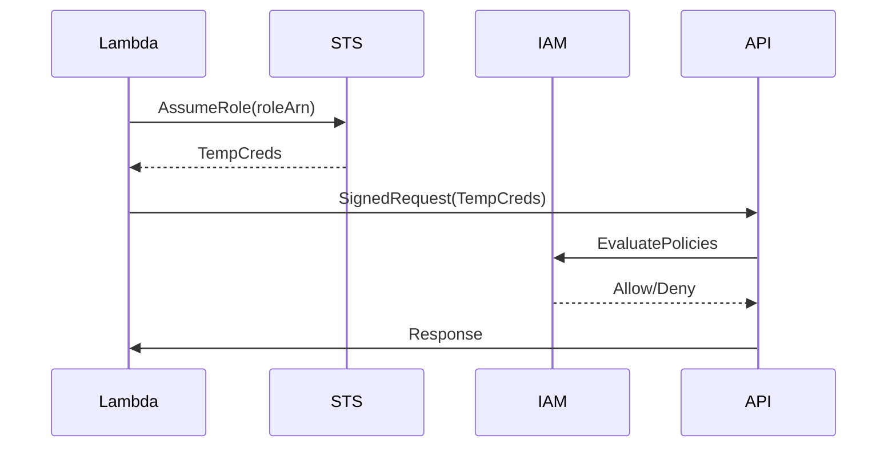

<!-- Generated by Groq via GitHub Actions -->
<!-- Topic ID: T202 -->
<!-- Category: Cloud Backend -->
<!-- Generated at UTC: 2026-11-12T08:33:12.035770+00:00 -->

# AWS IAM

## 1. What problem does this solve?

**Motivation**  
In a cloud‑native backend you have many services (EC2, Lambda, ECS, RDS, S3, etc.) that need to talk to each other and to external APIs. Every service must authenticate itself and be authorized to perform only the actions it really needs. Without a central, auditable way to manage identities and permissions, you end up:

- **Over‑privileged access** – a single credential can do everything, making a compromise catastrophic.
- **Hard‑to‑audit permissions** – it’s unclear who can do what, leading to accidental data leaks or accidental deletions.
- **Credential sprawl** – many static credentials scattered across code, config files, and secrets managers, increasing attack surface.

**Why it matters**  
- **Security**: Least‑privilege access reduces the blast radius of a breach.
- **Compliance**: Auditable logs of who accessed what are required for many regulations (PCI, HIPAA, SOC 2).
- **Operational stability**: Mis‑configured permissions can break deployments or cause downtime.

**What happens if IAM is not used**  
- You might rely on static access keys stored in code or environment variables, which are easy to leak.
- You lose the ability to audit or revoke permissions centrally.
- You can’t enforce MFA or rotate credentials automatically.

**Where IAM appears in real backend systems**  
- Lambda functions assume a role to read from S3 or write to DynamoDB.
- ECS tasks run with task roles that grant only the needed API calls.
- CI/CD pipelines assume a role to deploy CloudFormation stacks.
- Users in the developer console are assigned to IAM groups with specific policies.

---

## 2. Mental model

**Analogy**  
Think of AWS resources as a building with many rooms.  
- **Users** are people who need to enter the building.  
- **Roles** are temporary passes that let a person into specific rooms for a limited time.  
- **Policies** are the rules written on the pass that say “you may read, but not write.”  
- **Trust relationships** are the security guards who check the pass before letting you in.  
- **MFA** is a second lock that requires a one‑time code.

**Engineering model**  
- **Identity**: IAM users, roles, federated identities.  
- **Authorization**: IAM policies (JSON) attached to identities or resources.  
- **Evaluation**: AWS evaluates all applicable policies, resolves conflicts, and decides whether to allow or deny.  
- **Assumption**: Services assume roles to get temporary security credentials (access key, secret key, session token).  

---

## 3. Deep explanation

### Internals
- **Global service**: IAM is a global AWS service; policies are stored in the account’s metadata, not in a region.
- **Policy language**: JSON with `Effect`, `Action`, `Resource`, and optional `Condition`.
- **Evaluation order**:  
  1. **Explicit deny** (any policy that denies).  
  2. **Explicit allow** (any policy that allows).  
  3. **Implicit deny** (default if no allow).
- **Policy size limits**: 2 KB per inline policy, 10 KB per managed policy; 6 KB per role/user/group policy attachment.
- **Permission boundaries**: A boundary policy limits the maximum permissions a role/user can have, regardless of attached policies.
- **Service Control Policies (SCPs)**: In AWS Organizations, SCPs set the maximum permissions for all accounts in an OU.
- **Trust relationships**: JSON that defines who can assume a role (e.g., `sts:AssumeRole`).
- **Session tags**: Key/value pairs attached to a session that can be used in policy conditions.
- **IAM Access Analyzer**: Helps identify resources that are shared publicly or with external accounts.
- **IAM Policy Simulator**: Allows testing policy outcomes before deployment.

### Important terminology
| Term | Meaning |
|------|---------|
| **User** | Long‑term identity with credentials. |
| **Role** | Temporary identity with a trust policy; no long‑term credentials. |
| **Group** | Collection of users; policies attached to groups. |
| **Managed Policy** | Reusable policy stored by AWS or your account. |
| **Inline Policy** | Policy attached directly to a single identity. |
| **Permission Boundary** | Upper limit on permissions for a role/user. |
| **SCP** | Organization‑wide policy limiting permissions. |
| **AssumeRole** | Action to obtain temporary credentials. |
| **Condition** | Fine‑grained rule (e.g., IP address, MFA). |

### Trade‑offs
- **Granularity vs. manageability**: Very fine‑grained policies are hard to audit and maintain.
- **Security vs. convenience**: Using long‑term credentials (access keys) is convenient but risky; roles are safer but require proper trust configuration.
- **Performance**: IAM evaluation is fast; however, overly large policies can increase evaluation time marginally.

### Failure modes
- **Mis‑configured trust policy** → Service cannot assume role.  
- **Over‑privileged policy** → Unintentional data exposure.  
- **Missing MFA** → Root or privileged users can be compromised.  
- **Policy size limit exceeded** → Deployment fails.  

### Limitations
- **No per‑request dynamic permissions**: IAM cannot evaluate request context beyond what’s in the policy (e.g., request body).  
- **No built‑in rate limiting**: You must enforce throttling at the application level.  
- **No native support for custom authentication flows**: Use Cognito or custom auth for that.

### Where IAM fits in a backend architecture
- **Service‑to‑service communication**: Roles give services the minimal permissions they need.  
- **Infrastructure as Code**: Policies and roles are defined in CloudFormation/Terraform.  
- **CI/CD**: Pipelines assume roles to deploy or run tests.  
- **Observability**: CloudTrail logs IAM API calls; IAM Access Analyzer surfaces risky permissions.

### Interaction with related concepts
- **AWS STS**: Provides temporary credentials when assuming roles.  
- **AWS Organizations**: SCPs and consolidated billing.  
- **AWS Cognito**: User pools for application authentication; can federate to IAM roles.  
- **KMS**: IAM policies control who can decrypt data.  
- **S3 Bucket Policies**: Resource‑based policies complement IAM policies.

---

## 4. How it works

1. **Request**: A service (e.g., Lambda) needs to call an AWS API (e.g., `s3:GetObject`).  
2. **AssumeRole**: The service calls `sts:AssumeRole` on a role it trusts.  
3. **STS returns temporary credentials**: `AccessKeyId`, `SecretAccessKey`, `SessionToken`.  
4. **SDK signs request**: The AWS SDK uses the temporary credentials to sign the API call.  
5. **IAM evaluation**: AWS checks all applicable policies (role policies, resource policies, SCPs, permission boundaries).  
6. **Decision**: If any policy explicitly denies, the request is denied. If any policy allows and no deny, the request is allowed.  
7. **Action**: The API performs the requested action or returns an error.



---

## 5. Practical implementation

### 5.1 Create an IAM role for a Lambda that can read from a specific S3 bucket

```bash
# CloudFormation snippet (YAML)
Resources:
  LambdaS3ReadRole:
    Type: AWS::IAM::Role
    Properties:
      RoleName: LambdaS3ReadRole
      AssumeRolePolicyDocument:
        Version: "2012-10-17"
        Statement:
          - Effect: Allow
            Principal:
              Service: lambda.amazonaws.com
            Action: sts:AssumeRole
      Policies:
        - PolicyName: S3ReadOnly
          PolicyDocument:
            Version: "2012-10-17"
            Statement:
              - Effect: Allow
                Action:
                  - s3:GetObject
                  - s3:ListBucket
                Resource:
                  - arn:aws:s3:::my-bucket
                  - arn:aws:s3:::my-bucket/*
```

### 5.2 Node.js Lambda that lists objects

```ts
// handler.ts
import { S3Client, ListObjectsV2Command } from "@aws-sdk/client-s3";

const s3 = new S3Client({ region: "us-east-1" });

export const handler = async () => {
  const cmd = new ListObjectsV2Command({
    Bucket: "my-bucket",
  });

  try {
    const data = await s3.send(cmd);
    console.log("Objects:", data.Contents?.map(c => c.Key));
    return { statusCode: 200, body: JSON.stringify(data.Contents) };
  } catch (err) {
    console.error("Error listing objects:", err);
    return { statusCode: 500, body: "Internal error" };
  }
};
```

**Key lines explained**

- `S3Client` automatically uses the Lambda’s execution role credentials.  
- No hard‑coded keys; the role is assumed by the Lambda runtime.  
- The policy attached to the role limits the Lambda to only `GetObject` and `ListBucket` on `my-bucket`.

### 5.3 Using the AWS SDK to assume a role from a Node.js app

```ts
import { STSClient, AssumeRoleCommand } from "@aws-sdk/client-sts";
import { S3Client, ListObjectsV2Command } from "@aws-sdk/client-s3";

const sts = new STSClient({ region: "us-east-1" });

async function listBucketWithAssumedRole() {
  // 1. Assume the role
  const assumeRole = await sts.send(
    new AssumeRoleCommand({
      RoleArn: "arn:aws:iam::123456789012:role/ReadOnlyRole",
      RoleSessionName: "my-session",
      DurationSeconds: 900, // 15 minutes
    })
  );

  // 2. Create an S3 client with the temporary credentials
  const s3 = new S3Client({
    region: "us-east-1",
    credentials: {
      accessKeyId: assumeRole.Credentials!.AccessKeyId,
      secretAccessKey: assumeRole.Credentials!.SecretAccessKey,
      sessionToken: assumeRole.Credentials!.SessionToken,
    },
  });

  // 3. Call the API
  const data = await s3.send(
    new ListObjectsV2Command({ Bucket: "my-bucket" })
  );
  console.log(data.Contents);
}
```

---

## 6. Production considerations

| Concern | What to watch for | Mitigation |
|---------|-------------------|------------|
| **Scalability** | IAM is global; no scaling limits. | Use roles for services; avoid per‑instance IAM users. |
| **Reliability** | IAM is a managed service; occasional outages. | Enable CloudTrail to detect failures; use retries with exponential backoff. |
| **Security** | Over‑privileged policies, root key misuse, missing MFA. | Enforce least privilege, enable MFA for privileged users, rotate root credentials, use IAM Access Analyzer. |
| **Observability** | Hard to see who assumed a role. | CloudTrail logs `AssumeRole` events; use IAM Policy Simulator for testing. |
| **Performance** | Policy evaluation is fast but large policies can add latency. | Keep policies concise; use managed policies where possible. |
| **Error handling** | `AccessDenied` errors. | Catch and log errors; provide meaningful messages to developers. |
| **Resource usage** | None (IAM is free). | No cost, but IAM usage can incur costs in downstream services (e.g., S3 requests). |
| **Operational concerns** | Policy drift, naming confusion. | Use naming conventions, versioning, and automated policy linting (e.g., `cfn-lint`, `terraform validate`). |
| **Failure recovery** | Compromised credentials. | Rotate credentials immediately, revoke compromised roles, audit CloudTrail. |
| **Deployment** | Manual changes to IAM can break services. | Treat IAM as code: CloudFormation, Terraform, or CDK; use CI/CD to test policy changes. |

---

## 7. Common mistakes

| Mistake | Why it’s problematic |
|---------|----------------------|
| Using the **root account** for everyday tasks | Root has unlimited permissions; any compromise is catastrophic. |
| Hard‑coding **access keys** in code or env vars | Keys can leak; they never expire automatically. |
| Granting **`AdministratorAccess`** to roles or users | Violates least privilege; increases blast radius. |
| Forgetting to set **MFA** on privileged accounts | Easier for attackers to use stolen credentials. |
| Ignoring **policy size limits** | Deployment fails or policies are truncated. |
| Not using **trust policies** correctly | Services cannot assume roles; requests fail. |
| Relying solely on **resource policies** | Over‑complicates permissions; hard to audit. |
| Not using **IAM Access Analyzer** | Publicly shared resources may go unnoticed. |
| Over‑relying on **inline policies** | Hard to reuse and audit; better to use managed policies. |
| Not rotating **temporary credentials** | Session tokens can be reused if leaked. |

---

## 8. Senior engineer perspective

### What changes at scale
- **Central governance**: Use AWS Organizations, SCPs, and permission boundaries to enforce company‑wide policies.
- **Automation**: Treat IAM as code; version control policies; run policy linting in CI.
- **Audit & compliance**: Enable CloudTrail, GuardDuty, and IAM Access Analyzer; integrate with SIEM.
- **Cost control**: While IAM itself is free, over‑privileged roles can lead to unnecessary API calls and storage costs.

### Design decisions
| Decision | Trade‑off | Bottleneck | Monitoring |
|----------|-----------|------------|------------|
| Use **service roles** (e.g., Lambda, ECS) instead of long‑term users | Safer, but requires trust policy updates | None | CloudTrail |
| Implement **permission boundaries** | Adds a layer of safety, but increases policy complexity | Policy evaluation time | IAM Access Analyzer |
| Use **SCPs** in Organizations | Enforces global limits, but can block legitimate use | None | CloudTrail, SCP reports |
| Store **policies in Terraform** | Infrastructure as code, but requires Terraform expertise | Terraform state size | Terraform plan outputs |
| Enable **MFA** on all privileged accounts | Improves security, but adds friction | None | IAM console logs |

### Bottlenecks
- **Policy size limits**: Exceeding 2 KB inline or 10 KB managed policy can break deployments.
- **Policy evaluation time**: With many attached policies, evaluation can add a few milliseconds—usually negligible but matters in high‑frequency services.

### Failure scenarios
- **Compromised root**: Immediate credential rotation, audit all CloudTrail logs, enable SCPs to lock down accounts.
- **Misconfigured trust**: Services cannot assume roles; use the IAM Policy Simulator to test.
- **SCP mis‑application**: Entire OU blocked; need to rollback or adjust SCP.

### When NOT to use IAM
- **Fine‑grained per‑request auth**: Use custom JWT validation or Cognito for user‑level permissions.
- **Non‑AWS resources**: IAM only governs AWS services; external APIs need separate auth mechanisms.

---

## 9. Interview questions

1. **Beginner**: *What is the difference between an IAM user and an IAM role?*  
   **Answer**:  
   - User: long‑term identity with persistent credentials.  
   - Role: temporary identity with no long‑term credentials; assumed via STS.

2. **Beginner**: *Explain how AWS evaluates an IAM policy when a request is made.*  
   **Answer**:  
   - Collect all applicable policies (identity, resource, SCP, permission boundary).  
   - Apply explicit denies first.  
   - If any allow and no deny, the request is allowed.  
   - Otherwise, implicit deny.

3. **Senior**: *How would you design a policy that allows a Lambda function to read from an S3 bucket only if the request originates from a specific VPC endpoint?*  
   **Answer**:  
   - Attach a policy to the Lambda’s role with `Condition` using `aws:SourceVpc` or `aws:SourceVpce`.  
   - Example:  
     ```json
     {
       "Effect":"Allow",
       "Action":["s3:GetObject"],
       "Resource":"arn:aws:s3:::my-bucket/*",
       "Condition":{"StringEquals":{"aws:SourceVpc":"vpc-12345678"}}
     }
     ```

4. **Senior**: *Describe how you would use IAM Access Analyzer to detect a mis‑configured bucket policy that inadvertently exposes data to the public.*  
   **Answer**:  
   - Enable Access Analyzer for the account.  
   - It scans bucket policies and outputs findings.  
   - Review findings, adjust policy to remove `Principal: "*"`, or add `Condition` for VPC or IP.

5. **Scenario/Debugging**: *A Lambda function fails with `AccessDenied` when trying to write to DynamoDB. The role has a policy that allows `dynamodb:PutItem`. What could be wrong?*  
   **Answer**:  
   - Check if the DynamoDB table has a resource‑based policy that denies the role.  
   - Verify that the role’s trust policy allows Lambda.  
   - Ensure the table’s `Condition` (e.g., `aws:SourceVpc`) isn’t blocking.  
   - Look at CloudTrail for the exact denied action and resource.  
   - Confirm no SCP or permission boundary is overriding the allow.

---

## 10. Hands‑on task

**Task**: Create a new IAM role that allows a Node.js Lambda function to write logs to CloudWatch Logs and read a secret from AWS Secrets Manager. Deploy the Lambda using AWS SAM, and verify that the function can write logs and retrieve the secret.

**Steps**  
1. Define a SAM template with the role and policies.  
2. Write a Lambda handler that logs a message and fetches a secret.  
3. Deploy with `sam deploy`.  
4. Invoke the Lambda and check CloudWatch Logs.  
5. Inspect the secret value in the Lambda’s output.

---

## 11. Quick revision

- IAM is AWS’s identity and access management service.  
- **Users** = long‑term identities; **Roles** = temporary identities.  
- Policies are JSON documents with `Effect`, `Action`, `Resource`, `Condition`.  
- Evaluation order: explicit deny → explicit allow → implicit deny.  
- Trust policy defines who can assume a role.  
- Permission boundaries limit maximum permissions.  
- SCPs enforce organization‑wide limits.  
- Use `sts:AssumeRole` to obtain temporary credentials.  
- Always follow least privilege and enable MFA for privileged accounts.  
- Store IAM as code (CloudFormation/Terraform/CDK).  
- Use CloudTrail and IAM Access Analyzer for audit and compliance.  
- Avoid hard‑coding credentials; use roles or Secrets Manager.  

---

## 12. References

- https://docs.aws.amazon.com/IAM/latest/UserGuide/introduction.html  
- https://docs.aws.amazon.com/IAM/latest/UserGuide/access_policies.html  
- https://docs.aws.amazon.com/IAM/latest/UserGuide/access_policies_limits.html  
- https://docs.aws.amazon.com/IAM/latest/UserGuide/access_policies_boundary.html  
- https://docs.aws.amazon.com/organizations/latest/userguide/orgs_manage_policies.html  
- https://docs.aws.amazon.com/IAM/latest/UserGuide/access-analyzer.html  
- https://docs.aws.amazon.com/IAM/latest/UserGuide/id_credentials_temp.html  
- https://docs.aws.amazon.com/IAM/latest/UserGuide/id_credentials_mfa.html  
- https://docs.aws.amazon.com/IAM/latest/UserGuide/id_policies_syntax.html  
- https://docs.aws.amazon.com/IAM/latest/UserGuide/id_policies_simulator.html  

---
