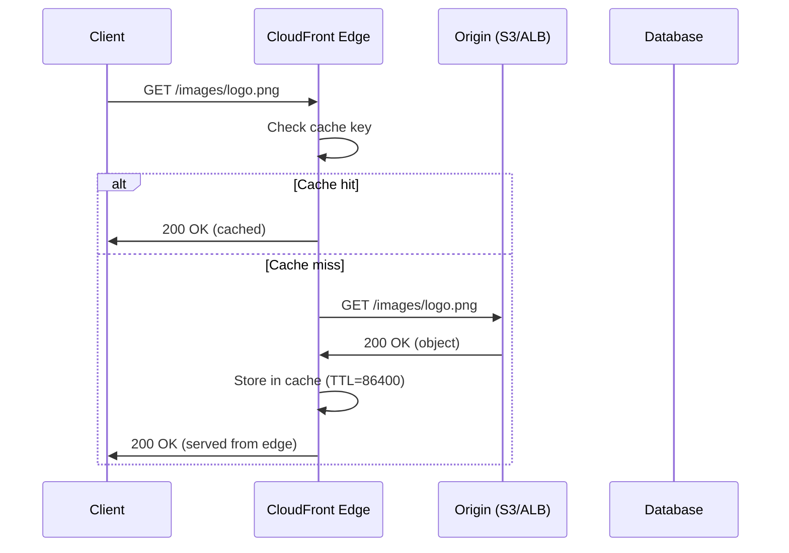

<!-- Generated by Groq via GitHub Actions -->
<!-- Topic ID: T203 -->
<!-- Category: Cloud Backend -->
<!-- Generated at UTC: 2026-11-12T20:59:42.917227+00:00 -->

# AWS CloudFront

## 1. What problem does this solve?

| Problem | Why it matters | Consequence of not using CloudFront | Real‑world appearance |
|---------|----------------|-------------------------------------|-----------------------|
| **High latency for global users** | Users far from your origin (e.g., an S3 bucket in N. Virginia) experience slow load times. | Poor UX, higher bounce rates, lower conversion. | Static assets for a global e‑commerce site. |
| **Bandwidth cost & origin load** | Every request hits your origin, consuming compute and network resources. | Expensive origin traffic, potential throttling. | API responses for a SaaS platform. |
| **Security & DDoS protection** | Origins are exposed to the internet; they can be targeted. | Data breaches, service outages. | Public API endpoints. |
| **Dynamic content personalization** | Need to serve different content per user while keeping caching efficient. | Inconsistent user experience, higher server load. | Personalized product recommendations. |
| **Content freshness & invalidation** | Updating assets (images, CSS, JS) requires propagating changes worldwide. | Stale content, brand inconsistency. | Updating a marketing banner. |

CloudFront is a global CDN that sits between your users and your origin. It caches content at edge locations, reduces latency, offloads traffic, and adds security layers.

---

## 2. Mental model

### Analogy  
Imagine a library system. Your origin is the main library in New York. Every time someone wants a book, they go to New York, which is slow for people in Tokyo. CloudFront is a network of local libraries (edge locations) around the world. When a user in Tokyo requests a book, the local library serves it instantly if it already has a copy. If not, it fetches from the main library, caches it, and serves the user. The local library can also decide how long to keep the book before checking back with the main library.

### Engineering model  
- **Origin** – The source of truth (S3 bucket, ALB, EC2, custom HTTP server).  
- **Edge location** – A geographically distributed AWS data center that caches objects.  
- **Cache behavior** – Rules that tell CloudFront how to cache (path pattern, TTL, query string handling).  
- **Cache key** – Combination of URL, query string, headers, cookies that uniquely identifies a cached object.  
- **Invalidation** – Explicit request to remove an object from the cache so the next request fetches fresh data.  
- **Signed URLs / Cookies** – Mechanism to restrict access to private content.  
- **Lambda@Edge / CloudFront Functions** – Serverless code that runs at the edge to modify requests/responses.

---

## 3. Deep explanation

### Internals
1. **Request routing** – CloudFront uses Route 53 or custom DNS to route traffic to the nearest edge.  
2. **Cache lookup** – Edge checks if the cache key exists.  
3. **Origin fetch** – If miss, CloudFront forwards the request to the origin, respecting cache behavior rules.  
4. **Response handling** – CloudFront stores the response in the cache (subject to TTL, size limits, and cacheability headers).  
5. **Delivery** – Edge returns the cached or fetched response to the client, optionally applying compression or HTTP/2.

### Important terminology
- **Distribution** – The CloudFront configuration (origins, behaviors, settings).  
- **Origin Group** – Fallback mechanism: if one origin fails, CloudFront can route to a secondary.  
- **Origin Access Identity (OAI)** – IAM role that allows CloudFront to read private S3 objects.  
- **Cache Policy** – Defines TTL, query string, header, and cookie handling.  
- **Origin Request Policy** – Defines which request elements are forwarded to the origin.  
- **Invalidation Batch** – A set of paths to remove from the cache.  
- **Lambda@Edge** – Node.js/Go/Python runtime that runs in response to viewer or origin events.  
- **CloudFront Functions** – Lightweight JavaScript that runs on the edge, cheaper and faster than Lambda@Edge.

### Trade‑offs
| Feature | Benefit | Drawback |
|---------|---------|----------|
| **Long TTL** | Fewer origin hits, lower cost. | Stale content if origin changes. |
| **Short TTL** | Freshness. | More origin traffic, higher cost. |
| **Signed URLs** | Fine‑grained access control. | Extra complexity, key rotation. |
| **Lambda@Edge** | Custom logic at edge. | Higher latency, higher cost, cold start. |
| **CloudFront Functions** | Cheap, fast. | Limited language (JavaScript), no async. |

### Failure modes
- **Origin down** – CloudFront can return cached content or use origin groups for failover.  
- **Cache miss** – Causes a round‑trip to origin, increasing latency.  
- **Invalidation throttling** – Too many invalidations can hit limits (1 000 per 24 h).  
- **Stale data** – If TTL is too long, users see outdated content.  
- **Large objects** – >20 GB objects are not supported; large files degrade cache hit ratio.

### Limitations
- Max object size: 20 GB.  
- Max request/response size: 10 MB (unless using origin that supports larger).  
- No native WebSocket support (use API Gateway or ALB).  
- Limited to HTTP/HTTPS; no FTP.  
- No built‑in database or stateful services.

### Where it fits
```
Client → CloudFront Edge → (Cache or Origin) → Origin (S3/ALB/EC2) → Database
```
CloudFront sits in front of static assets, APIs, and even dynamic content that benefits from caching. It integrates with WAF, Shield, and IAM for security, and with CloudWatch/CloudTrail for observability.

### Interaction with related concepts
- **S3** – Often the origin; use OAI for private buckets.  
- **ALB / NLB** – For dynamic APIs; CloudFront can forward to them.  
- **API Gateway** – Alternative to CloudFront for REST APIs; CloudFront can front API Gateway for caching.  
- **Route 53** – DNS routing to CloudFront.  
- **ACM** – TLS certificates for custom domains.  
- **WAF** – Web application firewall at the edge.  
- **Shield** – DDoS protection.  
- **CloudWatch** – Metrics, logs, alarms.  
- **Lambda@Edge / CloudFront Functions** – Edge logic.

---

## 4. How it works



**Step‑by‑step flow**

1. **DNS resolution** – Client resolves `cdn.example.com` to the nearest edge IP.  
2. **Edge request** – CloudFront receives the request.  
3. **Cache key calculation** – Based on URL, query string, headers, cookies (as per cache policy).  
4. **Cache lookup** – If key exists and not expired, return cached object.  
5. **Origin fetch** – If miss, forward request to origin, respecting origin request policy.  
6. **Response storage** – Store response in cache if cacheable (status 200, 301, 302, 404 with `Cache-Control`).  
7. **Delivery** – Return response to client, optionally compressing or using HTTP/2.  
8. **Invalidation** – When you need to purge an object, send an invalidation request; CloudFront removes the key from all edges.

---

## 5. Practical implementation

### 5.1 Create a CloudFront distribution with an S3 origin (TypeScript + AWS CDK)

```ts
// cdk/lib/cloudfront-stack.ts
import * as cdk from 'aws-cdk-lib';
import { Construct } from 'constructs';
import * as s3 from 'aws-cdk-lib/aws-s3';
import * as cloudfront from 'aws-cdk-lib/aws-cloudfront';
import * as origins from 'aws-cdk-lib/aws-cloudfront-origins';

export class CloudFrontStack extends Construct {
  constructor(scope: Construct, id: string) {
    super(scope, id);

    // S3 bucket that holds static assets
    const bucket = new s3.Bucket(this, 'StaticAssets', {
      websiteIndexDocument: 'index.html',
      publicReadAccess: false, // We'll use OAI
    });

    // OAI to restrict bucket access to CloudFront
    const oai = new cloudfront.OriginAccessIdentity(this, 'OAI', {
      comment: 'OAI for StaticAssets',
    });

    // Grant read access to the bucket for the OAI
    bucket.addToResourcePolicy(new iam.PolicyStatement({
      actions: ['s3:GetObject'],
      resources: [bucket.bucketArn + '/*'],
      principals: [new iam.CanonicalUserPrincipal(oai.cloudFrontOriginAccessIdentityS3CanonicalUserId)],
    }));

    // CloudFront distribution
    const distribution = new cloudfront.Distribution(this, 'CDN', {
      defaultBehavior: {
        origin: new origins.S3Origin(bucket, { originAccessIdentity: oai }),
        cachePolicy: cloudfront.CachePolicy.CACHING_OPTIMIZED,
        viewerProtocolPolicy: cloudfront.ViewerProtocolPolicy.REDIRECT_TO_HTTPS,
        allowedMethods: cloudfront.AllowedMethods.ALLOW_GET_HEAD,
      },
      domainNames: ['cdn.example.com'],
      certificate: /* ACM certificate ARN */,
    });

    new cdk.CfnOutput(this, 'DistributionDomain', {
      value: distribution.domainName,
    });
  }
}
```

**Key points**

- `OriginAccessIdentity` (OAI) hides the S3 bucket from the public internet.  
- `CachePolicy.CACHING_OPTIMIZED` sets a 24 h TTL and enables gzip.  
- `viewerProtocolPolicy` forces HTTPS.  
- The distribution’s domain name is used in your DNS record.

### 5.2 Invalidate an object (Node.js SDK)

```ts
// scripts/invalidate.ts
import { CloudFrontClient, CreateInvalidationCommand } from "@aws-sdk/client-cloudfront";

const client = new CloudFrontClient({ region: "us-east-1" });

async function invalidate() {
  const distributionId = process.env.DISTRIBUTION_ID!;
  const paths = ['/images/logo.png', '/css/*']; // Wildcards supported

  const command = new CreateInvalidationCommand({
    DistributionId: distributionId,
    InvalidationBatch: {
      CallerReference: `invalidate-${Date.now()}`,
      Paths: { Quantity: paths.length, Items: paths },
    },
  });

  const response = await client.send(command);
  console.log('Invalidation created:', response.Invalidation.Id);
}

invalidate().catch(console.error);
```

### 5.3 Generate a signed URL (Node.js)

```ts
// scripts/signed-url.ts
import { CloudFrontClient, GetSignedUrlCommand } from "@aws-sdk/client-cloudfront";
import { readFileSync } from "fs";

const client = new CloudFrontClient({ region: "us-east-1" });

async function signedUrl() {
  const keyPairId = process.env.CLOUDFRONT_KEY_PAIR_ID!;
  const privateKey = readFileSync(process.env.CLOUDFRONT_PRIVATE_KEY!, "utf8");

  const url = "https://cdn.example.com/private/video.mp4";

  const command = new GetSignedUrlCommand({
    DistributionDomainName: "cdn.example.com",
    KeyPairId: keyPairId,
    PrivateKey: privateKey,
    Expires: Math.floor(Date.now() / 1000) + 60 * 60, // 1 hour
    Policy: JSON.stringify({
      Statement: [
        {
          Resource: url,
          Condition: { DateLessThan: { "AWS:EpochTime": Math.floor(Date.now() / 1000) + 3600 } },
        },
      ],
    }),
  });

  const signed = await client.send(command);
  console.log('Signed URL:', signed.SignedUrl);
}

signedUrl().catch(console.error);
```

---

## 6. Production considerations

| Concern | How to address |
|---------|----------------|
| **Scalability** | Edge locations automatically scale; use multiple origins for load balancing. |
| **Reliability** | Enable origin groups with health checks; use CloudFront Functions for graceful degradation. |
| **Security** | Enforce HTTPS, use ACM for certificates, enable WAF & Shield, use OAI for S3, signed URLs for private content. |
| **Observability** | Enable CloudFront access logs (S3), CloudWatch metrics (Requests, 4xx/5xx), CloudWatch Logs for Lambda@Edge. |
| **Performance** | Set appropriate TTLs, enable gzip/Brotli, use HTTP/2, cache based on query string/cookies only when needed. |
| **Error handling** | Custom error pages, fallback origins, 503/504 handling. |
| **Resource usage** | Monitor request counts, data transfer, invalidation limits; use cost explorer. |
| **Operational concerns** | Automate distribution creation via CDK/CloudFormation; version distributions; use immutable tags. |
| **Failure recovery** | Use origin failover, keep stale content for a grace period, monitor health checks. |
| **Deployment** | Deploy via CI/CD, use CloudFormation change sets, keep distribution ID in environment. |

---

## 7. Common mistakes

| Mistake | Why it’s problematic |
|---------|----------------------|
| **Not setting cache headers** | CloudFront may not cache dynamic responses, leading to high origin traffic. |
| **Over‑invalidating** | Each invalidation costs $0.005 per path and is throttled; can hit limits. |
| **Using CloudFront for highly dynamic content without cache control** | Users see stale data; origin load spikes. |
| **Ignoring query string/cookie caching** | Different users get the same cached object, causing leaks or incorrect data. |
| **Not using OAI for private S3 buckets** | Exposes bucket to the public internet. |
| **Large objects (>20 GB)** | Unsupported; request fails. |
| **Hard‑coding URLs in code** | Breaks when domain changes; use environment variables. |
| **Not enabling compression** | Larger payloads increase latency and bandwidth cost. |
| **Using CloudFront for WebSocket traffic** | CloudFront doesn’t support WebSockets; use API Gateway or ALB. |
| **Skipping TLS** | HTTP traffic is insecure; CloudFront forces HTTPS for custom domains. |

---

## 8. Senior engineer perspective

### Architecture decisions
- **CDN vs API Gateway** – Use CloudFront when you need global caching for static assets or API responses; API Gateway is better for fine‑grained request throttling and integration with Lambda.  
- **Cache policy granularity** – Decide per path pattern; e.g., `/api/*` with short TTL, `/assets/*` with long TTL.  
- **Origin groups** – For high availability, pair a primary origin with a secondary.  
- **Signed URLs vs Signed Cookies** – Use signed URLs for single objects, signed cookies for session‑wide access.  
- **Lambda@Edge vs CloudFront Functions** – Use Lambda@Edge for complex logic; CloudFront Functions for lightweight rewrites.

### Bottlenecks
- **Origin latency** – If origin is slow, cache miss penalty is high.  
- **Cache miss ratio** – Poor cache key design leads to many misses.  
- **Invalidation limits** – Exceeding 1 000 per 24 h triggers throttling.  
- **Edge compute limits** – Lambda@Edge has 5 ms cold start; CloudFront Functions are faster but limited.

### Failure scenarios
- **Origin outage** – CloudFront serves stale content if `StaleIfError` is set.  
- **Edge failure** – Rare; AWS routes to another edge.  
- **DNS TTL** – Long TTL can delay propagation of new distribution.

### Monitoring
- **CloudWatch metrics** – `Requests`, `4xxErrorRate`, `5xxErrorRate`, `BytesDownloaded`.  
- **Access logs** – Store in S3, analyze with Athena or Kibana.  
- **Alarms** – Trigger on high error rates or low cache hit ratios.

### Cost/performance
- **Request cost** – $0.0075 per 10 000 requests (US East).  
- **Data transfer** – $0.085 per GB (first 10 TB).  
- **Invalidation** – $0.005 per path.  
- **Optimization** – Use `CachePolicy` to reduce origin fetches; enable compression.

### When NOT to use
- **Very low traffic sites** – CloudFront adds cost; S3 static hosting may suffice.  
- **Real‑time data** – If content changes every second, caching is counterproductive.  
- **WebSocket or HTTP/2 only** – CloudFront doesn’t support WebSockets; use ALB or API Gateway.

---

## 9. Interview questions

1. **Beginner** – *What is the purpose of a CloudFront distribution?*  
   *Answer:* It routes user requests to the nearest edge, caches objects to reduce latency, offloads origin traffic, and adds security features like HTTPS and WAF.

2. **Beginner** – *How does CloudFront determine whether to serve a cached object or fetch from the origin?*  
   *Answer:* It calculates a cache key (URL + query string + headers/cookies per cache policy). If the key exists and is not expired, it serves the cached object; otherwise it forwards to the origin.

3. **Senior** – *Explain how you would design a CloudFront distribution for a SaaS platform that serves both public static assets and private user‑specific content.*  
   *Answer:* Use two cache behaviors: `/assets/*` with a long TTL and public cache policy; `/private/*` with a short TTL, signed URLs, and an OAI to restrict S3 access. Optionally use Lambda@Edge to inject user‑specific headers or rewrite URLs.

4. **Senior** – *What are the trade‑offs between using Lambda@Edge and CloudFront Functions?*  
   *Answer:* Lambda@Edge runs in multiple runtimes, supports async, but has higher latency and cost. CloudFront Functions are JavaScript, cheaper, faster, but limited to synchronous, stateless logic.

5. **Scenario/Debugging** – *A user reports that after updating an image in S3, the new image still shows up for 24 hours. What could be wrong and how would you fix it?*  
   *Answer:* Likely the CloudFront cache TTL is too long or the object was cached with a stale `Cache-Control`. Check the cache policy, set a shorter TTL, or issue an invalidation. Also verify that the S3 object’s `Cache-Control` header is set correctly.

---

## 10. Hands‑on task

**Goal:** Deploy a CloudFront distribution for a Next.js static export and test caching.

1. **Export** your Next.js app to static files (`next export`).  
2. **Upload** the `out/` directory to an S3 bucket.  
3. **Create** a CloudFront distribution (using CDK or console) with:
   - Origin: the S3 bucket (use OAI).  
   - Cache behavior: `/static/*` with 30 days TTL, `/` with 5 minutes TTL.  
   - Custom domain `cdn.example.com` (Route 53 record).  
4. **Generate** a signed URL for a private asset (e.g., `/private/secret.txt`).  
5. **Invalidate** `/static/logo.png` and verify the new image is served.  
6. **Enable** CloudFront access logs and analyze the hit/miss ratio in CloudWatch.

Document each step, the commands used, and the observed metrics.

---

## 11. Quick revision

- CloudFront is a global CDN that caches content at edge locations.  
- **Origin** = source of truth (S3, ALB, EC2).  
- **Edge** = geographically distributed cache.  
- **Cache key** = URL + query string + headers/cookies per policy.  
- **TTL** controls freshness; longer TTL = fewer origin hits.  
- **OAI** protects private S3 buckets.  
- **Signed URLs/Cookies** restrict access to private content.  
- **Invalidation** removes objects from cache; limited to 1 000 per 24 h.  
- **Lambda@Edge** vs **CloudFront Functions** – trade‑offs in cost, latency, language.  
- **Observability**: CloudWatch metrics, access logs, CloudTrail.  
- **Security**: HTTPS, WAF, Shield, IAM, OAI.  
- **Common pitfalls**: missing cache headers, over‑invalidating, ignoring query string/cookie caching.

---

## 12. References

- https://docs.aws.amazon.com/AmazonCloudFront/latest/DeveloperGuide/Introduction.html  
- https://docs.aws.amazon.com/AmazonCloudFront/latest/DeveloperGuide/GettingStarted.html  
- https://docs.aws.amazon.com/AmazonCloudFront/latest/DeveloperGuide/Invalidation.html  
- https://docs.aws.amazon.com/AmazonCloudFront/latest/DeveloperGuide/ServingPrivateContent.html  
- https://docs.aws.amazon.com/AmazonCloudFront/latest/DeveloperGuide/AccessLogs.html  
- https://docs.aws.amazon.com/AmazonCloudFront/latest/DeveloperGuide/CloudFrontFunctions.html  
- https://docs.aws.amazon.com/AmazonCloudFront/latest/DeveloperGuide/lambda-at-the-edge.html  
- https://docs.aws.amazon.com/AWSCloudFormation/latest/UserGuide/aws-resource-cloudfront-distribution.html  
- https://docs.aws.amazon.com/cdk/api/v2/docs/aws-cloudfront-readme.html

---
