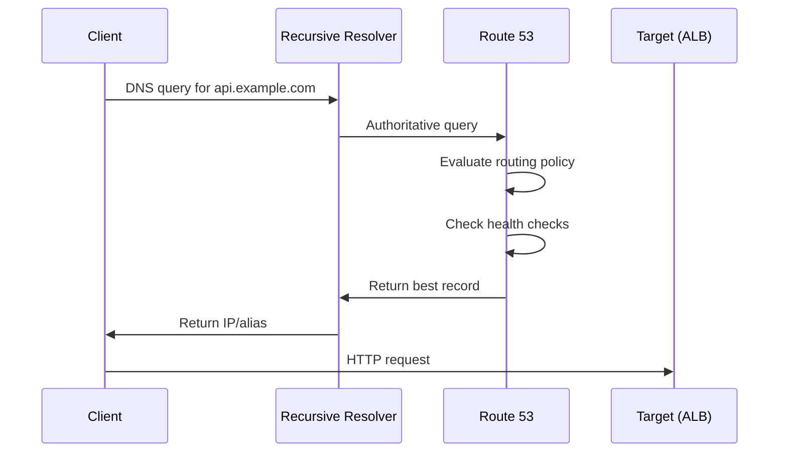

<!-- Generated by Groq via GitHub Actions -->
<!-- Topic ID: T204 -->
<!-- Category: Cloud Backend -->
<!-- Generated at UTC: 2026-11-12T20:59:42.917227+00:00 -->

# AWS Route 53

## 1. What problem does this solve?

| What | Why it matters | Consequence of not using it | Real‑world use |
|------|----------------|-----------------------------|----------------|
| **DNS resolution** – translating human‑readable domain names into IP addresses | Every web request starts with a DNS lookup. Without it, clients can’t reach services. | Clients get “Name not found” errors; services become unreachable. | All public APIs, web sites, microservice meshes. |
| **Global traffic routing** – directing users to the best endpoint (latency, geography, failover) | Users expect fast, reliable access regardless of location. | Higher latency, lower availability, poor UX. | CDN edge routing, multi‑region databases, global SaaS. |
| **Health‑check‑based failover** – automatically switching traffic when an endpoint fails | Prevents downtime and manual intervention. | Manual failover delays, increased MTTR. | High‑availability web apps, database replicas. |
| **Domain ownership & delegation** – managing subdomains and delegating control | Enables teams to own and manage their own services. | No isolation, hard to scale. | Multi‑tenant SaaS, micro‑service namespaces. |

In a typical backend stack, Route 53 sits at the very edge of the network: it receives the first request from the user, decides which AWS resource (ALB, CloudFront, S3, EC2, etc.) should answer, and hands the request off. It is the “traffic director” that keeps the rest of the architecture happy.

---

## 2. Mental model

### Analogy – The City Traffic Control Center

Imagine a city with many roads, traffic lights, and emergency routes. The traffic control center (Route 53) receives a driver’s request (“I want to go to `api.example.com`”) and, based on current road conditions (health checks, latency, geography), directs the driver to the fastest, safest route (the best endpoint). If a road is closed, the system automatically reroutes traffic to an alternate path.

### Engineering model

* **Hosted zone** – a container for all DNS records for a domain (like a city map).  
* **Record set** – a specific address on that map (e.g., `api.example.com` → IP or alias).  
* **Routing policy** – the rule that decides which record to return (simple, weighted, latency, failover, geolocation, multivalue).  
* **Health checks** – periodic probes that mark a record as healthy/unhealthy.  
* **Alias** – a special record that points to AWS resources (ALB, CloudFront) without using an IP.

---

## 3. Deep explanation

### Internals

* **Query flow**: Client → Recursive resolver → Route 53 authoritative name server → Record set → Target (ALB, CloudFront, etc.).  
* **Caching**: TTL controls how long resolvers cache a record.  
* **Latency measurement**: Route 53 can measure round‑trip times from multiple AWS regions to decide the best endpoint.  
* **Health checks**: HTTP/HTTPS, TCP, or CloudWatch metrics; results stored in a health‑check state machine.

### Important terminology

| Term | Meaning |
|------|---------|
| **Hosted zone** | Public or private DNS namespace. |
| **Record set** | A DNS record (A, AAAA, CNAME, MX, TXT, etc.). |
| **Routing policy** | Strategy for selecting records. |
| **Alias record** | Maps a domain name to an AWS resource without an IP. |
| **Health check** | Probe that determines if a record is healthy. |
| **Failover** | Automatic switch to a secondary record when primary fails. |
| **Latency‑based routing** | Chooses the record with lowest measured latency. |
| **Geolocation routing** | Routes based on user’s country/region. |
| **Weighted routing** | Distributes traffic according to weights. |
| **Multivalue answer** | Returns multiple healthy records (like a load balancer). |

### Trade‑offs

| Feature | Pros | Cons |
|---------|------|------|
| **Alias to ALB** | No IP changes, integrates with AWS health checks. | Only works with AWS resources. |
| **Latency routing** | Improves user experience. | Requires many health checks; cost. |
| **Weighted routing** | Simple load distribution. | No automatic failover. |
| **Geolocation routing** | Regional compliance. | Requires many records; may violate privacy laws. |
| **Health checks** | Automatic failover. | Extra cost; latency in detection. |

### Failure modes

* **DNS propagation delay** – TTL can delay updates.  
* **Health check misconfiguration** – false positives/negatives cause traffic to be routed to unhealthy endpoints.  
* **Record set conflicts** – duplicate records cause unpredictable responses.  
* **Rate limits** – too many API calls can trigger throttling.  

### Limitations

* **No built‑in TLS termination** – Route 53 only resolves names; TLS is handled by the target.  
* **No dynamic routing based on request content** – only on DNS query.  
* **Limited to 10 000 record sets per hosted zone** (can be increased with AWS support).  
* **Latency measurements are approximate** – not real‑time.

### Where it fits

```
┌─────────────────────┐
│  Client (Browser)   │
└───────▲──────────────┘
        │ DNS query
        ▼
┌─────────────────────┐
│  Recursive Resolver │
└───────▲──────────────┘
        │ authoritative
        ▼
┌─────────────────────┐
│  Route 53 Hosted Zone│
└───────▲──────────────┘
        │ record set
        ▼
┌─────────────────────┐
│  Target (ALB/CF/EC2)│
└─────────────────────┘
```

Route 53 sits between the client and the actual backend services, making it a critical component for any globally distributed architecture.

---

## 4. How it works

1. **Client** sends a DNS query for `api.example.com`.  
2. **Recursive resolver** (ISP or public resolver) asks the **authoritative name server** for `example.com`.  
3. **Route 53** looks up the **record set** for `api.example.com`.  
4. If the record has a **routing policy**, Route 53 evaluates it (e.g., latency, failover).  
5. Route 53 checks the **health‑check status** of each candidate record.  
6. The **best healthy record** is returned to the resolver.  
7. The resolver caches the answer for the TTL duration.  
8. The client receives the IP/alias and initiates the HTTP request to the target.



---

## 5. Practical implementation

Below is a minimal TypeScript example that:

1. Creates a hosted zone for `example.com`.  
2. Adds an alias record pointing to an existing ALB.  
3. Creates a health check for the ALB.  
4. Associates the health check with the record.

```ts
// route53-demo.ts
import {
  Route53Client,
  CreateHostedZoneCommand,
  CreateHealthCheckCommand,
  CreateRecordSetCommand,
} from "@aws-sdk/client-route-53";

const client = new Route53Client({ region: "us-east-1" });

async function main() {
  // 1️⃣ Create hosted zone
  const hostedZone = await client.send(
    new CreateHostedZoneCommand({
      Name: "example.com",
      CallerReference: `demo-${Date.now()}`,
      HostedZoneConfig: { Comment: "Demo zone" },
    })
  );
  const zoneId = hostedZone.HostedZone?.Id!;
  console.log("Hosted zone ID:", zoneId);

  // 2️⃣ Create health check for ALB
  const healthCheck = await client.send(
    new CreateHealthCheckCommand({
      CallerReference: `demo-hc-${Date.now()}`,
      HealthCheckConfig: {
        Type: "HTTPS",
        ResourcePath: "/health",
        FullyQualifiedDomainName: "api.example.com",
        Port: 443,
        RequestInterval: 30,
        FailureThreshold: 3,
      },
    })
  );
  const hcId = healthCheck.HealthCheck?.Id!;
  console.log("Health check ID:", hcId);

  // 3️⃣ Create alias record pointing to ALB
  const albArn = "arn:aws:elasticloadbalancing:us-east-1:123456789012:loadbalancer/app/my-alb/50dc6c495c0c9188";
  await client.send(
    new CreateRecordSetCommand({
      HostedZoneId: zoneId,
      ChangeBatch: {
        Changes: [
          {
            Action: "CREATE",
            ResourceRecordSet: {
              Name: "api.example.com",
              Type: "A",
              AliasTarget: {
                HostedZoneId: "Z35SXDOTRQ7X7K", // ALB hosted zone ID
                DNSName: "dualstack.my-alb-1234567890.us-east-1.elb.amazonaws.com",
                EvaluateTargetHealth: true,
              },
              SetIdentifier: "primary",
              Weight: 100,
              HealthCheckId: hcId,
            },
          },
        ],
      },
    })
  );
  console.log("Alias record created");
}

main().catch(console.error);
```

> **Important notes**  
> * `HostedZoneId` for the ALB can be found in the console or via `describe-load-balancers`.  
> * `EvaluateTargetHealth: true` tells Route 53 to use the ALB’s health status.  
> * The health check above probes `/health` on the ALB; adjust the path to match your app.

---

## 6. Production considerations

| Concern | What to watch for | Mitigation |
|---------|-------------------|------------|
| **Scalability** | 10 000 record limit per zone | Split domains into multiple zones or use a wildcard record with a load balancer. |
| **Reliability** | DNS propagation delays | Keep TTL low (e.g., 60 s) during rollouts; use health checks for failover. |
| **Security** | Public zone leaks | Use private hosted zones for internal services; enable DNSSEC for public zones. |
| **Observability** | Health‑check failures | Enable CloudWatch metrics, set up SNS alerts on health‑check state changes. |
| **Performance** | Latency routing overhead | Cache responses at edge resolvers; keep TTL reasonable. |
| **Error handling** | API throttling | Exponential back‑off; use SDK’s retry strategy. |
| **Resource usage** | Cost of health checks | Use fewer checks for low‑traffic services; consider CloudWatch alarms instead. |
| **Operational** | Zone delegation | Use IAM policies to restrict who can modify the zone. |
| **Failure recovery** | DNS misconfiguration | Keep a backup zone; use Route 53’s “Change batch” atomicity. |
| **Deployment** | Infrastructure as code | Manage zones with CloudFormation, CDK, or Terraform. |

---

## 7. Common mistakes

| Mistake | Why it hurts |
|---------|--------------|
| **Leaving TTL too high** | Delays propagation of critical changes (e.g., failover). |
| **Not enabling `EvaluateTargetHealth` on alias records** | Traffic may go to unhealthy ALB targets. |
| **Using CNAME at the zone apex** | DNS spec forbids CNAME at the root; causes resolution failures. |
| **Misconfiguring health‑check paths** | Health checks always fail, leading to traffic blackhole. |
| **Overusing weighted routing without failover** | No automatic recovery when a target dies. |
| **Ignoring DNSSEC** | Vulnerable to spoofing attacks on public zones. |
| **Hard‑coding zone IDs** | Breaks when zones are recreated; use dynamic lookup. |
| **Not monitoring health‑check metrics** | Misses early signs of degradation. |

---

## 8. Senior engineer perspective

### Architecture decisions

* **Zone granularity** – split by environment (dev, prod) or by service to reduce record count.  
* **Routing policy mix** – combine latency routing for global traffic with weighted routing for A/B testing.  
* **Health‑check strategy** – use CloudWatch metrics for internal services, HTTP checks for public APIs.  
* **Alias vs. IP** – always prefer alias to avoid IP churn.

### Trade‑offs & bottlenecks

* **Latency routing** can add ~10 ms per query; acceptable for most web traffic but not for ultra‑low‑latency APIs.  
* **Health‑check frequency** vs. cost: 30 s interval is common; tighter intervals increase cost and load on targets.  
* **Record set limits** can become a bottleneck for micro‑service‑heavy architectures; consider using wildcard records or a service‑mesh.

### Failure scenarios

* **Zone deletion** – accidental deletion wipes DNS for entire domain; mitigate with IAM restrictions and backups.  
* **Health‑check false positives** – misconfigured checks can cause traffic to be routed away from healthy endpoints; validate checks before enabling.  
* **DNSSEC misconfiguration** – breaks all clients; test in a staging zone first.

### Monitoring & cost

* **Metrics** – `HealthCheckStatus`, `Latency`, `QueryCount`.  
* **Alarms** – trigger SNS or Lambda on health‑check state changes.  
* **Cost** – health checks ~$0.75/month each; alias records free.  
* **When NOT to use** – if you need per‑request routing logic (e.g., feature flags), use an application load balancer or API gateway instead.

---

## 9. Interview questions

1. **Beginner** – *What is a hosted zone in Route 53?*  
   *Answer:* A container for all DNS records for a domain; can be public or private.

2. **Beginner** – *Explain the difference between a simple record and a weighted record.*  
   *Answer:* Simple returns a single record; weighted distributes traffic across multiple records based on assigned weights.

3. **Senior** – *How does Route 53’s latency‑based routing work, and what are its limitations?*  
   *Answer:* Route 53 measures round‑trip times from AWS edge locations to each endpoint and returns the lowest latency record. Limitations: measurements are periodic, not real‑time; cost of health checks; not suitable for sub‑second latency requirements.

4. **Senior** – *Describe a scenario where you would use a failover routing policy instead of a weighted policy.*  
   *Answer:* When you have a primary production environment and a standby environment; failover automatically switches traffic when the primary becomes unhealthy, ensuring high availability.

5. **Scenario/Debugging** – *Your application suddenly starts returning 504 Gateway Timeout errors. The ALB is healthy, but DNS queries for `api.example.com` return the wrong IP. What could be wrong and how would you investigate?*  
   *Answer:* Possible causes:  
   * TTL too high, propagating stale records.  
   * Health check misconfigured, causing Route 53 to route to a secondary record that points to a dead target.  
   * Record set deleted or replaced.  
   * Investigation steps: check Route 53 console for record sets, view health‑check status, look at CloudWatch metrics, verify TTL, and use `dig +trace api.example.com` to see the authoritative answer. |

---

## 10. Hands‑on task

**Task:**  
Create a Route 53 failover setup for a Next.js API that runs in two AWS regions (us‑east‑1 and us‑west‑2).  

1. Deploy a simple Next.js API behind an ALB in each region.  
2. Create a public hosted zone for `api.example.com`.  
3. Add two `A` alias records (`primary` and `secondary`) pointing to each ALB.  
4. Configure a health check on the `primary` record that probes `/health`.  
5. Set `EvaluateTargetHealth` to true.  
6. Verify that when you stop the `us‑east‑1` ALB, Route 53 automatically routes traffic to the `us‑west‑2` ALB.  

*Deliverable:* A GitHub repo with a CDK or Terraform script that provisions the zone, records, and health checks, plus a README with step‑by‑step instructions.

---

## 11. Quick revision

- Route 53 is AWS’s global DNS service.  
- **Hosted zone** = domain container.  
- **Record set** = DNS record (A, CNAME, etc.).  
- **Routing policy** = rule for selecting records (simple, weighted, latency, failover, geolocation, multivalue).  
- **Alias record** = maps to AWS resources without an IP.  
- **Health check** = probes endpoint; used for failover and multivalue.  
- **TTL** controls caching; low TTL = fast propagation.  
- **Latency routing** picks the lowest‑latency endpoint.  
- **Failover routing** switches to secondary when primary fails.  
- **Geolocation routing** directs users based on country.  
- **Weighted routing** distributes traffic by weight.  
- **Multivalue answer** returns multiple healthy records.  
- **DNSSEC** protects against spoofing.  
- **Cost**: health checks ~$0.75/month; alias records free.  
- **Common pitfalls**: high TTL, missing `EvaluateTargetHealth`, CNAME at apex, misconfigured health checks.  

---

## 12. References

- https://docs.aws.amazon.com/Route53/latest/DeveloperGuide/welcome.html  
- https://docs.aws.amazon.com/Route53/latest/DeveloperGuide/routing-policy.html  
- https://docs.aws.amazon.com/Route53/latest/DeveloperGuide/health-checks.html  
- https://docs.aws.amazon.com/Route53/latest/DeveloperGuide/hosted-zones.html  
- https://docs.aws.amazon.com/Route53/latest/DeveloperGuide/dns-query.html  
- https://docs.aws.amazon.com/Route53/latest/DeveloperGuide/dns-security.html  
- https://docs.aws.amazon.com/Route53/latest/DeveloperGuide/route53-dns-traffic-routing.html  
- https://docs.aws.amazon.com/Route53/latest/DeveloperGuide/route53-dns-traffic-routing.html#route53-dns-traffic-routing-failover  

---
