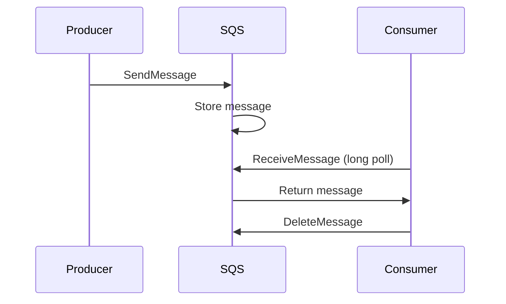

<!-- Generated by Groq via GitHub Actions -->
<!-- Topic ID: T205 -->
<!-- Category: Cloud Backend -->
<!-- Generated at UTC: 2026-11-13T08:18:35.551473+00:00 -->

# AWS SQS

## 1. What problem does this solve?

| Problem | Why it matters | Consequence of not using it | Real‑world use cases |
|---------|----------------|-----------------------------|----------------------|
| **Decoupling producers and consumers** | Allows services to operate at their own pace, improving resilience and scalability. | Tight coupling leads to cascading failures, back‑pressure, and hard‑to‑scale systems. | Order processing, image resizing, email sending, log aggregation. |
| **Reliable message delivery** | Guarantees that a message is processed at least once, even if a consumer crashes. | Lost or duplicated work, inconsistent state, hard‑to‑debug bugs. | Payment processing, inventory updates, AI inference pipelines. |
| **Load leveling** | Buffers bursts of work so downstream systems aren’t overwhelmed. | Throttling, request timeouts, degraded user experience. | API rate limiting, background job queues, analytics ingestion. |
| **Failure isolation** | A failing consumer doesn’t block producers; the queue holds messages until the consumer recovers. | System-wide outages, data loss. | Microservice architectures, event‑driven pipelines. |

## 2. Mental model

**Analogy – Post Office Mailbox**

- **Producers** drop letters (messages) into a mailbox (queue).  
- **Consumers** pick up letters when ready.  
- The mailbox guarantees each letter is delivered at least once, even if the post office is busy or a courier is delayed.

**Engineering model**

- **Queue** = ordered, durable store of messages.  
- **Producer** = publisher that `SendMessage`.  
- **Consumer** = subscriber that `ReceiveMessage` and `DeleteMessage`.  
- **Visibility timeout** = the time a message is invisible to other consumers after being fetched.  
- **Dead‑letter queue** = fallback for messages that repeatedly fail.

## 3. Deep explanation

### Internals

- **Distributed storage**: SQS stores messages across multiple AZs for durability.  
- **Sharding**: Messages are distributed across shards; each shard is a partition of the queue.  
- **Long polling**: Consumers can wait up to 20 s for a message, reducing empty responses.  
- **At‑least‑once delivery**: Messages may be delivered multiple times; consumers must be idempotent.

### Important terminology

| Term | Meaning |
|------|---------|
| **Visibility timeout** | Period after `ReceiveMessage` during which the message is hidden from other consumers. |
| **Message retention period** | Max time a message stays in the queue (default 4 days, max 14 days). |
| **Dead‑letter queue (DLQ)** | Separate queue for messages that exceed a max receive count. |
| **Batch operations** | `SendMessageBatch`, `ReceiveMessageBatch`, `DeleteMessageBatch` for efficiency. |
| **ApproximateNumberOfMessages** | Approximate count of visible messages. |
| **ApproximateNumberOfMessagesNotVisible** | Approximate count of messages currently being processed. |

### Trade‑offs

| Feature | Pros | Cons |
|---------|------|------|
| **Serverless (managed)** | No ops, auto‑scaling, high availability. | Limited control, higher cost at very high throughput. |
| **Visibility timeout** | Prevents duplicate processing. | If too short, leads to duplicates; if too long, delays retries. |
| **Batching** | Reduces API calls, cheaper. | Requires handling partial failures. |
| **DLQ** | Isolates bad messages. | Adds complexity; messages may still be lost if DLQ not processed. |

### Failure modes

- **Duplicate deliveries** → idempotent consumer logic required.  
- **Message loss** → only if the consumer deletes the message before visibility timeout expires and the queue is misconfigured.  
- **Visibility timeout expiry** → message reappears; consumer must handle reprocessing.  
- **DLQ overflow** → messages may accumulate if DLQ consumer is down.

### Limitations

- **Maximum message size**: 256 KB (standard) or 2 MB (FIFO).  
- **No ordering guarantee** (standard) – FIFO queues provide ordering but at lower throughput.  
- **No built‑in filtering** – consumers pull all messages and filter locally.  
- **No message attributes for routing** – use SNS or Lambda triggers for fan‑out.

### Where it fits

- **Event bus**: SQS can be the backbone of an event‑driven architecture.  
- **Background job queue**: Offload CPU‑heavy tasks.  
- **Retry mechanism**: Combine with DLQ for automatic retries.  
- **Integration with other AWS services**: SNS → SQS, Lambda → SQS, Step Functions → SQS.

### Interaction with related concepts

| Concept | Interaction |
|---------|-------------|
| **SNS** | SNS can publish to multiple SQS queues (fan‑out). |
| **Lambda** | Lambda can be triggered by SQS messages; visibility timeout must be > Lambda runtime. |
| **Step Functions** | Use SQS as a state machine task queue. |
| **Kinesis / Kafka** | SQS is simpler but less feature‑rich; choose based on throughput and ordering needs. |

## 4. How it works



**Step‑by‑step flow**

1. **Producer** calls `SendMessage` (or `SendMessageBatch`) to push a JSON payload.  
2. **SQS** writes the message to a shard, assigns a unique `MessageId`.  
3. **Consumer** calls `ReceiveMessage` (long poll).  
4. SQS returns up to 10 messages, marking them invisible for the *visibility timeout*.  
5. Consumer processes the message.  
6. Upon success, consumer calls `DeleteMessage` (or batch delete).  
7. If the consumer fails or the visibility timeout expires, the message becomes visible again.  
8. After *maxReceiveCount* attempts, the message is moved to the DLQ.

## 5. Practical implementation

### TypeScript/Node.js example

```ts
// sqs.ts
import { SQSClient, SendMessageCommand, ReceiveMessageCommand, DeleteMessageCommand } from "@aws-sdk/client-sqs";

const client = new SQSClient({ region: "us-east-1" });
const QUEUE_URL = process.env.SQS_QUEUE_URL!;

// Producer
export async function enqueueOrder(order: { id: string; items: string[] }) {
  const params = {
    QueueUrl: QUEUE_URL,
    MessageBody: JSON.stringify(order),
    MessageAttributes: {
      // optional: add metadata
      OrderType: { DataType: "String", StringValue: "purchase" },
    },
  };
  await client.send(new SendMessageCommand(params));
}

// Consumer
export async function pollOrders() {
  const params = {
    QueueUrl: QUEUE_URL,
    MaxNumberOfMessages: 5,
    WaitTimeSeconds: 20, // long polling
    VisibilityTimeout: 30, // seconds
  };
  const { Messages } = await client.send(new ReceiveMessageCommand(params));
  if (!Messages) return;

  for (const msg of Messages) {
    try {
      const order = JSON.parse(msg.Body!);
      // idempotent processing
      await processOrder(order);
      // delete on success
      await client.send(new DeleteMessageCommand({
        QueueUrl: QUEUE_URL,
        ReceiptHandle: msg.ReceiptHandle!,
      }));
    } catch (e) {
      console.error("Failed to process", msg.MessageId, e);
      // let visibility timeout expire → message reappears
    }
  }
}
```

**Key points**

- Use **long polling** (`WaitTimeSeconds`) to reduce empty responses.  
- Set **VisibilityTimeout** > your consumer runtime.  
- Handle **duplicate** messages by making `processOrder` idempotent (e.g., check a processed‑orders table).  
- Configure a **DLQ** in the console or via CloudFormation for messages that fail > 5 times.

### Docker Compose snippet (optional)

```yaml
# docker-compose.yml
services:
  app:
    build: .
    environment:
      - SQS_QUEUE_URL=http://localstack:4566/000000000000/my-queue
  localstack:
    image: localstack/localstack
    ports:
      - "4566:4566"
    environment:
      - SERVICES=sqs
      - DEFAULT_REGION=us-east-1
```

## 6. Production considerations

| Concern | Recommendation |
|---------|----------------|
| **Scalability** | Use standard queues for > 300 msg/s; FIFO for ordering (max 300 msg/s). Scale consumers horizontally. |
| **Reliability** | Enable **SQS long polling**; set **visibility timeout** > consumer runtime; use **DLQ**. |
| **Security** | IAM policies scoped to specific queues; enable **SQS encryption** (SSE). Use **VPC endpoints** for private access. |
| **Observability** | CloudWatch metrics: `ApproximateNumberOfMessagesVisible`, `ApproximateNumberOfMessagesNotVisible`, `ApproximateAgeOfOldestMessage`. Log `MessageId` and `ReceiptHandle`. |
| **Performance** | Batch operations (`SendMessageBatch`, `ReceiveMessageBatch`) reduce API calls. Use **parallel consumers**. |
| **Error handling** | Catch exceptions, log, and let visibility timeout expire for retry. For critical failures, move to DLQ manually. |
| **Resource usage** | SQS is serverless; cost is per request. Avoid unnecessary `SendMessage` calls. |
| **Operational concerns** | Monitor DLQ size; set alerts. Use **AWS Config** to audit queue policies. |
| **Failure recovery** | If a consumer crashes, messages reappear after visibility timeout. If the queue is deleted, data is lost; back up DLQ. |
| **Deployment** | Use CloudFormation/Terraform to create queues, DLQs, and IAM roles. |

## 7. Common mistakes

| Mistake | Why it’s problematic |
|---------|----------------------|
| **Assuming no duplicates** | SQS guarantees at‑least‑once delivery; duplicate processing can corrupt state. |
| **Visibility timeout too short** | Messages reappear before processing finishes → duplicate work. |
| **Ignoring DLQ** | Bad messages accumulate, clogging the queue and hiding real issues. |
| **Using FIFO for high throughput** | FIFO limits to 300 msg/s; can become a bottleneck. |
| **Not setting `WaitTimeSeconds`** | Polling every 0 s causes high request costs and CPU usage. |
| **Hard‑coding queue URLs** | Breaks in different environments; use environment variables or Parameter Store. |
| **Not handling message attributes** | Missed metadata, leading to unnecessary filtering logic. |

## 8. Senior engineer perspective

### Architecture decisions

- **Queue type**: Standard vs FIFO based on ordering needs.  
- **Visibility timeout strategy**: Use a multiplier of expected processing time; consider exponential backoff.  
- **DLQ strategy**: Separate DLQ per queue or shared DLQ? Trade‑off between isolation and cost.  
- **Consumer scaling**: Use auto‑scaling groups or serverless functions; consider concurrency limits.  
- **Multi‑region**: Replicate queues for disaster recovery; use cross‑region replication.  

### Trade‑offs

- **Throughput vs ordering**: FIFO queues are slower but guarantee order.  
- **Cost vs latency**: Long polling reduces cost but increases latency for immediate processing.  
- **Idempotency vs complexity**: Building idempotent consumers adds code but prevents data corruption.  

### Bottlenecks

- **Visibility timeout**: If many consumers fail, the queue can become saturated with invisible messages.  
- **Batch size**: Too small batches waste API calls; too large can hit memory limits.  

### Failure scenarios

- **Consumer crash**: Message reappears; ensure idempotent logic.  
- **Queue deletion**: Data loss; protect with CloudFormation drift detection.  
- **DLQ overflow**: Set alerts; process DLQ promptly.  

### Monitoring

- CloudWatch Alarms on `ApproximateNumberOfMessagesNotVisible` and `ApproximateAgeOfOldestMessage`.  
- Log correlation IDs for tracing across services.  

### Cost/performance

- SQS is cheap (~$0.40 per 1M requests).  
- Batch operations reduce cost.  
- Avoid unnecessary `DeleteMessage` calls; use batch delete.  

### When NOT to use SQS

- **Real‑time, low‑latency** requirements (e.g., gaming).  
- **Strict ordering** with high throughput (use Kafka or Kinesis).  
- **Complex routing** (use SNS + Lambda or EventBridge).  

## 9. Interview questions

1. **Beginner**: *What is the purpose of the visibility timeout in SQS?*  
   - *Answer*: It hides a message from other consumers while it’s being processed, preventing duplicate work.  

2. **Beginner**: *Explain the difference between a standard queue and a FIFO queue.*  
   - *Answer*: Standard queues provide at‑least‑once delivery with higher throughput; FIFO queues guarantee order and exactly‑once processing but are limited to 300 msg/s.  

3. **Senior**: *How would you design a system that needs to process 10,000 messages per second with strict ordering?*  
   - *Answer*: Use a combination of SQS FIFO (if throughput is sufficient) or switch to Kafka/Kinesis for higher throughput, partition by key to preserve order, and use consumer groups with careful offset management.  

4. **Senior**: *Describe how you would handle a consumer that consistently fails and pushes messages into the DLQ.*  
   - *Answer*: Investigate failure logs, add retries with exponential backoff, consider moving problematic messages to a separate DLQ for manual inspection, and set up alerts on DLQ size.  

5. **Scenario/Debugging**: *A consumer processes a message, but the message reappears after 30 s. What could be causing this, and how would you troubleshoot?*  
   - *Answer*: Likely the visibility timeout is too short or the consumer crashed before deleting. Check CloudWatch logs for errors, verify the timeout setting, and ensure the consumer deletes the message on success.  

## 10. Hands‑on task

**Task**: Build a simple order processing pipeline.

1. Create an SQS queue (`orders-queue`).  
2. Implement a producer that enqueues an order every 5 s.  
3. Implement a consumer that:
   - Receives messages in batches of 3.  
   - Processes the order (simulate with `setTimeout`).  
   - Deletes the message on success.  
4. Configure a DLQ (`orders-dlq`) and move messages that fail > 3 times.  
5. Add CloudWatch metrics and an alarm for DLQ size > 10.  

Push your code to the repo and run `npm run start:producer` and `npm run start:consumer` in separate terminals.

## 11. Quick revision

- SQS is a managed message queue with at‑least‑once delivery.  
- **Visibility timeout** prevents duplicate processing.  
- **Long polling** reduces empty responses and cost.  
- **Batch ops** (`SendMessageBatch`, `ReceiveMessageBatch`) improve throughput.  
- **DLQ** isolates messages that repeatedly fail.  
- FIFO queues guarantee order but are limited to 300 msg/s.  
- Idempotent consumers are essential due to duplicates.  
- Monitor `ApproximateNumberOfMessagesVisible/NotVisible` and DLQ size.  
- Use IAM policies, SSE, and VPC endpoints for security.  
- Scale consumers horizontally; use auto‑scaling or serverless functions.  

## 12. References

- https://docs.aws.amazon.com/AWSSimpleQueueService/latest/SQSDeveloperGuide/welcome.html  
- https://docs.aws.amazon.com/AWSSimpleQueueService/latest/SQSDeveloperGuide/sqs-visibility-timeout.html  
- https://docs.aws.amazon.com/AWSSimpleQueueService/latest/SQSDeveloperGuide/sqs-dead-letter-queues.html  
- https://docs.aws.amazon.com/AWSSimpleQueueService/latest/SQSDeveloperGuide/sqs-long-polling.html  
- https://docs.aws.amazon.com/AWSSimpleQueueService/latest/SQSDeveloperGuide/sqs-queues.html  
- https://docs.aws.amazon.com/AWSSimpleQueueService/latest/SQSDeveloperGuide/sqs-queue-attributes.html  
- https://docs.aws.amazon.com/AWSSimpleQueueService/latest/SQSDeveloperGuide/sqs-queue-metrics.html  
- https://docs.aws.amazon.com/AWSSimpleQueueService/latest/SQSDeveloperGuide/sqs-queue-security.html  
- https://docs.aws.amazon.com/AWSSimpleQueueService/latest/SQSDeveloperGuide/sqs-queue-visibility-timeout.html  
- https://docs.aws.amazon.com/AWSSimpleQueueService/latest/SQSDeveloperGuide/sqs-queue-faq.html
