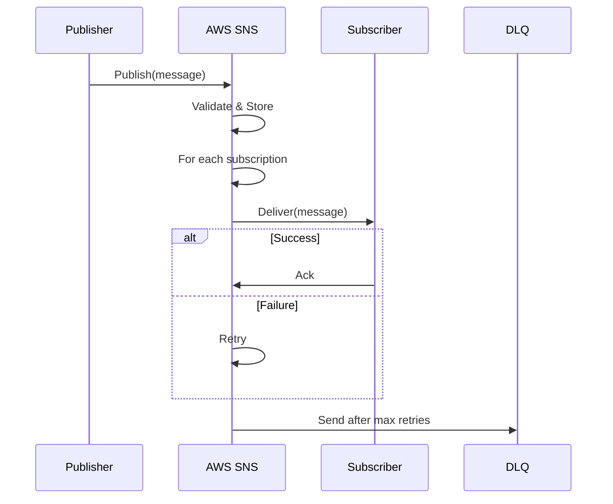

<!-- Generated by Groq via GitHub Actions -->
<!-- Topic ID: T206 -->
<!-- Category: Cloud Backend -->
<!-- Generated at UTC: 2026-11-13T08:18:35.551473+00:00 -->

# AWS SNS

## 1. What problem does this solve?

| Problem | Why it matters | Consequence of not using SNS | Real‑world use cases |
|---------|----------------|------------------------------|----------------------|
| **Tight coupling** between services | When Service A calls Service B directly, a failure in B breaks A. | Cascading failures, hard to scale, hard to test. | E‑commerce order service calling inventory and payment services. |
| **Scalability bottlenecks** | A single endpoint can only handle so many requests. | Throughput limits, increased latency. | Real‑time analytics pipelines. |
| **Event distribution** | Multiple downstream consumers need the same event (e.g., audit log, notification, analytics). | Duplicate code, inconsistent data. | User sign‑up triggers email, SMS, and analytics. |
| **Reliability & retry** | Network glitches can drop messages if you rely on a single request. | Lost data, inconsistent state. | IoT sensor data ingestion. |

AWS SNS (Simple Notification Service) is a fully managed **pub/sub** messaging service that decouples producers from consumers, scales automatically, and provides built‑in retry, dead‑letter, and filtering capabilities.

---

## 2. Mental model

### Analogy: The Postal Service

- **Publisher** → **Post Office**: A user writes a letter (message) and drops it at the post office (SNS topic).  
- **Topic** → **Mailing List**: The post office knows which mailing lists (subscriptions) the letter should go to.  
- **Subscriber** → **Recipient’s mailbox**: Each subscriber receives a copy of the letter.  
- **Delivery protocols** → **Mail carriers**: The post office can deliver via mail, email, or courier (HTTP, email, SMS, Lambda, SQS, etc.).  

### Engineering model

```
Publisher → SNS Topic → Subscriptions → Endpoints
```

- **Topic**: Logical channel for a type of event.  
- **Subscription**: Endpoint that receives copies of every message published to the topic.  
- **Protocol**: How the message is delivered (HTTP/HTTPS, email, SMS, Lambda, SQS, etc.).  
- **Message**: Payload + attributes (metadata).  

---

## 3. Deep explanation

### Internals

1. **Topics** are the central routing entities.  
2. When a message is published, SNS **stores** it briefly (up to 24 h) and **forwards** it to all subscriptions.  
3. SNS supports **message filtering**: a subscriber can receive only messages that match a set of attributes.  
4. Delivery is **at‑least‑once**; SNS retries failed deliveries up to 4 days (configurable).  
5. **Dead‑letter queues (DLQ)** can capture messages that fail after all retries.  

### Important terminology

| Term | Meaning |
|------|---------|
| **Topic** | Named logical channel. |
| **Subscription** | Endpoint + protocol. |
| **Message** | JSON or raw string payload. |
| **Message attribute** | Key/value metadata used for filtering. |
| **Delivery policy** | Retry strategy, back‑off, max attempts. |
| **DLQ** | SQS queue or Lambda DLQ for failed messages. |

### Trade‑offs

| Feature | Pros | Cons |
|---------|------|------|
| **Fan‑out** | One publish reaches many subscribers. | Higher cost per message (each delivery counts). |
| **Filtering** | Reduce noise for subscribers. | Requires attribute design; more complex. |
| **Retries** | Improves reliability. | Potential duplicate processing; increased latency. |
| **HTTP/HTTPS** | Direct integration with web services. | Requires endpoint availability; can time out. |
| **SQS** | Buffers messages, decouples downstream. | Adds another component; extra cost. |

### Failure modes

- **Endpoint failure**: HTTP 5xx or timeout → SNS retries.  
- **Message size > 256 KB**: Publish fails.  
- **Permission denied**: IAM policy missing.  
- **DLQ misconfiguration**: Failed messages lost.  

### Limitations

- **Message size**: 256 KB (incl. attributes).  
- **Per‑region limits**: 100 000 topics, 10 000 subscriptions per topic (soft limits).  
- **No ordering guarantee**: Messages may arrive out of order.  
- **No built‑in persistence**: SNS is transient; use SQS or Kinesis for durable storage.  

### Where it fits

- **Event bus** for microservices.  
- **Trigger** for Lambda functions.  
- **Fan‑out** to SQS, email, SMS, or HTTP endpoints.  
- **Bridge** between on‑prem and cloud services via API Gateway.

### Interaction with related concepts

| Concept | Interaction |
|---------|-------------|
| **SQS** | SNS can push to SQS; SQS can fan‑out to SNS. |
| **Lambda** | SNS can trigger Lambda; Lambda can publish to SNS. |
| **API Gateway** | API Gateway can publish to SNS. |
| **CloudWatch** | SNS emits metrics (Publish, Deliver, Fail). |
| **IAM** | Fine‑grained permissions for publish/subscribe. |

---

## 4. How it works

1. **Publisher** calls `Publish` API with topic ARN and message.  
2. SNS **validates** the message (size, format).  
3. SNS **stores** the message temporarily.  
4. SNS **iterates** over all subscriptions for the topic.  
5. For each subscription, SNS **applies filtering** (if any).  
6. SNS **delivers** the message via the configured protocol.  
7. If delivery fails, SNS **retries** according to the delivery policy.  
8. After max attempts, SNS sends the message to the **DLQ** (if configured).  



---

## 5. Practical implementation

### 5.1 Create a topic and subscription (HTTP)

```ts
// src/sns.ts
import { SNSClient, CreateTopicCommand, SubscribeCommand, PublishCommand } from "@aws-sdk/client-sns";

const client = new SNSClient({ region: "us-east-1" });

export async function createTopic(name: string) {
  const { TopicArn } = await client.send(new CreateTopicCommand({ Name: name }));
  return TopicArn!;
}

export async function subscribeHttp(topicArn: string, url: string) {
  const { SubscriptionArn } = await client.send(
    new SubscribeCommand({
      TopicArn: topicArn,
      Protocol: "https",
      Endpoint: url,
    })
  );
  return SubscriptionArn!;
}

export async function publish(topicArn: string, payload: any) {
  await client.send(
    new PublishCommand({
      TopicArn: topicArn,
      Message: JSON.stringify(payload),
      MessageAttributes: {
        // Example attribute for filtering
        eventType: {
          DataType: "String",
          StringValue: payload.type,
        },
      },
    })
  );
}
```

### 5.2 HTTP endpoint that receives SNS messages

```ts
// src/server.ts
import express from "express";
import bodyParser from "body-parser";

const app = express();
app.use(bodyParser.json());

// SNS requires a signature verification step in production.
// For demo purposes we skip it.
app.post("/sns", (req, res) => {
  const message = req.body;
  console.log("Received SNS message:", message);
  res.sendStatus(200);
});

app.listen(3000, () => console.log("HTTP subscriber listening on 3000"));
```

### 5.3 Publish a message

```ts
// src/publish.ts
import { createTopic, subscribeHttp, publish } from "./sns";

async function main() {
  const topicArn = await createTopic("user-events");
  await subscribeHttp(topicArn, "https://myapp.com/sns");
  await publish(topicArn, { type: "user.signup", userId: 123 });
}

main().catch(console.error);
```

> **Tip:** In production, verify the SNS signature (`X-Amz-Sns-Signature`) to avoid spoofed requests.

### 5.4 SNS → Lambda (serverless example)

```ts
// lambda/index.ts
import { SNSEvent, Context, Callback } from "aws-lambda";

export const handler = async (event: SNSEvent, context: Context, callback: Callback) => {
  for (const record of event.Records) {
    const payload = JSON.parse(record.Sns.Message);
    console.log("Lambda received:", payload);
    // Process event...
  }
  callback(null, "Success");
};
```

Deploy the Lambda and subscribe it to the topic via the console or CloudFormation.

---

## 6. Production considerations

| Concern | What to do |
|---------|------------|
| **Scalability** | Use SNS fan‑out to SQS for buffering; enable *message batching* in SQS. |
| **Reliability** | Configure DLQ; set delivery policy (max attempts, back‑off). |
| **Security** | IAM policies: `sns:Publish`, `sns:Subscribe`, `sns:Receive`. Use **encryption** (KMS) for message body. Verify signatures on HTTP endpoints. |
| **Observability** | CloudWatch metrics: `Publish`, `Deliver`, `Failed`. Enable CloudWatch Logs for Lambda. Use SNS topic tags for cost allocation. |
| **Performance** | Monitor latency; use *message filtering* to reduce traffic. |
| **Error handling** | Catch exceptions in subscribers; send to DLQ if needed. |
| **Resource usage** | Cost per message: $0.50 per 1M publishes (US‑East‑1). Avoid unnecessary fan‑out. |
| **Operational** | Use IaC (CloudFormation/Terraform) to manage topics/subscriptions. Version topics per environment. |
| **Failure recovery** | Inspect DLQ; reprocess messages manually or via Lambda. |
| **Deployment** | Use *Change Sets* for CloudFormation; test in staging before prod. |

---

## 7. Common mistakes

| Mistake | Why it’s bad |
|---------|--------------|
| **Using SNS for point‑to‑point** | SNS is pub/sub; for single consumer use SQS or direct HTTP. |
| **Ignoring DLQ** | Failed messages silently disappear; hard to debug. |
| **Exceeding message size** | Publish fails; use S3 + SNS or SQS for large payloads. |
| **Over‑subscribing HTTP endpoints** | Each HTTP subscriber incurs a request; can overwhelm services. |
| **No message filtering** | Subscribers receive all messages, causing unnecessary processing. |
| **Hard‑coding ARNs** | Makes deployments brittle; use CloudFormation outputs or environment variables. |
| **Skipping signature verification** | Security risk; allow spoofed messages. |

---

## 8. Senior engineer perspective

### Architecture decisions

- **Event bus vs. direct calls**: Use SNS when you need multiple downstream consumers or eventual consistency.  
- **Topic per domain**: Keeps concerns isolated; easier to manage permissions.  
- **Fan‑out to SQS**: Adds buffering, retries, and ordering guarantees.  
- **Message filtering**: Reduces noise; design attributes early.  

### Trade‑offs

- **Cost vs. simplicity**: Fan‑out increases cost; consider whether all subscribers need the message.  
- **Latency**: HTTP delivery can be slow; use Lambda or SQS for low‑latency processing.  
- **Ordering**: SNS does not guarantee order; use SQS FIFO if needed.  

### Bottlenecks

- **Topic limits**: 100 000 topics per region; rarely hit but consider naming conventions.  
- **Subscription limits**: 10 000 per topic; use topic hierarchy or multiple topics if needed.  
- **Delivery throttling**: If a subscriber is slow, SNS retries can back‑pressure the publisher.  

### Failure scenarios

- **Endpoint unavailability**: SNS retries but may hit DLQ; monitor `Failed` metric.  
- **IAM mis‑configuration**: Publish fails; check `AccessDenied` logs.  
- **Network partitions**: Use SQS as buffer to absorb spikes.  

### Monitoring

- CloudWatch metrics: `Publish`, `Deliver`, `Failed`, `NumberOfMessagesPublished`.  
- Custom dashboards: Show per‑topic traffic, DLQ depth.  
- Alerts: Trigger when DLQ depth > 0 or `Failed` > threshold.  

### Cost/performance

- **Per‑message cost**: $0.50 per 1 M publishes + $0.10 per 1 M deliveries.  
- **Batching**: Use SQS batching to reduce cost.  
- **Compression**: Compress payloads if size close to 256 KB.  

### When NOT to use

- **Low volume, synchronous**: Direct HTTP or gRPC is cheaper.  
- **Strict ordering**: Use SQS FIFO or Kinesis.  
- **Large payloads**: Store in S3 and send a reference.  

---

## 9. Interview questions

1. **Beginner** – *What is AWS SNS and how does it differ from SQS?*  
   *Answer:* SNS is a pub/sub notification service; SQS is a queue. SNS pushes to subscribers; SQS pulls. SNS is for fan‑out; SQS is for point‑to‑point.

2. **Beginner** – *What is a message attribute in SNS?*  
   *Answer:* Key/value metadata attached to a message, used for filtering subscribers.

3. **Senior** – *Explain how you would implement message filtering in SNS and its cost implications.*  
   *Answer:* Add attributes to messages; configure subscription filter policy (JSON). Filtering reduces traffic to subscribers, lowering cost and processing overhead. However, each message still counts toward publish cost.

4. **Senior** – *What are the trade‑offs of using SNS fan‑out to many HTTP endpoints versus SNS → SQS → Lambda?*  
   *Answer:* HTTP fan‑out is simple but each endpoint must be highly available; retries can overload services. SNS→SQS buffers, decouples, and guarantees at‑least‑once delivery; cost increases due to SQS usage but reliability improves.

5. **Scenario/Debugging** – *A user sign‑up triggers an email and SMS via SNS. The SMS occasionally fails, but the email always succeeds. How would you diagnose and fix this?*  
   *Answer:* Check CloudWatch metrics for the SMS subscription (`Failed`). Inspect the DLQ for failed messages. Verify IAM permissions for SNS to send SMS. Ensure the phone number format is correct. If using HTTP endpoints, verify the endpoint’s health and timeout settings. Consider adding a DLQ and monitoring its depth.

---

## 10. Hands‑on task

**Goal:** Build a small microservice that publishes “order created” events to SNS and another service that subscribes via HTTP and logs the events.

1. **Create an SNS topic** named `orders`.  
2. **Publish** a JSON payload `{ "orderId": 42, "status": "created" }` from a Node.js script.  
3. **Set up an HTTP endpoint** (Express) that receives SNS messages and writes them to a local file `orders.log`.  
4. **Verify** that the message appears in the log.  
5. (Optional) **Add message filtering** so the endpoint only receives events where `status = "created"`.

Use Docker Compose to run both services locally, or use LocalStack to mock SNS.

---

## 11. Quick revision

- SNS is a managed **pub/sub** service for event distribution.  
- **Topic** = channel; **Subscription** = endpoint.  
- Supports **HTTP/HTTPS, email, SMS, Lambda, SQS** protocols.  
- **Message size limit**: 256 KB.  
- **Retries**: up to 4 days; configurable via delivery policy.  
- **DLQ** captures messages after max retries.  
- **Filtering** uses message attributes and JSON policies.  
- **IAM** controls publish/subscribe actions.  
- **Cost**: $0.50/M publishes, $0.10/M deliveries.  
- **Use cases**: event bus, fan‑out, serverless triggers.  
- **Common pitfalls**: ignoring DLQ, exceeding size, over‑subscribing HTTP.  
- **Senior tips**: buffer with SQS, use filtering, monitor CloudWatch metrics, version topics.

---

## 12. References

- [AWS SNS Developer Guide](https://docs.aws.amazon.com/sns/latest/dg/welcome.html)  
- [SNS Topics and Subscriptions](https://docs.aws.amazon.com/sns/latest/dg/sns-topics.html)  
- [Message Filtering](https://docs.aws.amazon.com/sns/latest/dg/sns-message-filtering.html)  
- [Dead‑Letter Queues](https://docs.aws.amazon.com/sns/latest/dg/sns-dead-letter-queues.html)  
- [SNS Pricing](https://aws.amazon.com/sns/pricing/)  
- [AWS SDK for JavaScript v3](https://docs.aws.amazon.com/AWSJavaScriptSDK/v3/latest/index.html)
