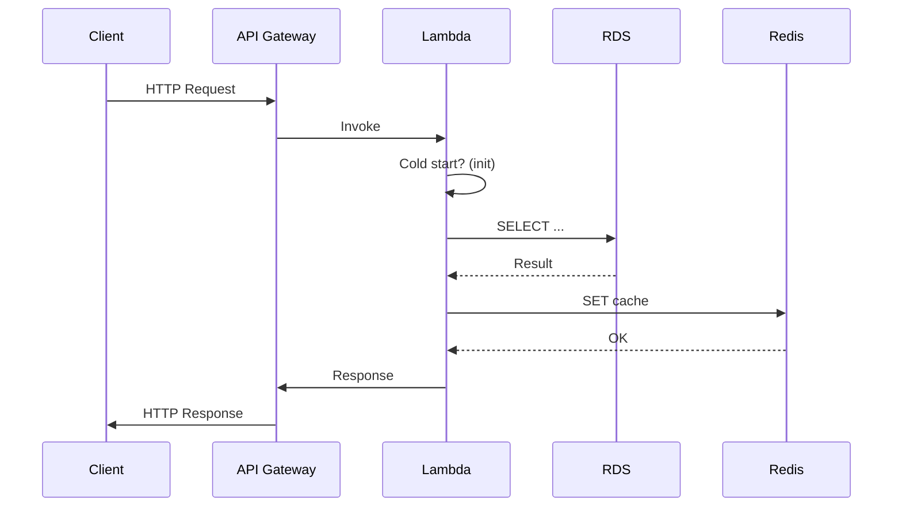

<!-- Generated by Groq via GitHub Actions -->
<!-- Topic ID: T207 -->
<!-- Category: Cloud Backend -->
<!-- Generated at UTC: 2026-11-13T20:35:48.014765+00:00 -->

# AWS Lambda

## 1. What problem does this solve?

**Motivation**  
Modern backends often need to run code in response to events (HTTP requests, file uploads, queue messages) without managing servers. Developers want to focus on business logic, not on provisioning, patching, or scaling infrastructure.

**What problem exists**  
- **Operational overhead**: spinning up EC2 instances, managing OS, scaling, patching, and monitoring.  
- **Cost inefficiency**: paying for idle servers even when traffic is low.  
- **Scaling complexity**: manual scaling or auto‑scaling groups can lag behind traffic spikes.  
- **Latency unpredictability**: cold starts can add noticeable latency.

**Why the problem matters**  
- **User experience**: slow or unavailable services hurt retention.  
- **Cost control**: unexpected server costs can blow budgets.  
- **Developer velocity**: spending time on ops delays feature delivery.

**What happens if this concept is not used**  
- You’ll need to maintain a fleet of servers or containers, incurring higher operational costs and slower scaling.  
- Scaling decisions become manual or require complex auto‑scaling logic.  
- You’ll pay for compute even when no requests are served.

**Where this concept appears in real backend systems**  
- **API backends**: Lambda behind API Gateway handles REST/GraphQL endpoints.  
- **Event processing**: Lambda triggered by S3, DynamoDB Streams, Kinesis, or SNS to process data.  
- **Background jobs**: scheduled tasks via CloudWatch Events or EventBridge.  
- **Microservice orchestration**: Step Functions orchestrate multiple Lambdas.

---

## 2. Mental model

**Analogy**  
Think of Lambda as a *pay‑per‑use vending machine* for code. You put in a request (the “coin”), the machine (Lambda runtime) runs the exact function you asked for, and then it’s gone. You only pay for the exact time the machine spends processing your request, not for the machine being idle.

**Engineering model**  
- **Stateless function**: each invocation runs in a fresh or warm container.  
- **Event‑driven**: Lambda is triggered by an event source (API Gateway, S3, SQS, etc.).  
- **Containerized runtime**: AWS manages a lightweight container that hosts your code and its dependencies.  
- **Auto‑scaling**: AWS automatically spins up containers to match traffic, up to concurrency limits.  
- **Pay‑for‑execution**: you pay per 100 ms of execution time and the memory allocated.

---

## 3. Deep explanation

### Internals
| Component | Role |
|-----------|------|
| **Runtime** | Node.js, Python, Java, Go, .NET, or custom container image. Handles bootstrapping, environment variables, and invoking the handler. |
| **Container** | Lightweight OS container that isolates the function. AWS reuses containers (warm start) to reduce latency. |
| **Event Source Mapping** | Connects an event source (SQS, DynamoDB Streams, etc.) to the Lambda function. |
| **Execution Role** | IAM role that grants the function permissions to other AWS services. |
| **Concurrency** | Max number of simultaneous executions. Reserved concurrency guarantees capacity for critical functions. |
| **Provisioned Concurrency** | Pre‑warmed containers to eliminate cold starts for a cost. |

### Important terminology
- **Cold start**: first invocation after the container is created. Latency can be 100 ms–1 s+ depending on language and dependencies.  
- **Warm start**: subsequent invocations reuse the container, reducing latency.  
- **Timeout**: maximum execution time (default 3 s, max 15 min). Exceeding it aborts the function.  
- **Memory**: allocated memory (128 MiB–10 GiB). CPU and network throughput scale linearly with memory.  
- **Dead‑Letter Queue (DLQ)**: SQS or SNS queue that receives failed events for later inspection.  
- **Version & Alias**: immutable snapshots of code; aliases point to a version and can be used for traffic shifting.  

### Trade‑offs
| Trade‑off | Impact |
|-----------|--------|
| **Cold start vs. cost** | Provisioned concurrency reduces latency but increases cost. |
| **Statelessness vs. caching** | No persistent state; use external cache (Redis, DynamoDB) for shared data. |
| **Memory vs. CPU** | More memory gives more CPU; choose based on workload. |
| **VPC integration vs. latency** | Connecting to a VPC adds 1–2 s latency but allows access to RDS, DynamoDB, etc. |
| **Container image vs. deployment package** | Images allow any runtime but increase deployment size and cold start time. |

### Failure modes
- **Throttling**: exceeding concurrency limits results in `429` errors.  
- **Timeouts**: long‑running tasks are killed.  
- **Resource limits**: exceeding memory or disk (`/tmp` max 512 MiB).  
- **IAM misconfig**: missing permissions cause failures.  
- **VPC misconfig**: no route to the internet or DB.  

### Limitations
- Max runtime 15 minutes.  
- No background threads or long‑lived sockets.  
- Limited local storage (`/tmp` 512 MiB).  
- No persistent state; must use external services.  
- Vendor lock‑in to AWS unless using container images with other providers.  

### Where it fits in a backend architecture
- **Microservice**: each Lambda can be a microservice endpoint.  
- **Event‑driven**: Lambda processes events from S3, Kinesis, etc.  
- **Orchestration**: Step Functions coordinate multiple Lambdas.  
- **API Gateway**: front‑end HTTP interface that routes to Lambda.  

### Interaction with related concepts
- **API Gateway**: HTTP trigger, request/response mapping, throttling.  
- **SQS / SNS**: queue or pub/sub triggers.  
- **DynamoDB Streams**: change‑data capture.  
- **CloudWatch**: logs, metrics, alarms.  
- **X‑Ray**: distributed tracing.  
- **IAM**: least‑privilege execution role.  
- **VPC**: secure access to RDS, Redis, etc.  

---

## 4. How it works

1. **Event source** (e.g., API Gateway) receives a request.  
2. API Gateway forwards the event to Lambda.  
3. If no warm container exists, AWS spins up a new container (cold start).  
4. Lambda runtime loads the handler, injects environment variables, and executes the function.  
5. Function performs business logic (e.g., query PostgreSQL, cache in Redis).  
6. Function returns a response or writes to a downstream service.  
7. Lambda sends the response back to API Gateway, which returns it to the client.  
8. Container may stay warm for subsequent invocations.



---

## 5. Practical implementation

Below is a realistic TypeScript Lambda that:

- Exposes an HTTP endpoint via API Gateway.  
- Reads a user record from PostgreSQL.  
- Caches the result in Redis.  
- Uses environment variables for secrets (stored in Parameter Store or Secrets Manager).  

```ts
// src/lambda/getUser.ts
import { APIGatewayProxyHandler } from 'aws-lambda';
import { Client as PgClient } from 'pg';
import Redis from 'ioredis';

const pgClient = new PgClient({
  connectionString: process.env.PG_CONNECTION_STRING,
});
const redis = new Redis({
  host: process.env.REDIS_HOST,
  port: Number(process.env.REDIS_PORT),
});

export const handler: APIGatewayProxyHandler = async (event) => {
  const userId = event.pathParameters?.id;
  if (!userId) {
    return { statusCode: 400, body: 'Missing user id' };
  }

  // 1️⃣ Try cache first
  const cacheKey = `user:${userId}`;
  const cached = await redis.get(cacheKey);
  if (cached) {
    return { statusCode: 200, body: cached };
  }

  // 2️⃣ Query DB
  await pgClient.connect();
  const res = await pgClient.query('SELECT id, name, email FROM users WHERE id = $1', [userId]);
  await pgClient.end();

  if (res.rows.length === 0) {
    return { statusCode: 404, body: 'User not found' };
  }

  const user = res.rows[0];
  const payload = JSON.stringify(user);

  // 3️⃣ Cache result for 5 minutes
  await redis.set(cacheKey, payload, 'EX', 300);

  return { statusCode: 200, body: payload };
};
```

**Key points**

- `pgClient.connect()` and `pgClient.end()` are called per invocation to avoid connection leaks.  
- Redis is used for caching to reduce DB load.  
- Environment variables hold secrets; in production use Parameter Store or Secrets Manager.  
- The function is stateless; all state lives in external services.

**Deployment with SAM**

```yaml
# template.yaml
AWSTemplateFormatVersion: '2010-09-09'
Transform: AWS::Serverless-2016-10-31
Resources:
  GetUserFunction:
    Type: AWS::Serverless::Function
    Properties:
      Handler: dist/getUser.handler
      Runtime: nodejs20.x
      CodeUri: .
      MemorySize: 512
      Timeout: 10
      Environment:
        Variables:
          PG_CONNECTION_STRING: !Ref PostgresConnectionString
          REDIS_HOST: !Ref RedisHost
          REDIS_PORT: !Ref RedisPort
      Policies:
        - AWSLambdaVPCAccessExecutionRole
      VpcConfig:
        SecurityGroupIds:
          - !Ref LambdaSG
        SubnetIds:
          - !Ref PrivateSubnet1
          - !Ref PrivateSubnet2
```

Compile TypeScript (`tsc`) and deploy with `sam deploy`.

---

## 6. Production considerations

| Concern | What to do |
|---------|------------|
| **Scalability** | Use reserved concurrency for critical functions; consider provisioned concurrency for latency‑sensitive workloads. |
| **Reliability** | Enable DLQs for event sources; use retries with exponential backoff; monitor throttling. |
| **Security** | Grant least‑privilege IAM roles; encrypt environment variables; use VPC endpoints for RDS/Redis. |
| **Observability** | Enable CloudWatch Logs, Metrics, and X‑Ray tracing; set up dashboards and alerts. |
| **Performance** | Profile cold start latency; use smaller memory if CPU is not bottleneck; cache external calls. |
| **Error handling** | Return meaningful HTTP status codes; log stack traces; use try/catch around external calls. |
| **Resource usage** | Monitor memory and CPU consumption; adjust allocation; avoid global variables that grow. |
| **Operational concerns** | Use CI/CD pipelines (GitHub Actions, CodePipeline); version and alias functions; use canary deployments. |
| **Failure recovery** | Implement DLQs; use Step Functions for retries; monitor for throttling. |
| **Deployment considerations** | Use SAM or CDK; keep deployment package < 50 MB; use container images for complex dependencies. |

---

## 7. Common mistakes

| Mistake | Why it’s problematic |
|---------|----------------------|
| **Ignoring cold starts** | Leads to inconsistent latency; users see slow responses. |
| **Using global mutable state** | State leaks between invocations; race conditions. |
| **Not handling async properly** | Unhandled promises cause function to exit early, losing work. |
| **Overusing `/tmp`** | Exceeds 512 MiB limit; causes failures. |
| **Setting timeout too low** | Legitimate work gets killed; data loss. |
| **Hard‑coding secrets** | Security breach; hard to rotate. |
| **Missing IAM permissions** | Function fails silently; hard to debug. |
| **Not configuring VPC correctly** | No network access to RDS/Redis; 504 errors. |
| **Not using versioning/aliases** | Hard to roll back; accidental deployments. |
| **Exposing Lambda directly** | No throttling or request validation; security risk. |

---

## 8. Senior engineer perspective

### When used at scale
- **Millions of invocations/day**: need reserved concurrency, provisioned concurrency, and careful cost modeling.  
- **High throughput**: consider batching, async patterns, or moving heavy work to ECS/EKS.  
- **Stateful workloads**: use DynamoDB, Redis, or RDS; avoid in‑memory state.  

### Design decisions
- **Architecture**: microservice vs. monolith; event‑driven vs. request‑driven.  
- **Concurrency strategy**: reserved vs. provisioned; set limits per function.  
- **Cost optimization**: balance memory vs. CPU; use Lambda Power Tuning.  
- **Observability**: X‑Ray sampling rate, CloudWatch dashboards, custom metrics.  
- **Deployment**: use CDK/Terraform for IaC; versioning, aliases, canary.  
- **Security**: IAM roles per function, VPC endpoints, secrets manager.  

### Bottlenecks
- **Cold starts**: mitigated by provisioned concurrency or container images.  
- **Database connections**: use connection pooling or RDS Proxy.  
- **VPC networking**: subnets, NAT gateways, route tables.  
- **Memory**: high memory increases CPU but also cost.  

### Failure scenarios
- **Throttling**: set alarms; increase concurrency or split into multiple functions.  
- **IAM misconfig**: use IAM Access Analyzer; audit roles.  
- **VPC misconfig**: ensure security groups allow required traffic.  

### Monitoring
- CloudWatch metrics: `Invocations`, `Duration`, `Errors`, `Throttles`.  
- Alarms on error rates, latency, throttles.  
- X‑Ray traces for distributed calls.  

### Cost/performance
- **Memory**: 128 MiB gives 1 CPU core; 512 MiB gives 4 CPU cores.  
- **Provisioned concurrency**: $0.000004 per 100 ms per GB‑second.  
- **Reserved concurrency**: $0.0000002 per invocation.  

### When NOT to use
- **Long‑running jobs (>15 min)**: use ECS/EKS or Step Functions.  
- **Stateful services**: use containers or EC2.  
- **High‑throughput, low‑latency**: consider Fargate or EC2 with load balancer.  
- **GPU workloads**: Lambda does not support GPUs.  

---

## 9. Interview questions

1. **Beginner** – *What is a cold start in AWS Lambda, and how can it affect your application?*  
   *Answer:* A cold start occurs when Lambda creates a new container for a function that hasn't run recently. It adds latency (hundreds of ms to seconds). It can affect user experience, especially for latency‑sensitive APIs.

2. **Beginner** – *How does Lambda achieve auto‑scaling?*  
   *Answer:* AWS automatically spins up new containers in response to incoming events, up to the function’s concurrency limit. Each container handles one invocation at a time.

3. **Senior** – *Explain how you would design a Lambda‑based system that processes a high‑volume stream of events from Kinesis while ensuring at‑least‑once processing and minimal latency.*  
   *Answer:* Use Kinesis event source mapping with batch size 1–10, enable `BatchWindow` for small bursts, use DynamoDB or SQS DLQ for retries, use Lambda Destinations for success/failure routing, and consider using Step Functions for complex orchestration. Use provisioned concurrency to reduce cold starts.

4. **Senior** – *What are the trade‑offs between using a Lambda function with a VPC versus without, and how do you mitigate the performance impact?*  
   *Answer:* VPC integration allows access to private resources (RDS, Redis) but adds ~1–2 s latency due to ENI attachment. Mitigation: use VPC endpoints, keep subnets small, use RDS Proxy, or move the function to a private subnet with a NAT gateway and minimal security group rules.

5. **Scenario/Debugging** – *Your Lambda function is intermittently returning 504 Gateway Timeout errors when called through API Gateway. What could be causing this, and how would you investigate?*  
   *Answer:* Possible causes: function timeout too low, cold start latency exceeding API Gateway timeout, or downstream service (DB, Redis) timing out. Investigate by checking CloudWatch Logs for `Task timed out after X seconds`, reviewing API Gateway integration timeout settings, enabling X‑Ray tracing, and monitoring downstream service latency.

---

## 10. Hands‑on task

**Goal**: Build and deploy a Lambda that processes an S3 “ObjectCreated” event, reads the uploaded CSV, stores rows into PostgreSQL, and caches a summary in Redis.

**Steps**

1. **Create a new Node.js project** (`npm init -y`).  
2. **Add dependencies**: `pg`, `ioredis`, `csv-parse`.  
3. **Write `src/lambda/processCsv.ts`** that:
   - Parses the S3 event to get bucket/key.  
   - Streams the object from S3.  
   - Parses CSV rows.  
   - Inserts rows into PostgreSQL (use `pg.Pool`).  
   - Stores a count in Redis.  
4. **Configure SAM** (`template.yaml`) with:
   - `processCsv` function triggered by S3 bucket.  
   - IAM role with `s3:GetObject`, `rds:Connect`, `redis:*`.  
   - VPC config if needed.  
5. **Deploy** (`sam build && sam deploy`).  
6. **Test**: upload a CSV to the bucket and check CloudWatch logs, PostgreSQL table, and Redis key.  
7. **Optional**: add a CloudWatch Event rule to trigger the Lambda every hour for scheduled processing.

---

## 11. Quick revision

- Lambda is a *stateless, event‑driven compute* that scales automatically.  
- **Cold start**: first invocation latency; mitigated by provisioned concurrency.  
- **Concurrency**: max simultaneous executions; reserve for critical functions.  
- **Environment**: secrets via Parameter Store/Secrets Manager; no persistent `/tmp`.  
- **VPC**: adds latency; use VPC endpoints and RDS Proxy.  
- **Error handling**: use DLQs, retries, and proper status codes.  
- **Observability**: CloudWatch Logs/Metrics, X‑Ray tracing, custom metrics.  
- **Cost**: pay per 100 ms * memory; balance memory vs. CPU.  
- **Testing**: local SAM CLI, unit tests with mocked AWS SDK.  
- **Deployment**: SAM, CDK, Terraform; versioning and aliases.  
- **When not to use**: long‑running jobs, stateful workloads, GPU tasks, >15 min tasks.

---

## 12. References

- https://docs.aws.amazon.com/lambda/latest/dg/welcome.html  
- https://docs.aws.amazon.com/lambda/latest/dg/configuration-concurrency.html  
- https://docs.aws.amazon.com/lambda/latest/dg/cold-start.html  
- https://docs.aws.amazon.com/lambda/latest/dg/with-s3.html  
- https://docs.aws.amazon.com/lambda/latest/dg/monitoring-cloudwatch.html  
- https://docs.aws.amazon.com/lambda/latest/dg/monitoring-xray.html  
- https://docs.aws.amazon.com/lambda/latest/dg/iam-roles.html  
- https://docs.aws.amazon.com/lambda/latest/dg/limits.html  
- https://docs.aws.amazon.com/serverless-application-model/latest/developerguide/what-is-sam.html  
- https://aws.amazon.com/architecture/serverless/  

---
