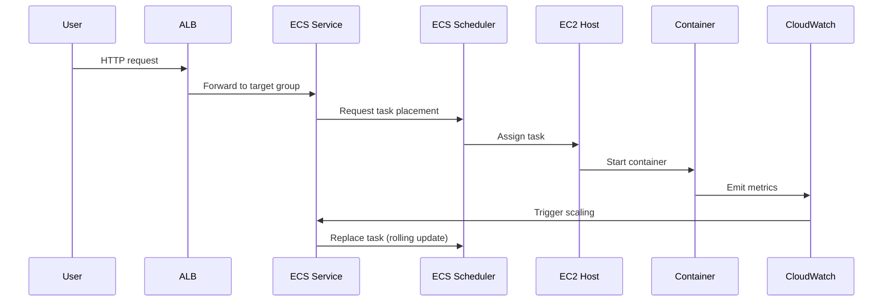

<!-- Generated by Groq via GitHub Actions -->
<!-- Topic ID: T208 -->
<!-- Category: Cloud Backend -->
<!-- Generated at UTC: 2026-11-13T20:35:48.014765+00:00 -->

# AWS ECS

## 1. What problem does this solve?

**Motivation**  
Modern web services are built from many micro‑services: a Next.js front‑end, a FastAPI API, a background worker, a Redis cache, etc.  
Deploying each service as a Docker container is straightforward, but running those containers at scale on a fleet of EC2 instances or on Fargate requires orchestration: scheduling, health checks, scaling, networking, and load balancing.

**The problem**  
- *Manual orchestration*: Without a tool, you’d have to write scripts to start/stop containers, monitor them, and restart on failure.  
- *Resource waste*: Running a single container on a large EC2 instance wastes CPU/memory.  
- *Zero‑downtime deployments*: Rolling updates without service interruption are hard to get right manually.  
- *Observability*: You need a unified view of logs, metrics, and health.

**Why it matters**  
If you ignore orchestration, you’ll spend more time on operations than on features, and your services will be brittle, hard to scale, and hard to debug.

**Real‑world appearance**  
- A Next.js app behind an Application Load Balancer (ALB) that forwards requests to a set of ECS tasks.  
- A FastAPI worker that processes messages from an SQS queue, scaled by CloudWatch alarms.  
- A background job runner (e.g., Celery) deployed as an ECS task that restarts automatically on failure.

---

## 2. Mental model

**Analogy**  
Think of ECS as a *hotel manager* for your containers.  
- **Rooms** = EC2 instances or Fargate hosts.  
- **Guests** = Docker containers (tasks).  
- The manager assigns guests to rooms, checks in/out, ensures each guest has a clean room (health checks), and if a room is broken, moves the guest elsewhere (auto‑replacement).  
- The manager also handles housekeeping (logs, metrics) and can add or remove rooms based on demand (autoscaling).

**Engineering model**  
- **Cluster**: A logical grouping of container hosts (EC2 or Fargate).  
- **Task Definition**: Blueprint for a container (image, CPU, memory, ports).  
- **Task**: A running instance of a task definition.  
- **Service**: A long‑running set of tasks that maintains desired count, handles load balancing, and performs rolling updates.  
- **Scheduler**: Decides where to place tasks within the cluster.  
- **Load Balancer**: Routes traffic to tasks via target groups.

---

## 3. Deep explanation

### Internals
- **ECS Agent** runs on each EC2 instance, reporting state to the ECS control plane and pulling task definitions.  
- **Task Placement** uses placement strategies (bin‑pack, random, spread) and constraints (instance type, availability zone).  
- **Service Scheduler** (default) or **Daemon Scheduler** (runs one task per instance).  
- **Fargate** removes the need for EC2 instances; AWS manages the host.

### Important terminology
| Term | Meaning |
|------|---------|
| **Cluster** | Collection of container hosts. |
| **Task Definition** | Immutable JSON that describes containers, resources, IAM role, networking. |
| **Task** | Runtime instance of a task definition. |
| **Service** | Desired state manager for tasks. |
| **Task Placement Strategy** | Rules for distributing tasks. |
| **Target Group** | Set of IPs/ports for load balancer routing. |
| **Task Role** | IAM role assumed by containers. |
| **Execution Role** | IAM role used by ECS agent to pull images and write logs. |

### Trade‑offs
| Option | Pros | Cons |
|--------|------|------|
| **EC2 launch type** | Full control over instances, cheaper for high utilization. | Requires managing EC2 lifecycle, patching, scaling. |
| **Fargate launch type** | No server management, auto‑scaling, pay per task. | Slightly higher cost per vCPU/memory, limited custom AMIs. |
| **Service vs. Standalone Task** | Services provide desired‑count, load balancing, rolling updates. | Extra overhead; tasks are simpler but lack these features. |

### Failure modes
- **Task crashes** → ECS restarts automatically (unless `stopTimeout` exceeded).  
- **Host failure** (EC2) → tasks are rescheduled on healthy hosts.  
- **Networking issues** → Target group health checks fail; traffic stops routing.  
- **IAM mis‑configuration** → Tasks cannot pull images or write logs.

### Limitations
- **Stateful workloads**: ECS is stateless; attach EFS or use RDS for persistence.  
- **Fine‑grained autoscaling**: Requires CloudWatch metrics or Application Auto Scaling policies.  
- **Cross‑region replication**: Must manually duplicate clusters.

### Where it fits
- **Front‑end**: Next.js container behind ALB.  
- **API**: FastAPI container behind ALB or NLB.  
- **Background workers**: ECS tasks triggered by CloudWatch events or SQS.  
- **Data pipelines**: ECS tasks that process Kafka streams.

### Interaction with related concepts
- **IAM**: Task and execution roles.  
- **VPC**: Networking, subnets, security groups.  
- **CloudWatch**: Logs, metrics, alarms.  
- **Application Auto Scaling**: Scale services based on CPU/Memory or custom metrics.  
- **ECR**: Container registry.  
- **EFS**: Shared file system for stateful containers.

---

## 4. How it works

1. **Define a Task Definition** in JSON or via the console.  
2. **Create a Cluster** (EC2 or Fargate).  
3. **Create a Service** that references the task definition and desired count.  
4. **ECS Scheduler** places tasks on hosts (or Fargate).  
5. **ECS Agent** pulls the image from ECR, starts the container.  
6. **Load Balancer** (ALB/NLB) registers the task’s IP/port as a target.  
7. **Health Checks** run; healthy tasks receive traffic.  
8. **Scaling**: CloudWatch alarms trigger Application Auto Scaling to adjust desired count.  
9. **Rolling Updates**: Service updates task definition; ECS replaces old tasks with new ones gradually.



---

## 5. Practical implementation

### 5.1 Task Definition (JSON)

```json
{
  "family": "fastapi-backend",
  "networkMode": "awsvpc",
  "requiresCompatibilities": ["FARGATE"],
  "cpu": "512",
  "memory": "1024",
  "executionRoleArn": "arn:aws:iam::123456789012:role/ecsTaskExecutionRole",
  "taskRoleArn": "arn:aws:iam::123456789012:role/ecsTaskRole",
  "containerDefinitions": [
    {
      "name": "api",
      "image": "123456789012.dkr.ecr.us-east-1.amazonaws.com/fastapi-backend:latest",
      "portMappings": [
        { "containerPort": 8000, "protocol": "tcp" }
      ],
      "environment": [
        { "name": "DATABASE_URL", "value": "postgres://user:pass@db:5432/app" }
      ],
      "logConfiguration": {
        "logDriver": "awslogs",
        "options": {
          "awslogs-group": "/ecs/fastapi-backend",
          "awslogs-region": "us-east-1",
          "awslogs-stream-prefix": "api"
        }
      }
    }
  ]
}
```

### 5.2 Deploying with AWS CLI

```bash
# Register task definition
aws ecs register-task-definition --cli-input-json file://task-def.json

# Create cluster
aws ecs create-cluster --cluster-name fastapi-cluster

# Create service with ALB integration
aws ecs create-service \
  --cluster fastapi-cluster \
  --service-name fastapi-service \
  --task-definition fastapi-backend \
  --desired-count 3 \
  --launch-type FARGATE \
  --network-configuration "awsvpcConfiguration={subnets=[subnet-abc123],securityGroups=[sg-xyz789],assignPublicIp=ENABLED}" \
  --load-balancers "targetGroupArn=arn:aws:elasticloadbalancing:us-east-1:123456789012:targetgroup/fastapi-tg/abcd1234,containerName=api,containerPort=8000"
```

### 5.3 Node.js health check endpoint

```ts
// src/health.ts
import express from 'express';
const app = express();

app.get('/health', (_req, res) => {
  // Simple DB ping or in‑memory check
  res.json({ status: 'ok', timestamp: Date.now() });
});

export default app;
```

Add to Dockerfile:

```dockerfile
FROM node:20-alpine
WORKDIR /app
COPY package*.json ./
RUN npm ci
COPY . .
EXPOSE 8000
CMD ["node", "dist/health.js"]
```

### 5.4 CloudWatch Alarm for scaling

```bash
aws application-autoscaling register-scalable-target \
  --service-namespace ecs \
  --resource-id service/fastapi-cluster/fastapi-service \
  --scalable-dimension ecs:service:DesiredCount \
  --min-capacity 1 \
  --max-capacity 10

aws application-autoscaling put-scaling-policy \
  --policy-name cpu-scale \
  --service-namespace ecs \
  --resource-id service/fastapi-cluster/fastapi-service \
  --scalable-dimension ecs:service:DesiredCount \
  --policy-type TargetTrackingScaling \
  --target-tracking-scaling-policy-configuration file://scale-config.json
```

`scale-config.json`:

```json
{
  "TargetValue": 50,
  "PredefinedMetricSpecification": {
    "PredefinedMetricType": "ECSServiceAverageCPUUtilization"
  },
  "ScaleOutCooldown": 60,
  "ScaleInCooldown": 60
}
```

---

## 6. Production considerations

| Concern | Tips |
|---------|------|
| **Scalability** | Use Fargate for auto‑scaling, or EC2 with Spot Instances for cost savings. |
| **Reliability** | Enable task health checks, use multiple AZs, set `desiredCount` > 1. |
| **Security** | Least‑privilege IAM roles, VPC isolation, security groups, encryption at rest for EFS. |
| **Observability** | CloudWatch Logs, Metrics, X-Ray tracing, Prometheus exporter. |
| **Performance** | Choose appropriate CPU/memory, use `awsvpc` networking for low latency. |
| **Error handling** | Graceful shutdown signals (`SIGTERM`), graceful retries in code. |
| **Resource usage** | Monitor CPU/memory; avoid over‑provisioning. |
| **Operational concerns** | Use CloudFormation/Terraform for IaC, CI/CD pipelines with CodePipeline. |
| **Failure recovery** | Auto‑scaling, task replacement, multi‑AZ, backup RDS snapshots. |
| **Deployment** | Blue/green with CodeDeploy, canary deployments via ECS service updates. |

---

## 7. Common mistakes

| Mistake | Why it’s bad |
|---------|--------------|
| **Hard‑coding container ports** | Breaks when scaling or changing services; use environment variables. |
| **Running containers on EC2 without scaling** | Leads to underutilized instances and higher costs. |
| **Ignoring IAM roles** | Tasks may fail to pull images or write logs; security risk. |
| **Using `awsvpc` without proper subnet/security group** | Containers become unreachable. |
| **Not configuring health checks** | Unhealthy tasks keep receiving traffic. |
| **Over‑provisioning CPU/memory** | Higher cost, wasted resources. |
| **Deploying without a load balancer** | Manual routing, no graceful rolling updates. |
| **Using `daemon` scheduler for stateless services** | One task per host; wastes capacity. |

---

## 8. Senior engineer perspective

### At scale
- **Architecture decisions**: Choose Fargate for simplicity vs. EC2 Spot for cost; decide between ALB (HTTP) vs. NLB (TCP).  
- **Trade‑offs**: Fargate eliminates server ops but adds per‑vCPU cost; EC2 offers custom AMIs but requires patching.  
- **Bottlenecks**: Task placement can be limited by instance types; network I/O can hit ENI limits.  
- **Failure scenarios**: Spot instance termination → tasks must be rescheduled; IAM role revocation → image pull failures.  
- **Monitoring**: Use CloudWatch dashboards, X-Ray for tracing, and custom metrics for business KPIs.  
- **Cost/performance**: Spot + Savings Plans can reduce cost by 70%; however, you must handle interruptions.  
- **When NOT to use ECS**: For highly stateful workloads needing persistent local storage, consider EKS or self‑managed Kubernetes. For very small, single‑container workloads, ECS might be overkill; use Lambda or ECS Fargate Spot with minimal configuration.

---

## 9. Interview questions

1. **Beginner**: *What is the difference between a task definition and a task in ECS?*  
   *Answer*: A task definition is a JSON blueprint; a task is a running instance of that definition.

2. **Beginner**: *How does ECS achieve zero‑downtime deployments?*  
   *Answer*: Through rolling updates: ECS replaces old tasks with new ones gradually, maintaining desired count.

3. **Senior**: *Explain how Application Auto Scaling works with ECS services and what metrics you would use for scaling a FastAPI backend.*  
   *Answer*: Auto Scaling registers a scalable target (DesiredCount) and a scaling policy (e.g., target tracking on CPU or custom metric). For FastAPI, CPU or request latency can be used.

4. **Senior**: *Describe a scenario where using Fargate Spot would be advantageous and how you would mitigate the risk of instance termination.*  
   *Answer*: Spot is great for batch jobs or background workers. Mitigate by using task placement strategies, graceful shutdown handling, and retry logic.

5. **Scenario/Debugging**: *Your ECS service is running, but the ALB reports “healthy” targets, yet clients receive 502 errors. What could be wrong and how would you investigate?*  
   *Answer*: Possible causes: container not listening on the expected port, health check path mismatch, or network ACL blocking. Investigate by checking container logs, verifying port mapping, and reviewing ALB target group health check settings.

---

## 10. Hands‑on task

**Task**: Deploy a simple FastAPI service to ECS Fargate that exposes a `/hello` endpoint and scales based on CPU usage.

1. Create a Dockerfile for FastAPI.  
2. Push the image to ECR.  
3. Write a task definition JSON.  
4. Create a cluster and service with an ALB.  
5. Set up Application Auto Scaling with a target tracking policy on CPU.  
6. Verify that the service scales up when you generate load (e.g., using `ab` or `wrk`).  

Document each step in a README and push the repo to GitHub.

---

## 11. Quick revision

- ECS orchestrates Docker containers on EC2 or Fargate.  
- **Cluster** = host pool; **Task Definition** = container blueprint; **Task** = running instance.  
- **Service** maintains desired count, handles load balancing, rolling updates.  
- **Fargate** removes server management; **EC2** gives more control.  
- Use **awsvpc** networking for isolation and ENI per task.  
- **Health checks** keep traffic only to healthy tasks.  
- **Application Auto Scaling** scales DesiredCount based on metrics.  
- **IAM roles**: `executionRole` for pulling images/logs; `taskRole` for application permissions.  
- **Observability**: CloudWatch Logs, Metrics, X‑Ray.  
- **Common pitfalls**: hard‑coded ports, missing health checks, wrong IAM roles.  
- **Scaling strategy**: CPU target tracking or custom metrics; consider Spot for cost.  
- **Deployment**: Blue/green or canary via ECS service updates.  
- **Security**: VPC, security groups, least‑privilege IAM.  

---

## 12. References

- https://docs.aws.amazon.com/AmazonECS/latest/developerguide/what-is-ecs.html  
- https://docs.aws.amazon.com/AmazonECS/latest/developerguide/task_definitions.html  
- https://docs.aws.amazon.com/AmazonECS/latest/developerguide/ecs_services.html  
- https://docs.aws.amazon.com/AmazonECS/latest/developerguide/ecs-optimized-ami.html  
- https://docs.aws.amazon.com/AmazonECS/latest/developerguide/ecs-fargate.html  
- https://docs.aws.amazon.com/AmazonECS/latest/developerguide/application-auto-scaling.html  
- https://docs.aws.amazon.com/AmazonECS/latest/developerguide/ecs-logging.html  
- https://docs.aws.amazon.com/AmazonECS/latest/developerguide/ecs-iam.html  
- https://docs.aws.amazon.com/AmazonECS/latest/developerguide/ecs-awslogs.html  
- https://docs.aws.amazon.com/AmazonECS/latest/developerguide/ecs-ecs-agent.html
