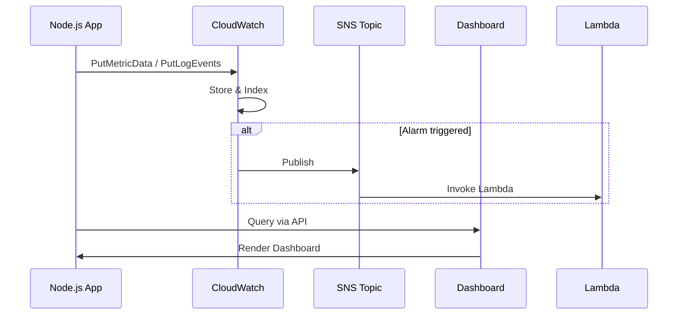

<!-- Generated by Groq via GitHub Actions -->
<!-- Topic ID: T210 -->
<!-- Category: Cloud Backend -->
<!-- Generated at UTC: 2026-11-14T07:44:25.174346+00:00 -->

# AWS CloudWatch

## 1. What problem does this solve?

| Problem | Why it matters | Consequence of not using | Real‑world appearance |
|---------|----------------|--------------------------|-----------------------|
| **Observability gap** – you can’t see what’s happening inside your services. | Without visibility you can’t detect, diagnose, or fix issues. | Silent failures, degraded performance, SLA violations. | Production APIs, background workers, micro‑services |
| **Alert fatigue / missed alerts** – you need a way to automatically notify you of abnormal behavior. | Teams waste time chasing false positives or miss critical incidents. | Unplanned outages, customer churn. | CI/CD pipelines, autoscaling triggers |
| **Cost & performance optimization** – you need metrics to understand resource usage. | You can’t right‑size instances or spot inefficiencies. | Over‑provisioning, wasted money. | Autoscaling groups, serverless functions |
| **Compliance & audit** – many regulations require logging of events. | Lack of logs can lead to non‑compliance penalties. | Legal risk, data breaches. | Financial services, healthcare APIs |

In a typical backend stack, CloudWatch sits between your application code, the AWS infrastructure (EC2, ECS, Lambda, RDS, etc.), and your monitoring/alerting tooling. It collects **metrics**, **logs**, and **events**, and exposes them via APIs, dashboards, and alarms.

---

## 2. Mental model

### Analogy: A city traffic control center

- **Sensors** (your application code) send data (speed, location, accidents) to a **control center** (CloudWatch).
- The control center aggregates data, displays it on **dashboards**, and triggers **alerts** (red lights) when something goes wrong.
- Operators (devs/ops) can **query** the data to investigate incidents.

### Engineering model

1. **Data producers** (your code, AWS services) emit **events** or **metrics**.
2. **CloudWatch** ingests, stores, and indexes this data.
3. **Consumers** (dashboards, alarms, CloudWatch Logs Insights, third‑party tools) query or subscribe to the data.
4. **Actions** (SNS notifications, Lambda triggers, Auto Scaling) are taken automatically.

---

## 3. Deep explanation

### Internals

| Component | Role |
|-----------|------|
| **Metrics** | Time‑series data points (e.g., `CPUUtilization`, `RequestCount`). Stored in a highly available, partitioned database. |
| **Logs** | Unstructured or structured text. Stored in CloudWatch Logs groups, indexed by timestamp. |
| **Alarms** | Threshold rules on metrics or log patterns. Trigger actions. |
| **Events** | System events (EC2 state changes, CodePipeline stages). |
| **Dashboards** | Visualizations built from metrics and logs. |
| **Logs Insights** | SQL‑like query engine over logs. |
| **Metric Filters** | Extract metrics from logs. |

### Important terminology

- **Namespace** – logical grouping of metrics (e.g., `AWS/EC2`).
- **Dimension** – key/value pair that further identifies a metric (e.g., `InstanceId= i-1234`).
- **Stat** – aggregation function (`Average`, `Sum`, `Maximum`, `Minimum`).
- **Period** – resolution of a metric (e.g., 60 s).
- **Retention** – metrics are stored for 15 months; logs for 90 days (default).

### Trade‑offs

| Aspect | Trade‑off |
|--------|-----------|
| **Granularity vs Cost** | 1‑second resolution metrics cost more and consume more API calls. |
| **Retention vs Storage** | Longer retention increases storage costs; logs can be archived to S3. |
| **Custom vs Default metrics** | Custom metrics give fine‑grained insight but require SDK calls. |
| **Alarms vs CloudWatch Events** | Alarms are metric‑based; events are state‑based. |

### Failure modes

- **API throttling** – exceeding PutMetricData limits (10 000 calls/second per account). |
- **Data loss** – if the application crashes before sending metrics. |
- **Mis‑configured retention** – logs deleted before analysis. |
- **Alarm mis‑tuning** – too many false positives or missed incidents. |

### Limitations

- **No native correlation** – CloudWatch doesn’t automatically link logs to metrics. |
- **Limited log query language** – Logs Insights is powerful but not as feature‑rich as ELK. |
- **Cold start latency** – first metric send may incur network latency. |
- **No built‑in APM** – you need X-Ray or third‑party APM for tracing. |

### Where it fits in a backend architecture

```
┌───────────────────────┐
│  Application (Node.js)│
│  ├─ Emit logs          │
│  ├─ Emit custom metrics│
└───────┬───────────────┘
        │
        ▼
┌───────────────────────┐
│  CloudWatch (Logs & Metrics) │
└───────┬───────────────┘
        │
        ▼
┌───────────────────────┐
│  Dashboards / Alarms  │
│  ├─ SNS / Lambda      │
│  └─ CloudWatch Events │
└───────────────────────┘
```

---

## 4. How it works

### Step‑by‑step flow

1. **Instrumentation** – Your code calls `PutMetricData` or writes to a log stream.  
2. **Transport** – Data is sent over HTTPS to the CloudWatch endpoint.  
3. **Ingestion** – CloudWatch parses the payload, validates dimensions, and stores it.  
4. **Indexing** – Logs are indexed by timestamp; metrics are stored in a time‑series store.  
5. **Query** – Dashboards, Alarms, or Logs Insights query the store.  
6. **Action** – If an alarm threshold is breached, CloudWatch triggers an SNS topic or Lambda.  



---

## 5. Practical implementation

### 5.1 Install dependencies

```bash
npm install @aws-sdk/client-cloudwatch @aws-sdk/client-cloudwatch-logs
```

### 5.2 Emit a custom metric

```ts
// metrics.ts
import { CloudWatchClient, PutMetricDataCommand } from "@aws-sdk/client-cloudwatch";

const cw = new CloudWatchClient({ region: "us-east-1" });

export async function emitRequestCount(success: boolean) {
  const metric = {
    Namespace: "MyApp/Requests",
    MetricData: [
      {
        MetricName: "RequestCount",
        Dimensions: [{ Name: "Success", Value: success ? "True" : "False" }],
        Timestamp: new Date(),
        Value: 1,
        Unit: "Count",
      },
    ],
  };

  await cw.send(new PutMetricDataCommand(metric));
}
```

### 5.3 Log to CloudWatch Logs

```ts
// logger.ts
import { CloudWatchLogsClient, PutLogEventsCommand } from "@aws-sdk/client-cloudwatch-logs";

const logs = new CloudWatchLogsClient({ region: "us-east-1" });
const logGroup = "/aws/myapp";
const logStream = "api-requests";

export async function logRequest(req: any, res: any) {
  const event = {
    message: `Request ${req.method} ${req.url} -> ${res.statusCode}`,
    timestamp: Date.now(),
  };

  await logs.send(
    new PutLogEventsCommand({
      logGroupName: logGroup,
      logStreamName: logStream,
      logEvents: [{ message: JSON.stringify(event), timestamp: event.timestamp }],
    })
  );
}
```

> **Tip**: Use a library like `winston-cloudwatch` to automatically send logs.

### 5.4 Create an alarm via CDK (optional)

```ts
// alarm.ts
import * as cdk from "aws-cdk-lib";
import { Alarm, Metric } from "aws-cdk-lib/aws-cloudwatch";

export const createAlarm = (scope: cdk.Construct) => {
  const metric = new Metric({
    namespace: "MyApp/Requests",
    metricName: "RequestCount",
    dimensionsMap: { Success: "False" },
    period: cdk.Duration.minutes(1),
  });

  new Alarm(scope, "HighErrorRate", {
    metric,
    threshold: 10,
    evaluationPeriods: 1,
    alarmDescription: "More than 10 failed requests per minute",
  });
};
```

---

## 6. Production considerations

| Concern | Recommendation |
|---------|----------------|
| **Scalability** | Batch metric uploads (`PutMetricData` supports up to 20 metrics per call). Use async queues. |
| **Reliability** | Retry with exponential backoff; use SDK’s built‑in retry logic. |
| **Security** | IAM role with least privilege (`cloudwatch:PutMetricData`, `logs:PutLogEvents`). Enable encryption at rest. |
| **Observability** | Combine CloudWatch with X‑Ray for tracing; use Logs Insights for ad‑hoc queries. |
| **Performance** | Avoid synchronous logging in hot paths; buffer logs locally and flush asynchronously. |
| **Error handling** | Catch SDK errors; log failures to a fallback file or SQS. |
| **Resource usage** | Monitor API call limits; use CloudWatch metrics for `PutMetricData` usage. |
| **Operational concerns** | Set up retention policies; archive logs to S3 or Glacier. |
| **Failure recovery** | Use CloudWatch Events to trigger recovery Lambda on alarm. |
| **Deployment** | Include CloudWatch resources in IaC (CDK, Terraform). |

---

## 7. Common mistakes

| Mistake | Why it’s problematic |
|---------|----------------------|
| **Sending one metric per request** | Exceeds API limits, increases cost, and adds latency. |
| **Hard‑coding metric names** | Makes refactoring hard; leads to typos. |
| **Ignoring dimensions** | Aggregated metrics lose context (e.g., per‑region). |
| **Not batching logs** | Causes high network overhead and throttling. |
| **Using default retention** | Logs may be deleted before you need them for investigations. |
| **Over‑alerting** | Too many alarms → alert fatigue. |
| **Not securing IAM** | Exposes metrics/logs to unauthorized users. |
| **Not monitoring CloudWatch API usage** | Can hit throttling silently. |

---

## 8. Senior engineer perspective

### What changes at scale?

- **Metric volume**: Thousands of services → millions of metrics per day. Requires careful namespace and dimension design to avoid cardinality explosion.
- **Cost control**: Custom metrics cost $0.30 per 1 000 000 data points. Use aggregation or sampling.
- **Automation**: Use IaC to provision alarms, dashboards, and log groups. Automate log retention and archival.
- **Observability stack**: Combine CloudWatch with OpenTelemetry, X‑Ray, and third‑party APM for full traceability.
- **Data lake**: Export logs to S3 and analyze with Athena or Redshift Spectrum for long‑term analytics.
- **Compliance**: Implement fine‑grained IAM, enable CloudTrail integration, and enforce encryption.

### Design decisions

| Decision | Trade‑off |
|----------|-----------|
| **Metric granularity** | Fine granularity → more cost & API calls. |
| **Log format** | Structured JSON → easier querying but more verbose. |
| **Retention policy** | Short retention → lower cost but less forensic data. |
| **Alarm thresholds** | Tight thresholds → early detection but more noise. |
| **Event vs Alarm** | Events for state changes; Alarms for metric thresholds. |

### When NOT to use CloudWatch

- **High‑volume log analytics**: For complex log processing, consider ELK or Splunk. |
- **Real‑time streaming**: Use Kinesis Data Firehose or Kafka for low‑latency ingestion. |
- **Fine‑grained tracing**: Use X‑Ray or OpenTelemetry instead of CloudWatch Logs. |

---

## 9. Interview questions

1. **Beginner**: *What is the difference between a metric and a log in CloudWatch?*  
   *Answer*: Metrics are numeric, time‑series data points; logs are unstructured text records. Metrics are used for alarms and dashboards; logs are used for debugging and detailed analysis.

2. **Beginner**: *How do you avoid exceeding the PutMetricData API limit?*  
   *Answer*: Batch up to 20 metrics per call, use async queues, and implement exponential backoff.

3. **Senior**: *Explain how you would design a metric namespace and dimension strategy for a micro‑service architecture with 50 services.*  
   *Answer*: Use a common namespace per service type, keep dimension cardinality low (e.g., `ServiceName`, `Environment`), avoid high‑cardinality dimensions like `UserId`. Use aggregation or sampling for per‑user metrics.

4. **Senior**: *Describe a scenario where CloudWatch Alarms caused a cascading failure and how you mitigated it.*  
   *Answer*: An alarm triggered a Lambda that scaled down a cluster, which in turn caused the alarm to fire again. Mitigation: use `AlarmActions` with `AlarmState` checks, add cooldown periods, or use a state machine to coordinate scaling.

5. **Scenario/Debugging**: *You notice that your custom metric “RequestCount” is missing data for the last 30 minutes. What steps would you take to diagnose and fix the issue?*  
   *Answer*:  
   - Check CloudWatch API throttling metrics (`PutMetricData` errors).  
   - Verify IAM permissions and network connectivity.  
   - Inspect application logs for errors when sending metrics.  
   - Ensure the metric batch size is within limits.  
   - Add retry logic and monitor the retry count.  
   - If the issue persists, enable CloudTrail to trace API calls.

---

## 10. Hands‑on task

**Goal**: Add a custom CloudWatch metric to an existing Express API that counts the number of failed requests, and create an alarm that sends an SNS notification when the failure rate exceeds 5% in a 5‑minute window.

**Steps**

1. Install `@aws-sdk/client-cloudwatch` and `@aws-sdk/client-sns`.  
2. Create a middleware that increments a counter on each failed response.  
3. Batch and send the metric every minute.  
4. Use CDK or Terraform to create an SNS topic and an alarm that monitors the metric.  
5. Deploy locally using Docker and test by sending requests that fail.  
6. Verify that the SNS topic receives a notification when the threshold is breached.

---

## 11. Quick revision

- CloudWatch collects **metrics**, **logs**, **events**, and **alarms**.  
- **Metrics**: numeric, time‑series; **Logs**: text, searchable.  
- **PutMetricData** supports up to 20 metrics per call; batch to avoid throttling.  
- **Alarms** trigger actions (SNS, Lambda) when thresholds are crossed.  
- **Log groups** can be archived to S3; retention defaults to 90 days.  
- Use **dimensions** to add context; keep cardinality low.  
- **IAM**: least privilege (`cloudwatch:PutMetricData`, `logs:PutLogEvents`).  
- **Cost**: $0.30 per 1 M custom metric data points.  
- Combine CloudWatch with X‑Ray or OpenTelemetry for full observability.  
- Avoid over‑alerting; tune thresholds and evaluation periods.  
- Export logs to S3 for long‑term analytics or compliance.  
- Use CDK/Terraform for IaC of CloudWatch resources.

---

## 12. References

- https://docs.aws.amazon.com/AmazonCloudWatch/latest/monitoring/WhatIsCloudWatch.html  
- https://docs.aws.amazon.com/AmazonCloudWatch/latest/monitoring/CloudWatch_Metrics.html  
- https://docs.aws.amazon.com/AmazonCloudWatch/latest/logs/WhatIsCloudWatchLogs.html  
- https://docs.aws.amazon.com/AmazonCloudWatch/latest/monitoring/AlarmThatSendsEmail.html  
- https://docs.aws.amazon.com/AWSCloudFormation/latest/UserGuide/aws-resource-cloudwatch-alarms.html  
- https://docs.aws.amazon.com/AWSJavaScriptSDK/v3/latest/clients/client-cloudwatch/  
- https://docs.aws.amazon.com/AWSJavaScriptSDK/v3/latest/clients/client-cloudwatch-logs/  

---
