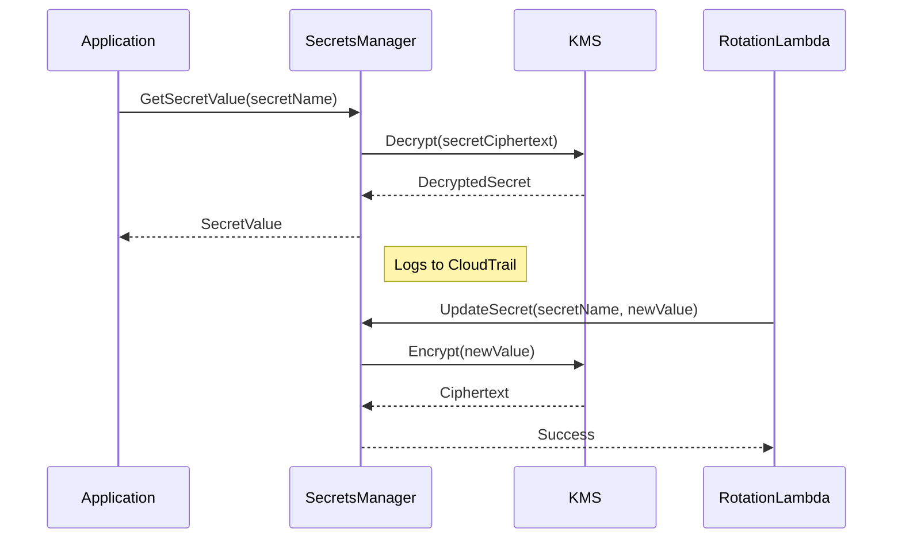

<!-- Generated by Groq via GitHub Actions -->
<!-- Topic ID: T211 -->
<!-- Category: Cloud Backend -->
<!-- Generated at UTC: 2026-11-14T18:47:42.206168+00:00 -->

# AWS Secrets Manager

## 1. What problem does this solve?

| What | Why it matters | Consequence of not using it | Real‑world use |
|------|----------------|-----------------------------|----------------|
| **Storing credentials, API keys, certificates, and other secrets** | Secrets are sensitive; leaking them can compromise entire systems. | Hard‑coded secrets in code or config files can be accidentally checked into source control, shared with the wrong people, or exposed through logs. | A microservice that needs a database password, a Lambda that calls an external API, or a CI/CD pipeline that deploys to production. |
| **Versioning and rotation** | Secrets change over time (password rotation, key rotation). | Stale secrets can lead to service outages or security breaches if an old key is compromised. | A PostgreSQL password rotated every 90 days, an API key rotated weekly. |
| **Fine‑grained access control** | Different services or developers need different secrets. | Over‑privileged access increases attack surface. | A front‑end service only needs a read‑only API key, while an admin service needs write access to secrets. |
| **Auditability** | Knowing who accessed or changed a secret is critical for compliance. | Lack of audit trails can violate regulations (PCI, HIPAA). | Auditing secret access in a financial application. |

In production backends, secrets are typically stored in environment variables or configuration files. Those approaches are fragile, insecure, and hard to audit. AWS Secrets Manager centralizes secret storage, encryption, rotation, and access control, turning a manual, error‑prone process into a managed service.

---

## 2. Mental model

**Analogy – The Vault**

Imagine a bank vault that holds valuable documents. The vault is locked with a master key (KMS key). Only authorized staff (IAM roles) can open it, and each staff member has a unique key card (policy). The vault keeps a log of every entry and exit (CloudTrail). When a document needs to be updated, a clerk (rotation Lambda) automatically replaces it with a fresh copy.

**Engineering model**

- **Secret** = the document inside the vault.  
- **Version** = each iteration of the document.  
- **KMS key** = the master key that encrypts the vault.  
- **IAM policy / resource policy** = the key cards that grant access.  
- **Rotation Lambda** = the clerk that updates the document on a schedule.  
- **Audit logs** = CloudTrail entries.  

This model keeps secrets safe, auditable, and automatically refreshed.

---

## 3. Deep explanation

### Internals

| Component | Role |
|-----------|------|
| **Secrets Manager API** | CRUD operations, versioning, rotation triggers. |
| **AWS KMS** | Encrypts secret data at rest. Each secret can use a customer‑managed key (CMK) or the default Secrets Manager key. |
| **IAM & Resource Policies** | Fine‑grained access to secrets. |
| **Rotation Lambda** | User‑supplied function that updates the secret value. |
| **CloudTrail & CloudWatch** | Auditing and metrics. |

### Important terminology

- **Secret** – a logical container for one or more key/value pairs.  
- **Version** – a specific value of a secret (e.g., `AWSCURRENT`, `AWSPREVIOUS`).  
- **KMS Key** – the encryption key that protects the secret.  
- **Rotation Schedule** – how often the rotation Lambda runs.  
- **Resource Policy** – a policy attached directly to a secret, controlling cross‑account access.  

### Trade‑offs

| Factor | Secrets Manager | Alternatives |
|--------|-----------------|--------------|
| **Cost** | $0.05 per secret per month + $0.40 per 10,000 API calls. | Parameter Store (free for SSM), self‑hosted vault (open source). |
| **Latency** | ~20–30 ms per request. | In‑memory env vars (instant). |
| **Vendor lock‑in** | AWS‑specific APIs. | HashiCorp Vault (multi‑cloud). |
| **Feature set** | Rotation, versioning, KMS integration, audit. | Parameter Store (no rotation), custom solutions (no audit). |

### Failure modes

- **KMS key deletion** – all secrets encrypted with that key become unreadable.  
- **IAM mis‑configuration** – accidental denial or over‑granting of access.  
- **API throttling** – exceeding Secrets Manager request limits causes retries or failures.  
- **Rotation Lambda failure** – secret remains stale or becomes inconsistent.  

### Limitations

- **Size** – each secret string ≤ 64 KB.  
- **Region** – secrets are region‑specific; cross‑region replication is manual.  
- **Rotation** – only supported for secrets that can be rotated via a Lambda; not all secret types (e.g., binary secrets).  

### Where it fits

```
┌───────────────────────┐
│  Application (Node.js)│
│  ├─ Fetch secret via SDK
│  ├─ Use secret to connect to DB
│  └─ Cache locally (optional)
└─────────────▲─────────┘
              │
              │ SDK call
              ▼
┌───────────────────────┐
│  AWS Secrets Manager   │
│  ├─ KMS encryption     │
│  ├─ IAM policy check   │
│  ├─ Return secret      │
│  └─ Log to CloudTrail  │
└───────────────────────┘
```

---

## 4. How it works

1. **Create a secret** – via console, CLI, or SDK.  
2. **Attach a KMS key** – either the default or a customer‑managed key.  
3. **Define IAM policies** – grant `secretsmanager:GetSecretValue` to the service role.  
4. **(Optional) Set rotation** – specify a Lambda function and schedule.  
5. **Application fetches secret** – calls `GetSecretValue`.  
6. **Secrets Manager decrypts** – uses KMS to decrypt the value.  
7. **Return secret** – application receives plaintext.  
8. **(Optional) Cache** – store in memory or Redis to reduce API calls.  
9. **Rotation** – Lambda runs, updates secret value, creates new version.  

**Mermaid diagram**



---

## 5. Practical implementation

### 5.1 Create a secret (CLI)

```bash
aws secretsmanager create-secret \
  --name dbPassword \
  --description "PostgreSQL password for prod" \
  --secret-string '{"username":"dbuser","password":"SuperSecret123!"}'
```

### 5.2 Retrieve the secret in a Node.js/TypeScript app

```ts
// src/secrets.ts
import { SecretsManagerClient, GetSecretValueCommand } from "@aws-sdk/client-secrets-manager";

const client = new SecretsManagerClient({ region: "us-east-1" });

export async function getSecret(secretName: string): Promise<Record<string, string>> {
  const command = new GetSecretValueCommand({ SecretId: secretName });
  const response = await client.send(command);

  if (!response.SecretString) {
    throw new Error("SecretString is empty");
  }

  // Secrets Manager returns JSON string
  return JSON.parse(response.SecretString) as Record<string, string>;
}
```

### 5.3 Use the secret in a Next.js API route

```ts
// pages/api/db.ts
import type { NextApiRequest, NextApiResponse } from "next";
import { getSecret } from "../../src/secrets";
import { Pool } from "pg";

let pool: Pool | null = null;

// Simple in‑memory cache
async function getPool() {
  if (!pool) {
    const creds = await getSecret("dbPassword");
    pool = new Pool({
      host: "db.example.com",
      port: 5432,
      user: creds.username,
      password: creds.password,
      database: "appdb",
    });
  }
  return pool;
}

export default async function handler(req: NextApiRequest, res: NextApiResponse) {
  try {
    const pool = await getPool();
    const result = await pool.query("SELECT NOW() as now");
    res.status(200).json(result.rows[0]);
  } catch (err) {
    console.error("DB error", err);
    res.status(500).json({ error: "Internal error" });
  }
}
```

> **Important lines**  
> *`getSecret`* – pulls the latest secret value.  
> *`pool`* – cached to avoid repeated SDK calls.  
> *`try/catch`* – ensures graceful failure and logs for observability.

---

## 6. Production considerations

| Concern | How Secrets Manager helps | What to watch out for |
|---------|--------------------------|-----------------------|
| **Scalability** | Handles thousands of secrets; throttling limits (~5 000 requests/second). | Use caching; batch retrieval if possible. |
| **Reliability** | Built‑in retries; integrates with CloudWatch metrics. | Implement exponential backoff; monitor `GetSecretValue` errors. |
| **Security** | Encryption at rest (KMS), fine‑grained IAM, rotation, audit logs. | Never hard‑code secrets; enforce least privilege. |
| **Observability** | CloudTrail logs, CloudWatch metrics (`GetSecretValue`, `PutSecretValue`). | Create dashboards for secret access patterns. |
| **Performance** | ~20–30 ms latency; acceptable for most services. | Cache secrets locally or in Redis for high‑frequency reads. |
| **Error handling** | SDK throws specific errors (`ResourceNotFoundException`, `AccessDeniedException`). | Catch and retry; fallback to env var only in dev. |
| **Resource usage** | Cost per secret + API calls. | Consolidate secrets where possible; use rotation to reduce manual updates. |
| **Operational concerns** | Rotation Lambda, versioning, tagging. | Tag secrets for cost allocation; monitor rotation failures. |
| **Failure recovery** | If KMS key is deleted, secrets become unreadable. | Keep a backup KMS key; use key rotation. |
| **Deployment** | CI/CD pipelines can inject secrets via Secrets Manager. | Use IAM roles for services; avoid embedding secrets in Docker images. |

---

## 7. Common mistakes

| Mistake | Why it’s bad |
|---------|--------------|
| Hard‑coding secrets in code or env files | Easy to leak via source control or logs. |
| Not rotating secrets | Stale credentials increase attack surface. |
| Granting `secretsmanager:*` to all roles | Over‑privilege; violates least privilege. |
| Ignoring KMS key rotation | Key compromise leads to all secrets being exposed. |
| Not handling `GetSecretValue` errors | Service crashes on transient failures. |
| Logging secret values | Violates compliance; secrets appear in logs. |
| Using Secrets Manager for non‑secret config | Adds unnecessary cost and complexity. |
| Forgetting to tag secrets | Hard to track cost and ownership. |

---

## 8. Senior engineer perspective

### Architecture decisions

- **Central vault vs per‑service vault** – centralizing reduces duplication but introduces a single point of failure.  
- **KMS key strategy** – per‑secret CMKs for isolation vs single CMK for simplicity.  
- **Rotation strategy** – automatic Lambda rotation vs manual rotation.  
- **Caching layer** – in‑memory vs Redis vs application‑level cache.  

### Trade‑offs

| Decision | Pros | Cons |
|----------|------|------|
| Single CMK | Lower cost, easier key rotation | All secrets share one key; compromise affects all. |
| Per‑secret CMK | Isolation, fine‑grained key rotation | Higher cost, more IAM policies. |
| Cache in Redis | Fast, shared across instances | Requires cache cluster, extra cost. |
| No cache | Simpler, no extra infra | Higher latency, more API calls. |

### Bottlenecks

- **API rate limits** – 5 000 requests/second per account; can be hit by many microservices.  
- **KMS key limits** – 10 000 keys per region; key rotation can be slow.  

### Failure scenarios

- **KMS key deletion** – all secrets become unreadable; must restore from backup.  
- **IAM policy change** – accidental denial of access to critical services.  
- **Rotation Lambda crash** – secrets become stale; need manual intervention.  

### Monitoring

- CloudWatch metrics: `GetSecretValue`, `PutSecretValue`, `RotateSecret`.  
- CloudTrail logs for access patterns.  
- Custom dashboards: secret access frequency, rotation failures.  

### Cost/performance

- Secrets: $0.05/month each.  
- API calls: $0.40 per 10 000 calls.  
- Optimize by grouping secrets, caching, and minimizing rotation frequency.  

### When NOT to use

- Small dev environments where secrets are few and can be stored in env vars.  
- Secrets that never change and are not sensitive (e.g., public API keys).  
- Multi‑cloud or on‑premise workloads where a vendor‑agnostic vault is preferred.

---

## 9. Interview questions

1. **Beginner** – *What is the difference between AWS Secrets Manager and Parameter Store?*  
   *Answer:* Secrets Manager encrypts at rest with KMS, supports automatic rotation, versioning, and audit logs. Parameter Store (SSM) is free for standard parameters, supports encryption, but lacks rotation and versioning for secrets.

2. **Beginner** – *How do you grant a Lambda function access to a secret?*  
   *Answer:* Attach an IAM role to the Lambda with `secretsmanager:GetSecretValue` permission on the secret ARN. Optionally add a resource policy on the secret for cross‑account access.

3. **Senior** – *Explain how you would design a system that needs to rotate database credentials every 30 days across multiple services in different regions.*  
   *Answer:* Use a single CMK per region, create a rotation Lambda that updates the secret and triggers the database password change. Deploy the Lambda in each region or use cross‑region replication. Use IAM roles with least privilege, tag secrets for cost allocation, and monitor rotation failures via CloudWatch.

4. **Senior** – *What are the trade‑offs between using Secrets Manager and a self‑hosted vault like HashiCorp Vault?*  
   *Answer:* Secrets Manager offers managed infrastructure, built‑in rotation, and audit logs, but incurs AWS costs and vendor lock‑in. HashiCorp Vault gives multi‑cloud flexibility, advanced policies, and lower per‑secret cost, but requires operational overhead (deployment, scaling, patching).

5. **Scenario/Debugging** – *Your application fails to read a secret after a recent deployment. The logs show `AccessDeniedException`. What steps would you take to diagnose and fix the issue?*  
   *Answer:*  
   - Verify the IAM role attached to the service has `GetSecretValue` permission on the secret ARN.  
   - Check the secret’s resource policy for cross‑account or explicit deny.  
   - Look at CloudTrail to see the denied request and the principal.  
   - Ensure the secret name/ARN is correct.  
   - If using a rotation Lambda, confirm it hasn’t changed the secret’s version or deleted it.  
   - Update the policy or role, then redeploy.

---

## 10. Hands‑on task

**Task:**  
Add a new secret called `apiKey` that stores an external service API key.  
1. Create the secret via the console or CLI.  
2. Update the Next.js API route `pages/api/hello.ts` to fetch the `apiKey` and include it in a request header when calling a dummy external endpoint (`https://httpbin.org/headers`).  
3. Cache the secret for 5 minutes using an in‑memory map.  
4. Log the number of times the secret was fetched from Secrets Manager vs the cache.  

**Goal:** Demonstrate secret retrieval, caching, and auditability.

---

## 11. Quick revision

- Secrets Manager stores secrets encrypted with KMS keys.  
- Secrets have versions (`AWSCURRENT`, `AWSPREVIOUS`).  
- IAM policies grant `GetSecretValue` access; resource policies allow cross‑account access.  
- Rotation is Lambda‑driven; you must implement the Lambda logic.  
- Secrets Manager logs all access to CloudTrail.  
- Cache secrets locally or in Redis to reduce latency and API costs.  
- Never log secret values; always use `console.warn` or `console.error` with placeholders.  
- Use tags for cost allocation and ownership.  
- Monitor `GetSecretValue` metrics and rotation failures in CloudWatch.  
- Delete secrets only after confirming no service uses them.  
- Keep KMS keys rotated; use a CMK per secret for isolation if needed.

---

## 12. References

- https://docs.aws.amazon.com/secretsmanager/latest/userguide/intro.html  
- https://docs.aws.amazon.com/secretsmanager/latest/APIReference/API_GetSecretValue.html  
- https://docs.aws.amazon.com/secretsmanager/latest/userguide/rotating-secrets.html  
- https://docs.aws.amazon.com/secretsmanager/latest/userguide/iam.html  
- https://docs.aws.amazon.com/secretsmanager/latest/userguide/monitoring.html  
- https://docs.aws.amazon.com/secretsmanager/latest/userguide/limits.html  
- https://docs.aws.amazon.com/sdk-for-javascript/v3/developer-guide/welcome.html  
- https://docs.aws.amazon.com/kms/latest/developerguide/overview.html  
- https://docs.aws.amazon.com/cloudtrail/latest/userguide/cloudtrail-logging.html
