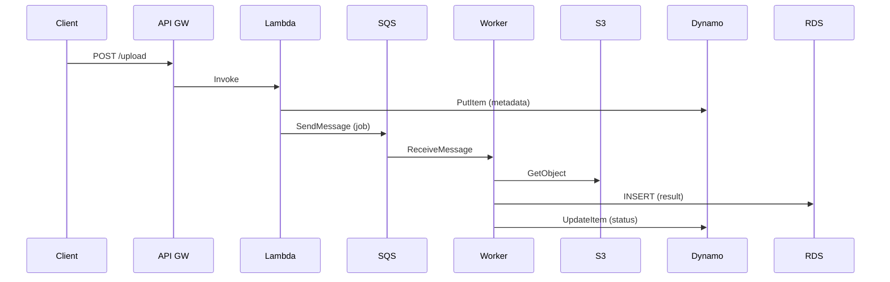

<!-- Generated by Groq via GitHub Actions -->
<!-- Topic ID: T212 -->
<!-- Category: Cloud Backend -->
<!-- Generated at UTC: 2026-11-14T18:47:42.206168+00:00 -->

# Choosing the right AWS service for a backend requirement

## 1. What problem does this solve?

**Motivation**  
When building a backend you have a list of requirements: compute, storage, messaging, caching, AI inference, etc. AWS offers dozens of services that can satisfy each requirement, but each service has its own trade‑offs. Picking the wrong service can lead to wasted money, performance bottlenecks, or operational headaches.

**What problem exists**  
- **Unclear mapping** between a business need (e.g., “process user uploads”) and an AWS service (e.g., Lambda, ECS, S3, etc.).  
- **Over‑engineering**: using a heavyweight service for a simple task, or a lightweight one for a heavy workload.  
- **Hidden costs**: e.g., Lambda cold starts, EC2 under‑utilization, or DynamoDB provisioned capacity overshoot.

**Why the problem matters**  
- **Cost**: AWS pricing is granular; mis‑choosing a service can inflate bills.  
- **Performance**: latency, throughput, and scaling limits differ across services.  
- **Operational overhead**: managing EC2 instances vs. a serverless function.  
- **Security & compliance**: some services require VPC endpoints, IAM roles, or encryption at rest.

**What happens if this concept is not used**  
- **Spending**: you may pay for idle compute or over‑provisioned capacity.  
- **Reliability**: a service that doesn’t meet SLAs can cause outages.  
- **Scalability**: a service that can’t auto‑scale will choke under load.  
- **Complexity**: you’ll need more tooling to manage a heterogeneous stack.

**Where this concept appears in real backend systems**  
- A SaaS platform deciding between Lambda + API Gateway vs. ECS Fargate for its API layer.  
- An e‑commerce site choosing DynamoDB for session storage vs. Redis.  
- A data pipeline deciding between Kinesis Data Streams vs. SQS for ingestion.

---

## 2. Mental model

**Analogy**  
> Think of AWS services as a toolbox.  
> - *Hammer* (EC2) is great for heavy, custom work.  
> - *Screwdriver* (Lambda) is quick for small, repeatable tasks.  
> - *Wrench* (ECS) lets you assemble multiple parts (containers).  
> Picking the right tool saves time and avoids damage.

**Engineering model**  
- **Compute**: EC2 (VM), ECS/EKS/Fargate (containers), Lambda (serverless).  
- **Storage**: S3 (object), EBS (block), RDS/Aurora (SQL), DynamoDB (NoSQL).  
- **Messaging**: SQS, SNS, Kinesis, EventBridge.  
- **Caching**: ElastiCache (Redis/Memcached).  
- **AI**: SageMaker, Bedrock, Comprehend, Rekognition.  
- **Observability**: CloudWatch, X-Ray, CloudTrail.  
- **Networking**: VPC, PrivateLink, Transit Gateway.  

You match the *job* (requirement) to the *tool* (service) by evaluating compute model, data model, latency, scaling, cost, and operational complexity.

---

## 3. Deep explanation

### Internals

| Service | Core Mechanism | Typical Use‑Case |
|---------|----------------|------------------|
| **Lambda** | Event‑driven, stateless functions; auto‑scales to 1,000+ concurrent invocations. | Short‑lived API endpoints, background jobs, event processing. |
| **ECS/Fargate** | Container orchestration; Fargate runs containers without managing EC2. | Microservices with stateful workloads, complex runtimes. |
| **EC2** | Bare‑metal VMs; you control OS, networking, scaling. | Legacy apps, custom kernel, GPU workloads. |
| **API Gateway** | HTTP(S) front‑end that routes to Lambda, HTTP back‑ends, or mock responses. | Public REST/GraphQL APIs. |
| **S3** | Object storage with eventual consistency; highly durable. | Static assets, backups, data lake. |
| **RDS/Aurora** | Managed relational DB; supports MySQL, PostgreSQL, etc. | OLTP workloads, transactional data. |
| **DynamoDB** | Key‑value/Document store; single‑digit ms latency. | Session store, high‑throughput counters. |
| **ElastiCache** | In‑memory cache; Redis or Memcached. | Cache layer, pub/sub, rate limiting. |
| **SQS** | Decoupled message queue; at‑least‑once delivery. | Background job queues, retry pipelines. |
| **SNS** | Pub/Sub messaging; fan‑out to multiple subscribers. | Event notifications, mobile push. |
| **Kinesis** | Real‑time streaming data ingestion. | Log aggregation, real‑time analytics. |
| **EventBridge** | Event bus for SaaS and custom events. | Cross‑service orchestration, SaaS integration. |
| **SageMaker** | Managed ML training & inference. | Custom model training, inference endpoints. |

### Important terminology

- **Cold start**: time to spin up a Lambda container.  
- **Provisioned concurrency**: pre‑warmed Lambda instances.  
- **Burst capacity**: DynamoDB’s ability to exceed provisioned throughput temporarily.  
- **VPC endpoints**: private connectivity to AWS services without traversing the public internet.  
- **Scaling policy**: how a service adjusts capacity (e.g., Lambda concurrency, ECS service autoscaling).  
- **Service quotas**: limits per account (e.g., max Lambda functions, max EC2 instances).  

### Trade‑offs

| Service | Pros | Cons |
|---------|------|------|
| **Lambda** | Zero‑ops, auto‑scaling, pay‑per‑invocation | Cold start latency, 15‑min timeout, limited memory (up to 10 GB) |
| **ECS/Fargate** | Container isolation, persistent storage via EFS, fine‑grained scaling | Slightly higher cost than Lambda, more operational overhead |
| **EC2** | Full control, GPU support, long‑running processes | Manual scaling, patching, higher cost for idle time |
| **API Gateway** | Built‑in throttling, request validation, caching | 1 ms latency overhead, request size limits |
| **S3** | Unlimited storage, cheap, highly durable | No relational queries, eventual consistency |
| **RDS** | ACID compliance, familiar SQL | Higher cost, scaling requires read replicas or sharding |
| **DynamoDB** | Single‑digit ms, auto‑scaling | No joins, limited query patterns, cost spikes with burst |
| **ElastiCache** | In‑memory speed | Data loss on eviction, requires persistence strategy |
| **SQS** | Decoupling, retries, dead‑letter queues | At‑least‑once semantics, visibility timeout complexity |
| **SNS** | Fan‑out, multiple protocols | No persistence, limited filtering |
| **Kinesis** | Real‑time streaming, parallel processing | Higher cost, shard limits |
| **EventBridge** | SaaS integration, event routing | Limited payload size, event bus limits |
| **SageMaker** | Managed training, inference | High cost, model size limits, vendor lock‑in |

### Failure modes & limitations

- **Lambda**: cold start spikes, memory exhaustion, 15‑min timeout.  
- **ECS/Fargate**: task failures due to image pull errors, networking misconfig.  
- **EC2**: instance termination, AMI drift, patching delays.  
- **API Gateway**: request size limits (10 MB), throttling.  
- **S3**: eventual consistency for overwrite/delete.  
- **RDS**: single point of failure without Multi-AZ; backup retention.  
- **DynamoDB**: exceeding provisioned capacity leads to throttling.  
- **ElastiCache**: data loss on node failure if not using persistence.  
- **SQS**: message duplication, visibility timeout mis‑config.  
- **SNS**: delivery failures to endpoints, no retry for HTTP.  
- **Kinesis**: shard limits, data retention period.  
- **EventBridge**: event bus limits, rule evaluation cost.  
- **SageMaker**: training job failures, model deployment latency.  

### Where this concept fits in a backend architecture

- **API Layer**: API Gateway + Lambda or ECS/Fargate.  
- **Business Logic**: Lambda functions, containerized services, or EC2.  
- **Data Layer**: RDS/Aurora for relational data, DynamoDB for NoSQL, S3 for objects.  
- **Cache Layer**: ElastiCache (Redis) for session, rate limiting.  
- **Messaging**: SQS for async jobs, SNS for notifications, EventBridge for orchestration.  
- **Observability**: CloudWatch logs/metrics, X‑Ray traces.  
- **AI**: SageMaker endpoints or Bedrock inference integrated via Lambda.  

### Interaction with related concepts

- **IAM**: fine‑grained permissions for each service.  
- **VPC**: private networking for database, cache, and Lambda (if needed).  
- **CI/CD**: SAM, Serverless Framework, ECS task definitions, CloudFormation.  
- **Monitoring**: CloudWatch Alarms, dashboards, log groups.  
- **Cost Management**: Budgets, Cost Explorer, Reserved Instances for EC2/RDS.  

---

## 4. How it works

### Step‑by‑step flow for a typical “upload & process” API

1. **Client** → **API Gateway** (HTTPS request).  
2. **API Gateway** validates schema, throttles, forwards to **Lambda**.  
3. **Lambda** receives event, writes file metadata to **DynamoDB**.  
4. **Lambda** publishes a message to **SQS** for background processing.  
5. **SQS** delivers message to **Worker Lambda** (or ECS task).  
6. **Worker** downloads file from **S3**, processes it, stores results in **RDS**.  
7. **Worker** updates status in **DynamoDB**.  
8. **Client** polls **API Gateway** for status or receives SNS push.



---

## 5. Practical implementation

Below is a minimal **Node.js** example using **Serverless Framework** to deploy a Lambda + API Gateway + DynamoDB + SQS stack.

```yaml
# serverless.yml
service: upload-service

provider:
  name: aws
  runtime: nodejs18.x
  region: us-east-1
  iamRoleStatements:
    - Effect: Allow
      Action:
        - dynamodb:PutItem
        - dynamodb:UpdateItem
        - sqs:SendMessage
      Resource: "*"

functions:
  upload:
    handler: handler.upload
    events:
      - http:
          path: upload
          method: post
          cors: true

resources:
  Resources:
    UploadTable:
      Type: AWS::DynamoDB::Table
      Properties:
        TableName: Uploads
        AttributeDefinitions:
          - AttributeName: id
            AttributeType: S
        KeySchema:
          - AttributeName: id
            KeyType: HASH
        BillingMode: PAY_PER_REQUEST
    UploadQueue:
      Type: AWS::SQS::Queue
      Properties:
        QueueName: upload-queue
```

```ts
// handler.ts
import { APIGatewayProxyHandlerV2 } from 'aws-lambda';
import { DynamoDBClient, PutItemCommand, UpdateItemCommand } from '@aws-sdk/client-dynamodb';
import { SQSClient, SendMessageCommand } from '@aws-sdk/client-sqs';
import { v4 as uuidv4 } from 'uuid';

const dynamo = new DynamoDBClient({});
const sqs = new SQSClient({});

export const upload: APIGatewayProxyHandlerV2 = async (event) => {
  const body = JSON.parse(event.body ?? '{}');
  const fileName = body.fileName;
  const id = uuidv4();

  // Persist metadata
  await dynamo.send(new PutItemCommand({
    TableName: 'Uploads',
    Item: {
      id: { S: id },
      fileName: { S: fileName },
      status: { S: 'queued' },
      createdAt: { S: new Date().toISOString() },
    },
  }));

  // Enqueue job
  await sqs.send(new SendMessageCommand({
    QueueUrl: process.env.UPLOAD_QUEUE_URL!,
    MessageBody: JSON.stringify({ id, fileName }),
  }));

  return {
    statusCode: 202,
    body: JSON.stringify({ id, status: 'queued' }),
  };
};
```

**Notes**

- `PAY_PER_REQUEST` DynamoDB table eliminates capacity planning.  
- `SQS` URL is injected via environment variables (Serverless automatically).  
- The Lambda function is stateless and can scale to thousands of concurrent uploads.  
- For production, add validation, error handling, and retry logic.

---

## 6. Production considerations

| Concern | Lambda | ECS/Fargate | EC2 | RDS | DynamoDB | SQS | S3 |
|---------|--------|-------------|-----|-----|----------|-----|----|
| **Scalability** | Auto‑scales to 1k+ invocations; throttling limits apply. | Auto‑scales via ECS Service Auto Scaling. | Manual or ASG scaling. | Read replicas, sharding. | Auto‑scales with provisioned throughput. | Auto‑scales; message retention. | Unlimited. |
| **Reliability** | Managed by AWS; cold start may delay first request. | Depends on cluster health; Fargate removes EC2 ops. | Requires patching, health checks. | Multi‑AZ for HA. | Built‑in retries, auto‑retries. | Dead‑letter queues. | 99.999999999% durability. |
| **Security** | IAM role per function; VPC endpoints for private access. | IAM roles, VPC, security groups. | Full OS control; patching. | Encryption at rest, IAM, VPC. | Encryption at rest, IAM. | IAM, encryption. | IAM, SSE. |
| **Observability** | CloudWatch logs, metrics, X‑Ray. | CloudWatch, ECS logs. | CloudWatch, custom logs. | CloudWatch, RDS metrics. | CloudWatch, DynamoDB metrics. | CloudWatch, DLQ. | CloudWatch, S3 access logs. |
| **Performance** | Cold start latency; memory limits. | Container startup latency; network latency. | Full control; can tune. | SQL query performance. | Single‑digit ms. | Latency depends on queue depth. | Retrieval latency ~10 ms. |
| **Error handling** | Timeout, retries, DLQ. | Task failure handling. | Custom. | RDS failover. | Throttling, back‑off. | Visibility timeout, DLQ. | Versioning, lifecycle. |
| **Resource usage** | Pay per invocation; no idle cost. | Pay per vCPU/memory; idle cost if over‑provisioned. | Pay for instance time. | Pay for instance + storage. | Pay for throughput. | Pay for messages. | Pay for storage. |
| **Operational concerns** | Minimal ops. | Container orchestration ops. | Full ops. | Managed DB ops. | Managed DB ops. | Managed queue. | Managed storage. |
| **Failure recovery** | Automatic retries, DLQ. | ECS task restarts. | Manual. | Multi‑AZ failover. | Auto‑retry. | DLQ, redrive. | Versioning, cross‑region replication. |
| **Deployment** | SAM/Serverless, CloudFormation. | ECS task definitions, CodeDeploy. | AMI, OpsWorks. | RDS snapshots. | DynamoDB backups. | SQS DLQ config. | S3 lifecycle rules. |

---

## 7. Common mistakes

| Mistake | Why it’s problematic |
|---------|----------------------|
| **Using Lambda for long‑running jobs** | Exceeds 15‑min timeout; cold start overhead. |
| **Ignoring VPC endpoints for S3/DynamoDB** | Traffic goes over the public internet; higher latency and cost. |
| **Over‑provisioning EC2 for a stateless API** | Idle compute cost; missed autoscaling benefits. |
| **Using RDS for high‑write NoSQL workloads** | Poor performance, higher cost. |
| **Not setting up DLQs for SQS** | Lost messages, hard to debug failures. |
| **Hard‑coding IAM policies** | Least‑privilege violations, security risk. |
| **Using API Gateway without throttling** | Denial of service under traffic spikes. |
| **Storing large blobs in DynamoDB** | Exceeds item size limits, high cost. |
| **Not monitoring Lambda cold starts** | Unexpected latency spikes. |
| **Deploying without environment variables** | Hard‑coded secrets, configuration drift. |

---

## 8. Senior engineer perspective

### What changes at scale

- **Cost modeling**: use Reserved Instances or Savings Plans for EC2/RDS; spot instances for batch jobs.  
- **Observability**: centralize logs (CloudWatch Logs Insights), use X‑Ray for distributed tracing, set up dashboards.  
- **Security hardening**: enforce IAM least privilege, use AWS Secrets Manager, enable VPC endpoints, enforce encryption.  
- **Disaster recovery**: multi‑region replication for S3, cross‑region read replicas for RDS, global DynamoDB tables.  
- **Automation**: IaC (CloudFormation, CDK), CI/CD pipelines, automated rollback on failure.  
- **Performance tuning**: monitor Lambda memory/timeout, DynamoDB provisioned capacity, SQS visibility timeout.  
- **Compliance**: enable CloudTrail, audit IAM roles, enforce data residency.  

### Design decisions

- **Serverless vs. containers**: choose Lambda for event‑driven, short tasks; ECS/Fargate for stateful or long‑running services.  
- **Database choice**: use RDS for relational consistency; DynamoDB for high‑throughput, low‑latency key‑value.  
- **Caching**: ElastiCache Redis for session store; consider DynamoDB Accelerator (DAX) for read‑heavy workloads.  
- **Messaging**: SQS for decoupled queues; SNS for fan‑out; EventBridge for SaaS integration.  
- **AI**: SageMaker endpoints for custom models; Bedrock for pre‑built LLMs.  

### When NOT to use the approach

- **Lambda**: if you need >15 min compute, GPU, or persistent storage.  
- **ECS/Fargate**: if you need fine‑grained OS control or legacy binaries.  
- **S3**: if you need transactional guarantees or relational queries.  
- **DynamoDB**: if you need complex joins or multi‑row ACID transactions.  

---

## 9. Interview questions

| # | Question | Answer points |
|---|----------|---------------|
| 1 (beginner) | What is a cold start in Lambda and how can you mitigate it? | • Cold start = first invocation after idle period. <br>• Causes latency. <br>• Mitigations: provisioned concurrency, keep functions warm, use smaller memory, use container image. |
| 2 (beginner) | Why would you choose DynamoDB over RDS for a session store? | • DynamoDB offers single‑digit ms latency. <br>• No need for relational joins. <br>• Pay‑per‑request pricing. <br>• Easy scaling. |
| 3 (senior) | How would you design a highly available, multi‑region API using API Gateway and Lambda? | • Deploy API Gateway + Lambda in each region. <br>• Use Route 53 latency‑based routing. <br>• Store shared state in DynamoDB Global Tables. <br>• Use CloudFront for caching. |
| 4 (senior) | Explain how you would handle a scenario where SQS messages are being throttled due to high throughput. | • Increase queue visibility timeout. <br>• Add more consumer Lambda functions or ECS workers. <br>• Use batch size and parallelism. <br>• Enable DLQ for dead messages. |
| 5 (scenario/debugging) | A Lambda function that writes to DynamoDB is intermittently failing with `ProvisionedThroughputExceededException`. What steps would you take to diagnose and fix this? | • Check CloudWatch metrics for throttling. <br>• Review provisioned capacity or enable auto‑scaling. <br>• Implement exponential back‑off. <br>• Consider using on‑demand capacity. <br>• Verify IAM permissions and table key schema. |

---

## 10. Hands‑on task

**Task**: Build a simple “image thumbnail generator” microservice.

1. **API**: Create an API Gateway + Lambda endpoint `/upload` that accepts an image file (base64 or multipart).  
2. **Storage**: Store the original image in S3.  
3. **Queue**: Publish a message to SQS with the S3 key.  
4. **Worker**: A second Lambda (or ECS task) reads from SQS, generates a thumbnail using Sharp, stores it back to S3, and updates a DynamoDB record with the thumbnail URL.  
5. **Observability**: Add CloudWatch metrics for successful vs. failed thumbnails.  
6. **Deployment**: Use Serverless Framework or CDK to deploy the stack.  

**Goal**: Understand how to orchestrate multiple AWS services, handle async processing, and monitor the pipeline.

---

## 11. Quick revision

- **Lambda**: stateless, auto‑scales, 15‑min timeout, cold starts.  
- **ECS/Fargate**: container orchestration, no EC2 ops, suitable for stateful workloads.  
- **API Gateway**: HTTP front‑end, throttling, caching, request validation.  
- **S3**: object storage, unlimited, eventual consistency for overwrite.  
- **RDS/Aurora**: managed relational DB, ACID, Multi‑AZ.  
- **DynamoDB**: key‑value/Document, single‑digit ms, on‑demand or provisioned.  
- **ElastiCache**: in‑memory cache (Redis/Memcached).  
- **SQS**: decoupled queue, at‑least‑once, DLQ.  
- **SNS**: pub/sub, fan‑out, no persistence.  
- **EventBridge**: event bus, SaaS integration, rule evaluation.  
- **SageMaker**: managed ML training/inference.  
- **Observability**: CloudWatch logs/metrics, X‑Ray traces, CloudTrail.  
- **Security**: IAM least privilege, VPC endpoints, encryption at rest.  
- **Cost**: pay‑per‑use vs. reserved, spot instances, on‑demand.  
- **Common pitfalls**: cold starts, DLQ omission, over‑provisioning, hard‑coded secrets.  

---

## 12. References

- [AWS Lambda Documentation](https://docs.aws.amazon.com/lambda/latest/dg/welcome.html)  
- [Amazon ECS Documentation](https://docs.aws.amazon.com/ecs/latest/developerguide/what-is-ecs.html)  
- [Amazon API Gateway Documentation](https://docs.aws.amazon.com/apigateway/latest/developerguide/welcome.html)  
- [Amazon S3 Documentation](https://docs.aws.amazon.com/s3/index.html)  
- [Amazon RDS Documentation](https://docs.aws.amazon.com/rds/index.html)  
- [Amazon DynamoDB Documentation](https://docs.aws.amazon.com/amazondynamodb/latest/developerguide/Introduction.html)  
- [Amazon SQS Documentation](https://docs.aws.amazon.com/sqs/index.html)  
- [Amazon SNS Documentation](https://docs.aws.amazon.com/sns/index.html)  
- [Amazon EventBridge Documentation](https://docs.aws.amazon.com/eventbridge/latest/userguide/what-is-amazon-eventbridge.html)  
- [Amazon SageMaker Documentation](https://docs.aws.amazon.com/sagemaker/latest/dg/whatis.html)  
- [AWS CloudWatch Documentation](https://docs.aws.amazon.com/cloudwatch/index.html)  
- [AWS IAM Documentation](https://docs.aws.amazon.com/IAM/latest/UserGuide/introduction.html)  
- [AWS Serverless Application Model (SAM)](https://docs.aws.amazon.com/serverless-application-model/latest/developerguide/what-is-sam.html)  
- [AWS CDK Documentation](https://docs.aws.amazon.com/cdk/latest/guide/home.html)
