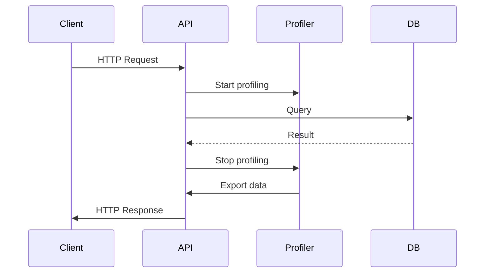

<!-- Generated by Groq via GitHub Actions -->
<!-- Topic ID: T213 -->
<!-- Category: Performance Engineering -->
<!-- Generated at UTC: 2026-11-15T08:01:20.272943+00:00 -->

# Profiling

## 1. What problem does this solve?

**Motivation**  
When a backend service receives traffic, you want it to respond fast, use resources efficiently, and stay stable. If a particular request path or database query is slow, it can cascade into higher latency, increased CPU usage, or even outages. Profiling is the systematic way to discover *where* the bottleneck lies.

**What problem exists**  
- Latency spikes that are hard to reproduce in tests.  
- Resource exhaustion (CPU, memory, I/O) that only appears under load.  
- Mis‑tuned queries or algorithms that degrade over time.

**Why the problem matters**  
- Poor performance hurts user experience and can lead to churn.  
- High resource usage increases infrastructure costs.  
- Undiagnosed slow paths can cause cascading failures in distributed systems.

**What happens if this concept is not used**  
- Developers may rely on ad‑hoc logging or manual timing, missing subtle issues.  
- Performance regressions can go unnoticed until production alerts fire.  
- Scaling decisions may be based on inaccurate assumptions.

**Where this concept appears in real backend systems**  
- Node.js/Express or FastAPI endpoints that hit a slow database query.  
- A microservice that spends most of its time in a CPU‑bound algorithm.  
- A background worker that leaks memory over time.  
- A Redis cache that is hit too often, causing eviction thrashing.

---

## 2. Mental model

**Analogy**  
Think of your backend as a car. The engine runs smoothly until you notice the car stalling or the fuel gauge dropping unexpectedly. To diagnose, you use a diagnostic tool (OBD‑II) that reads sensor data and logs. Profiling is that diagnostic tool: it tells you *which part of the engine* (CPU, memory, I/O) is causing the problem.

**Engineering model**  
- **Instrumentation**: Insert probes that record timestamps, call counts, or memory snapshots.  
- **Sampling**: Periodically capture the current state of the system (e.g., every 10 ms).  
- **Aggregation**: Combine raw data into a visual representation (flamegraph, timeline).  
- **Analysis**: Identify hotspots, memory leaks, or blocking operations.

---

## 3. Deep explanation

### Internals
- **CPU Profiling**: V8 (Node.js) can capture a call stack every few milliseconds. The profiler records how much time each function spends in user code vs. native code.  
- **Heap Snapshots**: Capture the entire V8 heap at a point in time, showing object allocations and references.  
- **I/O Profiling**: Tools like `perf` or `strace` can trace system calls, file descriptors, and network events.  
- **Async Context**: Modern profilers track async hooks to correlate callbacks with their originating request.

### Important terminology
- **Sampling vs. Instrumentation**: Sampling takes periodic snapshots; instrumentation inserts explicit counters or timers.  
- **Flamegraph**: A compact visual of call stack frequencies.  
- **Hotspot**: A function or line that consumes a disproportionate amount of CPU time.  
- **Memory Leak**: Objects that are no longer reachable but remain in the heap.  
- **Event Loop Blocking**: Long synchronous operations that prevent the event loop from processing other events.

### Trade‑offs
| Approach | Overhead | Accuracy | Complexity |
|----------|----------|----------|------------|
| Sampling | Low (≈1–5 %) | Good for CPU hotspots | Simple to enable |
| Instrumentation | Medium–High | Precise per‑call metrics | Requires code changes |
| Heap snapshots | Medium | Full memory picture | Heavy on memory |

### Failure modes
- **False positives**: A hot function may be called frequently but not be the real culprit.  
- **Missing async context**: Without async hooks, you may misattribute a callback to the wrong request.  
- **Profiler crash**: Profiling a process can crash it if the profiler is buggy or misconfigured.

### Limitations
- **Sampling resolution**: Very short functions may be missed.  
- **Multi‑core**: Profiling a single thread may not reflect overall CPU usage.  
- **Distributed systems**: Profiling a single service doesn’t capture cross‑service latency.

### Where it fits in a backend architecture
- **Service layer**: Profiling individual microservices to isolate bottlenecks.  
- **Infrastructure layer**: Profiling the runtime (Node.js, Python interpreter) to tune GC or JIT.  
- **Observability stack**: Profiling data feeds into APM dashboards (e.g., Datadog, New Relic).

### Interaction with related concepts
- **Tracing**: Traces give request‑level context; profiling gives function‑level detail.  
- **Metrics**: CPU/memory counters are coarse; profiling reveals the *why*.  
- **Logging**: Logs can be correlated with profiling snapshots for root‑cause analysis.

---

## 4. How it works

1. **Start the profiler** (e.g., `node --inspect-brk` or `clinic flame`).  
2. **Run the workload** (load test, real traffic).  
3. **Collect data**: The profiler records call stacks, heap snapshots, or system calls.  
4. **Stop the profiler** after a sufficient sample window.  
5. **Export data** (JSON, CSV, or binary).  
6. **Visualize**: Use `clinic`’s built‑in viewer, `speedscope`, or `flamegraph.pl`.  
7. **Analyze**: Look for functions with high self‑time, long async callbacks, or memory growth.  
8. **Iterate**: Apply fixes, re‑profile, and confirm regression.



---

## 5. Practical implementation

### Node.js CPU profiling with `clinic`

```bash
# Install clinic globally
npm i -g clinic

# Start a simple Express server (app.js)
cat > app.js <<'EOF'
const express = require('express')
const app = express()

app.get('/slow', async (req, res) => {
  // Simulate CPU work
  const start = Date.now()
  while (Date.now() - start < 200) {}
  res.send('done')
})

app.listen(3000, () => console.log('🚀'))
EOF

# Run clinic flame to profile
clinic flame -- node app.js
```

After you hit `Ctrl+C`, Clinic will generate `clinic-flame.html`. Open it in a browser to see a flamegraph. The `/slow` route will appear as a large block.

### Memory snapshot with `v8-profiler-next`

```bash
npm i v8-profiler-next
```

```ts
// memory.js
const profiler = require('v8-profiler-next')
const http = require('http')

http.createServer((req, res) => {
  if (req.url === '/snapshot') {
    const snapshot = profiler.takeSnapshot('heap')
    snapshot.export((err, result) => {
      res.setHeader('Content-Type', 'application/json')
      res.end(result)
      snapshot.delete()
    })
  } else {
    res.end('ok')
  }
}).listen(4000)
```

Requesting `/snapshot` gives a JSON heap snapshot that can be loaded into Chrome DevTools or `node --inspect`.

### Profiling async I/O with `perf`

```bash
# On Linux
sudo perf record -F 99 -a -g -- sleep 30
sudo perf report
```

This captures system‑call traces for all processes, useful for spotting blocking I/O.

---

## 6. Production considerations

| Concern | How to address |
|---------|----------------|
| **Scalability** | Use sampling profilers; enable only on a subset of instances or during maintenance windows. |
| **Reliability** | Run profilers in a separate process or container; avoid blocking the main service. |
| **Security** | Expose profiling endpoints only in staging; use auth or IP whitelisting. |
| **Observability** | Emit profiler metrics (e.g., CPU usage) to your APM; correlate with logs. |
| **Performance** | Keep sampling interval > 10 ms; disable instrumentation in prod unless needed. |
| **Error handling** | Wrap profiler start/stop in try/catch; ensure cleanup on crash. |
| **Resource usage** | Monitor profiler memory; rotate snapshots to avoid disk bloat. |
| **Operational concerns** | Automate snapshot rotation; archive to S3 or object store. |
| **Failure recovery** | If profiler crashes, restart the service; keep a fallback health check. |
| **Deployment** | Use environment variables (`PROFILING=true`) to toggle; CI can run profilers on test branches. |

---

## 7. Common mistakes

| Mistake | Why it’s problematic |
|---------|----------------------|
| Enabling full instrumentation in production | Adds 10–20 % overhead, can cause outages. |
| Profiling only once | Misses intermittent issues; results are not statistically significant. |
| Ignoring async context | Misattributes latency to the wrong function. |
| Interpreting flamegraphs without logs | Hard to map hotspots to business logic. |
| Forgetting to clean up snapshots | Disk space exhaustion. |
| Using CPU profiler on a single thread in a multi‑core system | Under‑estimates total CPU usage. |
| Profiling without a baseline | Hard to measure improvement. |
| Exposing profiling UI publicly | Security risk. |

---

## 8. Senior engineer perspective

### What changes at scale?
- **Distributed profiling**: Need to aggregate data from many instances; use sidecar containers or a central APM.  
- **Cluster awareness**: Profiling a single node may miss cross‑node contention (e.g., Redis lock contention).  
- **Cost vs. benefit**: Profiling can cost CPU cycles; balance with the value of insights.

### Design decisions
- **Where to run the profiler**: In a dedicated container to isolate overhead.  
- **Sampling frequency**: 1 kHz vs. 10 kHz; higher frequency gives more detail but more overhead.  
- **Data retention**: Keep only the last N snapshots; archive older ones.  
- **Triggering**: Automatic on error, manual via API, or scheduled nightly runs.  
- **Security**: Use mutual TLS for profiling endpoints; restrict to internal network.

### Bottlenecks & failure scenarios
- **GC pauses**: Profiling can trigger GC; monitor GC metrics.  
- **Profiler crash**: Ensure graceful fallback; use `process.on('uncaughtException')`.  
- **Network latency**: Transferring large snapshots can saturate the network; compress before upload.

### Monitoring & cost
- **Metrics**: Expose `profiler.cpu.samples`, `profiler.heap.snapshots`.  
- **Alerting**: Trigger when CPU samples exceed threshold.  
- **Cost**: Profiling 10 % of traffic may add 10 % CPU cost; evaluate ROI.

### When NOT to use
- **Low‑traffic services**: Profiling overhead may outweigh benefits.  
- **Stateless microservices**: If latency is already low, focus on observability instead.  
- **Highly regulated environments**: Profiling data may contain sensitive stack traces; ensure compliance.

---

## 9. Interview questions

1. **Beginner**: *What is a flamegraph and how does it help in performance debugging?*  
   *Answer*: A flamegraph visualizes call stack frequencies; the width of each block represents the proportion of time spent in that function, helping identify hotspots.

2. **Beginner**: *Why is sampling preferred over instrumentation in many Node.js profilers?*  
   *Answer*: Sampling adds minimal overhead and is easier to enable, whereas instrumentation requires code changes and can significantly slow the application.

3. **Senior**: *How would you design a profiling strategy for a fleet of 200 Node.js services running behind a load balancer?*  
   *Answer*: Use a sidecar container per service that runs a lightweight sampling profiler; aggregate data to a central APM; trigger profiling on error or scheduled intervals; ensure snapshots are compressed and stored in object storage.

4. **Senior**: *Explain how async context tracking works in Node.js profilers and why it matters.*  
   *Answer*: Node.js uses async hooks to maintain a context across callbacks; profilers capture this to correlate async operations with the originating request, preventing misattribution of latency.

5. **Scenario/Debugging**: *You notice that a particular API endpoint’s latency spikes intermittently. Profiling shows a large block in a database query, but the query itself is simple. What could be causing the spike and how would you investigate?*  
   *Answer*: Possible causes: database lock contention, slow disk I/O, or network latency. Investigate by profiling the database server, checking lock statistics, and correlating timestamps with application logs. Use `pg_stat_activity` for PostgreSQL or `mongostat` for MongoDB.

---

## 10. Hands‑on task

**Goal**: Identify and fix a CPU hotspot in a simple Express service.

1. Create an Express app with two routes: `/fast` and `/slow`.  
2. Use `clinic flame` to profile the service while hitting `/slow` 100 times.  
3. Inspect the flamegraph and locate the hotspot.  
4. Refactor the hotspot (e.g., replace a blocking loop with an async operation).  
5. Re‑profile and confirm latency reduction.

*Deliverable*: A GitHub repo with the original and refactored code, a screenshot of the flamegraph before and after, and a short README explaining the changes.

---

## 11. Quick revision

- Profiling uncovers *where* performance problems occur, not just *that* they exist.  
- **CPU profiling**: call stack samples → flamegraph.  
- **Heap snapshots**: object allocation view → memory leaks.  
- **Sampling vs. instrumentation**: trade‑off between overhead and precision.  
- **Async context**: essential for correlating callbacks with requests.  
- **Mermaid diagrams** help visualize request flow with profiling instrumentation.  
- **Clinic.js** is a popular Node.js profiling toolkit.  
- **Production**: enable profiling sparingly; use sampling; secure endpoints.  
- **Common mistakes**: over‑instrumenting, ignoring async context, profiling only once.  
- **Senior perspective**: distributed profiling, cost/benefit analysis, monitoring integration.  
- **Interview**: know flamegraphs, async hooks, and how to design a fleet‑wide profiling strategy.

---

## 12. References

- [Node.js Profiler Documentation](https://nodejs.org/api/diagnostics.html)  
- [V8 Profiler API](https://v8.dev/docs/heap-snapshot)  
- [Clinic.js](https://clinicjs.org/)  
- [Speedscope](https://github.com/jlfwong/speedscope)  
- [Perf (Linux)](https://perf.wiki.kernel.org/index.php/Main_Page)  
- [Datadog APM Profiling](https://docs.datadoghq.com/tracing/profiler/)  
- [Chrome DevTools Heap Snapshot](https://developer.chrome.com/docs/devtools/memory/)  

---
