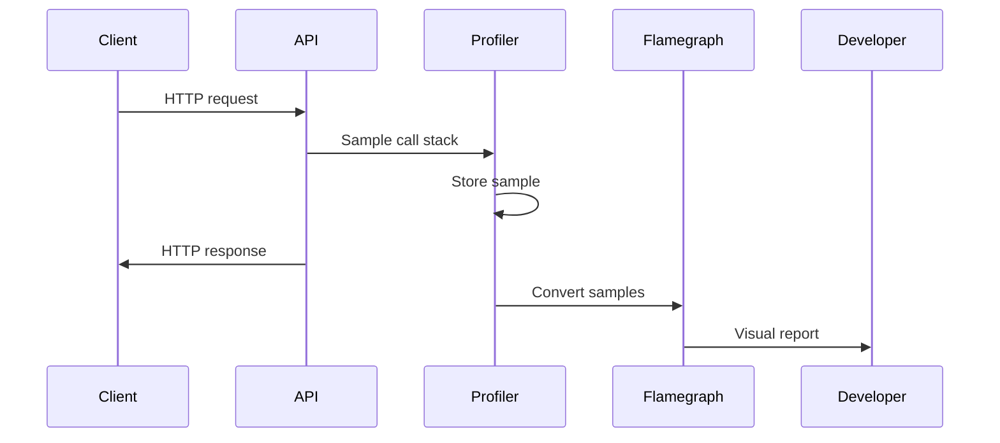

<!-- Generated by Groq via GitHub Actions -->
<!-- Topic ID: T214 -->
<!-- Category: Performance Engineering -->
<!-- Generated at UTC: 2026-11-15T08:01:20.272943+00:00 -->

# CPU profiling

## 1. What problem does this solve?

- **Problem** – In a production backend you often see slow requests, high latency, or CPU‑bound workers that consume more resources than expected. Without insight you can’t tell *why* the CPU is busy: is it a hot database query, a tight loop, or an inefficient algorithm?
- **Why it matters** – CPU is a scarce resource. A single hot function can throttle the entire service, increase cost (more VMs, higher cloud bill), and degrade user experience. Detecting and fixing CPU hotspots reduces latency, improves throughput, and lowers operational cost.
- **What happens if it’s not used** – You’ll keep guessing, adding more instances, or rewriting code without knowing the real bottleneck. This leads to wasted engineering time, higher cloud spend, and potentially missed SLAs.
- **Real‑world appearance** –  
  * A microservice that processes image uploads may spend most of its time in a native image‑processing library.  
  * A FastAPI endpoint that does heavy data transformation may block the event loop.  
  * A Next.js API route that calls a slow external AI model can hog CPU while waiting for the response.

## 2. Mental model

**Analogy** – Think of a city’s traffic system.  
- *CPU* is the road network.  
- *Processes/threads* are cars.  
- *CPU profiling* is a traffic camera that records which roads (functions) are congested and how long cars stay there.

**Engineering model** –  
- The profiler samples the call stack at regular intervals (or instruments every call).  
- It aggregates samples into a *flamegraph* or *call tree*, showing which functions consume the most CPU time.  
- You then investigate those hot spots, refactor, or add caching.

## 3. Deep explanation

| Concept | What it is | Why it matters |
|---------|------------|----------------|
| **CPU time vs. wall time** | CPU time is the actual time the CPU spent executing a thread; wall time is elapsed real time. | Profilers focus on CPU time because it reflects computational cost, not I/O waits. |
| **Sampling** | Periodically records the current call stack. | Low overhead, good for long‑running services. |
| **Instrumentation** | Hooks into every function call. | Precise but high overhead; useful for short, critical sections. |
| **Flamegraph** | Visual representation of stack traces; width proportional to CPU time. | Quickly spot hot functions. |
| **Hot function** | Function that consumes a large share of CPU. | Target for optimization. |
| **Context switch overhead** | Switching between threads/processes consumes CPU. | Profilers can reveal excessive context switching. |
| **Sampling bias** | If the sampling interval is too long, fast functions may be missed. | Choose interval based on expected hot spot duration. |
| **Limitations** | Profilers can’t see I/O waits, network latency, or external service performance. | Complement with tracing and metrics. |
| **Where it fits** | Usually part of the *observability* stack: metrics → tracing → profiling. | Profiling is deeper than metrics; it’s used when metrics show a problem but don’t explain why. |
| **Interaction with other concepts** | • **Tracing**: correlates spans with profiler data. <br>• **Metrics**: CPU usage metrics flag when profiling is needed. <br>• **Autoscaling**: CPU spikes can trigger scaling decisions. |

**Trade‑offs**

| Approach | Overhead | Accuracy | Use‑case |
|----------|----------|----------|----------|
| Sampling | Low | Good for long‑running services | Production |
| Instrumentation | High | Precise | Hot spot analysis, unit tests |
| Native (perf) | Medium | Full stack (user + kernel) | Low‑level bottlenecks |

**Failure modes**

- Profiling during a crash can produce incomplete data.  
- Profiling a highly concurrent service can produce noisy data if sampling interval is too short.  
- Profilers that run in the same process can interfere with the workload (e.g., `node --prof` starts a separate process).

## 4. How it works

1. **Start the profiler** – e.g., `node --prof` or `clinic flame`.  
2. **Run the workload** – send traffic to the service.  
3. **Collect samples** – the profiler records call stacks at each tick.  
4. **Stop the profiler** – terminate the process or send a signal.  
5. **Post‑process** – convert raw data into a flamegraph (`node --prof-process`, `clinic convert`, `perf script`).  
6. **Analyze** – look for wide bars (hot functions).  
7. **Iterate** – refactor the hot code, redeploy, re‑profile.



## 5. Practical implementation

### Node.js + TypeScript example

```ts
// src/profiler.ts
import { spawn } from 'child_process';
import * as fs from 'fs';
import * as path from 'path';

/**
 * Starts a Node.js process with built‑in V8 profiler.
 * Returns the child process so you can kill it later.
 */
export function startProfiler(entry: string, args: string[] = []): ReturnType<typeof spawn> {
  // `--prof` writes a log file to /tmp/v8.log
  const proc = spawn('node', ['--prof', entry, ...args], {
    stdio: ['ignore', 'inherit', 'inherit'],
  });

  console.log(`Profiler started (pid=${proc.pid})`);
  return proc;
}

/**
 * Stops the profiler and processes the log into a flamegraph.
 */
export function stopProfiler(proc: ReturnType<typeof spawn>, outDir: string = 'prof') {
  proc.kill('SIGINT'); // graceful shutdown

  // Wait for the log to be written
  setTimeout(() => {
    const logPath = path.join('/tmp', 'v8.log');
    const outPath = path.join(outDir, 'flamegraph.html');

    // Convert V8 log to a human‑readable format
    const convert = spawn('node', ['node_modules/v8-profiler-next/bin/v8-profiler-next', logPath, outPath], {
      stdio: 'inherit',
    });

    convert.on('close', () => {
      console.log(`Flamegraph generated at ${outPath}`);
    });
  }, 2000);
}
```

**Usage in a Next.js API route**

```ts
// pages/api/slow.ts
import type { NextApiRequest, NextApiResponse } from 'next';
import { startProfiler, stopProfiler } from '../../utils/profiler';

export default async function handler(req: NextApiRequest, res: NextApiResponse) {
  // Start profiling for this request
  const profiler = startProfiler('server.js', ['--port', '3000']);

  // Simulate CPU‑heavy work
  const start = Date.now();
  while (Date.now() - start < 2000) {
    // busy loop
  }

  // Stop profiling
  stopProfiler(profiler);

  res.status(200).json({ message: 'Done' });
}
```

> **Note**: In production you’d run the profiler as a separate process (e.g., via `clinic` or `perf`) and not per request. The above is for learning.

### Using `clinic` (recommended for production)

```bash
npm i -g clinic
clinic flame -- node server.js
```

`clinic` automatically samples, generates a flamegraph, and opens it in the browser.

### Linux native profiling with `perf`

```bash
# Install perf
sudo apt-get install linux-tools-common linux-tools-generic

# Profile a Node.js process
sudo perf record -F 99 -p $(pgrep -f node) -g
sudo perf report
```

## 6. Production considerations

| Concern | Recommendation |
|---------|----------------|
| **Scalability** | Run profiling on a subset of instances or in a dedicated profiling pod. |
| **Reliability** | Use a separate process (e.g., `clinic`) so the profiler doesn’t crash the service. |
| **Security** | Don’t expose raw profiling data; restrict access to internal dashboards. |
| **Observability** | Correlate flamegraphs with tracing spans (OpenTelemetry) and metrics (Prometheus). |
| **Performance** | Sampling interval ≥ 10 ms to keep overhead < 1 %. |
| **Error handling** | Capture profiler exit codes; clean up temp files. |
| **Resource usage** | Profiling logs can be large; rotate or compress them. |
| **Operational concerns** | Automate profiling in CI for regression tests; schedule nightly profiling in prod. |
| **Failure recovery** | If profiling fails, fall back to metrics and tracing. |
| **Deployment** | Use Docker build args to include profiler binaries only in staging. |

## 7. Common mistakes

| Mistake | Why it’s problematic |
|---------|----------------------|
| Profiling only in dev | Production workloads differ; dev profiling misses real bottlenecks. |
| Ignoring overhead | High sampling rates can add latency, masking the real issue. |
| Misreading flamegraphs | A wide bar may be due to a long‑running I/O wait, not CPU. |
| Profiling the whole app | Generates noisy data; focus on hot endpoints or services. |
| Not correlating with logs | Hard to map a hot function to a request without trace IDs. |
| Leaving profiling enabled in prod | Continuous profiling can consume CPU and storage. |
| Using the wrong tool | `node --prof` is legacy; modern tools (clinic, v8-profiler-next) are better. |

## 8. Senior engineer perspective

- **Architecture decisions** – Decide whether to profile per request, per instance, or per cluster. For microservices, a dedicated profiling service can aggregate data.
- **Trade‑offs** – Sampling gives low overhead but may miss short hot spots; instrumentation is precise but expensive. Choose based on the criticality of the service.
- **Bottlenecks** – CPU profiling often reveals that a single synchronous function (e.g., JSON parsing, image resizing) is the bottleneck. Refactor to async or move to a worker pool.
- **Failure scenarios** – Profiling can mask a race condition that only appears under load. Combine with load testing.
- **Monitoring** – Expose a “profiling health” endpoint; alert if CPU usage > 80 % for > 30 s.
- **Cost/performance** – Profiling logs can cost storage; compress or archive them. Use spot instances for nightly profiling.
- **When NOT to use** – If the service is I/O bound, CPU profiling won’t help. Use I/O profiling or network tracing instead.

## 9. Interview questions

1. **Beginner** – *What is a flamegraph and how does it help in CPU profiling?*  
   *Answer:* A flamegraph visualizes call stacks; each bar’s width represents CPU time spent in that function, making hot spots obvious.

2. **Beginner** – *Why might sampling miss a hot function?*  
   *Answer:* If the sampling interval is too long relative to the function’s execution time, the function may never be sampled.

3. **Senior** – *How would you design a CPU profiling pipeline for a fleet of microservices in production?*  
   *Answer:* Use a sidecar or dedicated profiling agent that samples at low overhead, aggregates data to a central observability backend, correlates with traces, and triggers alerts when CPU thresholds are exceeded.

4. **Senior** – *Explain the trade‑offs between using `node --prof` and `clinic flame` for profiling a Node.js service.*  
   *Answer:* `node --prof` is built‑in, low overhead, but produces legacy logs that need conversion. `clinic flame` is higher level, produces interactive flamegraphs, but adds a small runtime overhead and requires the clinic binary.

5. **Scenario/Debugging** – *You notice that a FastAPI endpoint has high latency but low CPU usage in metrics. However, a Node.js service behind it shows high CPU usage. What could be happening and how would you investigate?*  
   *Answer:* The Node.js service may be CPU‑bound while the FastAPI endpoint is I/O‑bound (e.g., waiting for the Node service). Investigate by profiling the Node service, correlating with tracing to see where the latency originates, and checking for blocking calls or synchronous code.

## 10. Hands‑on task

1. **Add CPU profiling to the existing `api/slow` endpoint** in the repository.  
2. **Generate a flamegraph** after sending 10 requests.  
3. **Identify the top 3 hot functions** and refactor one of them to use an async alternative (e.g., replace a busy loop with `setTimeout`).  
4. **Re‑profile** and confirm the CPU usage dropped by at least 30 %.

## 11. Quick revision

- CPU profiling measures *CPU time*, not wall time.  
- Sampling vs. instrumentation: low overhead vs. high precision.  
- Flamegraph: width = CPU time; stack depth = call hierarchy.  
- Profiling introduces overhead; choose interval wisely.  
- Correlate profiling data with tracing and metrics.  
- Use dedicated profiling tools (`clinic`, `perf`) in prod.  
- Avoid profiling the entire app; focus on hot endpoints.  
- Clean up profiler logs to avoid storage bloat.  
- Profiling is a diagnostic tool, not a permanent runtime feature.  
- In microservices, aggregate profiling data centrally for trend analysis.  

## 12. References

- [Node.js V8 Profiler Documentation](https://nodejs.org/api/v8.html#v8profiler)  
- [Chrome DevTools Flamegraph Guide](https://developer.chrome.com/docs/devtools/evaluate-performance/#flamegraph)  
- [Clinic.js – Performance Profiling](https://clinicjs.org/)  
- [Linux perf – CPU Profiling](https://perf.wiki.kernel.org/index.php/Main_Page)  
- [OpenTelemetry – Tracing and Profiling](https://opentelemetry.io/docs/concepts/profiling/)  
- [V8 Profiler Next](https://github.com/GoogleChrome/v8-profiler-next)
