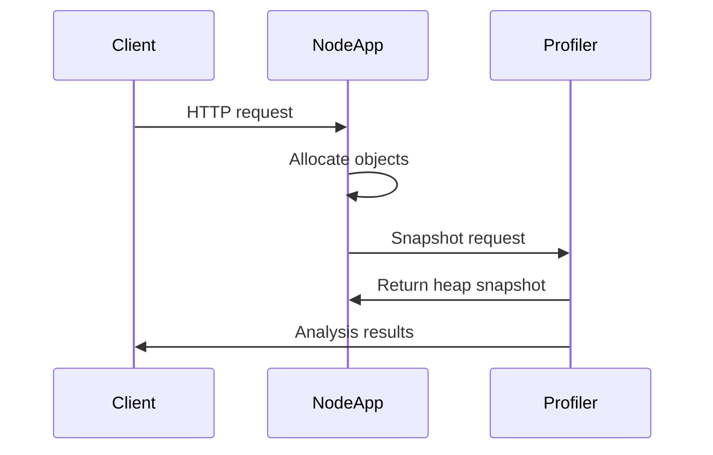

<!-- Generated by Groq via GitHub Actions -->
<!-- Topic ID: T215 -->
<!-- Category: Performance Engineering -->
<!-- Generated at UTC: 2026-11-15T19:25:48.366871+00:00 -->

# Memory profiling

## 1. What problem does this solve?

**Motivation**  
When a backend service runs, it consumes RAM for everything it does: request handling, database connections, caching, AI model inference, etc. If the service leaks memory or allocates more than necessary, the container or VM can run out of memory, leading to crashes, slowdowns, or evictions in orchestrators like Kubernetes.

**What problem exists**  
- **Memory leaks**: objects that are no longer needed stay referenced, preventing GC.
- **Unbounded growth**: e.g., caching without eviction policies or building large in‑memory data structures per request.
- **Hot spots**: certain functions or libraries allocate disproportionately large amounts of memory.

**Why the problem matters**  
- **Availability**: OOM kills the process → downtime.
- **Cost**: Larger instances or more replicas to compensate for memory waste.
- **Performance**: GC pauses become longer, increasing latency.

**What happens if this concept is not used**  
- Services may crash unpredictably.
- Performance degrades over time.
- Harder to diagnose why a deployment fails after a few hours of traffic.

**Where this concept appears in real backend systems**  
- Node.js microservices that keep request data in memory.
- Python FastAPI services that cache DB query results in a global dict.
- AI inference servers that load large models into RAM.
- Redis clients that keep connection pools alive.

---

## 2. Mental model

**Analogy**  
Think of a memory‑profiler as a *water meter* for your application. Just as a water meter tells you how much water you’re using, a profiler tells you how much memory your code is consuming, where it’s coming from, and whether it’s leaking.

**Engineering model**  
- **Heap**: the area where objects live.  
- **Stack**: per‑thread call frames.  
- **GC**: garbage collector that frees unreachable objects.  
- A profiler samples the heap or records allocations, then maps them back to source code.  
- The output is a *snapshot* (static view) or a *timeline* (dynamic view).

---

## 3. Deep explanation

### Internals
- **V8 heap snapshot**: Node.js uses V8’s built‑in heap snapshot API (`v8.getHeapSnapshot()`). The snapshot is a graph of objects, their sizes, and references.
- **Allocation instrumentation**: Node can be started with `--inspect` and `--inspect-brk` to expose the Chrome DevTools protocol. Tools like `clinic.js` or `node --inspect` can record allocation stacks.
- **CPU vs. Memory**: CPU profiling records function call times; memory profiling records allocation sizes and lifetimes.

### Important terminology
| Term | Meaning |
|------|---------|
| **Allocation** | Creation of a new object in the heap. |
| **Leak** | Objects that remain reachable after they are no longer needed. |
| **Retention size** | Total size of an object plus all objects it references. |
| **Dominators** | Objects that keep other objects alive; the root of a leak. |
| **GC pause** | Time spent by the garbage collector to clean up. |
| **Heap snapshot** | Static graph of the heap at a point in time. |
| **Allocation stack** | Call stack that led to an allocation. |

### Trade‑offs
- **Snapshot size vs. granularity**: Full snapshots are large (hundreds of MB) but give complete picture; incremental snapshots are smaller but may miss transient leaks.
- **Instrumentation overhead**: Allocation tracking can add 5–20 % latency; acceptable in dev but not in prod.
- **Sampling vs. tracing**: Sampling is lightweight but may miss short‑lived objects; tracing captures everything but is heavy.

### Failure modes
- **False positives**: Objects that appear leaked but are intentionally long‑lived (e.g., caches).
- **Missing leaks**: If a leak occurs only under specific traffic patterns, a snapshot taken at the wrong time will miss it.
- **Tool limitations**: Some profilers cannot handle native addons or multi‑process setups.

### Limitations
- **Non‑determinism**: GC timing is unpredictable; snapshots may capture different states.
- **Memory‑only view**: Does not show CPU or I/O bottlenecks.
- **Complexity**: Interpreting large snapshots requires experience.

### Where it fits in a backend architecture
- **Service layer**: Profiling individual microservices to ensure they stay within memory budgets.
- **Orchestration**: Kubernetes’ `--memory` limits rely on accurate profiling to set appropriate thresholds.
- **CI/CD**: Automated memory tests can catch regressions before release.

### Interaction with related concepts
- **Caching**: Profiling helps decide eviction policies and cache sizes.
- **Connection pooling**: Too many open connections can inflate memory usage.
- **AI model loading**: Profiling reveals whether models are loaded once or per request.
- **Container limits**: Profiling informs the `memory` and `memoryReservation` settings in Docker/K8s.

---

## 4. How it works

1. **Start the process with profiling flags**  
   ```bash
   node --inspect-brk app.js
   ```
2. **Trigger a workload** (e.g., send a burst of HTTP requests).
3. **Collect a heap snapshot** via Chrome DevTools or `node --inspect` protocol.  
   ```bash
   node --inspect app.js
   ```
   In DevTools → Memory → Take snapshot.
4. **Analyze the snapshot**: look for large objects, dominator chains, and retention sizes.
5. **Identify leaks**: objects that persist across snapshots or have large retention sizes.
6. **Instrument code**: add `global.gc()` or use `clinic.js` to get allocation stacks.
7. **Iterate**: fix code, redeploy, and re‑profile.



---

## 5. Practical implementation

### Node.js example: Detecting a simple memory leak

```ts
// app.ts
import express from 'express';
import { createServer } from 'http';

const app = express();
const leakedArray: any[] = []; // Global array that grows forever

app.get('/leak', (_req, res) => {
  // Each request pushes a new object into the global array
  leakedArray.push({ data: 'x'.repeat(1000) });
  res.send(`Leaked ${leakedArray.length} items`);
});

const server = createServer(app);
server.listen(3000, () => console.log('Server listening on 3000'));
```

**Run with V8 heap snapshot**

```bash
node --inspect-brk app.js
```

Open `chrome://inspect` → click “Open dedicated DevTools for Node” → Memory → Take snapshot.

**Automated snapshot via `clinic.js`**

```bash
npx clinic --node app.js
```

After the test run, `clinic` generates a `clinic.js.html` file that visualizes allocations and GC pauses.

### Profiling a FastAPI service (Python)

```python
# main.py
from fastapi import FastAPI
import uvicorn

app = FastAPI()
leaked_list = []

@app.get("/leak")
def leak():
    leaked_list.append("x" * 1000)
    return {"leaked": len(leaked_list)}

if __name__ == "__main__":
    uvicorn.run(app, host="0.0.0.0", port=8000)
```

Run with `memory_profiler`:

```bash
pip install memory_profiler
mprof run python main.py
mprof plot
```

---

## 6. Production considerations

| Concern | How memory profiling helps |
|---------|---------------------------|
| **Scalability** | Identify per‑request memory usage to set container limits and horizontal scaling thresholds. |
| **Reliability** | Detect leaks before they cause OOM in production; set alerts on memory usage trends. |
| **Security** | Prevent memory‑based DoS attacks by bounding allocations. |
| **Observability** | Expose memory metrics (e.g., `process_resident_memory_bytes`) to Prometheus; correlate with latency. |
| **Performance** | Reduce GC pauses by eliminating unnecessary allocations. |
| **Error handling** | Detect out‑of‑memory errors in logs and trigger graceful shutdowns. |
| **Resource usage** | Optimize memory footprint, reducing cloud costs. |
| **Operational concerns** | Automate profiling in CI; use Docker `--memory` limits; monitor with Grafana dashboards. |
| **Failure recovery** | Implement graceful restarts when memory exceeds thresholds. |
| **Deployment** | Use sidecar containers for profiling in staging; avoid profiling in production unless necessary. |

---

## 7. Common mistakes

| Mistake | Why it’s problematic |
|---------|----------------------|
| **Profiling only in dev** | Leaks may only appear under production load; missing them until after release. |
| **Ignoring GC pause data** | Long GC pauses can be mistaken for leaks; need to differentiate. |
| **Treating caches as leaks** | Global caches are intentional; mislabeling them wastes effort. |
| **Using too many snapshots** | Generates huge files, slows down the system, and obscures the real issue. |
| **Not correlating memory with request patterns** | A spike may be due to a specific endpoint, not a general leak. |
| **Assuming one snapshot is enough** | Leaks may be intermittent; multiple snapshots over time are needed. |
| **Over‑optimizing for memory at the cost of CPU** | Shrinking objects can increase GC frequency, hurting latency. |

---

## 8. Senior engineer perspective

### What changes at scale?
- **Distributed profiling**: Profiling across multiple pods or services; need to aggregate data.
- **Sampling strategies**: Use low‑overhead sampling in production, heavy tracing in staging.
- **Cost‑benefit analysis**: Profiling tools add CPU and storage overhead; balance against risk of leaks.
- **Automation**: Integrate profiling into CI/CD pipelines; fail builds if memory usage exceeds thresholds.

### Design decisions
- **Container limits**: Set `memory` and `memoryReservation` based on profiling data.
- **Cache eviction**: Choose LRU vs. LFU based on retention size analysis.
- **Model loading**: Load AI models once per container; profile to confirm single instance.
- **Connection pooling**: Tune pool size to avoid excessive memory.

### Bottlenecks & failure scenarios
- **GC thrashing**: Too many small allocations → frequent GC → latency spikes.
- **Memory pressure in orchestrator**: OOM kills → pod restarts → request loss.
- **Profiling overhead**: In production, profiling can double GC time; avoid unless necessary.

### Monitoring
- **Prometheus metrics**: `process_resident_memory_bytes`, `process_virtual_memory_bytes`.
- **Alerting**: Trigger on sustained >80% memory usage or sudden GC pause spikes.

### Cost/performance
- **Smaller instances**: Profiling informs whether you can move to cheaper nodes.
- **Memory vs. CPU trade‑off**: Sometimes a slightly larger instance with more memory reduces GC pauses, improving overall cost.

### When NOT to use
- **Stateless, short‑lived functions** (e.g., serverless Lambda) where memory is allocated per invocation; profiling may be overkill.
- **Highly dynamic workloads** where memory usage is inherently variable; focus on limits instead.

---

## 9. Interview questions

1. **Beginner**: *What is a heap snapshot and why is it useful?*  
   *Answer*: A heap snapshot is a graph of all objects in memory at a point in time. It helps identify which objects are consuming memory, detect leaks, and understand retention chains.

2. **Beginner**: *How does the V8 garbage collector decide what to free?*  
   *Answer*: V8 uses a generational GC: young objects are collected frequently; old objects survive longer. It traces reachable objects from roots; unreachable ones are reclaimed.

3. **Senior**: *Describe how you would design a memory‑profiling strategy for a microservice that serves AI inference requests.*  
   *Answer points*:  
   - Run profiling in staging with realistic load.  
   - Capture heap snapshots before and after model loading.  
   - Use allocation stacks to confirm model is loaded once.  
   - Set container memory limits based on peak usage + safety margin.  
   - Automate alerts on GC pause > threshold.  
   - Consider using a sidecar for profiling to avoid production overhead.

4. **Senior**: *Explain the trade‑offs between using a global cache versus a per‑request cache in a Node.js service.*  
   *Answer points*:  
   - Global cache reduces allocations but can grow unbounded; needs eviction.  
   - Per‑request cache keeps memory bounded but incurs allocation overhead per request.  
   - Global cache may cause leaks if not cleaned; per‑request cache avoids leaks but may hurt performance.

5. **Scenario/Debugging**: *Your service started crashing with “JavaScript heap out of memory” after a week of steady traffic. Describe your debugging steps.*  
   *Answer points*:  
   - Check container logs for OOM events.  
   - Capture a heap snapshot during a crash.  
   - Look for objects that persist across snapshots (leaks).  
   - Identify allocation stacks pointing to the leak.  
   - Fix code (e.g., clear global arrays, use proper cache eviction).  
   - Re‑profile to confirm resolution.  
   - Update memory limits and alerting.

---

## 10. Hands‑on task

**Goal**: Identify and fix a memory leak in a simple Express service.

1. Clone the repo (or create a new Node project).  
2. Add the following endpoint that intentionally leaks memory.  
3. Run the service with `node --inspect-brk app.js`.  
4. Use Chrome DevTools to take a heap snapshot after 100 requests.  
5. Analyze the snapshot to find the leaking object.  
6. Refactor the code to eliminate the leak (e.g., use a local array or proper cache).  
7. Verify that subsequent snapshots show no growth.  
8. Commit your changes and write a short README explaining the fix.

---

## 11. Quick revision

- Memory profiling reveals *how* and *where* memory is used.  
- **Heap snapshot** = static view; **allocation stack** = dynamic view.  
- **Leak** = object that stays reachable after it should be freed.  
- **Retention size** = size of an object + everything it references.  
- **GC pause** = time spent freeing memory; long pauses indicate high allocation rates.  
- Use `node --inspect` + Chrome DevTools or `clinic.js` for Node.  
- In Python, use `memory_profiler` or `tracemalloc`.  
- Set container memory limits based on peak usage + safety margin.  
- Automate profiling in CI; alert on sustained high memory or GC pauses.  
- Avoid profiling in production unless necessary; use sampling.  
- Global caches are not leaks; they need eviction policies.  
- A memory leak can cause OOM, downtime, and higher costs.

---

## 12. References

- [Node.js V8 Heap Snapshot API](https://nodejs.org/api/v8.html#v8_getheapsnapshot)  
- [Chrome DevTools Memory Panel](https://developer.chrome.com/docs/devtools/memory/)  
- [clinic.js – Node.js performance analysis](https://clinicjs.org/)  
- [Python memory_profiler](https://pypi.org/project/memory_profiler/)  
- [FastAPI docs – Profiling](https://fastapi.tiangolo.com/advanced/profiling/)  
- [Kubernetes memory limits](https://kubernetes.io/docs/concepts/configuration/manage-resources-containers/#memory)  
- [Prometheus Node Exporter – Memory metrics](https://github.com/prometheus/node_exporter)
