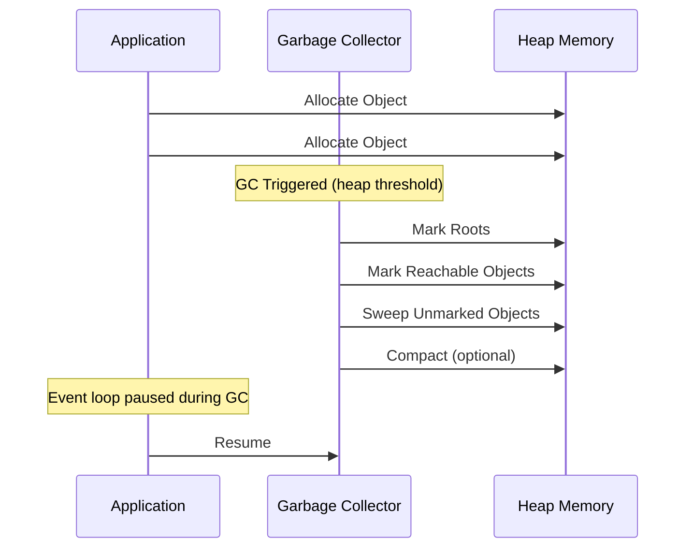

<!-- Generated by Groq via GitHub Actions -->
<!-- Topic ID: T216 -->
<!-- Category: Performance Engineering -->
<!-- Generated at UTC: 2026-11-15T19:25:48.366871+00:00 -->

# Garbage Collection

## 1. What problem does this solve?

**Motivation**  
When a program runs, it creates objects in memory. Those objects consume RAM, and if they are no longer needed, the memory should be reclaimed so the process can keep running and other services can share the same machine. Manual memory management (as in C/C++) is error‑prone: forgetting to free memory leads to *leaks*, while freeing memory that is still in use leads to *use‑after‑free* bugs.

**What problem exists**  
- Objects are allocated on the heap.  
- The runtime cannot know when an object is truly unreachable.  
- Without reclamation, the process will eventually exhaust available memory, causing crashes or degraded performance.

**Why the problem matters**  
- **Stability**: A memory leak can bring a service down.  
- **Performance**: GC pauses can cause latency spikes.  
- **Cost**: In cloud environments, more memory usage translates to higher instance costs.

**What happens if GC is not used**  
- Manual memory management is required, increasing code complexity and bugs.  
- In languages like JavaScript/TypeScript or Python, you cannot avoid GC; the runtime will throw errors or crash if you try to free memory manually.

**Where this concept appears in real backend systems**  
- Node.js V8 engine’s generational GC.  
- Python’s reference‑counting + cyclic GC.  
- JVM/CLR GC for Java/Kotlin/Go.  
- Database connection pools often rely on GC to clean up unused connections.  
- Serverless runtimes (AWS Lambda, Cloud Run) rely on GC to reclaim memory between invocations.

---

## 2. Mental model

**Analogy**  
Think of a garbage truck that drives around a city.  
- **Households (your code)** drop trash (objects) into bins.  
- The **garbage truck (GC)** periodically visits each bin, collects the trash, and disposes of it.  
- If the truck is slow or misses a bin, trash piles up, clogging streets (memory).  
- If the truck is too aggressive, it might pick up trash that is still needed (dangling references).

**Engineering model**  
- **Heap**: Memory area where objects live.  
- **Reachability**: An object is *reachable* if it can be accessed via any chain of references from a *root* (global variables, stack frames, registers).  
- **Mark‑and‑Sweep**: The GC marks all reachable objects, then sweeps (frees) the rest.  
- **Generational**: Objects are divided into *young* and *old* generations; most objects die young, so the GC focuses on the young generation first.  
- **Pause**: During GC, the application threads are paused (stop‑the‑world) or run concurrently, depending on the algorithm.

---

## 3. Deep explanation

### Internals

| Term | Meaning | Example |
|------|---------|---------|
| **Root set** | Starting points for reachability analysis. | Global variables, stack frames, registers. |
| **Mark phase** | Traverse object graph, marking reachable objects. | V8’s *mark‑compact* algorithm. |
| **Sweep phase** | Free unmarked objects. | Python’s cyclic GC sweeps unreachable cycles. |
| **Generational GC** | Separate young/old generations; young GC is fast. | V8’s *scavenge* (young) and *mark‑compact* (old). |
| **Concurrent GC** | Runs alongside application threads. | V8’s *Concurrent Mark* phase. |
| **Incremental GC** | Breaks GC work into small chunks to reduce pause. | V8’s *Incremental Mark*. |

### Trade‑offs

| Aspect | Pros | Cons |
|--------|------|------|
| **Generational** | Fast for short‑lived objects. | Requires copying, which can fragment memory. |
| **Concurrent** | Low pause times. | More CPU usage, more complex implementation. |
| **Incremental** | Small pauses. | GC overhead can increase total CPU usage. |
| **Stop‑the‑world** | Simpler, deterministic. | Long pauses hurt latency. |

### Failure modes

- **Memory leaks**: Objects referenced by long‑lived roots (e.g., global caches) never become unreachable.  
- **GC thrashing**: Frequent GC cycles due to high allocation rates, causing CPU overhead.  
- **Pause spikes**: Long stop‑the‑world pauses in high‑throughput services.  
- **Fragmentation**: Repeated allocations/deallocations can fragment the heap, leading to allocation failures.

### Limitations

- GC cannot reclaim memory that is still reachable.  
- GC pauses are unavoidable; they can be mitigated but not eliminated.  
- Some languages (e.g., Go) expose GC tuning knobs; others (Python) have limited control.  
- GC does not manage external resources (file handles, sockets); those must be closed explicitly.

### Where GC fits in backend architecture

- **Application layer**: Node.js runtime, Python interpreter.  
- **Middleware**: Connection pools, ORM caches.  
- **Infrastructure**: Container runtimes (Docker) rely on host OS GC for memory reclamation.  
- **Observability**: GC metrics (pause time, heap usage) are exposed via Prometheus exporters (e.g., `node_exporter`, `prometheus-nodejs-exporter`).

### Interaction with related concepts

| Concept | Interaction |
|---------|-------------|
| **Connection pooling** | GC frees unused connection objects; careful pooling reduces GC pressure. |
| **Caching** | Cached objects can become long‑lived roots; eviction policies help GC. |
| **Event loop** | Node.js event loop is paused during stop‑the‑world GC, affecting latency. |
| **Microservices** | GC metrics are aggregated across services for overall health. |

---

## 4. How it works

1. **Allocation** – Code creates an object; V8 allocates it in the *young generation* heap.  
2. **Mark phase** – GC starts from roots, recursively marks reachable objects.  
3. **Concurrent marking** – While the app runs, GC marks objects in the *old generation*.  
4. **Sweep phase** – Unmarked objects are freed; memory is returned to the heap.  
5. **Compaction** – Optional: move live objects to eliminate gaps, reducing fragmentation.  
6. **Pause** – During stop‑the‑world phases, the event loop is blocked; metrics expose pause duration.  
7. **Repeat** – GC triggers when thresholds (heap size, allocation rate) are exceeded.



---

## 5. Practical implementation

### Node.js example – monitoring GC pauses

```ts
// gc-monitor.ts
import { performance } from 'perf_hooks';
import { setInterval } from 'timers';
import { Counter, Histogram, register } from 'prom-client';

const gcPauseHistogram = new Histogram({
  name: 'node_gc_pause_seconds',
  help: 'GC pause duration in seconds',
  buckets: [0.001, 0.005, 0.01, 0.05, 0.1, 0.5, 1, 5]
});

const gcCount = new Counter({
  name: 'node_gc_count',
  help: 'Total number of GC cycles'
});

performance.on('gc', (info) => {
  gcPauseHistogram.observe(info.duration / 1000);
  gcCount.inc();
});

export const exposeMetrics = () => {
  // Expose /metrics endpoint
  const express = require('express');
  const app = express();
  app.get('/metrics', async (_req, res) => {
    res.set('Content-Type', register.contentType);
    res.end(await register.metrics());
  });
  app.listen(9100, () => console.log('Metrics on :9100/metrics'));
};
```

**Explanation**

- `performance.on('gc')` fires on every GC cycle (Node 12+).  
- We record pause duration and count.  
- Expose metrics via `/metrics` for Prometheus.  

### Python example – detecting reference cycles

```python
# leak_detector.py
import gc
import time

def create_cycle():
    a = {}
    b = {'a': a}
    a['b'] = b  # cycle

for _ in range(1000):
    create_cycle()
    time.sleep(0.01)

gc.collect()  # force collection
print(f"Unreachable objects: {len(gc.garbage)}")
```

**Explanation**

- Python’s `gc` module can be used to inspect and force collection of cyclic garbage.  
- `gc.garbage` holds objects that were part of a cycle but could not be freed automatically.

---

## 6. Production considerations

| Concern | Key Points |
|---------|------------|
| **Scalability** | Tune GC thresholds (`--max-old-space-size`, `--max-semi-space-size`) to match workload; use multiple worker threads (`cluster`, `worker_threads`). |
| **Reliability** | Monitor GC pause times; set alerts if pauses exceed latency SLAs. |
| **Security** | GC does not affect security; however, memory leaks can expose sensitive data if not cleaned. |
| **Observability** | Export GC metrics; use tracing to correlate GC pauses with request latency. |
| **Performance** | Avoid large allocations in hot paths; use object pooling for high‑frequency objects. |
| **Error handling** | Catch `RangeError: Invalid array length` or `MemoryError` to detect out‑of‑memory. |
| **Resource usage** | GC consumes CPU; balance between allocation rate and GC frequency. |
| **Operational concerns** | Use container limits (`--memory`) to trigger OOM kills before GC thrashing. |
| **Failure recovery** | Restart service on OOM; use health checks that include GC metrics. |
| **Deployment** | Pass GC flags via environment variables (`NODE_OPTIONS=--max-old-space-size=2048`). |

---

## 7. Common mistakes

| Mistake | Why it’s problematic |
|---------|----------------------|
| **Holding onto global references** | Prevents GC from freeing objects; leads to memory leaks. |
| **Using `setInterval`/`setTimeout` without clearing** | Creates long‑lived timers that keep closures alive. |
| **Ignoring GC metrics** | Misses early signs of thrashing or pause spikes. |
| **Over‑tuning GC flags** | Setting `--max-old-space-size` too low causes frequent GC; too high wastes memory. |
| **Assuming GC is instant** | Stop‑the‑world pauses can be hundreds of ms in large heaps. |
| **Relying on `delete` for cleanup** | `delete` only removes property; object may still be referenced elsewhere. |
| **Using `process.memoryUsage()` as a proxy for leaks** | It shows heap usage, not necessarily leaks; must compare over time. |
| **Not using object pools for high‑frequency objects** | Creates many short‑lived objects, increasing GC load. |

---

## 8. Senior engineer perspective

### Architecture decisions

- **Microservice isolation**: Keep each service in its own container to limit GC impact to a single process.  
- **Worker pool**: Use `cluster` or `worker_threads` to parallelize CPU‑bound work while keeping GC pauses isolated.  
- **GC tuning**: Expose GC flags as part of deployment config; run load tests to find optimal thresholds.

### Trade‑offs

- **CPU vs. latency**: Aggressive GC (short pause) increases CPU usage; conservative GC reduces CPU but increases latency.  
- **Memory footprint**: Larger heap reduces GC frequency but increases cost.  
- **Complexity**: Concurrent GC requires careful handling of thread safety and data races.

### Bottlenecks

- **Stop‑the‑world pauses**: In high‑throughput APIs, even 10 ms pauses can break SLAs.  
- **Fragmentation**: Repeated allocations of varying sizes can fragment the heap, leading to allocation failures.

### Failure scenarios

- **OOM kills**: If GC cannot reclaim enough memory, the process is killed by the OS.  
- **GC thrashing**: Rapid allocation/deallocation cycles cause CPU saturation.  
- **Leak in third‑party library**: External dependencies may hold onto references; monitor with heap snapshots.

### Monitoring

- **Prometheus metrics**: `nodejs_gc_runs_total`, `nodejs_gc_pause_seconds`.  
- **Tracing**: Correlate GC pauses with request traces (OpenTelemetry).  
- **Heap snapshots**: Periodically take snapshots (`node --inspect`) to analyze leaks.

### Cost/performance

- **Instance sizing**: More memory reduces GC frequency but increases hourly cost.  
- **Serverless**: Cold starts include GC; keep functions lightweight.

### When NOT to use the approach

- **Real‑time systems**: Where deterministic latency is required, GC pauses may be unacceptable.  
- **Embedded or IoT**: Limited memory and CPU; manual memory management may be preferable.  
- **High‑frequency trading**: GC pauses can cause unacceptable jitter.

---

## 9. Interview questions

1. **Beginner** – *What is the purpose of garbage collection in a language like JavaScript?*  
   *Answer*: Reclaim memory from objects that are no longer reachable, preventing memory leaks and allowing the process to continue running.

2. **Beginner** – *What is the difference between a stop‑the‑world GC and a concurrent GC?*  
   *Answer*: Stop‑the‑world pauses all application threads during GC, while concurrent GC runs alongside the application, reducing pause times but increasing CPU usage.

3. **Senior** – *How would you tune Node.js GC for a high‑throughput API that must keep latency below 5 ms?*  
   *Answer*: Use `--max-old-space-size` to set an appropriate heap size, enable `--max-semi-space-size` for the young generation, consider `--gc-interval` or `--gc-interval` (if available), monitor pause times, and adjust thresholds to keep GC pauses under the SLA. Use worker threads to isolate GC pauses.

4. **Senior** – *Explain how generational GC works and why most objects die young.*  
   *Answer*: Objects are allocated in the young generation; most are short‑lived (e.g., request‑scoped objects). The GC quickly collects the young generation. Surviving objects are promoted to the old generation, where GC runs less frequently. This reduces overhead because the majority of allocations are reclaimed quickly.

5. **Scenario/Debugging** – *Your Node.js service is slowly increasing memory usage over time and eventually crashes with an OOM error. What steps would you take to diagnose and fix the issue?*  
   *Answer*:  
   - Enable GC metrics (`performance.on('gc')`) and monitor heap usage.  
   - Take heap snapshots at intervals using `node --inspect` and analyze with Chrome DevTools.  
   - Look for objects that remain reachable but should be garbage‑collected (e.g., global caches, event listeners).  
   - Check for unclosed timers or listeners.  
   - Refactor to use weak references or clear intervals.  
   - If a third‑party library leaks, consider patching or replacing it.  
   - After fixes, re‑run load tests to confirm memory stabilizes.

---

## 10. Hands‑on task

**Goal**: Create a small Node.js service that intentionally leaks memory, then fix it.

1. **Create a new repo** (or use the existing one).  
2. **Implement `leaky-service.ts`** that starts an HTTP server and, on each request, stores a callback in a global array that never gets cleared.  
3. **Run the service** and observe memory growth with `top` or `ps`.  
4. **Add GC metrics** (see section 5) and expose `/metrics`.  
5. **Fix the leak** by removing the global reference or using a `WeakMap`.  
6. **Verify** that memory stabilizes under load.

```ts
// leaky-service.ts
import http from 'http';

const leakyArray: (() => void)[] = []; // global leak

http.createServer((req, res) => {
  // Store a closure that references the request
  leakyArray.push(() => console.log(req.url));
  res.end('ok');
}).listen(3000, () => console.log('Listening on 3000'));
```

After fixing:

```ts
// fixed-service.ts
import http from 'http';
import { WeakMap } from 'weakmap'; // pseudo, Node has WeakMap built‑in

const weakRefs = new WeakMap<http.IncomingMessage, () => void>();

http.createServer((req, res) => {
  weakRefs.set(req, () => console.log(req.url));
  res.end('ok');
}).listen(3000, () => console.log('Listening on 3000'));
```

Run `node leaky-service.ts` and `node fixed-service.ts` while sending requests, and observe memory usage.

---

## 11. Quick revision

- GC reclaims memory from unreachable objects.  
- **Roots**: globals, stack frames, registers.  
- **Mark‑and‑Sweep**: mark reachable, sweep unreachable.  
- **Generational GC**: young (fast) vs. old (slow).  
- **Stop‑the‑world** vs. **concurrent** GC.  
- Node.js exposes GC events via `perf_hooks`.  
- Monitor GC pause times; set alerts if > SLA.  
- Avoid global references; clear timers and listeners.  
- Use object pools for high‑frequency allocations.  
- Tune heap size (`--max-old-space-size`) based on workload.  
- Heap snapshots help detect leaks.  
- In microservices, isolate GC impact per container.

---

## 12. References

- V8 GC documentation: https://v8.dev/docs/gc  
- Node.js `perf_hooks` GC events: https://nodejs.org/api/perf_hooks.html#perf_hooks_event_gc  
- Python GC module: https://docs.python.org/3/library/gc.html  
- Prometheus Node.js exporter: https://github.com/siimon/prom-client  
- OpenTelemetry Node.js instrumentation: https://opentelemetry.io/docs/instrumentation/js/  
- Google Cloud Functions memory limits: https://cloud.google.com/functions/docs/concepts/exec#memory  
- AWS Lambda memory tuning: https://docs.aws.amazon.com/lambda/latest/dg/configuration-memory.html

---
