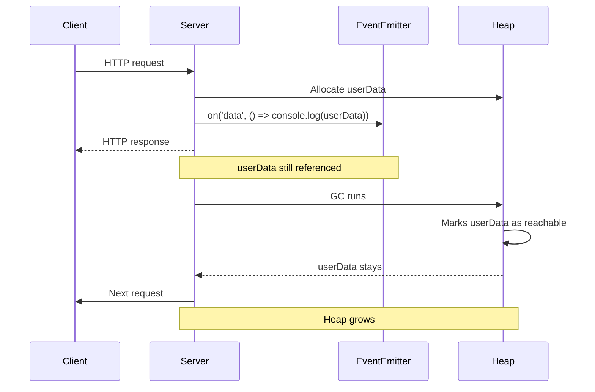

<!-- Generated by Groq via GitHub Actions -->
<!-- Topic ID: T217 -->
<!-- Category: Performance Engineering -->
<!-- Generated at UTC: 2026-11-16T08:10:40.861595+00:00 -->

# Memory leaks

## 1. What problem does this solve?

Memory leaks are hidden bugs that silently consume more and more RAM over time.  
In a long‑running backend service (Node.js, FastAPI, etc.) a leak can:

- **Increase memory usage** until the process hits the OS limit → `OutOfMemoryError` or `OOMKilled`.
- **Slow down** the garbage collector, causing longer pauses and higher latency.
- **Stabilize** the service only until the next restart, making it hard to reproduce.

If a leak is not addressed, the service may keep running for a while but eventually crash or become unresponsive, which is unacceptable in production where uptime and latency are critical.

Memory leaks appear in many places:

- **Event listeners** that are never removed.
- **Closures** that capture large objects and keep them alive.
- **Global or static caches** that grow without bounds.
- **Database connection pools** that are not closed.
- **Third‑party libraries** with bugs.

In a real backend, a leaking request handler can cause the entire cluster to exhaust memory, leading to cascading failures and costly downtime.

---

## 2. Mental model

**Analogy**  
Think of a garbage collector as a janitor who cleans up after you.  
If you leave a trash bag on the floor (a reference that should be dropped), the janitor can’t find it, so the bag stays and the floor gets cluttered. Eventually the floor is full and the janitor can’t move.

**Engineering model**  
- **Objects** live on the *heap*.
- The **garbage collector** runs periodically, marking objects that are still reachable from roots (global variables, stack frames, etc.) and sweeping the rest.
- A *memory leak* happens when an object that should be unreachable is still reachable, so the GC never frees it.

---

## 3. Deep explanation

### Internals

| Concept | What it is | Why it matters |
|---------|------------|----------------|
| **Heap** | Memory region where objects are allocated. | Size limits the process memory. |
| **Mark‑and‑Sweep** | GC algorithm used by V8. | Determines which objects can be freed. |
| **Generational GC** | Young and old generations. | Improves performance by focusing on short‑lived objects. |
| **Reference cycles** | Objects referencing each other. | Can prevent GC from reclaiming them. |
| **Event loop** | Drives async callbacks. | Holds references to callbacks, causing leaks if not cleaned. |

### Important terminology

- **Root set** – variables that are always reachable (globals, stack frames, active callbacks).
- **Closure** – function that captures variables from its lexical scope.
- **Leak** – a reference that should be dropped but is kept alive.
- **Heap snapshot** – a point‑in‑time image of the heap, useful for debugging leaks.
- **Memory pressure** – when the heap is close to its limit, GC runs more aggressively.

### Trade‑offs

| Decision | Benefit | Drawback |
|----------|---------|----------|
| **Large heap (`--max-old-space-size`)** | More memory for objects | Longer GC pauses |
| **Frequent GC** | Keeps memory low | CPU overhead |
| **Explicit cleanup** (e.g., `listener.remove()`) | Prevents leaks | Extra code, risk of forgetting |

### Failure modes

- **OOMKilled** by Docker/Kubernetes → service restarts.
- **Slow response** due to GC pauses.
- **Increased CPU** from repeated GC cycles.
- **Stale data** if a cache never evicts.

### Limitations

- **Detection**: Leaks are hard to spot without instrumentation.
- **False positives**: Some objects stay alive intentionally (e.g., long‑lived caches).
- **GC tuning**: V8’s GC is largely automatic; manual tuning is limited.

### Where it fits

Memory leaks are a *runtime* issue that sits between the **application layer** and the **operating system**. They affect:

- **Request handling** (per‑request allocations).
- **Background jobs** (long‑running workers).
- **Connection pools** (DB, Redis, Kafka).

They interact with:

- **Caching** (Redis, in‑memory).
- **Connection pooling** (pg, mongoose).
- **Event handling** (EventEmitter, streams).

---

## 4. How it works

1. **Request arrives** → handler allocates objects (e.g., user data, query results).
2. **Handler registers an event listener** or creates a closure that captures a large object.
3. **Handler finishes** but the listener/closure remains referenced by a global or event emitter.
4. **GC runs** → sees the reference, marks the object as reachable.
5. **Object stays in heap** → memory usage grows.
6. **Repeat** for many requests → heap fills up → GC pauses become longer → eventual OOM.



---

## 5. Practical implementation

### Example: leaking a listener

```ts
// leak.ts
import { EventEmitter } from 'events';

const emitter = new EventEmitter();

export function startLeaking() {
  // This listener captures a large object and never gets removed
  const largeObject = { data: new Array(1e6).fill('x') }; // ~6 MB
  emitter.on('tick', () => {
    console.log('tick', largeObject.data.length);
  });
}
```

```ts
// server.ts
import express from 'express';
import { startLeaking } from './leak';

const app = express();
startLeaking(); // start leaking on startup

app.get('/', (req, res) => {
  res.send('Hello');
});

app.listen(3000, () => console.log('Server running'));
```

**What happens?**  
Every time the server starts, a new listener is added. If you call `startLeaking()` repeatedly (e.g., on each request), the heap will grow linearly.

### Detecting the leak

```bash
# Run with heap snapshot
node --inspect-brk server.js
# In Chrome DevTools: Memory → Take snapshot
```

Look for objects of type `Array` that grow over time.

### Fixing the leak

```ts
export function startFixed() {
  const largeObject = { data: new Array(1e6).fill('x') };
  const handler = () => console.log('tick', largeObject.data.length);
  emitter.on('tick', handler);

  // Remove after use
  setTimeout(() => {
    emitter.removeListener('tick', handler);
  }, 1000);
}
```

Or, if the listener should stay, keep a reference to the large object in a cache that has an eviction policy.

---

## 6. Production considerations

| Concern | How to address |
|---------|----------------|
| **Scalability** | Use stateless services; containerize each worker; set memory limits (`--max-old-space-size=2048`). |
| **Reliability** | Restart policies (Docker `restart: always`), health checks that detect high memory usage. |
| **Security** | Avoid leaking sensitive data in cached objects; sanitize logs. |
| **Observability** | Export metrics (`process.memoryUsage()`), set alerts on `rss` > threshold. |
| **Performance** | Profile with `clinic.js` or `node --inspect`; tune GC flags if needed. |
| **Error handling** | Catch uncaught exceptions; use `process.on('unhandledRejection')`. |
| **Resource usage** | Monitor container memory; use cgroups to enforce limits. |
| **Operational concerns** | Automate heap snapshot collection on OOM events. |
| **Failure recovery** | Graceful shutdown hooks to close DB connections, flush caches. |
| **Deployment** | CI pipeline runs memory tests; use feature flags to enable/disable suspect code. |

---

## 7. Common mistakes

| Mistake | Why it’s problematic |
|---------|----------------------|
| **Never removing listeners** | Keeps references alive; leaks grow with each request. |
| **Storing large objects in globals** | Globals are root objects; GC never frees them. |
| **Using `setInterval` without clearing** | Interval callbacks hold references forever. |
| **Caching without eviction** | Cache grows until OOM. |
| **Not closing DB connections** | Connection objects stay alive; pool grows. |
| **Assuming GC will fix everything** | GC only frees unreachable objects; leaks stay. |
| **Ignoring heap snapshots** | Hard to pinpoint the source of a leak. |
| **Over‑optimizing GC flags** | Can worsen latency if misconfigured. |

---

## 8. Senior engineer perspective

### At scale

- **Isolation**: Run each microservice in its own container; a leak in one service doesn’t bring down the whole system.
- **Memory limits**: Set per‑container limits; Kubernetes `resources.limits.memory` forces a restart on OOM.
- **Observability**: Instrument memory usage per pod; correlate with request latency.
- **Auto‑scaling**: Scale out when memory usage spikes; avoid scaling in until the leak is fixed.
- **Graceful restarts**: Use `preStop` hooks to flush caches and close connections.

### Design decisions

| Decision | Trade‑off |
|----------|-----------|
| **Stateless vs stateful** | Stateless services are easier to restart; stateful services need careful cleanup. |
| **In‑memory cache vs external cache** | In‑memory is fast but leaks; external (Redis) offloads memory. |
| **Connection pooling** | Pooling reduces overhead but must be closed on shutdown. |
| **GC tuning** | `--max-old-space-size` vs `--gc-interval` – larger heap reduces GC frequency but increases pause time. |
| **Use of worker threads** | Offload CPU‑heavy work; each thread has its own heap, isolating leaks. |

### Bottlenecks & monitoring

- **GC pause time** → monitor `node --trace_gc` logs.
- **Memory churn** → use `clinic.js` or `heap-profiler`.
- **Leak detection** → automated heap snapshot comparison in CI.

### When NOT to use the approach

- If the service is truly **stateless** and **short‑lived** (e.g., serverless), GC overhead may be acceptable; focus on code correctness instead of GC tuning.
- If the **memory footprint** is negligible compared to the container limits, a simple restart policy may suffice.

---

## 9. Interview questions

1. **Beginner**: *What is a memory leak in a Node.js application?*  
   *Answer*: A situation where objects that are no longer needed remain reachable, preventing the garbage collector from freeing them, leading to increasing memory usage.

2. **Beginner**: *How can you detect a memory leak in a running Node.js process?*  
   *Answer*: Use heap snapshots (`node --inspect` → Chrome DevTools → Memory → Take snapshot), `clinic.js`, or `heapdump` to compare object counts over time.

3. **Senior**: *Explain how V8’s generational GC works and why it matters for long‑running services.*  
   *Answer*: V8 divides the heap into young and old generations. Most objects die young, so GC focuses on the young generation, which is fast. Objects that survive multiple collections move to the old generation, which is collected less often but more expensive. Long‑running services must balance heap size and GC pause times.

4. **Senior**: *Describe a scenario where a seemingly harmless global cache could cause a memory leak in a microservice architecture.*  
   *Answer*: A global cache that never evicts entries will grow with each request. In a containerized environment, the container’s memory limit will be reached, causing OOM kills. The leak is hidden because the cache is intentionally long‑lived.

5. **Scenario/Debugging**: *You notice that a Node.js service’s memory usage steadily rises over a day and eventually crashes. Describe the steps you would take to locate and fix the leak.*  
   *Answer*:  
   - Enable `--inspect` and take periodic heap snapshots.  
   - Compare snapshots to find objects whose count increases.  
   - Identify the allocation site (stack trace).  
   - Check for unremoved listeners, global variables, or long‑lived closures.  
   - Refactor to remove references or implement eviction.  
   - Deploy with memory limits and monitor.

---

## 10. Hands‑on task

**Goal**: Create a small Express server that leaks memory by adding a listener on every request. Then:

1. Run the server and observe memory growth with `top` or `htop`.  
2. Take a heap snapshot after 30 requests.  
3. Identify the leaking object.  
4. Refactor the code to remove the listener or use a proper cache eviction.  
5. Verify that memory stabilizes.

**Starter code** (`leakyServer.ts`):

```ts
import express from 'express';
import { EventEmitter } from 'events';

const emitter = new EventEmitter();
const app = express();

app.get('/', (req, res) => {
  const data = { payload: new Array(1e5).fill('x') }; // ~0.5 MB
  emitter.on('tick', () => console.log(data.payload.length));
  res.send('ok');
});

app.listen(3000, () => console.log('Server listening'));
```

Run with:

```bash
node --inspect-brk leakyServer.ts
```

Use Chrome DevTools → Memory → Take snapshot → Inspect `Array` objects.

---

## 11. Quick revision

- A memory leak keeps reachable objects alive longer than needed.
- Leaks arise from lingering event listeners, global caches, unclosed DB connections, or closure captures.
- V8 uses mark‑and‑sweep GC; generational GC optimizes for short‑lived objects.
- Detect leaks with heap snapshots, `clinic.js`, or `heapdump`.
- Fix by removing listeners, closing connections, or implementing eviction.
- In production: set memory limits, monitor `rss`, use health checks, restart on OOM.
- Common mistakes: never removing listeners, global caches without eviction, `setInterval` leaks.
- Senior engineers focus on isolation, observability, and automated restarts.

---

## 12. References

- [Node.js Garbage Collection](https://nodejs.org/en/docs/guides/gc/)
- [V8 Garbage Collector](https://v8.dev/docs/garbage-collector)
- [Chrome DevTools Memory](https://developer.chrome.com/docs/devtools/memory/)
- [heapdump](https://github.com/patrickhener/heapdump)
- [clinic.js](https://clinicjs.org/)
- [Docker Memory Limits](https://docs.docker.com/config/containers/resource_constraints/)
- [Kubernetes Memory Resources](https://kubernetes.io/docs/tasks/configure-pod-container/assign-memory-resource/)
- [Express.js EventEmitter](https://expressjs.com/en/4x/api.html#app)
