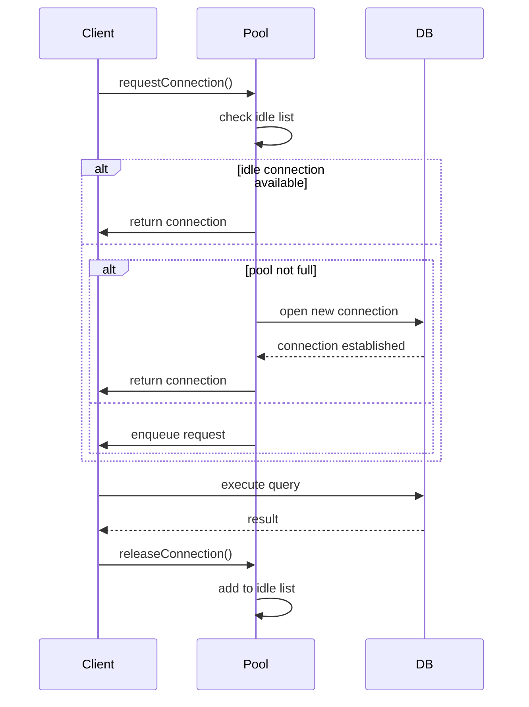

<!-- Generated by Groq via GitHub Actions -->
<!-- Topic ID: T218 -->
<!-- Category: Performance Engineering -->
<!-- Generated at UTC: 2026-11-16T08:10:40.861595+00:00 -->

# Connection pooling

## 1. What problem does this solve?

When a backend service needs to talk to a database, cache, or any external system, it usually opens a network connection, performs a request, and then closes the connection.  
- **What problem exists?**  
  Opening a TCP connection is expensive: it involves a three‑way handshake, TLS negotiation, and sometimes authentication. If a service handles thousands of requests per second, repeatedly opening/closing connections can consume CPU, memory, and network resources, and can even hit the remote system’s connection limits.  
- **Why the problem matters?**  
  High connection churn increases latency, reduces throughput, and can cause the remote system to reject new connections (rate limiting or max‑connections reached).  
- **What happens if this concept is not used?**  
  You’ll see “connection timeout” errors, degraded performance, and in the worst case, the service becomes a bottleneck or crashes under load.  
- **Where this concept appears in real backend systems?**  
  Almost every production backend uses connection pools:  
  * PostgreSQL clients (`pg`, `node-postgres`)  
  * MongoDB drivers (`mongodb`)  
  * Redis clients (`ioredis`, `node-redis`)  
  * HTTP clients (`axios`, `node-fetch`) when making many outbound calls  
  * Kafka producers/consumers (`kafkajs`, `node-rdkafka`)  

## 2. Mental model

**Analogy:**  
Imagine a restaurant with a fixed number of chefs. Each incoming order (request) must wait for a chef to become free. If the kitchen hires a new chef for every order, the overhead of hiring, training, and paying them is huge. Instead, the restaurant keeps a small team of chefs that handle many orders over time. The chefs are the *connections*; the kitchen staff are the *pool*.

**Engineering model:**  
A connection pool is a bounded, reusable collection of open connections. When a request needs a connection, it borrows one from the pool; when finished, it returns it. The pool manages the lifecycle: opening new connections up to a maximum, closing idle ones, and optionally validating connections before reuse.

## 3. Deep explanation

| Topic | Explanation |
|-------|-------------|
| **Internals** | A pool keeps a list of active connections and a queue of pending requests. It tracks usage metrics (idle time, usage count). When a request arrives, if an idle connection exists, it’s handed out immediately; otherwise, if the pool hasn’t reached `maxSize`, a new connection is created. If the pool is full, the request is queued until a connection becomes available. |
| **Important terminology** | *maxSize* – maximum concurrent connections. <br>*idleTimeout* – how long a connection can stay idle before being closed. <br>*acquireTimeout* – how long a request waits for a connection before timing out. <br>*validation* – optional check (e.g., `SELECT 1`) before handing a connection to ensure it’s still alive. |
| **Trade‑offs** | • **Higher maxSize** → more parallelism but higher resource usage and risk of hitting remote limits. <br>• **Long idleTimeout** → fewer connections created but may keep unused sockets open, wasting resources. <br>• **Validation** → safer but adds latency. |
| **Failure modes** | • Connection leaks (never returned). <br>• Stale connections (closed by the remote side). <br>• Pool exhaustion (all connections busy, queued requests time out). |
| **Limitations** | • Not a silver bullet for all latency problems. <br>• Some drivers (e.g., older MongoDB drivers) may not expose fine‑grained pool controls. |
| **Where it fits** | In a typical request‑handler: <br>1. Acquire connection from pool. <br>2. Execute query/command. <br>3. Release connection. <br>In microservices, each service may maintain its own pool per external dependency. |
| **Interaction with related concepts** | • **Transactions**: a connection must stay in the pool only after the transaction ends. <br>• **Load balancing**: pool can be per‑node; each node balances its own connections. <br>• **Circuit breakers**: if the pool is exhausted, a circuit breaker can open to avoid cascading failures. |

## 4. How it works



## 5. Practical implementation

### TypeScript/Node.js – PostgreSQL with `pg`

```ts
import { Pool } from 'pg';

// 1. Configure the pool
const pool = new Pool({
  connectionString: process.env.DATABASE_URL!,
  max: 20,                // max 20 concurrent connections
  idleTimeoutMillis: 30000, // close idle after 30s
  connectionTimeoutMillis: 2000, // wait 2s for a new connection
  // optional validation query
  // (pg does this automatically on connect)
});

// 2. Use the pool in an async handler
export async function getUser(id: string) {
  const client = await pool.connect(); // acquire
  try {
    const res = await client.query('SELECT * FROM users WHERE id = $1', [id]);
    return res.rows[0];
  } finally {
    client.release(); // return to pool
  }
}
```

**Key lines explained**

- `max`: caps the number of sockets; prevents exhausting the DB’s limit.  
- `idleTimeoutMillis`: frees resources when a connection sits idle.  
- `client.release()`: must be called in a `finally` block to avoid leaks.  

### Redis with `ioredis` (pooling via `generic-pool`)

```ts
import Redis from 'ioredis';
import genericPool from 'generic-pool';

const factory = {
  create: () => Promise.resolve(new Redis(process.env.REDIS_URL!)),
  destroy: (client: Redis.Redis) => client.quit(),
};

const redisPool = genericPool.createPool(factory, {
  max: 10,
  min: 2,
  idleTimeoutMillis: 30000,
});

export async function getCache(key: string) {
  const client = await redisPool.acquire();
  try {
    return await client.get(key);
  } finally {
    redisPool.release(client);
  }
}
```

## 6. Production considerations

| Concern | How to address it |
|---------|-------------------|
| **Scalability** | Tune `max` per instance based on DB limits and expected concurrency. Use horizontal scaling (more instances) instead of a single huge pool. |
| **Reliability** | Enable connection validation; use `acquireTimeout` to avoid hanging requests. |
| **Security** | Use TLS/SSL for connections; keep credentials in secrets managers. |
| **Observability** | Expose pool metrics: `idleCount`, `totalCount`, `pendingRequests`. Use Prometheus exporters or built‑in stats. |
| **Performance** | Benchmark different `max` and `idleTimeout` settings. Avoid over‑provisioning to reduce memory usage. |
| **Error handling** | Catch pool errors (`pool.on('error', ...)`). Handle `ECONNREFUSED` gracefully. |
| **Resource usage** | Monitor open sockets; ensure idle connections are closed. |
| **Operational concerns** | Restart pool on config changes; gracefully drain pool during deployments. |
| **Failure recovery** | Implement circuit breakers around the pool; fallback to alternative data sources if pool is exhausted. |
| **Deployment** | Keep pool config in environment variables; use feature flags to adjust pool size without redeploying. |

## 7. Common mistakes

| Mistake | Why it’s problematic |
|---------|----------------------|
| Forgetting `client.release()` in a `finally` block | Leads to connection leaks → pool exhaustion. |
| Setting `max` too high | Exceeds DB’s max connections → connection refusals. |
| Ignoring `idleTimeout` | Idle sockets linger, consuming memory and hitting OS limits. |
| Using a single global pool across unrelated services | One service’s spike can starve another; better to isolate pools per service. |
| Not validating connections | Stale connections cause “broken pipe” errors at runtime. |
| Blocking the event loop while waiting for a connection | Use async/await; avoid synchronous `while` loops. |
| Over‑pooling in a Docker container with limited resources | Container may run out of memory or hit OS socket limits. |

## 8. Senior engineer perspective

When scaling to thousands of requests per second:

- **Architecture decisions**  
  * Use per‑service pools rather than a shared pool.  
  * Consider connection sharding (e.g., per tenant) to avoid contention.  
  * For read‑heavy workloads, use read replicas with separate pools.  

- **Trade‑offs**  
  * Larger pools give lower latency but increase memory and DB load.  
  * Shorter idle time frees resources but may increase connection churn.  

- **Bottlenecks**  
  * The pool’s `max` can become a hard limit; monitor `pendingRequests`.  
  * Under heavy load, the pool may queue many requests → increased latency.  

- **Failure scenarios**  
  * Remote DB restart → all connections become stale. Use validation or auto‑reconnect.  
  * Network partition → pool blocks until timeout; circuit breaker can mitigate.  

- **Monitoring**  
  * Expose pool metrics; alert on high `pendingRequests` or `totalCount` near `max`.  
  * Track connection health checks.  

- **Cost/performance**  
  * Each open connection consumes DB credits (e.g., in managed services). Balance cost vs. latency.  

- **When NOT to use**  
  * For one‑off scripts or low‑traffic services where the overhead of a pool outweighs benefits.  
  * When the external system doesn’t support persistent connections (e.g., some HTTP APIs).  

## 9. Interview questions

1. **Beginner** – *What is a connection pool and why do we use it?*  
   *Answer:* A pool is a reusable set of open connections that reduces the cost of establishing connections for each request, improving latency and resource usage.

2. **Beginner** – *What could happen if you forget to release a connection back to the pool?*  
   *Answer:* The connection stays checked out, leading to a leak; eventually the pool runs out of connections and new requests block or fail.

3. **Senior** – *How would you tune a PostgreSQL connection pool for a service that receives 10,000 requests per second?*  
   *Answer:* Consider the DB’s max connections, set `max` to a value that balances concurrency and resource limits (e.g., 200), use `idleTimeout` to close unused sockets, enable validation, and monitor `pendingRequests`. Use read replicas if write load is high.

4. **Senior** – *Explain how a connection pool interacts with a circuit breaker pattern.*  
   *Answer:* The circuit breaker monitors failure rates; if the pool is exhausted or connections fail, the breaker opens to stop sending requests, preventing cascading failures. When the breaker closes, the pool resumes normal operation.

5. **Scenario/Debugging** – *Your application starts throwing “Too many connections” errors after a traffic spike. What steps would you take to diagnose and fix the issue?*  
   *Answer:*  
   - Check pool metrics (`totalCount`, `idleCount`, `pendingRequests`).  
   - Verify `max` is not set too high for the DB.  
   - Look for connection leaks (missing `release`).  
   - Enable connection validation to catch stale connections.  
   - Consider scaling horizontally or increasing DB limits.  
   - Add back‑pressure or rate limiting to smooth traffic spikes.  

## 10. Hands‑on task

**Task:**  
Add a connection pool to the existing `getUser` endpoint in the repository’s `src/api/users.ts`.  
- Use `pg`’s `Pool`.  
- Set `max` to 10, `idleTimeoutMillis` to 15 s.  
- Log the pool’s `totalCount` and `idleCount` on each request.  
- Write a test that simulates 50 concurrent requests and verifies no “Too many connections” errors occur.

## 11. Quick revision

- Connection pool = reusable set of open sockets.  
- `max` limits concurrent connections; `idleTimeout` frees idle ones.  
- Acquire → use → release pattern; always release in `finally`.  
- Validation queries prevent stale connections.  
- Pool metrics (`totalCount`, `idleCount`, `pendingRequests`) are critical for observability.  
- Over‑pooling → DB overload; under‑pooling → high latency.  
- Use per‑service pools; avoid shared global pools.  
- Combine with circuit breakers for resilience.  
- Monitor and tune based on real traffic patterns.  

## 12. References

- [node-postgres Pool documentation](https://node-postgres.com/features/pooling)  
- [ioredis Connection Pooling](https://github.com/luin/ioredis#connection-pooling)  
- [generic-pool](https://github.com/coopernurse/node-pool)  
- [PostgreSQL Connection Limits](https://www.postgresql.org/docs/current/runtime-config-connection.html)  
- [Redis Connection Pooling](https://redis.io/docs/manual/client-connection/)  
- [Prometheus Node Exporter – Pool Metrics](https://github.com/siimon/prom-client)  

---
