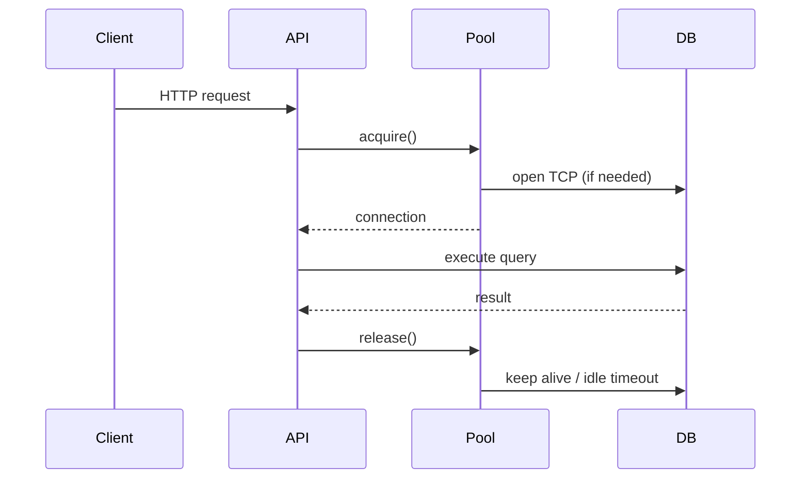

<!-- Generated by Groq via GitHub Actions -->
<!-- Topic ID: T219 -->
<!-- Category: Performance Engineering -->
<!-- Generated at UTC: 2026-11-16T22:58:23.512628+00:00 -->

# Database connection limits

## 1. What problem does this solve?

- **Resource exhaustion** – Every open database connection consumes memory, file descriptors, and a slot on the DB server. If a backend opens too many connections, the server can run out of resources and start rejecting new requests.
- **Performance degradation** – A saturated connection pool forces requests to wait, increasing latency and reducing throughput.
- **Stability** – Without limits, a single misbehaving request (e.g., a long‑running query or a connection leak) can bring down the entire service.
- **Cost** – Cloud database providers often charge per connection or per connection pool. Uncontrolled growth inflates bills.

In real systems this concept appears in:

- Web servers (Next.js API routes, Express, FastAPI) that talk to PostgreSQL or MongoDB.
- Background workers (BullMQ, Celery) that need to keep a pool of connections alive.
- Cache layers (Redis) that also use connection pools for performance.

---

## 2. Mental model

**Analogy**  
Imagine a library with a limited number of books. If everyone tries to borrow a book at once, some will have to wait. The library keeps a *queue* and returns books to the shelf when patrons finish.  

**Engineering model**  
A *connection pool* is that shelf: a pre‑allocated set of TCP connections that are reused. The pool has a **maximum size** (how many books can be on the shelf) and an **idle timeout** (how long a book can stay on the shelf before being removed). When a request needs a connection, it asks the pool; if one is free, it borrows it; otherwise it waits or fails.

---

## 3. Deep explanation

| Topic | Explanation |
|-------|-------------|
| **Internals** | The driver opens a TCP socket to the DB. The pool keeps these sockets alive, handing them out to queries. The OS limits the number of concurrent sockets per process. |
| **Important terminology** | `maxPoolSize` / `poolSize` – maximum concurrent connections.<br>`idleTimeoutMillis` – time a connection can stay idle before being closed.<br>`connectionLifetime` – maximum time a connection can live before being refreshed.<br>`acquireTimeout` – how long to wait for a free connection. |
| **Trade‑offs** | <ul><li>Higher pool size → lower request latency but higher memory and DB load.</li><li>Lower pool size → less resource usage but higher contention.</li></ul> |
| **Failure modes** | <ul><li>Connection leak: code forgets to release a connection → pool exhaustion.</li><li>Deadlock: two queries wait for each other on the same connections.</li><li>Network partition: all connections drop → service becomes unavailable.</li></ul> |
| **Limitations** | <ul><li>Per‑process limit: each Node.js worker has its own pool.</li><li>Global DB limit: the DB server may cap total connections across all clients.</li></ul> |
| **Where it fits** | The pool sits between the application layer and the database driver. It is usually configured once at startup and shared across request handlers. |
| **Interactions** | • With **caching**: you might keep a separate pool for Redis.<br>• With **async/await**: you must `await pool.connect()` and `release()`.<br>• With **serverless**: you need to reuse connections across invocations or use a connection pooler (PgBouncer). |

---

## 4. How it works

1. **Startup** – Application creates a pool with `maxPoolSize` and other options.  
2. **Request arrives** – API handler calls `pool.connect()` to acquire a connection.  
3. **Connection acquisition** – If a free socket exists, it is handed out; otherwise the request waits until one becomes available or `acquireTimeout` expires.  
4. **Query execution** – The handler runs its SQL/NoSQL commands.  
5. **Release** – After the query, the handler calls `release()` (or uses a `try/finally` block).  
6. **Idle timeout** – If a connection stays idle longer than `idleTimeoutMillis`, the pool closes it.  
7. **Pool maintenance** – Periodically, the pool may refresh connections that hit `connectionLifetime`.  



---

## 5. Practical implementation

### PostgreSQL (pg)

```ts
// src/db.ts
import { Pool } from 'pg';

export const pool = new Pool({
  connectionString: process.env.DATABASE_URL,
  max: 20,                 // maxPoolSize
  idleTimeoutMillis: 30000, // 30s idle timeout
  connectionTimeoutMillis: 2000, // 2s acquire timeout
});

export async function query(sql: string, params: any[]) {
  const client = await pool.connect();
  try {
    const res = await client.query(sql, params);
    return res.rows;
  } finally {
    client.release(); // crucial! prevents leaks
  }
}
```

### MongoDB (mongoose)

```ts
// src/mongo.ts
import mongoose from 'mongoose';

const opts = {
  poolSize: 10,          // maxPoolSize
  socketTimeoutMS: 45000,
  serverSelectionTimeoutMS: 5000,
};

mongoose.connect(process.env.MONGO_URI!, opts);
```

### Redis (ioredis)

```ts
// src/redis.ts
import Redis from 'ioredis';

export const redis = new Redis({
  host: process.env.REDIS_HOST,
  port: Number(process.env.REDIS_PORT),
  maxRetriesPerRequest: null,
  enableReadyCheck: true,
  // ioredis uses a single connection by default; for many concurrent
  // commands you can use a connection pooler like `generic-pool`.
});
```

### Detecting a leak

```ts
// src/leakDetector.ts
import { pool } from './db';

setInterval(() => {
  const idle = pool.idleCount;
  const total = pool.totalCount;
  console.warn(`Pool status: ${idle} idle / ${total} total`);
  if (total > 30) {
    console.error('Possible connection leak detected!');
  }
}, 60000);
```

---

## 6. Production considerations

| Concern | What to watch for |
|---------|-------------------|
| **Scalability** | Increase `maxPoolSize` per instance, but keep total DB connections below the DB limit. Use connection poolers (PgBouncer, Redis Sentinel). |
| **Reliability** | Enable retry logic on connection failures. Use `pool.on('error', ...)` to log broken connections. |
| **Security** | Use TLS (`ssl: true`), rotate credentials, store secrets in Vault or KMS. |
| **Observability** | Export metrics: `pool.totalCount`, `pool.idleCount`, `pool.waitingCount`. Use Prometheus exporters or built‑in drivers. |
| **Performance** | Tune `idleTimeoutMillis` to balance memory vs. latency. Avoid per‑request `new Pool()` calls. |
| **Error handling** | Handle `pool.connect()` rejections. Use `try/catch/finally` to guarantee release. |
| **Resource usage** | Monitor file descriptor usage (`ulimit -n`). |
| **Operational** | Automate pool health checks. Use health‑check endpoints that query the DB. |
| **Failure recovery** | On shutdown, call `pool.end()` to gracefully close connections. |
| **Deployment** | Expose pool config via env vars. Use CI to test pool limits under load. |

---

## 7. Common mistakes

| Mistake | Why it hurts |
|---------|--------------|
| **No pool, one connection per request** | Creates a new TCP socket each request → high latency, resource exhaustion. |
| **Hard‑coding pool size** | Fails to adapt to traffic spikes or environment differences. |
| **Not releasing connections** | Leaks lead to pool exhaustion and request timeouts. |
| **Using global connections in serverless** | Connections may be closed between invocations; leads to cold‑start latency. |
| **Ignoring `acquireTimeout`** | Requests hang indefinitely when the pool is full. |
| **Using default idle timeout too long** | Keeps sockets open, consuming DB slots unnecessarily. |
| **Not handling pool errors** | Silent failures cause confusing bugs. |
| **Over‑pooling** | More connections than the DB can handle → connection refusals, increased cost. |

---

## 8. Senior engineer perspective

When scaling to thousands of users:

- **Architecture**: Deploy a dedicated connection pooler (PgBouncer, Redis Sentinel) between services and the DB. The service only talks to the pooler, keeping its own pool small.
- **Trade‑offs**: Pooler adds a small latency but dramatically reduces per‑service connection count, easing DB scaling and cost.
- **Bottlenecks**: The pooler itself can become a bottleneck if misconfigured; monitor its connection usage.
- **Failure scenarios**: If the pooler crashes, all services lose DB access. Use HA pooler setups.
- **Monitoring**: Expose pooler metrics (connections used, wait times). Alert on high wait times.
- **Cost/performance**: A pooler reduces the number of DB connections, lowering licensing or cloud costs. However, it introduces an extra hop; measure the impact.
- **When NOT to use**: In very small, low‑traffic services where the overhead of a pooler outweighs benefits. Or in serverless functions where you rely on the provider’s connection pooling.

---

## 9. Interview questions

1. **Beginner** – *What is a connection pool and why do we use it?*  
   *Answer:* A pool keeps a set of open DB connections ready for reuse, reducing the cost of establishing a new connection for every request and preventing resource exhaustion.

2. **Beginner** – *What could happen if you forget to release a connection back to the pool?*  
   *Answer:* The connection stays checked out, eventually exhausting the pool and causing subsequent requests to block or fail.

3. **Senior** – *How would you design a system that scales to 10,000 concurrent users while keeping the number of database connections under 200?*  
   *Answer:* Use a connection pooler (PgBouncer) with a small per‑service pool (e.g., 10). The pooler multiplexes those connections to the DB, keeping the total below 200. Add monitoring and auto‑scaling of pooler instances.

4. **Senior** – *Explain the difference between `maxPoolSize`, `idleTimeoutMillis`, and `connectionLifetime` in a PostgreSQL pool.*  
   *Answer:* `maxPoolSize` limits concurrent sockets. `idleTimeoutMillis` closes sockets that sit idle beyond the threshold. `connectionLifetime` forces a socket to be refreshed after a set time to avoid stale connections.

5. **Scenario/Debugging** – *You notice that after a week of traffic, your API starts returning 503 errors. The logs show “pool exhausted” messages. What steps would you take to diagnose and fix the issue?*  
   *Answer:*  
   - Check pool metrics (`totalCount`, `idleCount`, `waitingCount`).  
   - Look for connection leaks (unreleased connections).  
   - Verify `maxPoolSize` against DB limits.  
   - Add `acquireTimeout` to fail fast.  
   - Consider scaling the pool size or adding a pooler.  
   - Review recent code changes for missing `release()` calls.

---

## 10. Hands‑on task

**Goal:** Build a small Express API that queries PostgreSQL and exposes a `/stats` endpoint showing pool metrics.

1. Create a new Node.js project (`npm init -y`).
2. Install dependencies: `express`, `pg`, `dotenv`.
3. Add a `.env` file with `DATABASE_URL`.
4. Implement `src/db.ts` with a pool (`max: 10`, `idleTimeoutMillis: 30000`).
5. Create `src/index.ts` with:
   - `/users` – returns rows from a `users` table.
   - `/stats` – returns `{ total, idle, waiting }` from the pool.
6. Run `npm run dev` and test the endpoints.
7. Introduce a deliberate connection leak in `/users` (forget to `release()`), observe `/stats` showing `waiting` > 0, then fix it.
8. Add a simple Prometheus exporter (`express-prom-bundle`) to expose metrics.

---

## 11. Quick revision

- A **connection pool** keeps a set of reusable DB connections.
- `maxPoolSize` limits concurrent sockets; `idleTimeoutMillis` closes idle sockets.
- Always `await pool.connect()` and `client.release()` in a `finally` block.
- Leaks → pool exhaustion → request timeouts.
- Use a **pooler** (PgBouncer, Redis Sentinel) for large scale.
- Monitor pool metrics (`totalCount`, `idleCount`, `waitingCount`).
- Set `acquireTimeout` to avoid indefinite waits.
- In serverless, reuse connections across invocations or use a pooler.
- Security: TLS, rotate credentials, store secrets safely.
- Performance: balance pool size vs. DB load; avoid over‑pooling.

---

## 12. References

- PostgreSQL: [Connection Pooling](https://www.postgresql.org/docs/current/runtime-config-connection.html)
- `pg` driver: [Pool documentation](https://node-postgres.com/features/pooling)
- Mongoose: [Connection Pooling](https://mongoosejs.com/docs/connections.html)
- ioredis: [Connection Pooling](https://github.com/luin/ioredis#connection-pooling)
- PgBouncer: [Official site](https://www.pgbouncer.org/)
- Redis Sentinel: [Official guide](https://redis.io/docs/management/sentinel/)
- Node.js: [Cluster module](https://nodejs.org/api/cluster.html)
- Prometheus: [Express Prom Bundle](https://github.com/siimon/express-prom-bundle)
