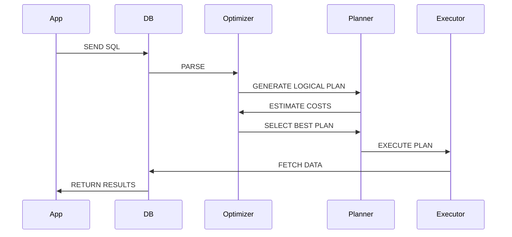

<!-- Generated by Groq via GitHub Actions -->
<!-- Topic ID: T220 -->
<!-- Category: Performance Engineering -->
<!-- Generated at UTC: 2026-11-16T22:58:23.512628+00:00 -->

# Query optimization

## 1. What problem does this solve?

- **What problem exists**  
  Databases can return millions of rows in seconds if a query is poorly written or missing indexes. In a real backend, a single slow query can block an entire request, increase latency, and exhaust database resources.

- **Why the problem matters**  
  *User experience*: 1 s latency feels fine, 5 s feels broken.  
  *Cost*: More CPU, memory, and I/O mean higher cloud bill and slower scaling.  
  *Reliability*: A single slow query can cause timeouts, cascading failures, and even deadlocks.

- **What happens if this concept is not used**  
  *Stale or missing statistics → bad query plans.*  
  *Unindexed columns → full table scans.*  
  *Large joins without proper ordering → exponential growth in intermediate result size.*  
  The system may become unresponsive under load, and maintenance windows become longer.

- **Where this concept appears in real backend systems**  
  *E‑commerce*: product search, recommendation joins.  
  *Social media*: feed aggregation, follower counts.  
  *Analytics*: reporting dashboards, ad targeting.  
  All of these rely on efficient queries to keep response times low.

## 2. Mental model

**Analogy**  
Imagine a library with millions of books. If you ask the librarian to hand you every book that contains the word “quantum”, and the librarian has to scan every shelf, it will take forever. Instead, the librarian uses a *catalog* (index) that tells exactly which shelves hold that word, and the librarian can fetch the books directly.  

**Engineering model**  
A query optimizer is that librarian’s smart assistant: it reads the query, looks at statistics and indexes, decides the fastest way to fetch the data, and then executes that plan. The optimizer’s job is to choose the best “route” through the data, just like the librarian chooses the quickest shelves.

## 3. Deep explanation

| Topic | Explanation |
|-------|-------------|
| **Internals** | The optimizer parses the query, builds a *query tree*, estimates costs for each possible execution plan using statistics (row counts, distribution, index selectivity), and picks the lowest‑cost plan. |
| **Important terminology** | *Index*, *table scan*, *index scan*, *join order*, *hash join*, *merge join*, *nested loop*, *materialized view*, *statistics*, *cost model*, *execution plan*. |
| **Trade‑offs** | Indexes speed reads but slow writes (insert/update/delete). Large indexes consume disk and memory. Complex plans (hash joins) may use more memory but avoid repeated scans. |
| **Failure modes** | Out‑of‑date statistics → wrong plan. Over‑indexed tables → write amplification. Index corruption → query failures. |
| **Limitations** | The optimizer is heuristic; it may pick sub‑optimal plans for unusual data distributions. It cannot foresee future data growth or workload changes. |
| **Where it fits** | Query optimization sits inside the database engine, but its effects ripple through the application layer (ORMs, query builders), caching layers (Redis), and monitoring tools. |
| **Interaction with related concepts** | • **Caching**: A fast query may still be cached in Redis, reducing DB load. <br>• **Sharding**: Each shard must have its own indexes. <br>• **ORMs**: They may generate suboptimal queries if not used carefully. <br>• **Monitoring**: Tools like pg_stat_statements expose slow queries for optimization. |

## 4. How it works

1. **Parse** the SQL into an abstract syntax tree (AST).  
2. **Generate** a logical query plan (relational algebra).  
3. **Estimate** cost for each possible physical plan using statistics.  
4. **Select** the plan with the lowest estimated cost.  
5. **Execute** the plan, fetching data via scans, joins, and aggregations.  



## 5. Practical implementation

### 5.1 Create an index and analyze its effect

```ts
// db.ts
import { Pool } from 'pg';
export const pool = new Pool({
  connectionString: process.env.DATABASE_URL,
});
```

```ts
// createIndex.ts
import { pool } from './db';

async function createIndex() {
  await pool.query(`
    CREATE INDEX IF NOT EXISTS idx_users_email
    ON users(email);
  `);
  console.log('Index created');
}

createIndex().catch(console.error);
```

### 5.2 Run a query with `EXPLAIN ANALYZE`

```ts
// query.ts
import { pool } from './db';

async function runQuery() {
  const res = await pool.query(`
    EXPLAIN ANALYZE
    SELECT * FROM users
    WHERE email = $1
  `, ['alice@example.com']);

  console.log(res.rows[0].QUERY_PLAN);
}

runQuery().catch(console.error);
```

> **Important lines**  
> *`EXPLAIN ANALYZE`* forces PostgreSQL to execute the query and return the actual runtime statistics, not just the estimated plan.  
> *`IF NOT EXISTS`* prevents errors if the index already exists.

### 5.3 Using an ORM (TypeORM) with a custom index

```ts
// User.ts
import { Entity, PrimaryGeneratedColumn, Column, Index } from 'typeorm';

@Entity()
export class User {
  @PrimaryGeneratedColumn()
  id: number;

  @Column()
  @Index() // creates an index on the email column
  email: string;

  @Column()
  name: string;
}
```

TypeORM will automatically create the index when running migrations.

## 6. Production considerations

| Concern | What to watch for |
|---------|-------------------|
| **Scalability** | Indexes must be replicated across read replicas. Large indexes can slow replication lag. |
| **Reliability** | Monitor `pg_stat_user_indexes` for index bloat. Rebuild indexes during maintenance windows. |
| **Security** | Avoid exposing raw SQL; use parameterized queries to prevent injection. |
| **Observability** | Enable `pg_stat_statements` and Grafana dashboards to spot slow queries. |
| **Performance** | Use `VACUUM` and `ANALYZE` regularly to keep statistics fresh. |
| **Error handling** | Catch `duplicate key` errors when inserting into indexed columns. |
| **Resource usage** | Indexes consume disk; monitor disk I/O and memory usage of the query planner. |
| **Operational concerns** | Plan index creation during low‑traffic periods; use `CONCURRENTLY` to avoid locking. |
| **Failure recovery** | Keep backups of indexes; use `pg_dump` with `--schema-only` to restore indexes. |
| **Deployment** | Include index creation in CI/CD pipelines; run `EXPLAIN` tests on staging. |

## 7. Common mistakes

| Mistake | Why it’s problematic |
|---------|----------------------|
| **Using `SELECT *`** | Fetches unnecessary columns, increasing I/O and memory. |
| **Missing indexes on foreign keys** | Joins become full table scans, causing O(n²) growth. |
| **Over‑indexing** | Each write must update every index → slower writes, higher storage. |
| **Not updating statistics** | Planner relies on stale data → wrong cost estimates. |
| **Using `LIKE '%foo%'`** | Prevents index usage unless a trigram or full‑text index is present. |
| **Ignoring query plan changes after schema changes** | New columns or data distribution can invalidate old plans. |
| **Assuming indexes are free** | They consume disk and memory; they can become fragmented. |
| **Not considering read/write ratio** | Heavy reads justify many indexes; heavy writes may require fewer. |

## 8. Senior engineer perspective

- **Architecture decisions**  
  *Choose between a single monolithic DB vs. sharded clusters.*  
  *Decide which columns to index based on query patterns and write load.*

- **Trade‑offs**  
  *Index size vs. read speed.*  
  *Write amplification vs. query latency.*  
  *Single‑node vs. multi‑node cost.*

- **Bottlenecks**  
  *Index maintenance during peak writes.*  
  *Lock contention on heavily updated tables.*  
  *Replication lag on read replicas.*

- **Failure scenarios**  
  *Index corruption → query failures.*  
  *Missing statistics → catastrophic plan regressions.*

- **Monitoring**  
  *Track `pg_stat_user_indexes` for bloat.*  
  *Alert on high `idx_scan` vs. `idx_tup_read` ratios.*  
  *Use `pg_stat_statements` to surface regressions.*

- **Cost/performance**  
  *Index storage cost vs. query cost savings.*  
  *Compute cost of `ANALYZE` jobs.*

- **When NOT to use the approach**  
  *If the workload is write‑heavy and reads are infrequent, avoid many indexes.*  
  *If the data is highly volatile and statistics become stale quickly, consider caching or materialized views instead.*

## 9. Interview questions

1. **Beginner**: *What is an index and why do we use it?*  
   *Answer*: An index is a data structure that allows the database to locate rows faster. It speeds up reads but slows writes and consumes storage.

2. **Beginner**: *What does `EXPLAIN` do in PostgreSQL?*  
   *Answer*: It shows the query planner’s chosen execution plan and estimated costs, helping you understand how the query will run.

3. **Senior**: *Explain the difference between a hash join and a merge join. When would you choose one over the other?*  
   *Answer*:  
   - *Hash join* builds a hash table on the smaller input and probes it with the larger input. It’s fast for large, unsorted data but uses memory.  
   - *Merge join* requires both inputs to be sorted; it streams through them. It’s efficient when data is already sorted or when memory is constrained.  
   Choose hash join when the smaller side fits in memory and the larger side is unsorted; choose merge join when both sides are sorted or when you want to avoid large hash tables.

4. **Senior**: *How do you keep query plans from becoming stale in a production system?*  
   *Answer*: Regularly run `ANALYZE` (or `VACUUM ANALYZE`) to update statistics, monitor `pg_stat_user_tables` for changes in row counts, and consider auto‑analyze thresholds. Use `pg_stat_statements` to detect regressions and trigger re‑analysis.

5. **Scenario/Debugging**: *A query that used to run in 50 ms now takes 5 s after a data migration. What steps would you take to diagnose and fix it?*  
   *Answer*:  
   1. Run `EXPLAIN ANALYZE` to see the new plan.  
   2. Check if the migration changed data distribution or added a new column.  
   3. Verify statistics are up‑to‑date (`ANALYZE`).  
   4. Look for missing or dropped indexes.  
   5. Consider adding or rebuilding indexes, or rewriting the query.  
   6. Validate changes on a staging environment before deploying.

## 10. Hands‑on task

**Task**: In the provided Node.js repository, add an index on the `orders` table’s `customer_id` column, then rewrite the existing `getOrdersByCustomer` function to use a parameterized query. Run `EXPLAIN ANALYZE` before and after adding the index, and document the performance difference in a README comment.

**Steps**:
1. Create the index: `CREATE INDEX idx_orders_customer_id ON orders(customer_id);`
2. Update the query in `ordersService.ts` to use `$1` instead of string interpolation.
3. Run `node explainOrders.js` to capture the plan.
4. Compare the `rows processed` and `execution time` metrics.

## 11. Quick revision

- Indexes speed reads but slow writes and use storage.  
- `EXPLAIN` shows the planner’s chosen plan; `EXPLAIN ANALYZE` runs it.  
- Full table scans are the worst; index scans are the best.  
- Join order matters: put the smallest tables first.  
- Keep statistics fresh with `ANALYZE`.  
- Over‑indexing → write amplification; under‑indexing → slow reads.  
- Monitor `pg_stat_statements` for regressions.  
- Use parameterized queries to avoid injection and enable index usage.  
- Rebuild fragmented indexes with `REINDEX`.  
- In sharded setups, each shard needs its own indexes.

## 12. References

- PostgreSQL Documentation – [Query Planner and Optimizer](https://www.postgresql.org/docs/current/planner-optimizer.html)  
- PostgreSQL Documentation – [EXPLAIN](https://www.postgresql.org/docs/current/sql-explain.html)  
- TypeORM Docs – [Indexes](https://typeorm.io/#/entities/creating-indexes)  
- pg_stat_statements – [Monitoring](https://www.postgresql.org/docs/current/pgstatstatements.html)  
- PostgreSQL Docs – [VACUUM and ANALYZE](https://www.postgresql.org/docs/current/sql-vacuum.html)  
- Node.js pg – [Connection Pool](https://node-postgres.com/features/pooling)
