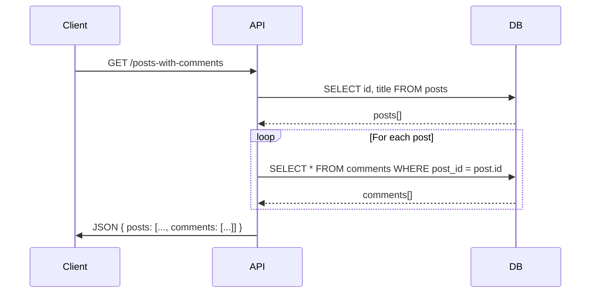

<!-- Generated by Groq via GitHub Actions -->
<!-- Topic ID: T221 -->
<!-- Category: Performance Engineering -->
<!-- Generated at UTC: 2026-11-17T09:25:41.779389+00:00 -->

# N+1 problem

## 1. What problem does this solve?

**Motivation**  
When a backend service fetches a list of parent records (e.g., blog posts) and then, for each parent, performs an additional query to fetch related child data (e.g., comments), the number of database round‑trips grows linearly with the number of parents. This is the classic *N+1* problem: one query to get the parents plus *N* queries to get each child.

**What problem exists**  
- **Excessive round‑trips**: Each query incurs network latency, database connection overhead, and query planning time.
- **Resource waste**: The database must parse and execute many similar queries, consuming CPU, I/O, and memory.
- **Scalability bottleneck**: As the list grows, latency and load grow linearly, quickly exhausting database capacity.

**Why the problem matters**  
- **User experience**: Slow API responses lead to poor UX, especially on mobile or high‑traffic sites.
- **Cost**: Cloud databases charge per request and per compute usage; N+1 inflates billable operations.
- **Maintainability**: Code that issues many queries is harder to read, test, and refactor.

**What happens if this concept is not used**  
- The service may hit database timeouts or connection limits.
- The API may become a choke point, causing cascading failures in downstream services.
- Developers may inadvertently repeat the same pattern, creating a hidden performance regression.

**Where this concept appears in real backend systems**  
- ORM‑based data access (e.g., TypeORM, Prisma, Sequelize).
- GraphQL resolvers that fetch related data per node.
- Microservice calls that aggregate data from multiple services.
- Legacy code that loops over results and performs separate queries.

---

## 2. Mental model

**Simple analogy**  
Imagine you’re ordering a menu at a restaurant. The waiter first gives you a list of all dishes (the parent query). Then, for each dish, you ask the kitchen for its ingredients (child queries). If you have 10 dishes, you’ll ask the kitchen 10 times, even though the kitchen could give you a single ingredient list for all dishes at once.

**Precise engineering model**  
- **Parent query**: `SELECT id, title FROM posts;`
- **Child queries**: For each post ID, `SELECT * FROM comments WHERE post_id = ?;`
- **Result**: 1 + N queries.

---

## 3. Deep explanation

### Internals
- **Database round‑trip**: Each query requires a TCP handshake, authentication, query parsing, execution, and result serialization.
- **Connection pooling**: Even with pooling, each query consumes a connection slot; many concurrent queries can exhaust the pool.
- **Query planner**: Repeated similar queries may be cached, but the planner still processes each one.

### Important terminology
- **N+1**: One query for the parent set + *N* queries for each child.
- **Batching**: Combining multiple child queries into a single query (e.g., `WHERE post_id IN (…)`).
- **Eager loading / prefetching**: Fetching related data in the same query or in a single batch.
- **Lazy loading**: Deferring child fetch until accessed, often causing N+1.

### Trade‑offs
| Approach | Pros | Cons |
|----------|------|------|
| N+1 (lazy) | Simple to implement; fine for small N | Poor performance for large N |
| Batch (`IN`) | Fewer round‑trips; efficient | Potentially large IN clause; risk of hitting query size limits |
| JOIN | One query, no IN | May duplicate parent rows; requires grouping/aggregation |
| Subquery | One query, no duplication | Can be slower if not indexed |
| GraphQL DataLoader | Transparent batching | Adds complexity; requires caching layer |

### Failure modes
- **Connection pool exhaustion**: Many concurrent N+1 queries can block threads.
- **Query timeout**: Long-running child queries can delay the entire response.
- **Data duplication**: JOINs can produce Cartesian products if relationships are not properly constrained.

### Limitations
- **Large result sets**: Even a single JOIN can return huge payloads; pagination is essential.
- **Complex relationships**: Deeply nested associations may still require multiple queries or recursive CTEs.
- **Cache invalidation**: Batching can complicate caching strategies.

### Where this concept fits in a backend architecture
- **Data access layer**: ORMs often expose eager/lazy loading options.
- **API layer**: GraphQL resolvers or REST endpoints that aggregate data.
- **Microservice boundaries**: A service may need to call another service per item, leading to N+1 across services.

### Interaction with related concepts
- **Caching**: Storing child data can reduce repeated queries.
- **Pagination**: Limits N, but still requires efficient child fetching.
- **CQRS / Event sourcing**: Read models can be pre‑joined to avoid N+1.
- **Database sharding**: N+1 across shards can be particularly costly.

---

## 4. How it works

1. **Client requests** a list of posts with comments.  
2. **API handler** runs `SELECT id, title FROM posts;`.  
3. For each post, the handler runs `SELECT * FROM comments WHERE post_id = ?;`.  
4. Results are assembled and returned.

**Mermaid diagram**



---

## 5. Practical implementation

### TypeScript/Node.js example with Prisma (lazy loading)

```ts
// prismaClient.ts
import { PrismaClient } from '@prisma/client';
export const prisma = new PrismaClient();
```

```ts
// posts.ts
import { prisma } from './prismaClient';

export async function getPostsWithComments() {
  // 1. Parent query
  const posts = await prisma.post.findMany({
    select: { id: true, title: true },
  });

  // 2. N+1 child queries
  const postsWithComments = await Promise.all(
    posts.map(async (post) => {
      const comments = await prisma.comment.findMany({
        where: { postId: post.id },
      });
      return { ...post, comments };
    })
  );

  return postsWithComments;
}
```

**Why this is N+1**  
`prisma.comment.findMany` is executed once per post.

### Eager loading with `include`

```ts
export async function getPostsWithCommentsEager() {
  const posts = await prisma.post.findMany({
    include: { comments: true }, // single query with JOIN
  });
  return posts;
}
```

### Batch with `IN`

```ts
export async function getPostsWithCommentsBatch() {
  const posts = await prisma.post.findMany({
    select: { id: true, title: true },
  });

  const postIds = posts.map((p) => p.id);
  const comments = await prisma.comment.findMany({
    where: { postId: { in: postIds } },
  });

  const commentsByPost = comments.reduce<Record<number, any[]>>((acc, c) => {
    (acc[c.postId] = acc[c.postId] || []).push(c);
    return acc;
  }, {});

  return posts.map((p) => ({ ...p, comments: commentsByPost[p.id] ?? [] }));
}
```

**Key lines**  
- `where: { postId: { in: postIds } }` – single query for all comments.  
- `reduce` – groups comments by parent ID.

---

## 6. Production considerations

| Concern | Tips |
|---------|------|
| **Scalability** | Use eager loading or batching; avoid per‑item queries. |
| **Reliability** | Wrap database calls in retry logic; use connection pooling. |
| **Security** | Parameterize queries to prevent injection; validate IDs. |
| **Observability** | Instrument query counts; log N+1 occurrences. |
| **Performance** | Profile query plans; add indexes on foreign keys. |
| **Error handling** | Fail fast if a child query fails; consider partial results. |
| **Resource usage** | Monitor connection pool size; tune max connections. |
| **Operational concerns** | Ensure DB replicas can handle increased load. |
| **Failure recovery** | Use circuit breakers for external services. |
| **Deployment** | Incrementally enable eager loading; monitor impact. |

---

## 7. Common mistakes

| Mistake | Why it’s problematic |
|---------|----------------------|
| **Assuming ORM will auto‑batch** | Many ORMs default to lazy loading; developers forget to enable eager loading. |
| **Using `SELECT *` in batch queries** | Pulls unnecessary columns, increasing payload size. |
| **Ignoring pagination** | A single query may return millions of rows, exhausting memory. |
| **Hard‑coding `IN` lists without size checks** | `IN` clause can exceed DB limits or degrade performance. |
| **Not indexing foreign keys** | Child queries become full table scans, hurting latency. |
| **Mixing eager and lazy loading in the same request** | Creates hidden N+1 patterns. |
| **Over‑fetching data for caching** | Cache invalidation becomes complex; stale data. |

---

## 8. Senior engineer perspective

### What changes at scale
- **Architecture**: Use read replicas or materialized views to offload heavy joins.  
- **Trade‑offs**: A single JOIN may be faster than a batch if the result set is small; otherwise, batch with pagination.  
- **Bottlenecks**: Connection pool exhaustion, CPU contention on query planning.  
- **Failure scenarios**: A slow child query can block the entire request; consider async streaming responses.  
- **Monitoring**: Track `db.query.count`, `db.query.duration`, and `api.response.time`.  
- **Cost/performance**: Evaluate whether a denormalized cache (Redis) is cheaper than repeated DB hits.  
- **When NOT to use**: If the child data is rarely needed, keep lazy loading to avoid unnecessary work.

---

## 9. Interview questions

1. **Beginner**: *What is the N+1 problem in database access?*  
   *Answer*: It’s when you run one query to fetch a list of parents and then run one additional query per parent to fetch related data, leading to N+1 total queries.

2. **Intermediate**: *How can you avoid the N+1 problem when using an ORM like Prisma?*  
   *Answer*: Use eager loading (`include`), batch queries with `WHERE IN`, or write raw SQL with JOINs.

3. **Senior**: *Explain the trade‑offs between using a single JOIN versus a batch `IN` query for fetching related data.*  
   *Answer*: JOINs avoid duplicate rows but can produce large result sets; batch `IN` queries reduce duplication but may hit size limits and require grouping logic.

4. **Senior**: *Describe how you would monitor and alert on N+1 queries in a production system.*  
   *Answer*: Instrument query counts per request, log patterns, set thresholds, and alert when the ratio of child to parent queries exceeds a baseline.

5. **Scenario/Debugging**: *Your API endpoint returns a 5‑second latency spike after a deployment. Database logs show many `SELECT * FROM comments WHERE post_id = ?` queries. What steps would you take to diagnose and fix the issue?*  
   *Answer*:  
   - Verify if the endpoint is still using lazy loading.  
   - Check connection pool metrics.  
   - Profile the child queries for slow plans.  
   - Add eager loading or batch queries.  
   - Re‑deploy and monitor latency.

---

## 10. Hands‑on task

**Task**: Refactor the `getPostsWithComments` function in `posts.ts` to eliminate the N+1 problem using Prisma’s eager loading.  

**Steps**  
1. Replace the `map` with a single `findMany` that includes `comments`.  
2. Verify that the returned JSON structure matches the original.  
3. Add a unit test that asserts the number of database queries is 1.  
4. Run the test and ensure it passes.

---

## 11. Quick revision

- N+1 = 1 parent query + N child queries.  
- Causes latency, resource waste, and scalability issues.  
- Common in ORMs with lazy loading.  
- Solutions: eager loading (`include`), batch `IN`, JOIN, subquery, GraphQL DataLoader.  
- Use indexes on foreign keys.  
- Monitor query counts and response times.  
- Avoid `SELECT *` in batch queries.  
- Batch size limits: watch for `IN` clause limits.  
- Pagination is essential for large result sets.  
- Cache child data when appropriate.  
- Test query counts in unit tests.  
- Consider read replicas or materialized views for heavy joins.

---

## 12. References

- [Prisma Docs – Relations](https://www.prisma.io/docs/concepts/components/prisma-client/relations)  
- [PostgreSQL Documentation – JOIN](https://www.postgresql.org/docs/current/queries-table-expressions.html#QUERIES-JOIN)  
- [MySQL Documentation – IN Clause](https://dev.mysql.com/doc/refman/8.0/en/where-in.html)  
- [SQL Performance Tuning – Indexes](https://www.sqlshack.com/sql-performance-tuning-indexes/)  
- [GraphQL DataLoader](https://github.com/graphql/dataloader)  
- [Node.js Connection Pooling – pg-pool](https://node-postgres.com/features/pooling)
