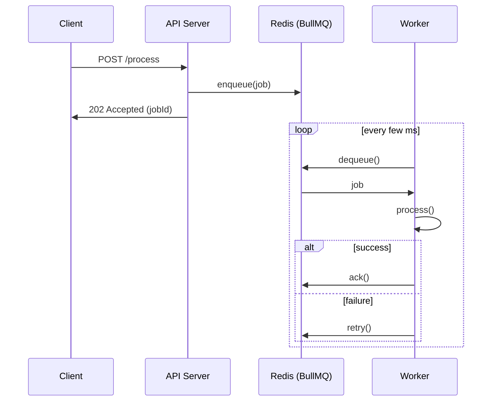
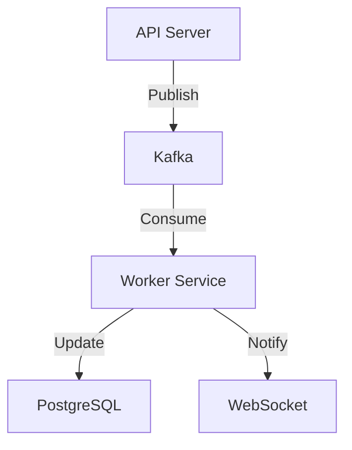

<!-- Generated by Groq via GitHub Actions -->
<!-- Topic ID: T223 -->
<!-- Category: Performance Engineering -->
<!-- Generated at UTC: 2026-11-17T21:51:54.887406+00:00 -->

# Async processing

## 1. What problem does this solve?

| Problem | Why it matters | Consequence of not using async processing | Real‑world appearance |
|---------|----------------|------------------------------------------|------------------------|
| **Blocking I/O** – A single request can hang while waiting for a database, external API, or file system | Users see slow responses; servers waste CPU cycles | High latency, low throughput, poor user experience | Image upload, payment processing |
| **High concurrency** – Many users hit the same endpoint simultaneously | A single thread or event loop can’t serve all requests | Request queueing, timeouts, server crashes | Chat apps, e‑commerce checkout |
| **Decoupling** – Long‑running or optional work (e‑mail, analytics) should not delay the main request | Tight coupling makes the system brittle and hard to scale | Feature toggles, code duplication, hard rollback | Notification services, recommendation engines |
| **Reliability** – External services can fail or be slow | A single failure can cascade to the whole request | Unreliable APIs, poor SLAs | Third‑party APIs, microservice communication |

Async processing lets you **offload work** to background workers or message brokers, freeing the request thread to respond immediately. It also gives you **retry, idempotency, and scaling** capabilities that are hard to achieve with synchronous code.

---

## 2. Mental model

### Analogy: The Kitchen

| Kitchen | Async system |
|---------|--------------|
| **Chef** prepares the main dish (HTTP request) | **API server** handles the request |
| **Sous‑chef** takes care of side dishes (background jobs) | **Worker pool** processes queued jobs |
| **Waiter** brings the dish to the customer | **Response** is sent back immediately |
| **Kitchen inventory** (ingredients) | **Message broker** (Redis, Kafka) |
| **Order book** keeps track of pending side dishes | **Job queue** tracks pending jobs |

**Key takeaway:** The chef never waits for the sous‑chef to finish; the waiter delivers the main dish right away. The sous‑chef works in parallel, and if something goes wrong, the kitchen can retry or discard the side dish without affecting the main course.

### Engineering model

1. **Producer** (API, service) creates a **job** and pushes it to a **broker**.
2. **Broker** stores the job in a **queue** (FIFO, priority, etc.).
3. **Consumer** (worker) pulls jobs, processes them, and updates state or writes results.
4. **Acknowledgement** ensures the job is removed only after successful completion.
5. **Retry / dead‑letter** logic handles failures.

---

## 3. Deep explanation

### Internals

- **Node.js event loop**: single‑threaded, non‑blocking I/O. Heavy CPU work blocks it.
- **libuv thread pool**: handles file I/O, DNS, crypto. Limited to 4 threads by default.
- **Worker threads**: explicit background threads for CPU‑bound tasks.
- **Message brokers** (Redis, RabbitMQ, Kafka): persistent queues that survive crashes.
- **Job libraries** (BullMQ, Agenda, Kue): provide abstractions over brokers.

### Important terminology

| Term | Meaning |
|------|---------|
| **Producer** | Component that enqueues jobs. |
| **Consumer** | Component that dequeues and processes jobs. |
| **Broker** | Persistent storage for jobs (Redis, Kafka, etc.). |
| **Queue** | Ordered list of jobs. |
| **Job** | Unit of work (payload + metadata). |
| **Retry** | Re‑enqueuing a failed job after a delay. |
| **Dead‑letter queue** | Store jobs that failed repeatedly. |
| **Idempotency** | Guarantee that repeated execution has the same effect. |
| **Backpressure** | Mechanism to slow producers when consumers are overloaded. |

### Trade‑offs

| Aspect | Synchronous | Asynchronous |
|--------|-------------|--------------|
| **Latency** | Low for simple tasks | Higher for queued tasks (wait time) |
| **Throughput** | Limited by single thread | Scales with workers |
| **Complexity** | Simple code path | Requires broker, workers, monitoring |
| **Reliability** | Fails fast | Can retry, persist, recover |
| **Resource usage** | CPU bound | CPU + memory for workers, broker overhead |

### Failure modes

- **Lost messages** – broker crashes before ack.
- **Duplicate processing** – no idempotency, retries cause double work.
- **Backpressure** – producers overwhelm broker → memory blowup.
- **Ordering violations** – parallel workers may process jobs out of order.
- **Deadlocks** – workers waiting on each other or on DB locks.

### Limitations

- **CPU‑bound tasks** still need worker threads or separate services.
- **Strict ordering** is hard to guarantee across distributed workers.
- **Stateful jobs** require careful design (e.g., using a database or Redis for checkpoints).

### Where it fits

- **Microservice architecture**: each service owns its own queue.
- **CQRS / Event Sourcing**: events are queued and consumed by read models.
- **Background jobs**: e‑mail, image resizing, analytics.
- **Event‑driven systems**: Kafka topics as event streams.

### Interaction with related concepts

- **Caching**: Workers may read/write to Redis; careful cache invalidation.
- **Database**: Jobs often write to Postgres/Mongo; use transactions or idempotent writes.
- **HTTP**: API responds with 202 Accepted + job ID; client polls or uses websockets.
- **Security**: Broker authentication, TLS, role‑based access.

---

## 4. How it works

### Step‑by‑step flow

1. **Client** sends HTTP request to `/process`.
2. **API server** validates input, creates a job payload.
3. **API server** pushes job to **Redis** via BullMQ.
4. **API server** immediately returns `202 Accepted` with job ID.
5. **Worker** (BullMQ worker) pulls job from Redis.
6. **Worker** processes the job (e.g., calls external API, writes to DB).
7. **Worker** acknowledges success → job removed from queue.
8. **Optional**: Worker publishes completion event to another topic.



### Distributed system diagram



---

## 5. Practical implementation

### 5.1. Install dependencies

```bash
npm init -y
npm install bullmq ioredis express
npm install -D typescript ts-node @types/express
```

### 5.2. `src/queue.ts` – shared queue definition

```ts
import { Queue, Worker, QueueScheduler } from 'bullmq';
import IORedis from 'ioredis';

const connection = new IORedis(); // defaults to localhost:6379

export const jobQueue = new Queue('email', { connection });

export const scheduler = new QueueScheduler('email', { connection });
// Scheduler handles delayed jobs and retries

export const worker = new Worker(
  'email',
  async job => {
    // Simulate external API call
    console.log(`Processing job ${job.id}: ${JSON.stringify(job.data)}`);
    // Example: await sendEmail(job.data);
    // Mark as done
  },
  { connection }
);

// Graceful shutdown
process.on('SIGTERM', async () => {
  await worker.close();
  await scheduler.close();
  await connection.quit();
  process.exit(0);
});
```

### 5.3. `src/server.ts` – API endpoint

```ts
import express from 'express';
import { jobQueue } from './queue';

const app = express();
app.use(express.json());

app.post('/send-email', async (req, res) => {
  const { to, subject, body } = req.body;
  if (!to) return res.status(400).json({ error: 'Missing "to"' });

  // Enqueue job
  const job = await jobQueue.add('send', { to, subject, body }, {
    attempts: 5,          // retry up to 5 times
    backoff: { type: 'exponential', delay: 1000 },
    removeOnComplete: true,
    removeOnFail: false,   // keep failed jobs for debugging
  });

  res.status(202).json({ jobId: job.id });
});

app.listen(3000, () => console.log('API listening on :3000'));
```

### 5.4. Run

```bash
# In one terminal
node -r ts-node/register src/worker.ts

# In another terminal
node -r ts-node/register src/server.ts
```

Send a POST request:

```bash
curl -X POST http://localhost:3000/send-email \
  -H 'Content-Type: application/json' \
  -d '{"to":"alice@example.com","subject":"Hello","body":"Hi!"}'
```

You’ll see the worker log the job and the API respond immediately.

### 5.5. Adding idempotency

```ts
// In worker
const existing = await jobQueue.getJob(job.id);
if (existing && existing.finishedOn) {
  console.log(`Job ${job.id} already processed`);
  return;
}
```

Or use a unique job ID based on payload hash.

---

## 6. Production considerations

| Concern | Recommendation |
|---------|----------------|
| **Scalability** | Horizontal workers; partition queues (e.g., `email:1`, `email:2`). Use Redis Cluster or Kafka partitions. |
| **Reliability** | Enable `QueueScheduler` for delayed jobs; configure `retry` and `dead‑letter` queues. |
| **Security** | Use TLS for Redis/Kafka; restrict ACLs; encrypt payloads if sensitive. |
| **Observability** | Expose BullMQ metrics (queue length, job latency) via Prometheus. Log job IDs, errors. |
| **Performance** | Tune Redis memory, eviction policy; set worker concurrency to match CPU cores. |
| **Error handling** | Use `try/catch` inside worker; log stack traces; alert on repeated failures. |
| **Resource usage** | Monitor Redis memory; avoid storing large payloads in the queue. |
| **Operational concerns** | Health checks for workers; auto‑restart on crash; graceful shutdown. |
| **Failure recovery** | Persist job state in DB; use idempotent writes; keep dead‑letter jobs for manual inspection. |
| **Deployment** | Containerize API and workers; use Kubernetes Jobs/Deployments; separate Redis cluster. |

---

## 7. Common mistakes

| Mistake | Why it’s problematic |
|---------|----------------------|
| **Blocking the event loop** – using `fs.readFileSync` or heavy loops | Slows all requests, defeats async benefits |
| **No idempotency** – retrying a job that writes to DB | Duplicate records, inconsistent state |
| **Single queue for all jobs** | Bottleneck; hard to prioritize or scale specific workloads |
| **Ignoring backpressure** – producers push faster than consumers | Queue memory grows, Redis crashes |
| **Not handling failures** – swallowing errors in workers | Silent failures, data loss |
| **Using `await` inside a loop without concurrency control** | Creates too many concurrent DB connections |
| **Hard‑coding broker URLs** – no secrets management | Security risk, hard to change environment |
| **Not monitoring queue depth** | Cannot detect slow workers early |
| **Using `removeOnComplete: false` for all jobs** | Unbounded memory growth |

---

## 8. Senior engineer perspective

### Architecture decisions

| Decision | Options | Trade‑offs |
|----------|---------|------------|
| **Broker** | Redis (BullMQ), RabbitMQ, Kafka | Redis: low latency, simple; Kafka: high throughput, ordering guarantees |
| **Worker model** | Single process with concurrency, separate processes, micro‑services | Concurrency: simpler, but risk of shared state; separate services: isolation, scaling |
| **Retry strategy** | Fixed delay, exponential backoff, circuit breaker | Fixed: simple; exponential: reduces load; circuit breaker: protects downstream |
| **Idempotency** | Unique job IDs, database flags, outbox pattern | Unique IDs: easy; outbox: ensures consistency across services |

### Bottlenecks

- **Broker throughput** – Redis single‑threaded I/O can be a limit; Kafka partitions help.
- **Worker CPU** – CPU‑bound jobs need worker threads or separate services.
- **Database locks** – Many workers writing to the same table can cause contention.

### Failure scenarios

- **Broker outage** – Workers block; use fallback queues or local persistence.
- **Worker crash** – Job remains unacknowledged; `QueueScheduler` retries.
- **Network partition** – Workers may lose connection; use idempotent writes.

### Monitoring

- **Queue depth** – alert when > threshold.
- **Job latency** – average and percentile.
- **Error rate** – per job type.
- **Resource usage** – CPU, memory of workers and broker.

### Cost/performance

- **More workers** → higher CPU cost but lower latency.
- **Sharding queues** → more Redis instances, higher cost.
- **Kafka** → higher operational overhead but better scalability.

### When NOT to use async processing

- **Low volume, low latency** tasks (e.g., simple CRUD).
- **Synchronous dependencies** that must finish before response.
- **Highly interactive features** where user waits for result (e.g., real‑time chat).

---

## 9. Interview questions

1. **Beginner** – *What is the difference between a promise and a callback in Node.js?*  
   *Answer:* A callback is a function passed to another function to be invoked later. A promise represents a value that may be available now or in the future and can be chained with `.then()`/`.catch()`. Promises avoid “callback hell” and provide better error propagation.

2. **Intermediate** – *How does BullMQ guarantee that a job is processed exactly once?*  
   *Answer:* BullMQ uses Redis transactions and a `QueueScheduler`. When a worker fetches a job, it moves it to a “delayed” or “active” list. Only after successful completion does it delete the job. If the worker crashes, the scheduler re‑queues the job after a timeout, ensuring at most once semantics.

3. **Senior** – *Explain how you would design a system that needs to process 10k image resize jobs per second using async processing.*  
   *Answer:* Use a high‑throughput broker like Kafka with many partitions. Deploy a pool of worker containers, each running a thread pool for CPU‑bound resizing (e.g., using `sharp`). Scale workers horizontally based on queue depth. Store intermediate results in S3, update Postgres with URLs. Use idempotent job IDs, monitor latency, and implement backpressure by limiting producer rate.

4. **Senior** – *What are the trade‑offs between using Redis (BullMQ) and Kafka for background jobs?*  
   *Answer:* Redis offers low latency, simple API, and persistence, but is single‑threaded and limited in throughput. Kafka provides high throughput, ordering guarantees, and partitioning, but adds complexity (brokers, Zookeeper, offsets). Choice depends on volume, ordering needs, and operational skill.

5. **Scenario/Debugging** – *A worker occasionally fails with “ECONNREFUSED” when trying to write to PostgreSQL. What could be the cause and how would you investigate?*  
   *Answer:* Likely the worker exceeded the database connection pool limit or the DB instance is overloaded. Check the pool size in the worker config, monitor DB connection counts, look at PostgreSQL logs for “too many connections”. Add connection pooling, increase pool size, or scale the DB horizontally.

---

## 10. Hands‑on task

**Build a “notification” service**

1. Create an Express API with `/notify` that accepts `userId` and `message`.
2. Enqueue a job to BullMQ; the job should:
   - Fetch user email from Postgres.
   - Send an email via a mock SMTP (e.g., `nodemailer` with `ethereal.email`).
   - Log success or failure.
3. Implement retry logic with exponential backoff.
4. Add a `/status/:jobId` endpoint that returns job state.
5. Deploy the API and worker in Docker Compose.
6. Test by sending 100 notifications concurrently and observe queue depth and worker throughput.

---

## 11. Quick revision

- Async processing decouples request handling from long‑running work.
- Producer → Broker → Consumer is the core pattern.
- Node’s event loop + libuv thread pool handles I/O; heavy CPU needs worker threads.
- BullMQ (Redis) is simple; Kafka is high‑throughput, ordered.
- Idempotency protects against duplicate work on retries.
- Queue depth, job latency, and error rate are key metrics.
- Backpressure prevents broker overload.
- Graceful shutdown: close workers, ack jobs, close broker connection.
- Use `QueueScheduler` for delayed jobs and retries.
- Separate concerns: API, worker, broker, database.
- Monitor logs, metrics, and alerts; keep dead‑letter queues for investigation.

---

## 12. References

- [Node.js Event Loop](https://nodejs.org/en/docs/guides/event-loop-timers-and-nexttick/)
- [BullMQ Documentation](https://docs.bullmq.io/)
- [Redis Official Docs](https://redis.io/docs/)
- [Kafka Documentation](https://kafka.apache.org/documentation/)
- [Express.js Guide](https://expressjs.com/en/starter/installing.html)
- [Node.js Worker Threads](https://nodejs.org/api/worker_threads.html)
- [Prometheus Node Exporter](https://prometheus.io/docs/guides/node-exporter/)
- [OpenTelemetry for Node.js](https://opentelemetry.io/docs/instrumentation/node/)

---
