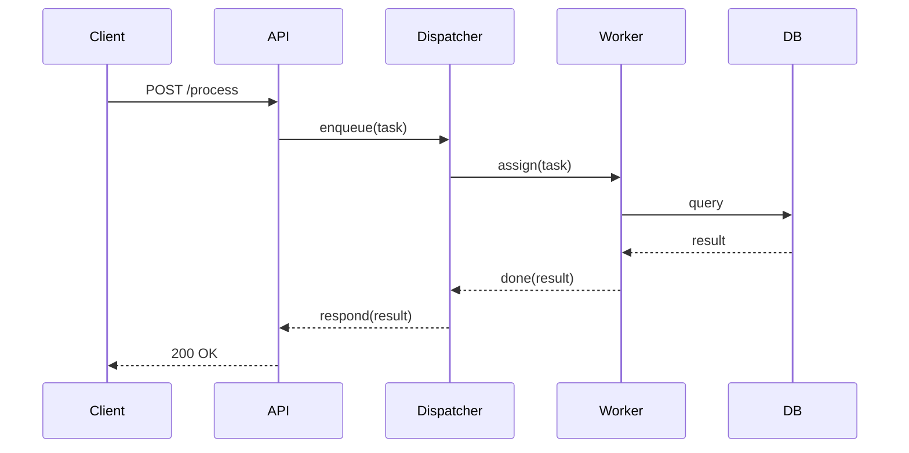

<!-- Generated by Groq via GitHub Actions -->
<!-- Topic ID: T224 -->
<!-- Category: Performance Engineering -->
<!-- Generated at UTC: 2026-11-17T21:51:54.887406+00:00 -->

# Worker pools

## 1. What problem does this solve?

**Motivation**  
When a backend receives many concurrent requests that need CPU‑bound or I/O‑bound work, the event loop can become saturated. Each request may spawn a long‑running task (image processing, external API call, database migration). If we spawn a new thread or process per request, we risk exhausting system resources, causing high latency, or even crashing the service.

**Problem exists**  
- Unbounded concurrency → memory exhaustion, context switching overhead, OS limits.  
- Spawning a new worker for every request is expensive (process creation, IPC).  
- Without limits, a burst of requests can overwhelm downstream services (DB, cache, external APIs).

**Why it matters**  
- Service availability: a single runaway request can bring down the whole service.  
- Cost: more workers mean more CPU, memory, and potentially more containers/VMs.  
- Predictability: bounded concurrency gives deterministic latency and resource usage.

**What happens if not used**  
- Resource starvation, high GC pressure, or process crashes.  
- Unpredictable latency spikes.  
- Hard to scale horizontally because each node may become a bottleneck.

**Real‑world appearance**  
- Background job queues (Bull, Sidekiq).  
- Rate‑limited API gateways.  
- Data pipelines that batch work (ETL).  
- Serverless functions that need to limit concurrency per instance.

---

## 2. Mental model

**Analogy**  
Think of a kitchen with a fixed number of chefs (workers). Each incoming order (task) is queued. Chefs pick up orders one by one. If too many orders arrive, the queue grows; if too few chefs, orders sit idle. The kitchen never hires a new chef for each order; instead, it reuses the same chefs efficiently.

**Engineering model**  
- **Worker pool** = a fixed set of reusable worker threads/processes.  
- **Task queue** = FIFO buffer of work items.  
- **Dispatcher** = assigns queued tasks to idle workers.  
- **Back‑pressure** = when the queue is full, new requests are rejected or delayed.

---

## 3. Deep explanation

### Internals
- **Thread pool** (Node.js `worker_threads`, `child_process`, or external libs).  
- **Process pool** (Docker containers, Kubernetes pods).  
- **Task queue** (in‑memory array, Redis list, Kafka topic).  
- **Scheduler** (round‑robin, priority, weighted).  
- **IPC** (message passing, shared memory, HTTP).  

### Important terminology
| Term | Meaning |
|------|---------|
| **Worker** | An independent execution context (thread/process). |
| **Pool size** | Max number of workers alive at once. |
| **Queue depth** | Max number of pending tasks. |
| **Back‑pressure** | Mechanism to slow or reject new tasks when saturated. |
| **Graceful shutdown** | Waiting for workers to finish before exiting. |
| **Hot‑standby** | Spare workers ready to take over if a worker dies. |

### Trade‑offs
| Aspect | Small pool | Large pool |
|--------|------------|------------|
| Latency | Lower queue wait | Lower context switching |
| Memory | Lower | Higher |
| CPU | Under‑utilized | Potential over‑commit |
| Complexity | Simpler | More failure modes |

### Failure modes
- **Worker crash** → lost task, need retry.  
- **Deadlock** if workers wait on each other.  
- **Starvation** if priority queue blocks lower‑priority tasks.  
- **Resource leak** if workers never terminate.

### Limitations
- **Non‑parallelizable tasks** (e.g., single‑threaded CPU work) cannot benefit.  
- **External rate limits** may still be violated if workers are too aggressive.  
- **Stateful workers** (caching) may require careful eviction.

### Placement in architecture
- **Microservice boundary**: each service may own its own pool for heavy jobs.  
- **Shared pool**: a dedicated job worker cluster (e.g., BullMQ).  
- **Hybrid**: use in‑process pool for short tasks, external queue for long jobs.

### Interaction with related concepts
- **Rate limiting**: pool size can be a form of rate limiter.  
- **Circuit breaker**: if workers fail repeatedly, open circuit.  
- **Autoscaling**: adjust pool size based on queue length.  
- **Observability**: expose metrics (queue length, worker health).

---

## 4. How it works

1. **Request arrives** → handler enqueues a task.  
2. **Dispatcher** checks for idle workers.  
3. If idle → assign task to worker via IPC.  
4. Worker processes task, returns result.  
5. Dispatcher receives result, sends response.  
6. If no idle workers → task sits in queue until one becomes free.  
7. If queue full → reject or apply back‑pressure (e.g., HTTP 429).  



---

## 5. Practical implementation

### TypeScript/Node.js example – simple thread pool

```ts
// workerPool.ts
import { Worker } from 'worker_threads';
import path from 'path';
import { EventEmitter } from 'events';

interface Task<T> {
  data: any;
  resolve: (value: T) => void;
  reject: (reason?: any) => void;
}

export class ThreadPool extends EventEmitter {
  private workers: Worker[] = [];
  private idle: Worker[] = [];
  private queue: Task<any>[] = [];
  private readonly max: number;

  constructor(max: number, workerScript: string) {
    super();
    this.max = max;
    for (let i = 0; i < max; i++) {
      const worker = new Worker(path.resolve(workerScript));
      worker.on('message', (msg) => this.handleMessage(worker, msg));
      worker.on('error', (err) => this.handleError(worker, err));
      worker.on('exit', (code) => this.handleExit(worker, code));
      this.workers.push(worker);
      this.idle.push(worker);
    }
  }

  private handleMessage(worker: Worker, msg: any) {
    const { taskId, result, error } = msg;
    const task = this.queue.find(t => t.id === taskId);
    if (!task) return;
    if (error) task.reject(error);
    else task.resolve(result);
    this.idle.push(worker);
    this.dispatch();
  }

  private handleError(worker: Worker, err: Error) {
    this.emit('error', err);
    // Replace crashed worker
    this.replaceWorker(worker);
  }

  private handleExit(worker: Worker, code: number) {
    if (code !== 0) this.emit('error', new Error(`Worker exited ${code}`));
    this.replaceWorker(worker);
  }

  private replaceWorker(old: Worker) {
    const idx = this.workers.indexOf(old);
    if (idx === -1) return;
    const newWorker = new Worker(path.resolve('workerScript.js'));
    newWorker.on('message', (msg) => this.handleMessage(newWorker, msg));
    newWorker.on('error', (err) => this.handleError(newWorker, err));
    newWorker.on('exit', (code) => this.handleExit(newWorker, code));
    this.workers[idx] = newWorker;
    this.idle.push(newWorker);
  }

  async run<T>(data: any): Promise<T> {
    return new Promise<T>((resolve, reject) => {
      const task: Task<T> = { data, resolve, reject, id: Symbol() };
      this.queue.push(task);
      this.dispatch();
    });
  }

  private dispatch() {
    while (this.idle.length && this.queue.length) {
      const worker = this.idle.shift()!;
      const task = this.queue.shift()!;
      worker.postMessage({ taskId: task.id, data: task.data });
    }
  }
}
```

```ts
// workerScript.js
const { parentPort } = require('worker_threads');

parentPort.on('message', async ({ taskId, data }) => {
  try {
    // Simulate CPU‑bound work
    const result = heavyComputation(data);
    parentPort.postMessage({ taskId, result });
  } catch (e) {
    parentPort.postMessage({ taskId, error: e.message });
  }
});

function heavyComputation(x) {
  // Dummy CPU work
  let sum = 0;
  for (let i = 0; i < 1e7; i++) sum += i + x;
  return sum;
}
```

```ts
// server.ts
import express from 'express';
import { ThreadPool } from './workerPool';

const pool = new ThreadPool(4, './workerScript.js');
const app = express();

app.use(express.json());

app.post('/compute', async (req, res) => {
  try {
    const result = await pool.run(req.body.value);
    res.json({ result });
  } catch (e) {
    res.status(500).json({ error: e.message });
  }
});

app.listen(3000, () => console.log('Server listening on 3000'));
```

**Key lines explained**

- `new Worker(path.resolve(workerScript))`: creates a new thread.  
- `worker.postMessage`: sends task to worker.  
- `worker.on('message')`: receives result.  
- `idle.push(worker)`: marks worker free.  
- `dispatch()`: keeps queue drained as workers become available.

---

## 6. Production considerations

| Concern | Tips |
|---------|------|
| **Scalability** | Use dynamic pool size based on CPU load; consider horizontal scaling (multiple nodes). |
| **Reliability** | Graceful shutdown: wait for queue to empty or set a timeout. |
| **Security** | Workers run isolated code; avoid executing untrusted data. |
| **Observability** | Expose metrics: queue length, worker health, task latency (Prometheus). |
| **Performance** | Benchmark pool size vs. latency; avoid oversubscription of CPU cores. |
| **Error handling** | Retry logic per task; circuit breaker if workers fail repeatedly. |
| **Resource usage** | Monitor memory per worker; set `maxOldSpaceSize` if needed. |
| **Operational concerns** | Log worker crashes; auto‑restart via process manager (PM2, Docker). |
| **Failure recovery** | Persist tasks in durable store (Redis, DB) if workers can die. |
| **Deployment** | Containerize workers; use Kubernetes `Deployment` with `replicas` for scaling. |

---

## 7. Common mistakes

| Mistake | Why it’s bad |
|---------|--------------|
| **Unlimited pool size** | Exceeds OS limits → OOM, thrashing. |
| **Blocking main thread** | Using `worker_threads` incorrectly; still blocking event loop. |
| **No back‑pressure** | Queue grows unbounded → memory blowup. |
| **Ignoring worker crashes** | Silent failures; tasks lost. |
| **Sharing mutable state** | Race conditions between workers. |
| **Hard‑coding pool size** | Fails to adapt to load spikes. |
| **Not handling errors** | Unhandled rejections crash process. |
| **Using heavy IPC** | Excessive serialization overhead. |

---

## 8. Senior engineer perspective

### At scale
- **Architecture**: separate worker cluster (e.g., BullMQ + Redis) from API layer.  
- **Trade‑offs**: external queue gives persistence but adds latency; in‑process pool is fast but less fault‑tolerant.  
- **Bottlenecks**: database locks, external API rate limits, network bandwidth.  
- **Failure scenarios**: worker pool exhaustion → request back‑pressure; worker crashes → task loss.  
- **Monitoring**: queue depth, worker CPU/memory, task latency, error rates.  
- **Cost/performance**: more workers = higher CPU cost; fewer workers = higher latency.  
- **When NOT to use**: pure I/O‑bound tasks that can be handled by async event loop; tasks that require persistent state across restarts.

---

## 9. Interview questions

1. **Beginner**: *What is a worker pool and why would you use one?*  
   *Answer:* A fixed set of reusable workers that process queued tasks, used to limit concurrency, avoid resource exhaustion, and improve throughput.

2. **Beginner**: *How does back‑pressure work in a worker pool?*  
   *Answer:* When the queue is full, new tasks are rejected or delayed, signaling the client to slow down or retry.

3. **Senior**: *Explain how you would design a worker pool that can scale horizontally across multiple machines.*  
   *Answer:* Use a distributed queue (Redis list, Kafka topic) and a pool of workers on each node; workers pull tasks, process, and push results. Ensure idempotency, deduplication, and graceful shutdown.

4. **Senior**: *What metrics would you expose for a worker pool and why?*  
   *Answer:* Queue length, worker count, task latency, error rate, CPU/memory per worker, retry count. They help detect bottlenecks, failures, and guide autoscaling.

5. **Scenario/Debugging**: *A production system with a worker pool suddenly shows a spike in task latency and a growing queue. What steps would you take to diagnose and fix the issue?*  
   *Answer:*  
   - Check worker health logs for crashes or slow tasks.  
   - Inspect queue depth and back‑pressure signals.  
   - Profile CPU/memory usage on workers.  
   - Verify external dependencies (DB, API) latency.  
   - Consider increasing pool size or adding more nodes.  
   - Add retries or circuit breakers if external services are flaky.

---

## 10. Hands‑on task

**Task**: Build a simple image‑resizing service.

1. Create an Express endpoint `/resize` that accepts an image URL and target dimensions.  
2. Use the worker pool from section 5 to offload the resizing to a separate thread.  
3. Store the resized image in Redis (keyed by a hash of the URL + dimensions).  
4. If the image is already cached, return it immediately without invoking the worker.  
5. Add metrics: queue length, worker count, cache hit ratio.  
6. Write a small test that sends 50 concurrent resize requests and observes the queue behavior.

---

## 11. Quick revision

- Worker pool = reusable set of workers that process queued tasks.  
- Limits concurrency → prevents resource exhaustion.  
- Queue + dispatcher pattern: tasks queued, workers idle → assign.  
- Back‑pressure: reject or delay when queue full.  
- Common implementations: `worker_threads`, `child_process`, external queues (Redis, Kafka).  
- Key metrics: queue depth, worker health, task latency, error rate.  
- Failure modes: worker crash, deadlock, memory leak, unbounded queue.  
- Production tips: graceful shutdown, autoscaling, observability, idempotent tasks.  
- Senior considerations: horizontal scaling, persistence, cost vs. latency trade‑off.  

---

## 12. References

- [Node.js worker_threads](https://nodejs.org/api/worker_threads.html)  
- [BullMQ – Redis Queue](https://docs.bullmq.io/)  
- [Prometheus – Metrics](https://prometheus.io/docs/introduction/overview/)  
- [PM2 – Process Manager](https://pm2.keymetrics.io/)  
- [Docker – Multi‑stage builds](https://docs.docker.com/develop/develop-images/multistage-build/)  
- [Kubernetes – Horizontal Pod Autoscaler](https://kubernetes.io/docs/tasks/run-application/horizontal-pod-autoscale/)
