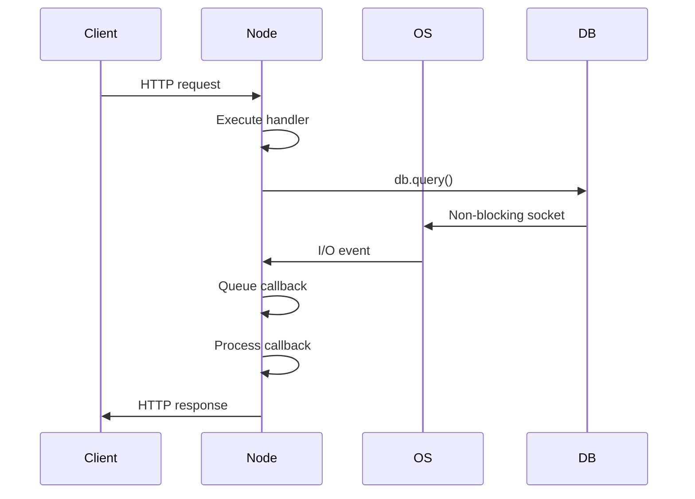

<!-- Generated by Groq via GitHub Actions -->
<!-- Topic ID: T225 -->
<!-- Category: Performance Engineering -->
<!-- Generated at UTC: 2026-11-18T08:43:29.457804+00:00 -->

# Event loops

## 1. What problem does this solve?

- **Problem**: Traditional operating systems use *threads* to handle concurrency. Each thread has its own stack, context, and scheduling overhead. In a high‑traffic backend, creating thousands of threads is impossible due to memory and context‑switch costs.
- **Why it matters**: Backend services (e.g., a Next.js API route, a FastAPI endpoint, or a Redis‑backed job queue) must handle many simultaneous I/O operations (HTTP requests, DB queries, message broker reads) while keeping CPU usage low. Threads would waste resources and hurt latency.
- **What if we don’t use it**: You’d either spawn a thread per request (exhausting system resources) or block the event loop, causing all requests to stall. Either way, throughput drops and the service becomes unresponsive.
- **Real‑world appearance**:  
  - Node.js server handling thousands of concurrent WebSocket connections.  
  - FastAPI app using `asyncio` event loop to serve many async database calls.  
  - A microservice that pulls messages from Kafka and processes them without blocking the main thread.

## 2. Mental model

**Analogy**:  
Think of the event loop as a *single‑person chef* in a busy kitchen. The chef can only cook one dish at a time, but they can *prepare* ingredients (start a database query, open a file) and then *wait* while the oven does its work. While waiting, the chef immediately starts cooking the next dish. The chef never sits idle; they keep a queue of “ready” tasks and pick the next one as soon as the previous one finishes.

**Engineering model**:  
- The event loop is a **single thread** that runs a **queue** of callbacks.  
- When an I/O operation is initiated, it is handed off to the OS (or a worker pool).  
- The event loop registers a **callback** to be executed when the I/O completes.  
- While waiting, the loop continues to process other callbacks, ensuring the thread never blocks.

## 3. Deep explanation

### Internals

| Component | Role |
|-----------|------|
| **Reactor** | Monitors OS I/O events (e.g., `epoll`, `kqueue`). |
| **Task Queue** | Holds callbacks ready to run. |
| **Microtask Queue** | Holds promises’ `.then` callbacks, executed before the next tick. |
| **Timer Queue** | Holds `setTimeout`/`setInterval` callbacks. |
| **Event Loop** | Pulls tasks from the queues in a specific order and executes them. |

### Important terminology

- **Event**: An I/O completion, timer expiry, or promise resolution.  
- **Callback**: Function scheduled to run when an event occurs.  
- **Tick**: One iteration of the event loop (processing all ready callbacks).  
- **Microtasks**: Promise callbacks that run after the current stack but before the next tick.  
- **Worker Threads**: Optional pool for CPU‑bound work in Node.js (not part of the core loop).

### Trade‑offs

| Trade‑off | Explanation |
|-----------|-------------|
| **Single‑threaded vs. multi‑threaded** | Simpler concurrency model, but CPU‑bound tasks block the loop. |
| **Callback vs. Promise** | Callbacks can lead to “callback hell”; promises/async‑await improve readability but still rely on the same loop. |
| **Worker pool size** | Larger pool reduces blocking but increases memory usage. |

### Failure modes

- **Blocking the loop**: Long synchronous code (e.g., `JSON.parse` on huge payloads) stalls all I/O.  
- **Unbounded queue growth**: If callbacks keep adding more callbacks faster than they are processed, memory can explode.  
- **Race conditions**: Shared mutable state accessed from multiple callbacks can cause subtle bugs.

### Limitations

- **CPU‑bound workloads**: Pure JavaScript cannot parallelize CPU work; must offload to worker threads or external services.  
- **Memory overhead**: Each callback and promise consumes memory; large numbers can strain the heap.  
- **Determinism**: Order of microtasks vs. macrotasks can be confusing; careful design needed.

### Where it fits in backend architecture

- **API servers**: Node.js/Express, FastAPI’s `asyncio`, or Go’s goroutine model all rely on an event loop or similar scheduler.  
- **Message brokers**: Kafka consumers often use an event loop to process messages asynchronously.  
- **Databases**: PostgreSQL drivers use non‑blocking sockets, returning promises that resolve when data arrives.  
- **Cache layers**: Redis clients in Node.js use the event loop for pipelining commands.

### Interaction with related concepts

- **Promises / async‑await**: Syntax sugar that schedules microtasks on the event loop.  
- **Worker threads**: Offload CPU work; the main loop remains responsive.  
- **Cluster module**: Spawns multiple Node.js processes, each with its own event loop, to utilize multi‑core CPUs.  
- **Backpressure**: Flow control mechanisms (e.g., streams) prevent the loop from being flooded with data.

## 4. How it works

1. **Start**: Node.js process boots, creates the event loop.  
2. **Register**: Application registers callbacks (e.g., `app.get('/api', handler)`).  
3. **I/O request**: HTTP request arrives → callback queued.  
4. **Process**: Event loop picks callback, executes handler.  
5. **Async call**: Handler calls `db.query()`.  
6. **Delegate**: `db.query()` hands off to libpq (PostgreSQL) via non‑blocking socket.  
7. **Callback**: When data arrives, libpq signals the OS.  
8. **Reactor**: OS notifies Node.js; callback is queued.  
9. **Microtasks**: Promise resolution callbacks run before next tick.  
10. **Next tick**: Loop continues with next queued callback.



## 5. Practical implementation

### Node.js example: Fast API‑style endpoint with PostgreSQL

```ts
// src/server.ts
import express from 'express';
import { Pool } from 'pg';

const app = express();
const pool = new Pool({
  connectionString: process.env.DATABASE_URL,
});

app.get('/users/:id', async (req, res) => {
  try {
    // Async DB call – non‑blocking
    const { rows } = await pool.query(
      'SELECT id, name, email FROM users WHERE id = $1',
      [req.params.id]
    );
    if (!rows.length) return res.status(404).send('Not found');
    res.json(rows[0]);
  } catch (err) {
    console.error(err);
    res.status(500).send('Internal server error');
  }
});

app.listen(3000, () => console.log('Server listening on :3000'));
```

**Key lines**

- `await pool.query(...)`: Returns a promise; the event loop can continue while the DB query runs.  
- `try/catch`: Handles errors without blocking the loop.

### Offloading CPU work to a worker thread

```ts
// src/worker.ts
import { parentPort } from 'worker_threads';

parentPort?.on('message', (data: string) => {
  // CPU‑heavy operation
  const result = heavyComputation(data);
  parentPort?.postMessage(result);
});

function heavyComputation(input: string): string {
  // Simulate CPU work
  let sum = 0;
  for (let i = 0; i < 1e8; i++) sum += i;
  return `Result: ${sum}`;
}
```

```ts
// src/server.ts (continued)
import { Worker } from 'worker_threads';

app.get('/heavy', (req, res) => {
  const worker = new Worker('./worker.js');
  worker.postMessage(req.query.input || '');
  worker.on('message', (msg) => res.send(msg));
  worker.on('error', (err) => res.status(500).send(err.message));
});
```

## 6. Production considerations

| Concern | How to address |
|---------|----------------|
| **Scalability** | Use Node.js `cluster` or container orchestration (K8s) to run multiple processes; each has its own event loop. |
| **Reliability** | Wrap async handlers in `try/catch`; use `process.on('unhandledRejection')` to catch promise rejections. |
| **Security** | Validate all inputs; avoid `eval`; use HTTPS; set proper CORS. |
| **Observability** | Instrument with OpenTelemetry; log request latency; trace async operations. |
| **Performance** | Profile event loop lag (`process.hrtime.bigint()`); avoid blocking code; use worker threads for CPU tasks. |
| **Error handling** | Central error middleware; graceful shutdown on fatal errors. |
| **Resource usage** | Monitor memory; set `--max-old-space-size`; limit worker pool size. |
| **Operational concerns** | Use PM2 or systemd for process management; enable graceful restarts. |
| **Failure recovery** | Retry logic for transient DB/network errors; circuit breakers. |
| **Deployment** | Containerize with Docker; expose health endpoints; use rolling updates. |

## 7. Common mistakes

| Mistake | Why it’s problematic |
|---------|----------------------|
| **Blocking the loop** (e.g., `fs.readFileSync`, heavy loops) | Stalls all I/O, causing timeouts. |
| **Not awaiting promises** | Unhandled rejections, race conditions. |
| **Using callbacks instead of promises** | Leads to callback hell, hard to read. |
| **Ignoring microtask vs. macrotask order** | Unexpected ordering of async operations. |
| **Over‑creating worker threads** | Excessive memory usage, context switching. |
| **Not handling backpressure** | Streams can overflow, causing memory leaks. |
| **Assuming single‑threaded is always enough** | CPU‑bound tasks will block the loop. |

## 8. Senior engineer perspective

### What changes at scale?

- **Architecture decisions**:  
  - *Horizontal scaling*: Run many Node.js instances behind a load balancer.  
  - *Service decomposition*: Separate CPU‑heavy services into micro‑services.  
  - *Queueing*: Use message brokers (Kafka, RabbitMQ) to decouple producers and consumers.

- **Trade‑offs**:  
  - More processes → higher memory footprint but better CPU utilization.  
  - Worker threads → lower latency for CPU tasks but added complexity.

- **Bottlenecks**:  
  - Event loop lag > 50 ms indicates blocking code.  
  - Database connection pool exhaustion.  
  - Network I/O limits (e.g., max concurrent sockets).

- **Failure scenarios**:  
  - *Backpressure overload*: Use `stream.pause()` / `stream.resume()`.  
  - *Database outages*: Implement retry with exponential backoff.  
  - *Worker crashes*: Use `cluster`’s `uncaughtException` handling.

- **Monitoring**:  
  - Event loop lag metrics (`event-loop-lag`).  
  - Queue depth for async tasks.  
  - Worker thread pool health.

- **Cost/performance**:  
  - More processes → more CPU cores, higher cost.  
  - Offloading to managed services (e.g., AWS Lambda) can reduce ops overhead.

- **When NOT to use**:  
  - If the workload is heavily CPU‑bound and cannot be parallelized, consider a language with true multi‑threading (Go, Rust).  
  - If you need deterministic ordering of tasks that the event loop cannot guarantee, use a job queue.

## 9. Interview questions

1. **Beginner**: *What is the event loop in Node.js?*  
   *Answer*: A single‑threaded loop that processes callbacks, timers, and I/O events, ensuring non‑blocking execution.

2. **Beginner**: *Why should you avoid blocking code in an async handler?*  
   *Answer*: Blocking code stalls the event loop, preventing it from handling other requests and leading to timeouts.

3. **Senior**: *Explain how microtasks and macrotasks are ordered in the event loop. Why does this matter?*  
   *Answer*: Microtasks (promises) run after the current stack but before the next tick; macrotasks (I/O callbacks, timers) run after microtasks. This ordering affects when async code executes and can lead to subtle bugs.

4. **Senior**: *Describe a scenario where you would use worker threads in a Node.js application. What are the trade‑offs?*  
   *Answer*: Use worker threads for CPU‑heavy computations (image processing, encryption). Trade‑offs: increased memory, context switching, but keeps the main loop responsive.

5. **Scenario/Debugging**: *You notice that your Node.js API’s latency spikes to 200 ms during peak traffic, but CPU usage stays below 30 %. What could be causing this, and how would you investigate?*  
   *Answer*: Likely event loop lag due to blocking code or backpressure. Investigate with `process.hrtime.bigint()` or `event-loop-lag` metrics, profile with `clinic.js`, check for synchronous operations, and monitor queue depth.

## 10. Hands‑on task

**Task**: Build a simple “image thumbnail” microservice.

1. Create an Express server with an endpoint `/thumb?url=<image_url>`.  
2. When a request arrives, download the image asynchronously (use `node-fetch`).  
3. Offload image resizing to a worker thread (use `sharp` library).  
4. Cache the thumbnail in Redis for 10 minutes.  
5. Return the thumbnail as a Base64 string.

**Goals**:  
- Practice async I/O, worker threads, and caching.  
- Measure event loop lag before and after adding the worker.

## 11. Quick revision

- Event loop = single thread that processes callbacks, timers, and I/O events.  
- I/O is non‑blocking; callbacks are queued until completion.  
- Microtasks (promises) run before the next tick; macrotasks run after.  
- Blocking code stalls the loop → latency spikes.  
- Use worker threads for CPU‑bound work; keep main loop free.  
- Cluster or container orchestration scales horizontally.  
- Monitor event loop lag, queue depth, and worker health.  
- Handle backpressure with stream pause/resume.  
- Wrap async handlers in `try/catch`; use global unhandled rejection handler.  
- Avoid callback hell; prefer async/await.  
- Redis or message queues decouple producers/consumers.  
- Graceful shutdown: close DB connections, stop accepting new requests.

## 12. References

- https://nodejs.org/api/async_hooks.html  
- https://nodejs.org/api/process.html#process_process_hrtimediff_time  
- https://nodejs.org/api/cluster.html  
- https://nodejs.org/api/worker_threads.html  
- https://developer.mozilla.org/en-US/docs/Web/JavaScript/Event_loop  
- https://docs.mongodb.com/manual/core/event-loop/  
- https://docs.fastapi.tiangolo.com/advanced/async-await/  
- https://nodejs.org/api/stream.html  
- https://github.com/GoogleChromeLabs/clinic  
- https://github.com/elastic/apm-agent-nodejs  

---
