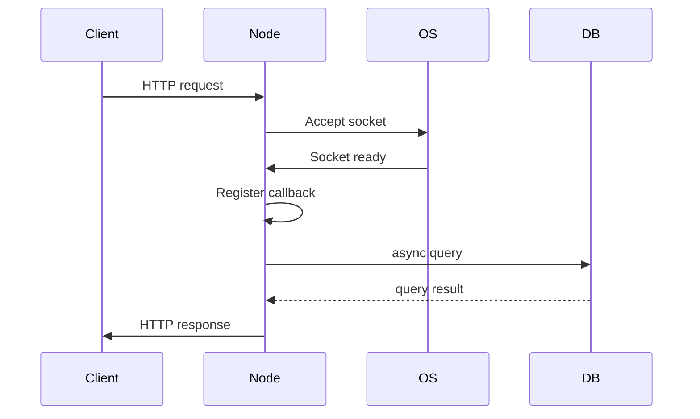

<!-- Generated by Groq via GitHub Actions -->
<!-- Topic ID: T226 -->
<!-- Category: Performance Engineering -->
<!-- Generated at UTC: 2026-11-18T08:43:29.457804+00:00 -->

# Concurrency

## 1. What problem does this solve?

- **Problem**: A single thread can only do one thing at a time. If a backend service spends time waiting for I/O (disk, network, database), the thread is idle, and the system can’t serve other requests.
- **Why it matters**: Modern web traffic is high‑volume and latency‑sensitive. A bottleneck in request handling translates directly into slower responses and lower throughput, hurting user experience and revenue.
- **What happens if we ignore concurrency**:  
  * Requests are queued and processed sequentially → high latency.  
  * CPU‑bound work blocks I/O → overall throughput drops.  
  * Resource utilization is low → you need more hardware to meet demand.
- **Real‑world appearance**:  
  * HTTP servers (Express, FastAPI) that handle thousands of concurrent connections.  
  * Background job workers (Bull, Celery) that run many tasks in parallel.  
  * Database connection pools that allow multiple queries to run concurrently.  
  * Message brokers (Kafka, RabbitMQ) that deliver messages to many consumers at once.

---

## 2. Mental model

### Analogy – The Kitchen

| Kitchen | Concurrency |
|---------|-------------|
| **Chef** | One thread |
| **Orders** | Incoming requests |
| **Stove** | CPU |
| **Oven** | I/O (disk, network) |
| **Waiter** | Event loop |

A single chef can’t cook multiple dishes at once. If the chef spends time waiting for the oven, the kitchen stalls. Instead, the chef can start another dish while the oven is heating, or hand off a dish to a sous‑chef. In concurrency, the “chef” (thread) delegates waiting tasks to the “oven” (I/O system) and keeps busy with other work.

### Engineering model

- **Event loop**: A single thread that processes I/O callbacks and microtasks.  
- **Async I/O**: Operations that return immediately; the OS notifies the event loop when they finish.  
- **Worker threads / processes**: Dedicated threads/processes that run CPU‑bound work.  
- **Message passing / queues**: Decouple producers and consumers, enabling parallelism across machines.

---

## 3. Deep explanation

### Internals

| Component | Role |
|-----------|------|
| **Event Loop** (Node: libuv) | Drives async callbacks, microtasks, timers. |
| **Thread Pool** (libuv) | Handles blocking I/O (fs, DNS) and CPU‑bound tasks. |
| **Worker Threads** (Node `worker_threads`) | Full JS threads with own event loop, useful for CPU work. |
| **Cluster** (Node `cluster`) | Forks multiple Node processes, each with its own event loop. |
| **Message Queue** (Redis, Kafka) | Decouples producers/consumers, supports horizontal scaling. |

### Important terminology

- **Concurrency vs Parallelism**: Concurrency is about *doing* many things *overlap* in time; parallelism is *doing* many things *simultaneously* on multiple cores.
- **Race Condition**: Two or more operations that depend on order but are not synchronized, leading to nondeterministic results.
- **Deadlock**: Two or more threads wait forever for each other’s resources.
- **Starvation**: A thread never gets CPU because others monopolize it.
- **Backpressure**: Mechanism to signal producers to slow down when consumers are overloaded.

### Trade‑offs

| Aspect | Benefit | Cost |
|--------|---------|------|
| **Thread pool size** | More I/O ops in parallel | Higher memory, context‑switch overhead |
| **Worker threads** | CPU‑bound tasks run in parallel | Extra memory, serialization cost |
| **Cluster** | Full CPU parallelism | Inter‑process communication overhead |
| **Async I/O** | Non‑blocking, low latency | Complexity, harder to reason about order |

### Failure modes

- **Uncaught rejections** → process crash.  
- **Excessive thread pool usage** → thread starvation, GC pauses.  
- **Race conditions** in shared state (e.g., in-memory cache).  
- **Deadlocks** in database transactions or lock hierarchies.

### Limitations

- **Node’s single‑threaded event loop**: CPU‑bound work blocks it unless offloaded.  
- **Python GIL**: True parallelism requires multiprocessing or C extensions.  
- **Database locks**: Can become bottlenecks if many concurrent writes.

### Where it fits

- **Request handling**: Each HTTP request is an async task.  
- **Background jobs**: Workers process tasks concurrently.  
- **Microservices**: Services communicate via async message queues.  
- **Caching**: Redis clients use async APIs to avoid blocking.

### Interaction with related concepts

| Concept | Interaction |
|---------|-------------|
| **Connection pooling** | Reduces contention on DB connections, works with async queries. |
| **Rate limiting** | Uses counters that must be updated atomically. |
| **Tracing** | Adds overhead; must be async‑aware. |
| **Load balancing** | Distributes requests across multiple instances. |

---

## 4. How it works

1. **Request arrives** → OS passes socket to Node.  
2. **Event loop** picks up the socket, registers a callback.  
3. **Handler** starts async I/O (e.g., `fetch`, `db.query`).  
4. **I/O operation** is handed to OS; Node’s thread pool may be used for blocking ops.  
5. **Event loop** continues processing other events.  
6. **I/O completes** → callback queued in the event loop.  
7. **Event loop** executes callback, sends response.  



---

## 5. Practical implementation

### 5.1 Async request handling (Node/Express)

```ts
// server.ts
import express from 'express';
import { pool } from './db'; // pg pool

const app = express();

app.get('/users/:id', async (req, res, next) => {
  try {
    const { id } = req.params;
    // Async DB query – non‑blocking
    const { rows } = await pool.query('SELECT * FROM users WHERE id=$1', [id]);
    res.json(rows[0] ?? { error: 'not found' });
  } catch (err) {
    next(err); // unhandledRejection handled by middleware
  }
});

app.listen(3000, () => console.log('🚀'));
```

### 5.2 Offloading CPU work to a worker thread

```ts
// worker.ts
import { parentPort } from 'worker_threads';

function heavyComputation(n: number): number {
  let sum = 0;
  for (let i = 0; i < n; i++) sum += Math.sqrt(i);
  return sum;
}

parentPort?.on('message', (msg: { n: number }) => {
  const result = heavyComputation(msg.n);
  parentPort?.postMessage({ result });
});
```

```ts
// server.ts
import express from 'express';
import { Worker } from 'worker_threads';

const app = express();

app.get('/heavy/:n', async (req, res) => {
  const n = Number(req.params.n);
  const worker = new Worker('./worker.js');

  worker.postMessage({ n });

  worker.once('message', (msg) => {
    res.json({ result: msg.result });
  });

  worker.once('error', (err) => {
    res.status(500).json({ error: err.message });
  });
});

app.listen(3000);
```

### 5.3 Using a job queue (Bull + Redis)

```ts
// queue.ts
import Queue from 'bull';
export const jobQueue = new Queue('tasks', {
  redis: { host: 'localhost', port: 6379 }
});
```

```ts
// worker.ts
import { jobQueue } from './queue';

jobQueue.process(async (job) => {
  // CPU‑bound or I/O‑bound work
  const result = await heavyComputation(job.data.n);
  return { result };
});
```

```ts
// api.ts
import express from 'express';
import { jobQueue } from './queue';

const app = express();
app.use(express.json());

app.post('/tasks', async (req, res) => {
  const { n } = req.body;
  const job = await jobQueue.add({ n });
  res.json({ jobId: job.id });
});

app.listen(3000);
```

---

## 6. Production considerations

| Concern | Tips |
|---------|------|
| **Scalability** | Use cluster or container orchestration (K8s). Horizontal scaling of workers. |
| **Reliability** | Idempotent handlers, retries, circuit breakers. |
| **Security** | Run workers in separate processes/containers. Avoid shared mutable state. |
| **Observability** | Instrument event loop lag, thread pool usage, queue depth. Use OpenTelemetry. |
| **Performance** | Tune libuv thread pool (`UV_THREADPOOL_SIZE`). Use connection pooling. |
| **Error handling** | Global `unhandledRejection` and `uncaughtException` handlers. |
| **Resource usage** | Monitor memory per worker, GC pauses. |
| **Operational** | Graceful shutdown (`SIGTERM` → finish current tasks). Health checks. |
| **Failure recovery** | Retry logic, dead‑letter queues, graceful backpressure. |
| **Deployment** | Docker images with multi‑stage builds. Use `pm2` or `systemd` for process management. |

---

## 7. Common mistakes

| Mistake | Why it’s bad |
|---------|--------------|
| **Blocking I/O in Node** (`fs.readFileSync`) | Blocks the event loop, serializes all requests. |
| **Ignoring `unhandledRejection`** | Silent crashes, unpredictable state. |
| **Over‑creating workers** | Exhausts memory, increases context switching. |
| **Sharing mutable state across workers** | Race conditions, hard‑to‑debug bugs. |
| **Not using connection pools** | Too many DB connections → throttling. |
| **No backpressure handling** | Queue overflows, memory blow‑up. |
| **Using `cluster` without sticky sessions** | Session data lost across workers. |
| **Hard‑coding thread pool size** | Under‑utilization or over‑commitment. |

---

## 8. Senior engineer perspective

### What changes at scale?

- **Architecture**: Move from a single monolith to a micro‑service or event‑driven architecture.  
- **Concurrency model**: Prefer message queues (Kafka, RabbitMQ) over direct RPC for decoupling.  
- **Resource limits**: Set explicit CPU/memory limits per container; use autoscaling.  
- **Observability**: Distributed tracing (Jaeger), metrics (Prometheus), log aggregation.  
- **Failure scenarios**: Handle partial failures (e.g., one worker dies) gracefully; use retries with exponential backoff.  
- **Cost/performance**: Evaluate whether adding more workers or scaling horizontally yields better ROI than optimizing code.

### Design decisions

| Decision | Trade‑off |
|----------|-----------|
| **Use worker threads vs cluster** | Threads share memory → easier state sharing but higher GC cost. Cluster isolates memory but requires IPC. |
| **Synchronous vs asynchronous DB drivers** | Sync is simpler but blocks; async scales better but adds complexity. |
| **In‑memory cache vs Redis** | In‑memory is fast but not shared; Redis is networked but persists across restarts. |
| **Queue vs direct call** | Queue adds latency but improves resilience and scalability. |

### When NOT to use concurrency

- Extremely low traffic where single‑threaded simplicity wins.  
- Purely CPU‑bound workloads that cannot be parallelized (e.g., single‑threaded algorithm).  
- Legacy systems where adding concurrency would break existing contracts.

---

## 9. Interview questions

1. **Beginner**: *What is the event loop in Node.js?*  
   *Answer*: A single thread that processes callbacks, microtasks, and timers. It handles async I/O by delegating to the OS and waking up when I/O completes.

2. **Beginner**: *Why should we avoid `fs.readFileSync` in a request handler?*  
   *Answer*: It blocks the event loop, preventing other requests from being processed until the file read finishes.

3. **Senior**: *Explain the difference between concurrency and parallelism in the context of Node.js. How would you achieve parallelism?*  
   *Answer*: Concurrency is overlapping tasks; parallelism is executing them simultaneously on multiple cores. In Node, parallelism is achieved via worker threads, child processes, or clustering.

4. **Senior**: *Describe a scenario where a deadlock could occur in a Node application that uses a Redis lock. How would you detect and mitigate it?*  
   *Answer*: If two services acquire locks in different orders, they can wait forever. Detect via timeout logs or Redis key expiration. Mitigate by enforcing a global lock acquisition order or using Redlock algorithm.

5. **Scenario/Debugging**: *You notice that your HTTP server’s latency spikes during peak traffic. The code uses async/await everywhere. What could be causing the spike and how would you investigate?*  
   *Answer*: Possible causes: thread pool exhaustion (blocking I/O), GC pauses, database contention, or unhandled backpressure. Investigate with `node --inspect` to check event loop lag, monitor thread pool usage (`UV_THREADPOOL_SIZE`), enable GC logs, and inspect database metrics.

---

## 10. Hands‑on task

**Build a simple “image thumbnail” service**:

1. Create an Express server that accepts image uploads.  
2. Offload the resizing work to a worker thread.  
3. Store the thumbnail in Redis.  
4. Return the thumbnail URL.  
5. Measure throughput with `wrk` or `ab` and compare single‑threaded vs worker‑threaded versions.

*Goal*: Observe the impact of concurrency on CPU‑bound image processing.

---

## 11. Quick revision

- Concurrency overlaps work; parallelism runs it simultaneously.  
- Node’s event loop is single‑threaded; heavy I/O is non‑blocking.  
- Worker threads handle CPU‑bound tasks; cluster scales across cores.  
- Thread pool size (`UV_THREADPOOL_SIZE`) affects async I/O concurrency.  
- Use connection pools for DB, Redis, and message brokers.  
- Handle `unhandledRejection` and `uncaughtException` globally.  
- Monitor event loop lag, GC pauses, queue depth, and worker health.  
- Avoid blocking I/O; prefer async APIs.  
- Use message queues for decoupling and scaling.  
- Test for race conditions and deadlocks when sharing state.  
- Scale horizontally with containers and orchestrators.  
- Implement graceful shutdown and backpressure handling.

---

## 12. References

- [Node.js Event Loop](https://nodejs.org/en/docs/guides/event-loop-timers-and-nexttick/)  
- [libuv Thread Pool](https://github.com/libuv/libuv/blob/main/doc/threadpool.md)  
- [Node.js Worker Threads](https://nodejs.org/api/worker_threads.html)  
- [Node.js Cluster Module](https://nodejs.org/api/cluster.html)  
- [Bull Queue](https://github.com/OptimalBits/bull)  
- [OpenTelemetry for Node.js](https://opentelemetry.io/docs/instrumentation/node/)  
- [Prometheus Node Exporter](https://github.com/prometheus/node_exporter)  
- [Redis Pub/Sub](https://redis.io/docs/manual/pubsub/)  
- [Kafka Streams](https://kafka.apache.org/documentation/streams/)  

---
