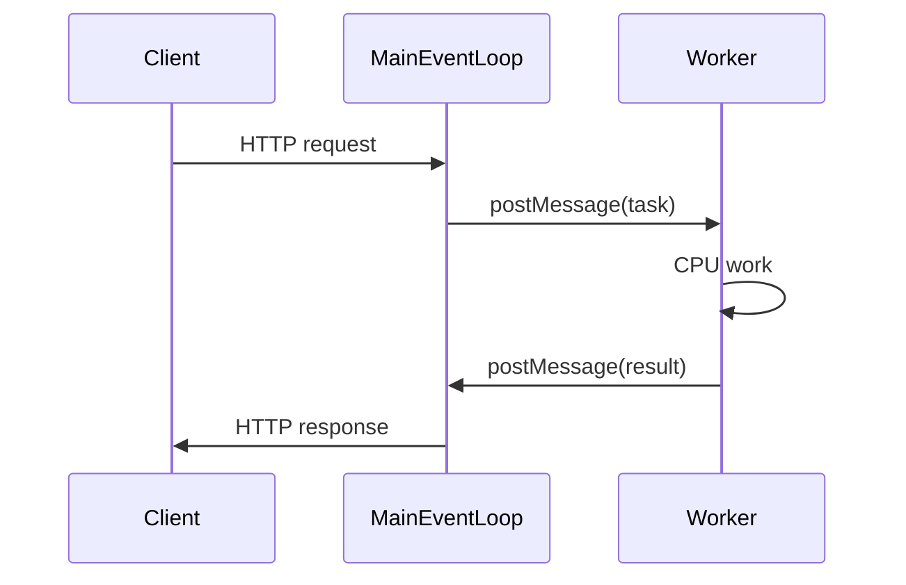
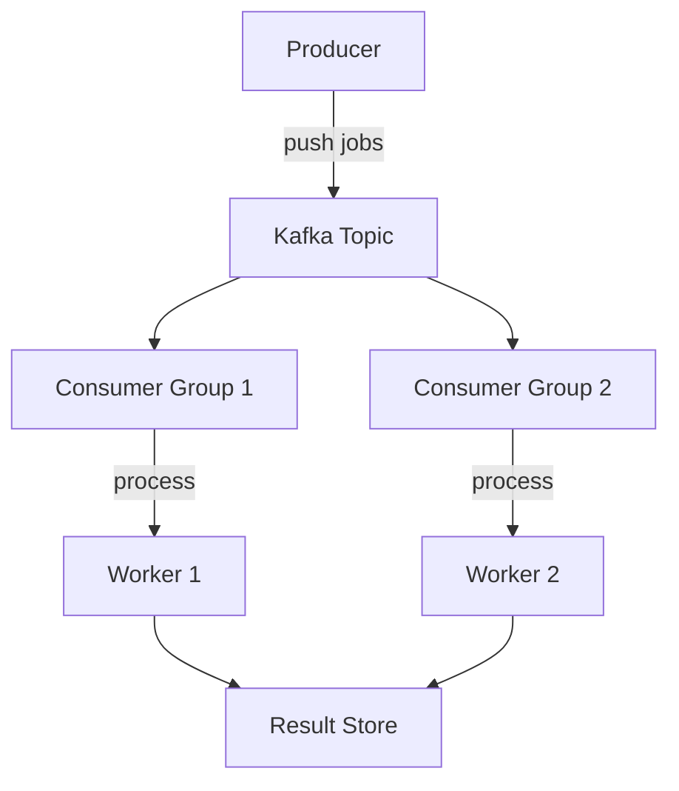

<!-- Generated by Groq via GitHub Actions -->
<!-- Topic ID: T227 -->
<!-- Category: Performance Engineering -->
<!-- Generated at UTC: 2026-11-18T21:30:38.794719+00:00 -->

# Parallelism

## 1. What problem does this solve?

- **Throughput vs Latency** – A single request‑handling thread can only process one request at a time. When many users hit the API, the response time grows linearly with the number of concurrent requests. Parallelism lets the system handle many requests simultaneously, improving overall throughput and keeping latency low.

- **CPU‑bound work** – Tasks like image resizing, AI inference, or cryptographic hashing consume CPU cycles. Running them sequentially blocks the event loop in Node.js or the main thread in Python, starving other requests. Parallelism distributes the work across multiple cores or processes.

- **I/O‑bound concurrency** – Even when a request is waiting for a database or external API, the thread can be reused for another request. Parallelism (via async I/O) keeps the CPU busy while waiting for I/O, maximizing resource utilization.

- **Real‑world impact** –  
  - **Microservice clusters**: A single service can spawn worker processes to serve thousands of requests per second.  
  - **Batch pipelines**: Parallel map/reduce jobs process terabytes of data in minutes instead of hours.  
  - **AI inference**: Serving a model on multiple GPUs or CPUs in parallel reduces per‑request latency.

If parallelism is not used, systems become bottlenecked by a single thread, leading to high latency, wasted CPU cycles, and poor scalability.

## 2. Mental model

### Analogy  
Imagine a kitchen with one chef. The chef can only cook one dish at a time. If ten customers arrive, each dish takes the chef’s full attention, and the wait time grows linearly. Now add more chefs: each can cook a dish simultaneously, so the kitchen can serve all customers in roughly the same time as a single dish. The key is that the chefs (threads/processes) work in parallel, not one after another.

### Engineering model  
- **Concurrency**: Multiple tasks *appear* to run at the same time (interleaved execution).  
- **Parallelism**: Tasks truly run simultaneously on separate CPU cores or processes.  
- **Event loop + thread pool** (Node.js): The event loop handles I/O callbacks; the libuv thread pool runs blocking operations.  
- **Worker threads / child processes**: Explicit parallel execution units that can run CPU‑heavy code or isolate failures.

## 3. Deep explanation

| Concept | What it is | Why it matters | Typical use |
|---------|------------|----------------|-------------|
| **Concurrency vs Parallelism** | Concurrency is about *managing* multiple tasks; parallelism is about *executing* them simultaneously. | Misunderstanding leads to over‑optimistic performance claims. | Concurrency for I/O, parallelism for CPU work. |
| **Thread pool** | A fixed set of worker threads (e.g., libuv’s 4‑core pool in Node.js). | Limits resource usage; oversubscription causes contention. | Database drivers, file I/O, crypto. |
| **Worker threads** | Dedicated threads that can run arbitrary JS. | Avoid blocking the main event loop; share memory via `SharedArrayBuffer`. | CPU‑bound tasks, image processing. |
| **Child processes** | Separate OS processes; full isolation. | Higher overhead but safer for untrusted code. | Running external binaries, sandboxed AI inference. |
| **Cluster module** | Forks Node.js processes to share a port. | Leverages multi‑core CPUs for request handling. | High‑traffic HTTP servers. |
| **Message queues (Kafka, RabbitMQ)** | Decouple producers and consumers. | Enables horizontal scaling and fault tolerance. | Background jobs, microservice communication. |
| **GIL (Python)** | Global Interpreter Lock prevents true parallelism in CPython threads. | Forces use of processes or native extensions for CPU work. | CPU‑bound Python tasks. |

### Trade‑offs

| Parallelism strategy | Pros | Cons |
|----------------------|------|------|
| **Async I/O** | No extra threads; low memory. | Cannot parallelize CPU work. |
| **Worker threads** | Share memory; lower overhead than processes. | Still limited by V8’s single‑threaded nature; need careful synchronization. |
| **Child processes** | Full isolation; can run any language. | Higher memory, context switch overhead. |
| **Cluster** | Simple to scale HTTP servers. | Each worker has its own memory; state duplication. |
| **Distributed workers (Kafka + Docker)** | Elastic scaling; fault tolerance. | Network latency; eventual consistency. |

### Failure modes

- **Race conditions** when multiple workers modify shared state without proper locking.  
- **Deadlocks** if locks are nested incorrectly.  
- **Thread starvation** if the pool is saturated with long‑running tasks.  
- **Resource exhaustion** (CPU, memory, file descriptors) when too many workers are spawned.  
- **Process crashes** propagating to the whole cluster if not isolated.

### Limitations

- Node.js’s event loop is single‑threaded; only I/O is truly asynchronous.  
- Python’s GIL limits CPU parallelism in threads.  
- Hardware constraints: number of cores, available GPUs.  
- Memory bandwidth can become the bottleneck before CPU cores.

### Where it fits

- **Request handling**: Cluster workers or load balancers distribute HTTP requests.  
- **Background jobs**: Message queues + worker pools.  
- **Data pipelines**: Map/Reduce frameworks, Spark, Dask.  
- **AI inference**: GPU workers, TensorFlow Serving, ONNX Runtime.

### Interaction with related concepts

- **Caching**: Parallel workers can read/write to Redis concurrently; need atomic operations.  
- **Database connections**: Connection pools must be thread‑safe; avoid per‑worker leaks.  
- **Observability**: Distributed tracing (OpenTelemetry) must propagate across workers.  
- **Security**: Child processes can run untrusted code; sandboxing is essential.

## 4. How it works

### Step‑by‑step flow for a CPU‑bound request in Node.js

1. **HTTP request arrives** at the main event loop.  
2. **Main thread** checks if the request requires CPU work.  
3. **If yes**, it sends the task to a **worker thread** via `worker.postMessage`.  
4. **Worker thread** receives the payload, performs the CPU‑heavy computation.  
5. **Worker** sends the result back with `parentPort.postMessage`.  
6. **Main thread** receives the result, sends HTTP response.  
7. **If the worker crashes**, the main thread can spawn a new worker or retry.



### Parallel batch processing



## 5. Practical implementation

### Node.js example: Parallel image resizing with `worker_threads`

```ts
// resize-worker.ts
import { parentPort } from 'worker_threads';
import sharp from 'sharp';

parentPort?.on('message', async (data: { id: string; buffer: Buffer }) => {
  try {
    const resized = await sharp(data.buffer)
      .resize(200, 200)
      .toBuffer();
    parentPort?.postMessage({ id: data.id, buffer: resized });
  } catch (err) {
    parentPort?.postMessage({ id: data.id, error: err.message });
  }
});
```

```ts
// server.ts
import express from 'express';
import { Worker } from 'worker_threads';
import fs from 'fs';
import path from 'path';

const app = express();
app.use(express.json({ limit: '10mb' }));

// Simple worker pool
const workers: Worker[] = [];
const maxWorkers = 4; // tune per CPU

for (let i = 0; i < maxWorkers; i++) {
  workers.push(new Worker(path.resolve(__dirname, 'resize-worker.js')));
}

let nextWorker = 0;

app.post('/resize', async (req, res) => {
  const { imageBase64 } = req.body;
  const buffer = Buffer.from(imageBase64, 'base64');

  const worker = workers[nextWorker];
  nextWorker = (nextWorker + 1) % workers.length;

  const taskId = Date.now().toString();

  const result = await new Promise((resolve, reject) => {
    const onMessage = (msg: any) => {
      if (msg.id === taskId) {
        worker.off('message', onMessage);
        if (msg.error) reject(new Error(msg.error));
        else resolve(msg.buffer);
      }
    };
    worker.on('message', onMessage);
    worker.postMessage({ id: taskId, buffer });
  });

  res.json({ resizedBase64: result.toString('base64') });
});

app.listen(3000, () => console.log('Server listening on 3000'));
```

**Key points**

- Workers are reused; no per‑request spawn cost.  
- `nextWorker` implements round‑robin load distribution.  
- Error handling is per‑message; the main thread can retry or log.  
- The worker uses `sharp`, a native module that already uses libvips’ thread pool, so we avoid double‑threading.

### Alternative: Async I/O parallelism

```ts
app.get('/fetch-multiple', async (req, res) => {
  const urls = ['https://api1.com', 'https://api2.com'];
  const promises = urls.map(url => fetch(url).then(r => r.json()));
  const results = await Promise.all(promises); // I/O parallel
  res.json(results);
});
```

## 6. Production considerations

| Concern | How parallelism impacts it | Mitigation |
|---------|---------------------------|------------|
| **Scalability** | More workers → higher throughput, but saturates CPU. | Auto‑scale worker count based on CPU load; use container orchestration. |
| **Reliability** | Worker crashes can drop tasks. | Wrap workers in a supervisor; use message queues with retry. |
| **Security** | Untrusted code in workers can compromise the host. | Run workers in separate containers or use `vm2` sandbox. |
| **Observability** | Hard to trace across threads/processes. | Use OpenTelemetry context propagation; expose per‑worker metrics. |
| **Performance** | Context switching, memory overhead. | Benchmark worker pool size; use `worker_threads` for CPU work, async I/O for I/O. |
| **Error handling** | Exceptions in workers may crash the whole process. | Catch all errors inside workers; send error messages back. |
| **Resource usage** | Each worker consumes memory and CPU. | Monitor memory; set limits in Docker/Kubernetes. |
| **Operational concerns** | Deploying multiple workers requires coordination. | Use CI/CD to build worker binaries; use Docker images. |
| **Failure recovery** | Lost messages if queue is not durable. | Use durable queues (Kafka, SQS) with idempotent processing. |
| **Deployment** | Need to ship worker code with the main app. | Use monorepo or shared package; version lock. |

## 7. Common mistakes

| Mistake | Why it’s problematic |
|---------|----------------------|
| **Blocking the event loop** (e.g., `fs.readFileSync`) | Blocks all requests, negating parallelism benefits. |
| **Creating a new worker per request** | High overhead, memory leaks, thread exhaustion. |
| **Ignoring worker pool size** | Oversubscription leads to CPU thrashing; undersubscription underutilizes cores. |
| **Sharing mutable state without locks** | Race conditions, corrupted data. |
| **Not handling worker errors** | Crashes propagate, causing service downtime. |
| **Using async/await for CPU work** | Still runs on the main thread; no parallelism. |
| **Assuming Node.js threads are truly parallel** | libuv thread pool is limited; heavy CPU tasks still block. |
| **Not using message queues for decoupling** | Tight coupling leads to brittle scaling. |

## 8. Senior engineer perspective

When scaling to millions of requests:

- **Architecture**: Use a **cluster of stateless HTTP workers** behind a load balancer, coupled with **distributed workers** (Kafka + Docker) for heavy jobs.  
- **Trade‑offs**:  
  - *CPU vs I/O*: For CPU‑bound tasks, prefer GPU workers; for I/O, async I/O suffices.  
  - *Memory vs Speed*: Larger worker pools increase memory; use container limits.  
- **Bottlenecks**:  
  - *Database connection limits*: Each worker needs its own pool; pool size must be tuned.  
  - *Network I/O*: Parallel external calls can saturate outbound bandwidth.  
- **Failure scenarios**:  
  - *Worker crash*: Supervisor restarts; idempotent job design prevents duplicate work.  
  - *Message loss*: Use durable queues, transactional commits.  
- **Monitoring**:  
  - *Per‑worker latency* (OpenTelemetry).  
  - *CPU/memory per worker* (cAdvisor, Prometheus).  
  - *Queue depth* (Kafka metrics).  
- **Cost/performance**:  
  - *Serverless vs VM*: Serverless scales automatically but may have cold‑start latency; VMs give predictable performance.  
  - *GPU pricing*: Use spot instances or GPU‑optimized nodes only for inference.  
- **When NOT to use**:  
  - Simple I/O‑bound workloads that fit in async event loop.  
  - Extremely short tasks where thread overhead outweighs benefit.  
  - Environments with strict memory constraints (e.g., micro‑containers).

## 9. Interview questions

1. **Beginner**: *What is the difference between concurrency and parallelism?*  
   *Answer*: Concurrency is about managing multiple tasks that may interleave; parallelism is about executing tasks simultaneously on multiple cores or processes.

2. **Beginner**: *How does Node.js handle CPU‑bound work without blocking the event loop?*  
   *Answer*: By delegating CPU work to the libuv thread pool (`worker_threads` or native modules) or by spawning child processes.

3. **Senior**: *Describe how you would design a system that processes 10,000 image resize jobs per minute using Node.js. Consider scaling, fault tolerance, and cost.*  
   *Answer points*: Use a message queue (Kafka), a worker pool with `worker_threads` or Docker containers, autoscaling based on queue depth, idempotent job processing, monitoring with Prometheus, cost‑effective GPU instances for heavy resizing, graceful shutdown, retry policy.

4. **Senior**: *Explain the trade‑offs between using `cluster` vs `worker_threads` for scaling an HTTP server in Node.js.*  
   *Answer points*: `cluster` creates separate processes, each with its own event loop and memory; good for CPU‑bound request handling, but state duplication. `worker_threads` share memory, lower overhead, but still share the same event loop; better for offloading CPU work while keeping a single process.

5. **Scenario/Debugging**: *You notice that after a few hours of operation, your Node.js service’s response time degrades from 50 ms to 500 ms. The CPU usage is 90 %. What could be causing this, and how would you investigate and fix it?*  
   *Answer points*: Possible causes: worker pool exhaustion, memory leak, unbounded queue, thread starvation. Investigate with `top`, `htop`, `node --inspect`, profiling, check worker pool size, monitor queue depth, add backpressure, adjust pool size, implement graceful shutdown.

## 10. Hands‑on task

**Task**: Build a small Node.js microservice that accepts a list of URLs, downloads each page concurrently, extracts the `<title>` tag, and returns the titles. Use a worker pool to limit concurrent downloads to 8. Add metrics for:

- Number of active workers
- Average download latency
- Total requests processed

Deploy the service in Docker and expose `/metrics` for Prometheus.

**Hints**

- Use `worker_threads` for downloading to avoid blocking the event loop.  
- Use `node-fetch` or `axios` inside workers.  
- Use `prom-client` to expose metrics.  
- Implement graceful shutdown: wait for workers to finish before exiting.

## 11. Quick revision

- Parallelism = true simultaneous execution on multiple cores/processes.  
- Concurrency = managing multiple tasks that may interleave.  
- Node.js event loop + libuv thread pool handles async I/O; CPU work needs workers.  
- `worker_threads` share memory; `cluster` creates separate processes.  
- Use message queues (Kafka, SQS) for decoupled background jobs.  
- Limit worker pool size to avoid CPU thrashing.  
- Always catch errors inside workers; send error messages back.  
- Monitor per‑worker metrics (latency, CPU, memory).  
- For CPU‑bound tasks, consider GPU workers or native extensions.  
- Avoid blocking the event loop; use async APIs.  
- Use idempotent job processing to handle retries safely.  
- Deploy workers in containers for isolation and scaling.

## 12. References

- [Node.js Worker Threads](https://nodejs.org/api/worker_threads.html)  
- [Node.js Cluster Module](https://nodejs.org/api/cluster.html)  
- [libuv Thread Pool](https://github.com/libuv/libuv/blob/main/doc/threadpool.md)  
- [OpenTelemetry for Node.js](https://opentelemetry.io/docs/instrumentation/node/)  
- [Prometheus Node.js Client](https://github.com/siimon/prom-client)  
- [Kafka Documentation](https://kafka.apache.org/documentation/)  
- [Python GIL](https://docs.python.org/3/faq/programming.html#what-is-the-global-interpreter-lock-gil)  
- [Docker Best Practices](https://docs.docker.com/develop/develop-images/dockerfile_best-practices/)
