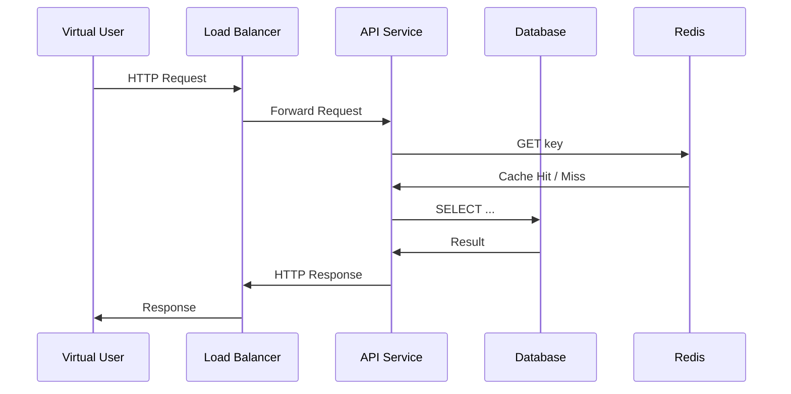

<!-- Generated by Groq via GitHub Actions -->
<!-- Topic ID: T228 -->
<!-- Category: Performance Engineering -->
<!-- Generated at UTC: 2026-11-18T21:30:38.794719+00:00 -->

# Load testing

## 1. What problem does this solve?

Load testing is the practice of simulating real‑world traffic against a system to understand how it behaves under pressure.  
- **Problem**: A backend that works fine with a handful of users can break when thousands or millions hit it at once.  
- **Why it matters**: Without knowing the limits, you risk outages, slow responses, or data corruption when traffic spikes.  
- **Consequences of ignoring it**:  
  - Unplanned downtime during launch or marketing events.  
  - Poor user experience (timeouts, 5xx errors).  
  - Hidden resource leaks that only appear under load.  
- **Real‑world appearance**:  
  - E‑commerce sites load‑test checkout flows before holiday sales.  
  - SaaS platforms test API rate limits before a new feature release.  
  - Microservice architectures use load tests to validate circuit‑breaker thresholds.

## 2. Mental model

**Analogy**: Think of a highway. A single lane can handle a few cars per minute, but as traffic grows you need more lanes or better traffic lights. Load testing is like driving a car through the highway at increasing speeds to see when traffic jams form.

**Engineering model**:  
- **Load** = number of concurrent users or requests per second.  
- **Capacity** = the maximum load the system can sustain while meeting SLAs.  
- **Stress point** = the first component that fails (DB, cache, network).  
- **Throughput** = requests processed per second.  
- **Latency** = time from request to response.  
- **Error rate** = percentage of failed requests.

## 3. Deep explanation

### Internals
- **Virtual users**: simulated clients that send requests.  
- **Ramp‑up**: gradually increase users to avoid sudden spikes.  
- **Metrics collection**: latency, error rate, CPU/memory, DB query times.  
- **Distributed test agents**: run tests from multiple machines to generate realistic traffic.

### Important terminology
- **Throughput (TPS)** – transactions per second.  
- **Concurrency** – number of active requests.  
- **SLA** – Service Level Agreement (e.g., 99.9% uptime).  
- **Burst** – short spikes in traffic.  
- **Saturation point** – load where latency starts to rise sharply.

### Trade‑offs
- **Realism vs. control**: Simulating real user behavior (e.g., think‑time) vs. pure request bursts.  
- **Cost**: Running many agents or cloud instances can be expensive.  
- **Granularity**: Fine‑grained metrics (per‑endpoint) vs. aggregate stats.

### Failure modes
- **Resource exhaustion**: CPU, memory, DB connections.  
- **Queue back‑pressure**: message brokers or async workers overflow.  
- **Cache stampede**: many clients hit a cache miss simultaneously.  
- **Network bottlenecks**: limited bandwidth or misconfigured load balancers.

### Limitations
- **Not a substitute for chaos engineering**: Load tests focus on steady traffic, not random failures.  
- **Cold starts**: Serverless functions may behave differently under load.  
- **Environment drift**: Staging environments may not match production capacity.

### Where it fits
- **CI/CD pipelines**: Run a quick load test after each merge.  
- **Pre‑deployment**: Validate new releases.  
- **Post‑deployment**: Monitor performance drift.

### Interaction with related concepts
- **Auto‑scaling**: Load tests help set thresholds.  
- **Circuit breakers**: Identify when to trip.  
- **Caching**: Validate cache hit ratios under load.  
- **Rate limiting**: Test limits and back‑off strategies.

## 4. How it works

1. **Define the target** – API endpoint, database query, or full user flow.  
2. **Model user behavior** – think‑time, request patterns, data payloads.  
3. **Set ramp‑up** – e.g., 10 users per second for 5 min.  
4. **Run test agents** – distribute across machines or cloud instances.  
5. **Collect metrics** – latency, error rate, system resource usage.  
6. **Analyze** – identify bottlenecks, calculate capacity.  
7. **Iterate** – optimize code, infrastructure, or configuration.  
8. **Validate** – re‑run to confirm improvements.



## 5. Practical implementation

### Node.js example with k6 (JavaScript)

```bash
npm install -g k6
```

```javascript
// load-test.js
import http from 'k6/http';
import { check, sleep } from 'k6';

export let options = {
  stages: [
    { duration: '1m', target: 50 },   // ramp up to 50 users
    { duration: '3m', target: 50 },   // steady state
    { duration: '1m', target: 0 },    // ramp down
  ],
  thresholds: {
    http_req_duration: ['p(95)<500'], // 95% requests < 500ms
    http_req_failed: ['rate<0.01'],   // <1% failures
  },
};

export default function () {
  const res = http.get('https://api.example.com/users/123');
  check(res, {
    'status was 200': (r) => r.status === 200,
    'body contains name': (r) => r.body.includes('name'),
  });
  sleep(1); // think time
}
```

Run:

```bash
k6 run load-test.js
```

### PostgreSQL load test with pgbench

```bash
pgbench -i -s 10 mydb   # initialize with scale factor 10
pgbench -c 50 -j 4 -T 300 mydb
```

### Redis load test with redis-benchmark

```bash
redis-benchmark -t set,get -n 100000 -q
```

## 6. Production considerations

| Concern | What to watch | Mitigation |
|---------|---------------|------------|
| **Scalability** | Auto‑scaling thresholds | Use load‑test data to set CPU/Memory triggers |
| **Reliability** | Circuit breakers, retries | Test failure scenarios (e.g., DB down) |
| **Security** | DoS protection | Rate limit, WAF, IP filtering |
| **Observability** | Distributed tracing, metrics | Instrument with OpenTelemetry, Prometheus |
| **Performance** | GC pauses, JIT warm‑up | Profile with `clinic.js`, use worker threads |
| **Error handling** | 5xx spikes | Graceful degradation, fallback |
| **Resource usage** | Memory leaks | Leak detection tools, memory snapshots |
| **Operational** | Test scheduling, data cleanup | CI pipelines, test data isolation |
| **Failure recovery** | Rollback, canary releases | Blue/green deployments |
| **Deployment** | Staging parity | Same environment, same config |

## 7. Common mistakes

| Mistake | Why it’s bad |
|---------|--------------|
| **Using a single machine for all load** | Underestimates network bottlenecks, cannot generate realistic traffic. |
| **Ignoring think‑time** | Over‑estimates concurrency, leads to false positives. |
| **Not cleaning test data** | Subsequent tests see stale state, skewed results. |
| **Treating 95th percentile as the only metric** | Ignores tail latency that hurts UX. |
| **Skipping error thresholds** | 0% errors in test but real traffic has failures. |
| **Assuming test equals production** | Differences in caching, CDN, or external services. |
| **Running tests in production** | Risk of affecting real users. |
| **Not monitoring system resources** | Misses CPU/memory bottlenecks. |

## 8. Senior engineer perspective

### What changes at scale
- **Distributed test agents**: Use cloud autoscaling to generate millions of requests.  
- **Realistic data sets**: Use production‑grade data, not synthetic.  
- **Multi‑region testing**: Simulate global traffic.  
- **Service mesh observability**: Capture per‑service latency.  
- **Chaos integration**: Combine load with fault injection.

### Design decisions
- **Architecture**: Decide between monolith vs. microservices; each component may need separate tests.  
- **Bottlenecks**: Identify whether CPU, I/O, or network is limiting.  
- **Failure scenarios**: Test cascading failures, e.g., DB partition.  
- **Monitoring**: Set up dashboards for latency, error rate, resource usage.  
- **Cost/performance**: Balance test depth with cloud spend.  
- **When NOT to use**: If the system is purely event‑driven with negligible request latency, focus on throughput instead of latency.

## 9. Interview questions

1. **Beginner**: *What is the difference between load testing and stress testing?*  
   *Answer*: Load testing measures performance under expected traffic; stress testing pushes beyond limits to find breaking points.

2. **Beginner**: *Why is think‑time important in a load test?*  
   *Answer*: It simulates real user pause between actions, preventing unrealistic concurrency and giving a more accurate load profile.

3. **Senior**: *How would you design a load test for a microservice that depends on an external payment gateway?*  
   *Answer*: Use a mock or stub for the gateway, isolate the service, test with realistic payloads, and measure latency and error propagation.

4. **Senior**: *Explain how you would use load testing results to configure auto‑scaling for a Node.js API behind a Kubernetes cluster.*  
   *Answer*: Identify CPU/Memory thresholds where latency rises, set HPA (Horizontal Pod Autoscaler) to trigger when metrics exceed those thresholds, validate with further tests.

5. **Scenario/Debugging**: *During a load test, you notice latency spikes after 10 minutes, but CPU usage stays low. What could be causing this?*  
   *Answer*: Possible causes: memory leaks, GC pauses, connection pool exhaustion, or external resource throttling. Investigate heap usage, GC logs, and external service limits.

## 10. Hands‑on task

Create a simple Express API that reads from PostgreSQL and caches results in Redis.  
1. Write a load test with k6 that simulates 200 concurrent users for 5 minutes.  
2. Measure latency and error rate.  
3. Identify the bottleneck (DB vs. cache vs. Node.js).  
4. Optimize by adding a connection pool, increasing Redis read replicas, or using async/await.  
5. Re‑run the test and document the improvement.

## 11. Quick revision

- Load testing simulates realistic traffic to find capacity limits.  
- Key metrics: throughput, latency, error rate, resource usage.  
- Think‑time models real user pauses.  
- Ramp‑up avoids sudden spikes.  
- Distributed agents generate realistic load.  
- Use thresholds to enforce SLAs.  
- Monitor system resources to locate bottlenecks.  
- Combine with chaos engineering for resilience.  
- Auto‑scaling decisions rely on load‑test data.  
- Avoid running tests in production; use isolated environments.

## 12. References

- [k6 Documentation](https://k6.io/docs/)  
- [pgbench – PostgreSQL Benchmark](https://www.postgresql.org/docs/current/pgbench.html)  
- [redis-benchmark](https://redis.io/docs/management/benchmark/)  
- [OpenTelemetry for Node.js](https://opentelemetry.io/docs/instrumentation/node/)  
- [Prometheus Node Exporter](https://prometheus.io/docs/guides/node-exporter/)  
- [AWS Auto Scaling for Kubernetes](https://docs.aws.amazon.com/eks/latest/userguide/auto-scaling.html)
