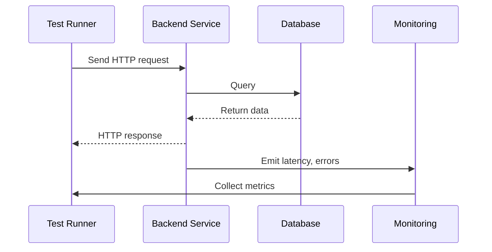

<!-- Generated by Groq via GitHub Actions -->
<!-- Topic ID: T229 -->
<!-- Category: Performance Engineering -->
<!-- Generated at UTC: 2026-11-19T08:58:32.663849+00:00 -->

# Stress testing

## 1. What problem does this solve?

Stress testing is a systematic way to **push a system beyond its expected load** to discover how it behaves under extreme conditions.  
It answers questions like:

- *What is the maximum number of concurrent users the API can handle before it starts failing?*  
- *Which component becomes the bottleneck when traffic spikes?*  
- *How does the system recover after a sudden drop in resources?*

### What problem exists
- **Unpredictable traffic spikes** (e.g., a viral post, a flash sale, a security breach) can overwhelm a backend.  
- **Hidden resource limits** (CPU, memory, database connections, network bandwidth) may not surface under normal load tests.  
- **Race conditions and concurrency bugs** often only appear when many requests hit the same code path simultaneously.

### Why the problem matters
- **Downtime** costs revenue, erodes user trust, and may violate SLAs.  
- **Data corruption** can occur if transactions are not properly isolated under load.  
- **Security vulnerabilities** (e.g., denial‑of‑service, privilege escalation) can be exposed when the system is under stress.

### What happens if this concept is not used
- The system may crash silently, leading to silent data loss.  
- Performance regressions go unnoticed until a real‑world incident occurs.  
- Architects lack visibility into which parts of the stack need scaling or refactoring.

### Where this concept appears in real backend systems
- **E‑commerce checkout**: stress tests simulate thousands of concurrent purchases during a sale.  
- **Social media feeds**: load spikes when a celebrity posts.  
- **Financial trading platforms**: thousands of orders per second during market openings.  
- **AI inference services**: many concurrent inference requests can exhaust GPU memory.

---

## 2. Mental model

### Simple analogy
Think of a **water pipe system**.  
- The **pipe** is your application stack.  
- **Water pressure** represents traffic load.  
- **Leaks** are failures (timeouts, crashes).  
- **Stress testing** is like gradually increasing the water pressure until the pipe bursts or leaks, so you know the maximum safe pressure and where the pipe is weak.

### Precise engineering model
- **Load** → **Requests per second (RPS)**, concurrent users, or message throughput.  
- **Capacity** → The maximum RPS the system can sustain while meeting SLA thresholds (latency, error rate).  
- **Bottleneck** → The component that first reaches its limit (CPU, DB connection pool, queue depth).  
- **Recovery** → How the system behaves when the load suddenly drops (resource deallocation, graceful shutdown).

---

## 3. Deep explanation

### Internals
1. **Request generator** (e.g., k6, artillery, Locust) creates synthetic traffic.  
2. **Target system** receives requests, processes them, and returns responses.  
3. **Metrics collector** (Prometheus, Grafana, built‑in test reporters) aggregates latency, error rates, resource usage.  
4. **Analysis** identifies thresholds where performance degrades.

### Important terminology
- **Throughput** – requests processed per second.  
- **Latency** – time from request sent to response received.  
- **Error rate** – percentage of failed requests.  
- **Saturation point** – load at which latency or error rate spikes.  
- **Ramp‑up** – gradually increasing load to avoid sudden spikes.  
- **Steady‑state** – period where load is constant, used for measurement.  
- **Burst** – short, high‑volume traffic spikes.

### Trade‑offs
| Aspect | Trade‑off |
|--------|-----------|
| **Realism vs. speed** | Simpler scripts run faster but may miss edge cases. |
| **Scope** | Full‑stack tests (frontend + backend) are more realistic but slower to run. |
| **Instrumentation** | Heavy instrumentation (e.g., tracing) gives more insight but adds overhead. |
| **Cost** | Running tests on cloud infrastructure can be expensive; local tests may miss cloud‑specific limits. |

### Failure modes
- **Resource exhaustion** (CPU, memory, file descriptors).  
- **Connection pool exhaustion** (DB, Redis).  
- **Queue back‑pressure** (Kafka, RabbitMQ).  
- **Cache stampedes** (many requests miss the cache simultaneously).  
- **Race conditions** leading to data corruption.  
- **Timeouts** that cascade into cascading failures.

### Limitations
- **Synthetic traffic may not match real user behavior** (e.g., session persistence, varied payloads).  
- **Infrastructure differences** (local vs. production) can skew results.  
- **Limited to what you can instrument** – hidden micro‑services or third‑party APIs may not be testable.  
- **Statistical noise** – need enough samples to get reliable metrics.

### Where this concept fits in a backend architecture
- **Performance testing layer** sits above the application layer, often integrated into CI/CD pipelines.  
- **Observability stack** (metrics, logs, traces) feeds into the test results.  
- **Scaling layer** (auto‑scaling groups, Kubernetes HPA) uses stress test data to set thresholds.

### Interaction with related backend concepts
- **Load balancing**: Stress tests reveal if a load balancer can distribute traffic evenly.  
- **Caching**: Helps identify cache miss patterns and TTL tuning.  
- **Database sharding/replication**: Stress tests can expose replication lag under load.  
- **Circuit breakers**: Verify that they trip at the right thresholds.  
- **Rate limiting**: Ensure limits are enforced without causing unnecessary failures.

---

## 4. How it works

1. **Define the target** – API endpoint, message queue, or database operation.  
2. **Create a test script** – specify RPS, concurrency, payload, and duration.  
3. **Configure monitoring** – expose Prometheus metrics, log aggregation, or use built‑in reporters.  
4. **Run the test** – gradually ramp up load, hold steady, then ramp down.  
5. **Collect metrics** – latency percentiles, error rates, resource usage.  
6. **Analyze** – plot curves, identify saturation points, correlate with system logs.  
7. **Iterate** – adjust code, infrastructure, or configuration, then retest.



---

## 5. Practical implementation

Below is a minimal **Node.js + Express** API and a **k6** stress test script.

### 5.1 Backend – `server.ts`

```ts
// server.ts
import express from 'express';
import { Pool } from 'pg';
import { RedisClient } from 'redis';
import { promisify } from 'util';

const app = express();
const port = 3000;

// PostgreSQL pool
const pool = new Pool({
  connectionString: process.env.DATABASE_URL,
});

// Redis client
const redis = new RedisClient({ url: process.env.REDIS_URL });
const getAsync = promisify(redis.get).bind(redis);
const setAsync = promisify(redis.set).bind(redis);

app.get('/user/:id', async (req, res) => {
  const id = req.params.id;

  // Try cache first
  const cacheKey = `user:${id}`;
  const cached = await getAsync(cacheKey);
  if (cached) {
    return res.json(JSON.parse(cached));
  }

  // Fallback to DB
  const { rows } = await pool.query('SELECT * FROM users WHERE id = $1', [id]);
  const user = rows[0];

  // Cache result for 60s
  await setAsync(cacheKey, JSON.stringify(user), 'EX', 60);

  res.json(user);
});

app.listen(port, () => {
  console.log(`Server listening on http://localhost:${port}`);
});
```

> **Important lines**  
> *Cache lookup* (`getAsync`) reduces DB load.  
> *Cache set* (`setAsync`) with TTL prevents stale data.  
> *Pool query* ensures connection reuse.

### 5.2 Stress test – `stress.js` (k6)

```js
// stress.js
import http from 'k6/http';
import { check, sleep } from 'k6';

export let options = {
  stages: [
    { duration: '1m', target: 100 },   // ramp up to 100 VUs
    { duration: '3m', target: 100 },   // steady state
    { duration: '1m', target: 0 },     // ramp down
  ],
  thresholds: {
    http_req_duration: ['p(95)<200'], // 95% requests < 200ms
    http_req_failed: ['rate<0.01'],   // <1% failures
  },
};

export default function () {
  const id = Math.floor(Math.random() * 1000) + 1;
  const res = http.get(`http://localhost:3000/user/${id}`);

  check(res, {
    'status was 200': (r) => r.status === 200,
    'body contains id': (r) => r.json('id') == id,
  });

  sleep(1);
}
```

Run the test:

```bash
k6 run stress.js
```

k6 will output real‑time metrics and a final report.  
You can also export to InfluxDB/Prometheus for Grafana dashboards.

---

## 6. Production considerations

| Concern | What to watch for | Mitigation |
|---------|-------------------|------------|
| **Scalability** | Auto‑scaling thresholds may be set too low/too high. | Use stress test data to set realistic CPU/Memory limits. |
| **Reliability** | Circuit breakers may trip too early or too late. | Tune thresholds based on observed error rates. |
| **Security** | Attack‑like traffic can expose vulnerabilities. | Run tests in isolated environments; use rate limiting. |
| **Observability** | Metrics may be noisy under load. | Aggregate metrics, use percentile metrics, enable tracing. |
| **Performance** | Cache warm‑up can skew results. | Warm caches before steady‑state phase. |
| **Error handling** | Unhandled exceptions under load can crash workers. | Use process managers (PM2, systemd) with graceful restarts. |
| **Resource usage** | Connection pools may exhaust. | Configure pool size, use connection pool metrics. |
| **Operational concerns** | Running tests on production can affect real users. | Use dedicated test clusters or blue‑green deployments. |
| **Failure recovery** | Long‑running transactions may lock tables. | Use proper isolation levels, monitor lock waits. |
| **Deployment considerations** | New releases may change performance characteristics. | Integrate stress tests into CI/CD; gate merges on passing tests. |

---

## 7. Common mistakes

| Mistake | Why it’s problematic |
|---------|----------------------|
| **Running tests on a single machine** | Misses network bottlenecks, load balancer limits, and multi‑node scaling issues. |
| **Ignoring latency percentiles** | Focusing only on average latency hides tail latency that hurts user experience. |
| **Using hard‑coded user IDs** | Creates cache stampedes; real traffic uses varied IDs. |
| **Skipping ramp‑up** | Sudden spikes can cause false positives; ramp‑up reveals true saturation. |
| **Not cleaning up resources** | Left‑over connections or cache entries skew subsequent tests. |
| **Assuming test results equal production** | Differences in data volume, network latency, and third‑party services can change behavior. |
| **Over‑optimizing for a single metric** | E.g., only minimizing latency may increase error rates; balance is key. |
| **Ignoring error thresholds** | A system with low latency but high error rate is unusable. |

---

## 8. Senior engineer perspective

### What changes at scale
- **Distributed tracing** becomes essential to pinpoint bottlenecks across services.  
- **Horizontal scaling** of stateless services and **sharding** of stateful stores (PostgreSQL, Redis) must be validated.  
- **Chaos engineering** complements stress tests by injecting failures (network partitions, node restarts).

### Design decisions
- **Service decomposition**: micro‑services vs. monolith; stress tests help decide which boundaries are needed.  
- **Resource quotas**: set per‑pod CPU/memory limits based on stress test data.  
- **Caching strategy**: decide between local in‑process cache vs. distributed cache; evaluate cache stampede mitigation.  
- **Database connection pooling**: tune pool size per service; monitor `pg_stat_activity`.  
- **Queue back‑pressure**: set consumer limits and prefetch sizes to avoid overwhelming downstream services.

### Trade‑offs
- **Cost vs. performance**: more replicas reduce latency but increase cloud spend.  
- **Latency vs. consistency**: eventual consistency may allow higher throughput but requires careful handling.  
- **Simplicity vs. observability**: adding instrumentation adds overhead; balance is needed.

### Bottlenecks
- **Single‑point services** (e.g., auth server) can become choke points.  
- **Database locks**: long transactions can block others under load.  
- **Network I/O**: egress limits on cloud VPCs can throttle traffic.

### Failure scenarios
- **Resource exhaustion**: monitor `node:process.memoryUsage()` and `os.loadavg()`.  
- **Cache invalidation storms**: use cache warming and TTL decay.  
- **Queue overload**: implement back‑pressure and retry policies.

### Monitoring
- **Latency percentiles** (`p90`, `p95`, `p99`).  
- **Error rates** per endpoint.  
- **Resource utilization** (CPU, memory, disk I/O).  
- **Queue depth** and **consumer lag**.  
- **Circuit breaker status**.

### Cost/performance considerations
- Run tests on **spot instances** or **on‑prem clusters** to reduce cost.  
- Use **incremental testing**: start with small loads, scale gradually.  
- Leverage **cloud autoscaling** metrics derived from stress tests.

### When NOT to use the approach
- **Highly dynamic workloads** where traffic patterns are unpredictable and cannot be modeled.  
- **Very small services** where the overhead of a full stress test outweighs benefits.  
- **Legacy monoliths** that cannot be instrumented easily; consider targeted unit tests instead.

---

## 9. Interview questions

| Level | Question | Key answer points |
|-------|----------|-------------------|
| Beginner | What is the difference between load testing and stress testing? | Load testing measures performance under expected load; stress testing pushes beyond limits to find breaking points. |
| Beginner | Why do we use ramp‑up in stress tests? | Prevents sudden spikes that can cause false positives; helps identify true saturation point. |
| Senior | How would you design a stress test for a micro‑service that uses both PostgreSQL and Redis? | Include DB queries, cache hits/misses, connection pool limits; monitor `pg_stat_activity`, Redis `INFO`. |
| Senior | Explain how you would use the results of a stress test to set auto‑scaling thresholds in Kubernetes. | Map CPU/memory usage at saturation to pod limits; use HPA metrics; consider request latency and error rate thresholds. |
| Scenario | A production API starts returning 500 errors when traffic spikes. How would you debug this using stress testing? | Reproduce spike locally, monitor logs, trace latency, check resource limits, identify which component (DB, cache, external API) is failing, adjust thresholds or add retries. |

---

## 10. Hands‑on task

**Task:** Add a new endpoint `/stats` to the `server.ts` that returns current memory usage, active DB connections, and Redis cache hit ratio. Then write a k6 script that:

1. Calls `/stats` every 2 seconds.  
2. Calls `/user/:id` with random IDs.  
3. Runs for 5 minutes with a ramp‑up to 200 virtual users.  
4. Exports metrics to InfluxDB and visualizes them in Grafana.

**Goal:** Observe how the `/stats` endpoint reflects system strain and use the data to adjust your stress test thresholds.

---

## 11. Quick revision

- Stress testing pushes a system beyond expected load to find breaking points.  
- **Key metrics:** throughput, latency percentiles, error rate, resource usage.  
- **Ramp‑up** is essential to avoid false positives.  
- **Cache stampedes** occur when many requests miss the cache simultaneously.  
- **Connection pool limits** often become bottlenecks before CPU.  
- **Distributed tracing** helps locate bottlenecks across services.  
- **Observability**: monitor latency, errors, and resource metrics together.  
- **Common mistakes:** single‑machine tests, ignoring tail latency, hard‑coded data.  
- **Senior decisions:** choose between monolith and micro‑services, set autoscaling thresholds, balance cost vs. performance.  
- **Interview tip:** explain how you would use test data to set real‑world scaling policies.

---

## 12. References

- https://k6.io/docs/  
- https://docs.docker.com/compose/  
- https://nodejs.org/api/process.html  
- https://node-postgres.com/  
- https://redis.io/docs/  
- https://prometheus.io/docs/introduction/overview/  
- https://grafana.com/docs/grafana/latest/  
- https://kubernetes.io/docs/tasks/run-application/horizontal-pod-autoscale/  

---
