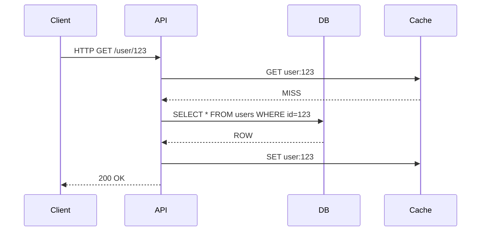

<!-- Generated by Groq via GitHub Actions -->
<!-- Topic ID: T230 -->
<!-- Category: Performance Engineering -->
<!-- Generated at UTC: 2026-11-19T08:58:32.663849+00:00 -->

# Benchmarking

## 1. What problem does this solve?

**Motivation**  
In a production backend you have a lot of moving parts: HTTP handlers, database queries, caching layers, background workers, external APIs, and sometimes AI inference services. Each of these layers can become a bottleneck. Without a systematic way to measure *how fast* each part actually runs, you risk:

- **Over‑provisioning**: buying more servers or resources than needed because you think the system is slow when it’s actually fine.
- **Under‑provisioning**: scaling too late because you didn’t notice a performance regression early.
- **Mis‑diagnosis**: attributing latency to the wrong layer (e.g., blaming a database when the real culprit is a slow external API call).

**Why it matters**  
- **Cost**: Cloud resources are billed per CPU, memory, and I/O. Unnecessary scaling inflates bills.
- **User experience**: Latency directly impacts perceived quality; a 200 ms increase can reduce conversion rates.
- **Reliability**: Knowing the limits of each component lets you set realistic SLAs and design graceful degradation.

**Consequences of not using benchmarking**  
- Blindly adding more replicas or upgrading hardware.
- Missing subtle regressions introduced by a new feature or library update.
- Inability to prove performance claims to stakeholders or auditors.

**Real‑world appearance**  
- API gateways measuring request latency before routing.
- Database connection pools monitoring query times.
- CI pipelines running micro‑benchmarks after each commit.
- A/B testing platforms comparing latency of two service versions.

---

## 2. Mental model

**Analogy**  
Think of a factory assembly line. Each station (cutting, welding, painting) has a *cycle time*. If one station is slow, the whole line slows down. Benchmarking is like measuring the cycle time of each station to identify the bottleneck.

**Engineering model**  
- **Instrumentation**: Insert timers around code blocks.
- **Measurement**: Run the instrumented code under realistic load.
- **Analysis**: Aggregate metrics (min, max, mean, percentiles) to spot outliers.
- **Optimization**: Refactor the slowest part, then re‑benchmark.

---

## 3. Deep explanation

| Topic | Explanation |
|-------|-------------|
| **Internals** | Benchmarks capture *execution time*, *memory usage*, *CPU cycles*, and *I/O waits*. In Node.js, the V8 engine exposes high‑resolution timers (`process.hrtime.bigint()`), and the `async_hooks` module can track async resource lifetimes. |
| **Important terminology** | • **Throughput** – requests per second.<br>• **Latency** – time to complete a single request.<br>• **Percentiles** – e.g., 95th percentile latency.<br>• **Cold start** – first invocation after a restart.<br>• **Warm start** – subsequent invocations. |
| **Trade‑offs** | • **Accuracy vs. overhead**: Instrumentation can add latency; choose lightweight timers for production.<br>• **Realism vs. control**: Synthetic benchmarks are fast but may miss real‑world contention; load‑testing tools (wrk, k6) simulate traffic but require infrastructure. |
| **Failure modes** | • **Non‑deterministic results**: GC pauses, V8 optimizations, or network jitter can skew data.<br>• **Sampling bias**: Benchmarking only a subset of inputs may miss edge cases.<br>• **Resource exhaustion**: Running a benchmark on the same machine as production can cause false positives. |
| **Limitations** | • Benchmarks measure *what* happens, not *why* it happens. They need to be paired with profiling.<br>• They cannot fully capture distributed system effects (e.g., network partitions). |
| **Architecture fit** | • **Micro‑benchmarks**: Inline timers in a single service.<br>• **Load‑testing**: Separate load generator services.<br>• **Continuous benchmarking**: CI pipelines that run after each commit. |
| **Interaction with related concepts** | • **Profiling**: Use `clinic.js` or `node --inspect` for deeper insights.<br>• **Tracing**: OpenTelemetry traces can be aggregated with latency metrics.<br>• **Caching**: Benchmark cache hit vs. miss paths.<br>• **Database tuning**: Benchmark query plans before deployment. |

---

## 4. How it works

1. **Identify the target** – e.g., a Next.js API route that queries PostgreSQL.  
2. **Instrument** – wrap the handler with timers and log metrics.  
3. **Run under load** – use a tool like `wrk` or `k6` to hit the endpoint.  
4. **Collect metrics** – aggregate latency, throughput, error rates.  
5. **Analyze** – compare against baseline, look for regressions.  
6. **Iterate** – refactor the slowest part, re‑benchmark.



---

## 5. Practical implementation

### 5.1 Node.js micro‑benchmark of an API route

```ts
// src/benchmark.ts
import express from 'express';
import { performance } from 'perf_hooks';
import { Pool } from 'pg';

const app = express();
const pool = new Pool({
  connectionString: process.env.DATABASE_URL,
});

app.get('/user/:id', async (req, res) => {
  const start = performance.now();

  // Simulate a cache miss
  const user = await pool.query(
    'SELECT id, name, email FROM users WHERE id = $1',
    [req.params.id]
  );

  const latency = performance.now() - start;
  console.log(`Latency: ${latency.toFixed(2)} ms`);

  res.json(user.rows[0]);
});

const PORT = 3000;
app.listen(PORT, () => console.log(`Listening on ${PORT}`));
```

Run the server:

```bash
node src/benchmark.ts
```

### 5.2 Load‑testing with `wrk`

```bash
wrk -t4 -c100 -d30s http://localhost:3000/user/1
```

`wrk` will report:

- **Requests/sec** (throughput)
- **Latency** (mean, 95th percentile)
- **Transfer** (bytes/sec)

### 5.3 Benchmarking a Redis cache hit/miss

```ts
import { createClient } from 'redis';

const client = createClient();
await client.connect();

async function getUser(id: string) {
  const start = performance.now();
  const cached = await client.get(`user:${id}`);
  if (cached) {
    console.log(`Cache hit in ${performance.now() - start} ms`);
    return JSON.parse(cached);
  }
  // Simulate DB fetch
  const user = { id, name: 'Alice' };
  await client.set(`user:${id}`, JSON.stringify(user), {
    EX: 60, // 1 minute TTL
  });
  console.log(`Cache miss + DB fetch in ${performance.now() - start} ms`);
  return user;
}
```

---

## 6. Production considerations

| Concern | How benchmarking informs it |
|---------|-----------------------------|
| **Scalability** | Identify the maximum requests per second before latency spikes; plan horizontal scaling. |
| **Reliability** | Detect outliers that could trigger timeouts or circuit breakers. |
| **Security** | Ensure that benchmarking does not expose sensitive data; use sanitized inputs. |
| **Observability** | Store latency metrics in Prometheus; alert on 95th percentile > threshold. |
| **Performance** | Pinpoint GC pauses or V8 deoptimizations; adjust `--max-old-space-size`. |
| **Error handling** | Correlate error rates with latency spikes to find root causes. |
| **Resource usage** | Measure memory and CPU per request to set proper container limits. |
| **Operational concerns** | Run benchmarks in a dedicated staging environment; avoid affecting live traffic. |
| **Failure recovery** | Use benchmark data to design fallback paths (e.g., serve stale cache). |
| **Deployment** | Include a post‑deployment benchmark step in CI/CD to catch regressions. |

---

## 7. Common mistakes

| Mistake | Why it’s problematic |
|---------|----------------------|
| **Benchmarking in production** | Adds noise, can cause outages, and may violate SLA. |
| **Ignoring cold starts** | Failing to benchmark the first request after a restart can hide latency spikes. |
| **Using too few samples** | Small sample size leads to high variance; percentiles become unreliable. |
| **Benchmarking only happy paths** | Edge cases (e.g., missing data, large payloads) may be the real bottleneck. |
| **Assuming single‑threaded CPU is the bottleneck** | In Node.js, I/O and GC often dominate; focus on async patterns. |
| **Not resetting state between runs** | Cached data can mask true performance of a fresh request. |
| **Treating micro‑benchmarks as end‑to‑end** | Micro‑benchmarks ignore network latency and load‑balancing overhead. |
| **Over‑optimizing early** | Premature micro‑optimizations can make code harder to maintain. |

---

## 8. Senior engineer perspective

### What changes at scale?

- **Distributed tracing**: Combine latency metrics with OpenTelemetry traces to see end‑to‑end paths across services.
- **Sampling strategy**: Instead of measuring every request, sample a percentage to reduce overhead.
- **Load‑testing infrastructure**: Use dedicated load generators (k6 Cloud, Artillery) that can simulate millions of users.
- **Cost‑performance trade‑offs**: Decide whether to pay for faster instances or more replicas based on benchmark data.
- **Chaos engineering**: Inject latency or failures to see how the system behaves under stress.

### Design decisions

| Decision | Trade‑offs |
|----------|------------|
| **Cache strategy** | Cache hit ratio vs. memory cost. |
| **Database sharding** | Complexity vs. query latency. |
| **Batching vs. single requests** | Throughput vs. latency. |
| **Circuit breaker thresholds** | Avoid cascading failures vs. false positives. |
| **Service mesh** | Observability vs. added latency. |

### Bottlenecks & monitoring

- **GC pauses**: Monitor `node --trace-gc` logs; set `--max-old-space-size`.
- **Database connection limits**: Track `pg` pool metrics; increase `max` if saturated.
- **Network latency**: Use `ping` and `traceroute` between containers; monitor `latency` in Prometheus.
- **CPU saturation**: `top` or `htop` inside containers; set `cpu_quota`.

### When NOT to use benchmarking

- **During rapid prototyping**: Focus on functionality; performance can be revisited later.
- **For trivial, low‑traffic services**: The cost of benchmarking may outweigh benefits.
- **When the system is already well‑optimized**: Incremental gains may be negligible.

---

## 9. Interview questions

1. **Beginner**: *What is the difference between latency and throughput?*  
   *Answer*: Latency is the time to complete a single request; throughput is the number of requests processed per second.

2. **Beginner**: *Why do we use `process.hrtime.bigint()` instead of `Date.now()` for benchmarking in Node.js?*  
   *Answer*: `process.hrtime.bigint()` provides nanosecond precision and is not affected by system clock changes, giving more accurate timing.

3. **Senior**: *Describe how you would design a benchmark suite for a microservice that interacts with both a PostgreSQL database and an external AI inference API.*  
   *Answer*: Separate micro‑benchmarks for database queries (using `pg` pool) and external API calls (mocking vs. real). Use `wrk` or `k6` to generate load, collect latency percentiles, and run in a CI pipeline. Include cold‑start tests and cache‑hit/miss scenarios.

4. **Senior**: *How do you mitigate the impact of garbage collection on Node.js benchmark results?*  
   *Answer*: Run benchmarks with `--max-old-space-size` tuned, use `--expose-gc` to manually trigger GC, monitor GC pause times, and consider using `node --trace-gc` or `clinic.js`. Use sampling and multiple runs to average out GC effects.

5. **Scenario/Debugging**: *Your API’s 95th percentile latency jumps from 120 ms to 350 ms after a recent deployment. What steps would you take to isolate the cause?*  
   *Answer*:  
   - Re‑run the benchmark locally to confirm the issue.  
   - Enable tracing (OpenTelemetry) to see where time is spent.  
   - Check for increased GC pauses or V8 deoptimizations.  
   - Verify database query plans; run `EXPLAIN ANALYZE`.  
   - Compare cache hit ratios.  
   - Look at external API latency.  
   - Roll back if necessary and investigate code changes.

---

## 10. Hands‑on task

**Task**: Add a benchmark to the existing Next.js API route `/api/user/[id]` that measures latency for both cache hit and miss scenarios.

1. **Create a new script** `scripts/benchmarkUser.ts`.  
2. Use `node --experimental-modules` to run it.  
3. The script should:
   - Make 100 requests to `/api/user/1` with a 50 % cache hit ratio (toggle a flag in the API).  
   - Record latency for each request.  
   - Output mean, 95th percentile, and max latency.  
4. Commit the script and run it locally.  
5. Document the results in a markdown file.

---

## 11. Quick revision

- Benchmarking measures *execution time* and *resource usage* under realistic load.  
- **Latency** vs. **throughput**; focus on percentiles for real‑world performance.  
- Use high‑resolution timers (`process.hrtime.bigint()`) in Node.js.  
- Separate micro‑benchmarks (code blocks) from load‑testing (full request flow).  
- Run benchmarks in isolated environments; avoid production.  
- Combine metrics with tracing and profiling for root‑cause analysis.  
- Watch for GC pauses, cold starts, and cache hit ratios.  
- Automate benchmarks in CI/CD to catch regressions early.  
- Scale decisions: horizontal scaling vs. faster instances; use sampling to reduce overhead.  
- Common pitfalls: too few samples, ignoring edge cases, benchmarking in production.

---

## 12. References

- [Node.js Performance Tips](https://nodejs.org/en/docs/guides/performance-tips/)
- [OpenTelemetry for Node.js](https://opentelemetry.io/docs/instrumentation/node/)
- [wrk – HTTP benchmarking tool](https://github.com/wg/wrk)
- [k6 – Load testing tool](https://k6.io/docs/)
- [pg – PostgreSQL client for Node.js](https://node-postgres.com/)
- [Redis Node.js Client](https://redis.io/docs/latest/develop/sdk/node/)
- [Prometheus – Monitoring system](https://prometheus.io/docs/introduction/overview/)
- [Clinic.js – Performance profiling](https://clinicjs.org/)
