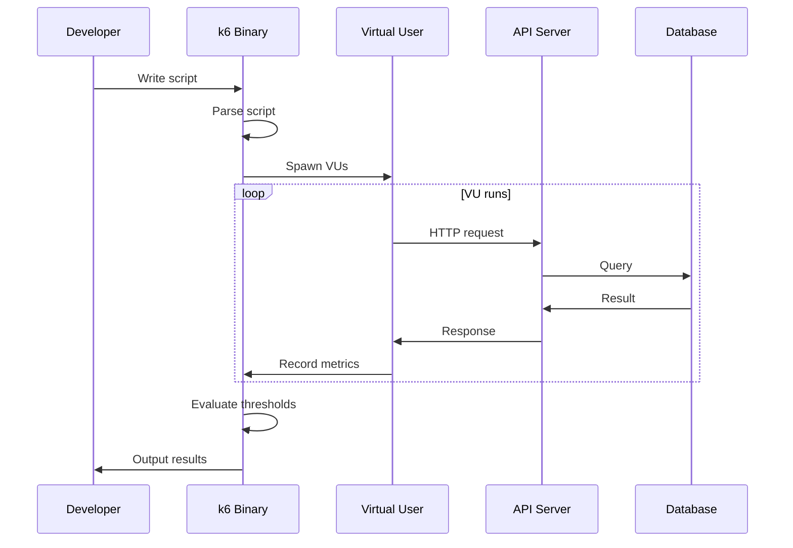

<!-- Generated by Groq via GitHub Actions -->
<!-- Topic ID: T231 -->
<!-- Category: Performance Engineering -->
<!-- Generated at UTC: 2026-11-19T21:42:42.766107+00:00 -->

# k6

## 1. What problem does this solve?

**Motivation**  
When you ship a new API, a new feature, or a database migration, you need to know *how many users* the system can handle before it starts to degrade. Manual load testing or eyeballing response times is error‑prone and does not expose hidden bottlenecks. k6 is a **performance‑testing framework** that lets you simulate realistic traffic, measure key metrics, and set hard thresholds that must be met before a release goes live.

**What problem exists**  
- Unpredictable traffic spikes (e.g., a marketing campaign, a new product launch).  
- Hidden resource limits (CPU, memory, DB connections).  
- Latency regressions introduced by new code or infrastructure changes.  
- Lack of quantitative data for capacity planning.

**Why the problem matters**  
- Poor performance leads to user churn, revenue loss, and brand damage.  
- Unplanned outages cost engineering time and can violate SLAs.  
- Without data you cannot justify scaling decisions or negotiate budgets.

**What happens if this concept is not used**  
- You may ship code that works locally but fails under load.  
- You will discover performance issues only after production incidents.  
- Capacity planning becomes guesswork, leading to over‑provisioning or under‑provisioning.

**Where this concept appears in real backend systems**  
- Continuous Integration pipelines that run load tests before merging PRs.  
- Pre‑deployment gates in GitOps workflows.  
- Monitoring dashboards that compare real‑time metrics against thresholds.  
- Capacity planning meetings that rely on load‑test results to size clusters.

---

## 2. Mental model

**Analogy**  
Think of k6 as a *traffic police officer* for your API.  
- The **virtual users (VUs)** are cars.  
- The **script** is the traffic signal that tells each car when to go, how fast, and where to turn.  
- The **backend** is the road network.  
- The **metrics** are the speed cameras that record how many cars passed, how long they took, and if any crashed.

If the traffic officer (k6) runs a simulation with 10,000 cars, you can see whether the roads (your servers, DB, cache) can handle that volume without traffic jams.

**Precise engineering model**  
- k6 is a **Go** binary that embeds the **Goja** JavaScript engine.  
- A **script** defines a set of **scenarios** (traffic patterns).  
- Each scenario spawns a number of **Virtual Users (VUs)** that execute the script concurrently.  
- VUs run in lightweight goroutines, making HTTP requests, WebSocket messages, or custom protocols.  
- k6 collects **metrics** (latency, throughput, error rates) in real time and aggregates them at the end.  
- You can set **thresholds** that fail the test if metrics exceed limits.

---

## 3. Deep explanation

### Internals
- **Go runtime**: k6 is compiled to a single binary, making it fast to start and portable.  
- **Goja**: a JavaScript engine written in Go that executes the test script.  
- **Virtual Users (VUs)**: each VU is a goroutine that runs the script in isolation.  
- **Scenarios**: declarative blocks that control how many VUs, how long they run, and how they ramp up/down.  
- **Metrics**: built‑in (http_reqs, http_req_duration, checks, data_sent, data_received) and custom.  
- **Thresholds**: functions that evaluate metrics and decide pass/fail.  
- **Output**: JSON, CSV, HTML, or real‑time dashboards via k6 Cloud or Grafana.

### Important terminology
| Term | Meaning |
|------|---------|
| **VU (Virtual User)** | Simulated user that executes the script. |
| **Iteration** | One full run of the script body. |
| **Scenario** | A named traffic pattern (e.g., ramping, constant, arrival rate). |
| **Threshold** | A condition that must hold true for the test to pass. |
| **Checks** | Assertions on response data (e.g., status code, JSON schema). |
| **Stages** | Predefined ramp‑up/down steps in a scenario. |
| **k6 Cloud** | Managed service that runs distributed load tests and visualizes results. |
| **k6 Enterprise** | Commercial edition with advanced features (distributed, CI integration). |

### Trade‑offs
| Aspect | Benefit | Drawback |
|--------|---------|----------|
| **Speed** | k6 starts in < 1 s, runs fast. | Requires Go environment for building custom extensions. |
| **Language** | Uses JavaScript (easy for most devs). | No native TypeScript support; you write plain JS. |
| **Scalability** | Can spawn thousands of VUs locally. | Local machine limits; distributed mode needed for >10k VUs. |
| **Accuracy** | Simulates real HTTP traffic, includes TLS, keep‑alive. | Does not emulate browser rendering or JavaScript execution. |

### Failure modes
- **Network errors**: DNS resolution, connection timeouts.  
- **Server errors**: 5xx responses, rate limiting.  
- **Script errors**: syntax errors, runtime exceptions.  
- **Resource exhaustion**: local machine runs out of CPU/memory.  

### Limitations
- **UI testing**: k6 cannot render pages or execute browser JS.  
- **Stateful protocols**: limited support for protocols like gRPC (requires plugins).  
- **Distributed testing**: requires k6 Cloud or Enterprise; local mode is single‑node.  

### Where it fits in a backend architecture
- **CI/CD**: run as a gate before merging.  
- **Pre‑deployment**: run against staging to validate capacity.  
- **Monitoring**: feed metrics into Prometheus/Grafana for trend analysis.  
- **Capacity planning**: use results to size clusters, set autoscaling thresholds.

### Interaction with related backend concepts
- **API Gateway**: test the gateway’s throttling and routing.  
- **Database**: measure query latency under load; combine with query profiling.  
- **Cache**: test cache hit/miss ratios.  
- **Message brokers**: test producer/consumer throughput.  
- **Observability**: integrate with tracing (OpenTelemetry) to correlate latency.

---

## 4. How it works

1. **Write a script** that defines the traffic pattern and checks.  
2. **Run k6**: the binary parses the script, spawns VUs.  
3. **VUs execute** the script concurrently, making HTTP requests.  
4. **k6 collects metrics** in real time (latency, throughput, errors).  
5. **Thresholds are evaluated** after each iteration or at the end.  
6. **Results are output** to console, file, or k6 Cloud.  
7. **If thresholds fail**, the test exits with a non‑zero status (CI can catch it).  



---

## 5. Practical implementation

Below is a minimal k6 script that tests a Next.js API endpoint (`/api/hello`).  
Save as `hello.js` and run `k6 run hello.js`.

```js
// hello.js
import http from 'k6/http';
import { check, sleep } from 'k6';
import { Trend } from 'k6/metrics';

// Custom metric to track response time
export let responseTime = new Trend('response_time');

export let options = {
  stages: [
    { duration: '30s', target: 50 },   // ramp up to 50 VUs
    { duration: '1m', target: 50 },    // stay at 50 VUs
    { duration: '30s', target: 0 },    // ramp down
  ],
  thresholds: {
    // Fail if average latency > 200ms
    'response_time{type:api}': ['avg<200'],
    // Fail if error rate > 1%
    'http_req_failed{type:api}': ['rate<0.01'],
  },
};

export default function () {
  // Target URL – use env var for flexibility
  const url = __ENV.BASE_URL || 'http://localhost:3000/api/hello';

  // Make the request
  const res = http.get(url, { tags: { type: 'api' } });

  // Record latency
  responseTime.add(res.timings.duration);

  // Simple check
  check(res, {
    'status was 200': (r) => r.status === 200,
    'body contains hello': (r) => r.body.includes('hello'),
  });

  // Pause to simulate think time
  sleep(1);
}
```

**Running locally**

```bash
# Install k6 (macOS)
brew install k6

# Run the test
k6 run hello.js
```

**Docker example**

```dockerfile
# Dockerfile.k6
FROM grafana/k6:latest
COPY hello.js /scripts/hello.js
CMD ["run", "/scripts/hello.js"]
```

```bash
docker build -t k6-hello -f Dockerfile.k6 .
docker run --rm k6-hello
```

---

## 6. Production considerations

| Concern | How k6 addresses it | Tips |
|---------|---------------------|------|
| **Scalability** | Local mode up to ~10k VUs; distributed via k6 Cloud or Enterprise. | Use k6 Cloud for >10k VUs; split tests into multiple stages. |
| **Reliability** | Tests are deterministic; can be rerun. | Pin k6 version; use CI to enforce thresholds. |
| **Security** | Avoid hardcoding secrets; use env vars or k6 Cloud secrets. | Never hit production with real credentials. |
| **Observability** | Built‑in metrics; export to Prometheus, Grafana, or k6 Cloud. | Add custom metrics for business KPIs. |
| **Performance** | k6 itself is lightweight; VUs are goroutines. | Monitor CPU/memory on test runner; use `--vus` wisely. |
| **Error handling** | Checks and thresholds catch failures early. | Log error details; use `console.log` for debugging. |
| **Resource usage** | Each VU consumes ~1–2 MB RAM. | For large VU counts, use distributed mode. |
| **Operational concerns** | CI integration, artifact storage, scheduling. | Store results in a central repo; use `k6 run --out json`. |
| **Failure recovery** | Graceful shutdown on SIGINT; cleanup hooks. | Use `setup()` and `teardown()` for test data. |
| **Deployment considerations** | Containerize k6; version lock. | Use Docker Compose to run k6 alongside services. |

---

## 7. Common mistakes

| Mistake | Why it’s problematic |
|---------|----------------------|
| **Hardcoding URLs** | Tests break when environment changes; hard to reuse. |
| **Ignoring environment variables** | Secrets leak; tests fail on CI. |
| **Setting too many VUs locally** | Causes local machine to OOM, skewing results. |
| **Not using stages** | No realistic ramp‑up; misses peak‑load behavior. |
| **Overlooking checks** | Latency may be fine but business logic errors slip through. |
| **Using `sleep` incorrectly** | Creates artificial think time that masks real concurrency. |
| **Failing to clean up test data** | Subsequent runs see stale data, affecting metrics. |
| **Treating thresholds as “good enough”** | Thresholds may be too lenient; hide regressions. |
| **Running tests against production** | Risk of DoS; violates SLAs. |
| **Ignoring distributed testing** | Local tests under‑represent real‑world load. |

---

## 8. Senior engineer perspective

### What changes at scale
- **Distributed load**: Use k6 Cloud or Enterprise to run tests across multiple nodes, simulating global traffic.  
- **Infrastructure as code**: Spin up test clusters (K8s, ECS) automatically for each test run.  
- **Performance budgets**: Tie thresholds to SLAs and cost budgets.  
- **Observability integration**: Export metrics to Prometheus, correlate with tracing (OpenTelemetry).  
- **Cost management**: Running k6 in the cloud incurs compute costs; balance test depth vs budget.

### Design decisions
- **Test environment isolation**: Use dedicated staging clusters; avoid shared DB.  
- **Data seeding**: Pre‑populate with realistic data; use fixtures or synthetic generators.  
- **Scenario design**: Model real user journeys (e.g., login → search → checkout).  
- **Threshold granularity**: Per‑endpoint thresholds vs global thresholds.  
- **Alerting**: Configure alerts for threshold breaches in Grafana.  
- **CI/CD integration**: Fail PRs if thresholds fail; gate merges.  
- **Security**: Use k6 Cloud secrets or Vault for credentials.  

### Bottlenecks & failure scenarios
- **Network**: Bandwidth limits, DNS resolution delays.  
- **Database**: Connection pool exhaustion, slow queries.  
- **Cache**: Eviction policies causing cache misses.  
- **API gateway**: Rate limiting or throttling.  
- **Third‑party services**: Latency spikes propagate downstream.  

### When NOT to use k6
- **UI/UX testing**: Requires browser rendering.  
- **Stateful, long‑running flows**: e.g., WebSocket chat; use specialized tools.  
- **Very low‑volume tests**: Unit tests or integration tests are sufficient.  

---

## 9. Interview questions

1. **Beginner**: *What is a Virtual User (VU) in k6 and how does it differ from a real user?*  
   - **Answer**: A VU is a lightweight goroutine that executes the test script; it does not render a UI or maintain a browser state. It simulates HTTP traffic only.

2. **Beginner**: *Explain what a threshold is and give an example.*  
   - **Answer**: A threshold is a condition that must be met for a test to pass, e.g., `http_req_duration{type:api} < 200` ensures average latency stays below 200 ms.

3. **Senior**: *How would you design a k6 test to simulate a global traffic pattern with users from North America, Europe, and Asia, each with different peak times?*  
   - **Answer**: Use multiple scenarios with `arrivalRate` or `rampingArrivalRate`, each tagged with a region. Deploy k6 Cloud or a distributed k6 cluster to run scenarios in parallel, and use tags to filter metrics per region.

4. **Senior**: *Describe how you would integrate k6 load testing into a GitHub Actions CI pipeline, ensuring that tests run only against a staging environment and that failures block merges.*  
   - **Answer**: Store k6 binary in the repo or use Docker. In the workflow, set environment variables for the staging URL, run `k6 run script.js --out json=results.json`. Use `k6 run --summary-export=summary.json` and parse the summary; if thresholds fail, exit with non‑zero status. Use `if: success()` to gate subsequent steps. Store results as artifacts.

5. **Scenario/Debugging**: *During a load test you notice that the error rate spikes after 15 minutes, but the latency remains stable. What could be causing this, and how would you investigate?*  
   - **Answer**: Possible causes:  
     - **Resource exhaustion** (e.g., DB connection pool exhausted).  
     - **Rate limiting** or **IP throttling** kicking in.  
     - **Memory leak** causing GC pauses.  
     Investigate by:  
     - Checking backend logs for connection errors or throttling messages.  
     - Monitoring DB connection pool metrics.  
     - Enabling k6 `--summary-export` to see error types.  
     - Adding custom metrics (e.g., `db_query_duration`) to correlate.  

---

## 10. Hands‑on task

**Goal**: Create a k6 load test for a FastAPI endpoint that returns a list of items.  
**Steps**:
1. Spin up a local FastAPI service (`uvicorn main:app --reload`).  
2. Write a k6 script (`fastapi_test.js`) that:
   - Sends GET requests to `/items`.  
   - Uses a `rampingScenario` to go from 10 to 200 VUs over 5 minutes.  
   - Checks that status is 200 and the JSON array length > 0.  
   - Sets thresholds: average latency < 300 ms, error rate < 0.5%.  
3. Run the test locally and verify it passes.  
4. Export results to a JSON file and plot latency over time using `k6 plot`.  
5. (Optional) Containerize the test and run it via Docker Compose alongside the FastAPI service.

---

## 11. Quick revision

- **k6** = load‑testing tool written in Go, scripts in JavaScript.  
- **Virtual User (VU)** = goroutine that runs the script.  
- **Scenario** = traffic pattern (ramp, constant, arrival rate).  
- **Threshold** = pass/fail condition on metrics.  
- **Checks** = assertions on response data.  
- **Metrics**: `http_reqs`, `http_req_duration`, `checks`, custom trends.  
- **Stages** = ramp‑up/down steps.  
- **Distributed mode** = k6 Cloud or Enterprise for >10k VUs.  
- **Best practice**: use env vars, avoid hardcoding URLs, clean up data.  
- **Common pitfalls**: over‑loading local machine, ignoring thresholds, running on prod.  
- **CI integration**: exit non‑zero on threshold failure.  
- **Observability**: export to Prometheus, Grafana, or k6 Cloud dashboards.  

---

## 12. References

- [k6 Official Documentation](https://k6.io/docs)  
- [k6 Tutorial – Getting Started](https://k6.io/docs/getting-started/quickstart)  
- [k6 Thresholds](https://k6.io/docs/using-k6/thresholds)  
- [k6 Cloud](https://k6.io/docs/cloud)  
- [k6 Enterprise](https://k6.io/docs/enterprise)  
- [Goja – JavaScript Engine in Go](https://github.com/dop251/goja)  
- [FastAPI Docs – Performance](https://fastapi.tiangolo.com/advanced/performance/)  

---
