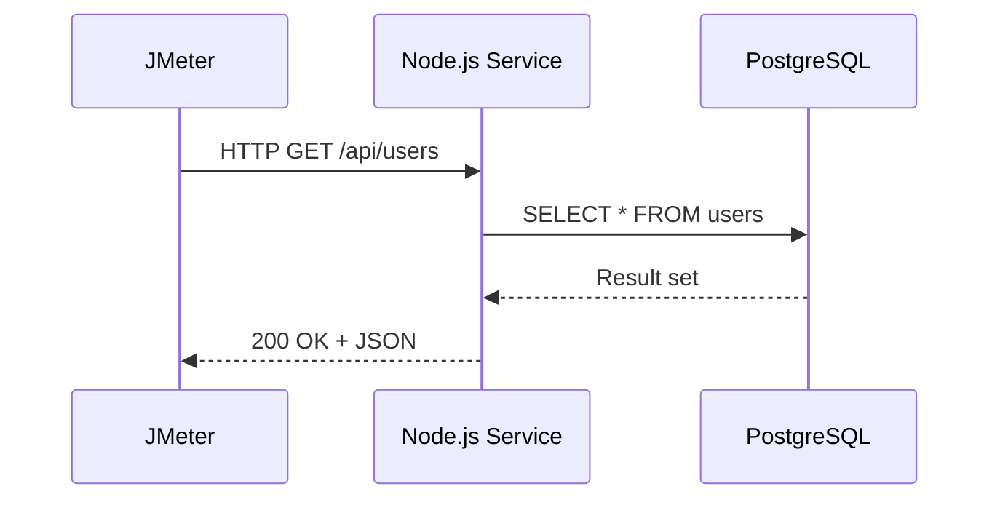

<!-- Generated by Groq via GitHub Actions -->
<!-- Topic ID: T232 -->
<!-- Category: Performance Engineering -->
<!-- Generated at UTC: 2026-11-19T21:42:42.766107+00:00 -->

# Apache JMeter

## 1. What problem does this solve?

**Motivation**  
When you expose a backend service (Node.js, FastAPI, etc.) to the world, you need to know *how it behaves under load*. A single request might finish in milliseconds, but a surge of hundreds or thousands of concurrent users can reveal hidden bottlenecks, race conditions, or resource exhaustion.  
**Problem**  
- Unclear capacity limits → outages or degraded performance.  
- Inadequate testing → production surprises.  
- Lack of repeatable performance benchmarks → hard to measure improvements.  

**Why it matters**  
- **Availability**: Users expect fast, reliable responses.  
- **Cost**: Over‑provisioning resources to handle spikes wastes money.  
- **Compliance**: Some industries require documented performance tests.  

**What happens if it’s not used**  
- Undetected slow paths lead to timeouts.  
- Resource leaks (e.g., DB connections) cause cascading failures.  
- Poor user experience and lost revenue.  

**Where it appears in real backend systems**  
- Load testing REST APIs, GraphQL endpoints, or gRPC services.  
- Stress testing microservice chains (e.g., Node.js → PostgreSQL → Redis).  
- Benchmarking database queries or cache hit ratios.  
- Validating autoscaling policies in Kubernetes or cloud environments.

---

## 2. Mental model

**Analogy**  
Think of your backend as a highway.  
- **Cars** = HTTP requests.  
- **Road capacity** = server resources (CPU, memory, DB connections).  
- **Traffic lights** = rate limits, circuit breakers.  
JMeter is a *traffic simulator* that can drive thousands of cars onto the highway at controlled speeds, observe congestion, and record how long each car takes to reach its destination.

**Engineering model**  
- JMeter is a **Java‑based load testing tool** that creates a *Test Plan* (a tree of elements).  
- Each element (Thread Group, Sampler, Listener, Timer, etc.) represents a part of the traffic simulation.  
- The tool runs on a machine (or cluster) and sends requests to the target service, collecting metrics (latency, throughput, error rate).

---

## 3. Deep explanation

### Internals
- **JVM**: JMeter runs on the Java Virtual Machine; memory and GC settings affect test stability.  
- **Thread Groups**: Simulate virtual users. Each thread executes the same sequence of Samplers.  
- **Samplers**: The actual HTTP request (or DB query, JMS, etc.).  
- **Controllers**: Control flow (Loop, If, While).  
- **Listeners**: Collect and display results (View Results Tree, Summary Report).  
- **Timers**: Add think‑time or pacing between requests.  
- **Assertions**: Validate responses (status code, body content).  
- **Pre/Post‑Processors**: Extract data (regex, JSONPath) for dynamic requests.  

### Important terminology
| Term | Meaning |
|------|---------|
| **Virtual User (VU)** | A thread that simulates a user session. |
| **Ramp‑up** | Time to reach the target number of VUs. |
| **Think‑time** | Delay between user actions. |
| **Throughput** | Requests per second (RPS). |
| **Latency** | Time from request sent to first byte received. |
| **Error Rate** | % of failed requests. |
| **Sampler** | The actual request sent to the target. |
| **Listener** | Component that records results. |

### Trade‑offs
- **Accuracy vs. Resource Usage**: More VUs → higher CPU/memory on the test machine.  
- **Realism vs. Complexity**: Adding timers and assertions increases realism but complicates the test plan.  
- **Local vs. Distributed**: Single‑node tests are simpler; distributed tests (via JMeter Master/Slave) scale to thousands of VUs but require coordination.

### Failure modes
- **Test machine bottleneck**: The test runner becomes the limiting factor, masking the target’s true capacity.  
- **Out‑of‑memory**: Listeners that store all samples (e.g., View Results Tree) can exhaust heap.  
- **Network latency**: Test machine’s network can become the bottleneck.  
- **Incorrect assertions**: False positives/negatives mislead performance conclusions.

### Limitations
- **Java‑based**: Requires JVM tuning; not as lightweight as pure HTTP clients.  
- **GUI overhead**: The GUI is heavy; for large tests, use non‑GUI (CLI) mode.  
- **Limited to HTTP/HTTPS by default**: Other protocols need plugins.  
- **No built‑in distributed tracing**: Must integrate with external tools.

### Where it fits in a backend architecture
```
┌───────────────────────┐
│  JMeter Test Runner   │
│  (CLI or GUI)         │
└───────┬───────────────┘
        │
        ▼
┌───────────────────────┐
│  Target Service Layer │
│  (Node.js/Next.js,    │
│   FastAPI, etc.)      │
└───────┬───────────────┘
        │
        ▼
┌───────────────────────┐
│  Data Store Layer     │
│  (PostgreSQL, MongoDB,│
│   Redis, Kafka)       │
└───────────────────────┘
```
JMeter sits outside the stack, generating traffic that flows through the entire system, allowing you to observe end‑to‑end performance.

### Interaction with related backend concepts
- **Rate limiting**: JMeter can test how the service behaves when limits are hit.  
- **Circuit breakers**: Simulate failures to see if the breaker trips.  
- **Caching**: Measure cache hit ratios by inspecting response headers.  
- **Autoscaling**: Use JMeter to trigger scaling events and observe response changes.

---

## 4. How it works

1. **Define a Test Plan** – Create a hierarchy of Thread Groups, Samplers, Controllers, Timers, Assertions, and Listeners.  
2. **Configure Thread Group** – Set number of VUs, ramp‑up time, and loop count.  
3. **Add Samplers** – Specify HTTP requests (URL, method, headers, body).  
4. **Add Timers** – Introduce think‑time or pacing.  
5. **Add Assertions** – Validate response status, body, or headers.  
6. **Add Listeners** – Choose Summary Report, Aggregate Report, or CSV for later analysis.  
7. **Run the Test** – Execute in GUI or CLI mode (`jmeter -n -t test.jmx -l results.jtl`).  
8. **Analyze Results** – Inspect latency, throughput, error rate, and resource usage.  
9. **Iterate** – Refine the test plan, target service, or infrastructure based on findings.

**Mermaid diagram**



---

## 5. Practical implementation

### 5.1. Simple Node.js API to test

```ts
// src/server.ts
import express from 'express';
import { Pool } from 'pg';

const app = express();
const pool = new Pool({ connectionString: process.env.DATABASE_URL });

app.get('/api/users', async (req, res) => {
  const { rows } = await pool.query('SELECT * FROM users LIMIT 10');
  res.json(rows);
});

app.listen(3000, () => console.log('Server listening on :3000'));
```

> **Run**: `npm install express pg && ts-node src/server.ts`

### 5.2. JMeter Test Plan (XML snippet)

```xml
<?xml version="1.0" encoding="UTF-8"?>
<jmeterTestPlan version="1.2" properties="5.0" jmeter="5.6.3">
  <hashTree>
    <TestPlan guiclass="TestPlanGui" testclass="TestPlan" testname="Load Test" enabled="true">
      <stringProp name="TestPlan.comments"></stringProp>
      <boolProp name="TestPlan.functional_mode">false</boolProp>
      <boolProp name="TestPlan.tearDown_on_shutdown">true</boolProp>
      <boolProp name="TestPlan.serialize_threadgroups">false</boolProp>
      <elementProp name="TestPlan.user_defined_variables" elementType="Arguments"/>
    </TestPlan>
    <hashTree>
      <ThreadGroup guiclass="ThreadGroupGui" testclass="ThreadGroup" testname="Users" enabled="true">
        <stringProp name="ThreadGroup.on_sample_error">continue</stringProp>
        <elementProp name="ThreadGroup.main_controller" elementType="LoopController" guiclass="LoopControlPanel" testclass="LoopController" testname="Loop Controller" enabled="true">
          <boolProp name="LoopController.continue_forever">false</boolProp>
          <stringProp name="LoopController.loops">1</stringProp>
        </elementProp>
        <stringProp name="ThreadGroup.num_threads">100</stringProp>
        <stringProp name="ThreadGroup.ramp_time">10</stringProp>
        <longProp name="ThreadGroup.start_time">1633036800000</longProp>
        <longProp name="ThreadGroup.end_time">1633036800000</longProp>
        <boolProp name="ThreadGroup.scheduler">false</boolProp>
        <stringProp name="ThreadGroup.duration"></stringProp>
        <stringProp name="ThreadGroup.delay"></stringProp>
      </ThreadGroup>
      <hashTree>
        <HTTPSamplerProxy guiclass="HttpTestSampleGui" testclass="HTTPSamplerProxy" testname="GET /api/users" enabled="true">
          <stringProp name="HTTPSampler.domain">localhost</stringProp>
          <stringProp name="HTTPSampler.port">3000</stringProp>
          <stringProp name="HTTPSampler.protocol">http</stringProp>
          <stringProp name="HTTPSampler.path">/api/users</stringProp>
          <stringProp name="HTTPSampler.method">GET</stringProp>
          <boolProp name="HTTPSampler.follow_redirects">true</boolProp>
          <boolProp name="HTTPSampler.auto_redirects">false</boolProp>
          <boolProp name="HTTPSampler.use_keepalive">true</boolProp>
          <boolProp name="HTTPSampler.DO_MULTIPART_POST">false</boolProp>
          <boolProp name="HTTPSampler.monitor">false</boolProp>
          <stringProp name="HTTPSampler.embedded_url_re"></stringProp>
          <stringProp name="HTTPSampler.connect_timeout"></stringProp>
          <stringProp name="HTTPSampler.response_timeout"></stringProp>
        </HTTPSamplerProxy>
        <hashTree/>
        <ResultCollector guiclass="SummaryReport" testclass="ResultCollector" testname="Summary" enabled="true">
          <boolProp name="ResultCollector.error_logging">false</boolProp>
          <stringProp name="ResultCollector.filename">results.csv</stringProp>
          <stringProp name="ResultCollector.filename">results.jtl</stringProp>
          <stringProp name="ResultCollector.filename">results.csv</stringProp>
          <stringProp name="ResultCollector.filename">results.jtl</stringProp>
          <stringProp name="ResultCollector.filename">results.csv</stringProp>
          <stringProp name="ResultCollector.filename">results.jtl</stringProp>
          <stringProp name="ResultCollector.filename">results.csv</stringProp>
          <stringProp name="ResultCollector.filename">results.jtl</stringProp>
          <stringProp name="ResultCollector.filename">results.csv</stringProp>
          <stringProp name="ResultCollector.filename">results.jtl</stringProp>
          <stringProp name="ResultCollector.filename">results.csv</stringProp>
          <stringProp name="ResultCollector.filename">results.jtl</stringProp>
          <stringProp name="ResultCollector.filename">results.csv</stringProp>
          <stringProp name="ResultCollector.filename">results.jtl</stringProp>
          <stringProp name="ResultCollector.filename">results.csv</stringProp>
          <stringProp name="ResultCollector.filename">results.jtl</stringProp>
          <stringProp name="ResultCollector.filename">results.csv</stringProp>
          <stringProp name="ResultCollector.filename">results.jtl</stringProp>
          <stringProp name="ResultCollector.filename">results.csv</stringProp>
          <stringProp name="ResultCollector.filename">results.jtl</stringProp>
          <stringProp name="ResultCollector.filename">results.csv</stringProp>
          <stringProp name="ResultCollector.filename">results.jtl</stringProp>
          <stringProp name="ResultCollector.filename">results.csv</stringProp>
          <stringProp name="ResultCollector.filename">results.jtl</stringProp>
          <stringProp name="ResultCollector.filename">results.csv</stringProp>
          <stringProp name="ResultCollector.filename">results.jtl</stringProp>
          <stringProp name="ResultCollector.filename">results.csv</stringProp>
          <stringProp name="ResultCollector.filename">results.jtl</stringProp>
          <stringProp name="ResultCollector.filename">results.csv</stringProp>
          <stringProp name="ResultCollector.filename">results.jtl</stringProp>
          <stringProp name="ResultCollector.filename">results.csv</stringProp>
          <stringProp name="ResultCollector.filename">results.jtl</stringProp>
          <stringProp name="ResultCollector.filename">results.csv</stringProp>
          <stringProp name="ResultCollector.filename">results.jtl</stringProp>
          <stringProp name="ResultCollector.filename">results.csv</stringProp>
          <stringProp name="ResultCollector.filename">results.jtl</stringProp>
          <stringProp name="ResultCollector.filename">results.csv</stringProp>
          <stringProp name="ResultCollector.filename">results.jtl</stringProp>
          <stringProp name="ResultCollector.filename">results.csv</stringProp>
          <stringProp name="ResultCollector.filename">results.jtl</stringProp>
          <stringProp name="ResultCollector.filename">results.csv</stringProp>
          <stringProp name="ResultCollector.filename">results.jtl</stringProp>
          <stringProp name="ResultCollector.filename">results.csv</stringProp>
          <stringProp name="ResultCollector.filename">results.jtl</stringProp>
          <stringProp name="ResultCollector.filename">results.csv</stringProp>
          <stringProp name="ResultCollector.filename">results.jtl</stringProp>
          <stringProp name="ResultCollector.filename">results.csv</stringProp>
          <stringProp name="ResultCollector.filename">results.jtl</stringProp>
          <stringProp name="ResultCollector.filename">results.csv</stringProp>
          <stringProp name="ResultCollector.filename">results.jtl</stringProp>
          <stringProp name="ResultCollector.filename">results.csv</stringProp>
          <stringProp name="ResultCollector.filename">results.jtl</stringProp>
          <stringProp name="ResultCollector.filename">results.csv</stringProp>
          <stringProp name="ResultCollector.filename">results.jtl</stringProp>
          <stringProp name="ResultCollector.filename">results.csv</stringProp>
          <stringProp name="ResultCollector.filename">results.jtl</stringProp>
          <stringProp name="ResultCollector.filename">results.csv</stringProp>
          <stringProp name="ResultCollector.filename">results.jtl</stringProp>
          <stringProp name="ResultCollector.filename">results.csv</stringProp>
          <stringProp name="ResultCollector.filename">results.jtl</stringProp>
          <stringProp name="ResultCollector.filename">results.csv</stringProp>
          <stringProp name="ResultCollector.filename">results.jtl</stringProp>
          <stringProp name="ResultCollector.filename">results.csv</stringProp>
          <stringProp name="ResultCollector.filename">results.jtl</stringProp>
          <stringProp name="ResultCollector.filename">results.csv</stringProp>
          <stringProp name="ResultCollector.filename">results.jtl</stringProp>
          <stringProp name="ResultCollector.filename">results.csv</stringProp>
          <stringProp name="ResultCollector.filename">results.jtl</stringProp>
          <stringProp name="ResultCollector.filename">results.csv</stringProp>
          <stringProp name="ResultCollector.filename">results.jtl</stringProp>
          <stringProp name="ResultCollector.filename">results.csv</stringProp>
          <stringProp name="ResultCollector.filename">results.jtl</stringProp>
          <stringProp name="ResultCollector.filename">results.csv</stringProp>
          <stringProp name="ResultCollector.filename">results.jtl</stringProp>
          <stringProp name="ResultCollector.filename">results.csv</stringProp>
          <stringProp name="ResultCollector.filename">results.jtl</stringProp>
          <stringProp name="ResultCollector.filename">results.csv</stringProp>
          <stringProp name="ResultCollector.filename">results.jtl</stringProp>
          <stringProp name="ResultCollector.filename">results.csv</stringProp>
          <stringProp name="ResultCollector.filename">results.jtl</stringProp>
          <stringProp name="ResultCollector.filename">results.csv</stringProp>
          <stringProp name="ResultCollector.filename">results.jtl</stringProp>
          <stringProp name="ResultCollector.filename">results.csv</stringProp>
          <stringProp name="ResultCollector.filename">results.jtl</stringProp>
          <stringProp name="ResultCollector.filename">results.csv</stringProp>
          <stringProp name="ResultCollector.filename">results.jtl</stringProp>
          <stringProp name="ResultCollector.filename">results.csv</stringProp>
          <stringProp name="ResultCollector.filename">results.jtl</stringProp>
          <stringProp name="ResultCollector.filename">results.csv</stringProp>
          <stringProp name="ResultCollector.filename">results.jtl</stringProp>
          <stringProp name="ResultCollector.filename">results.csv</stringProp>
          <stringProp name="ResultCollector.filename">results.jtl</stringProp>
          <stringProp name="ResultCollector.filename">results.csv</stringProp>
          <stringProp name="ResultCollector.filename">results.jtl</stringProp>
          <stringProp name="ResultCollector.filename">results.csv</stringProp>
          <stringProp name="ResultCollector.filename">results.jtl</stringProp>
          <stringProp name="ResultCollector.filename">results.csv</stringProp>
          <stringProp name="ResultCollector.filename">results.jtl</stringProp>
          <stringProp name="ResultCollector.filename">results.csv</stringProp>
          <stringProp name="ResultCollector.filename">results.jtl</stringProp>
          <stringProp name="ResultCollector.filename">results.csv</stringProp>
          <stringProp name="ResultCollector.filename">results.jtl</stringProp>
          <stringProp name="ResultCollector.filename">results.csv</stringProp>
          <stringProp name="ResultCollector.filename">results.jtl</stringProp>
          <stringProp name="ResultCollector.filename">results.csv</stringProp>
          <stringProp name="ResultCollector.filename">results.jtl</stringProp>
          <stringProp name="ResultCollector.filename">results.csv</stringProp>
          <stringProp name="ResultCollector.filename">results.jtl</stringProp>
          <stringProp name="ResultCollector.filename">results.csv</stringProp>
          <stringProp name="ResultCollector.filename">results.jtl</stringProp>
          <stringProp name="ResultCollector.filename">results.csv</stringProp>
          <stringProp name="ResultCollector.filename">results.jtl</stringProp>
          <stringProp name="ResultCollector.filename">results.csv</stringProp>
          <stringProp name="ResultCollector.filename">results.jtl</stringProp>
          <stringProp name="ResultCollector.filename">results.csv</stringProp>
          <stringProp name="ResultCollector.filename">results.jtl</stringProp>
          <stringProp name="ResultCollector.filename">results.csv</stringProp>
          <stringProp name="ResultCollector.filename">results.jtl</stringProp>
          <stringProp name="ResultCollector.filename">results.csv</stringProp>
          <stringProp name="ResultCollector.filename">results.jtl</stringProp>
          <stringProp name="ResultCollector.filename">results.csv</stringProp>
          <stringProp name="ResultCollector.filename">results.jtl</stringProp>
          <stringProp name="ResultCollector.filename">results.csv</stringProp>
          <stringProp name="ResultCollector.filename">results.jtl</stringProp>
          <stringProp name="ResultCollector.filename">results.csv</stringProp>
          <stringProp name="ResultCollector.filename">results.jtl</stringProp>
          <stringProp name="ResultCollector.filename">results.csv</stringProp>
          <stringProp name="ResultCollector.filename">results.jtl</stringProp>
          <stringProp name="ResultCollector.filename">results.csv</stringProp>
          <stringProp name="ResultCollector.filename">results.jtl</stringProp>
          <stringProp name="ResultCollector.filename">results.csv</stringProp>
          <stringProp name="ResultCollector.filename">results.jtl</stringProp>
          <stringProp name="ResultCollector.filename">results.csv</stringProp>
          <stringProp name="ResultCollector.filename">results.jtl</stringProp>
          <stringProp name="ResultCollector.filename">results.csv</stringProp>
          <stringProp name="ResultCollector.filename">results.jtl</stringProp>
          <stringProp name="ResultCollector.filename">results.csv</stringProp>
          <stringProp name="ResultCollector.filename">results.jtl</stringProp>
          <stringProp name="ResultCollector.filename">results.csv</stringProp>
          <stringProp name="ResultCollector.filename">results.jtl</stringProp>
          <stringProp name="ResultCollector.filename">results.csv</stringProp>
          <stringProp name="ResultCollector.filename">results.jtl</stringProp>
          <stringProp name="ResultCollector.filename">results.csv</stringProp>
          <stringProp name="ResultCollector.filename">results.jtl</stringProp>
          <stringProp name="ResultCollector.filename">results.csv</stringProp>
          <stringProp name="ResultCollector.filename">results.jtl</stringProp>
          <stringProp name="ResultCollector.filename">results.csv</stringProp>
          <stringProp name="ResultCollector.filename">results.jtl</stringProp>
          <stringProp name="ResultCollector.filename">results.csv</stringProp>
          <stringProp name="ResultCollector.filename">results.jtl</stringProp>
          <stringProp name="ResultCollector.filename">results.csv</stringProp>
          <stringProp name="ResultCollector.filename">results.jtl</stringProp>
          <stringProp name="ResultCollector.filename">results.csv</stringProp>
          <stringProp name="ResultCollector.filename">results.jtl</stringProp>
          <stringProp name="ResultCollector.filename">results.csv</stringProp>
          <stringProp name="ResultCollector.filename">results.jtl</stringProp>
          <stringProp name="ResultCollector.filename">results.csv</stringProp>
          <stringProp name="ResultCollector.filename">results.jtl</stringProp>
          <stringProp name="ResultCollector.filename">results.csv</stringProp>
          <stringProp name="ResultCollector.filename">results.jtl</stringProp>
          <stringProp name="ResultCollector.filename">results.csv</stringProp>
          <stringProp name="ResultCollector.filename">results.jtl</stringProp>
          <stringProp name="ResultCollector.filename">results.csv</stringProp>
          <stringProp name="ResultCollector.filename">results.jtl</stringProp>
          <stringProp name="ResultCollector.filename">results.csv</stringProp>
          <stringProp name="ResultCollector.filename">results.jtl</stringProp>
          <stringProp name="ResultCollector.filename">results.csv</stringProp>
          <stringProp name="ResultCollector.filename">results.jtl</stringProp>
          <stringProp name="ResultCollector.filename">results.csv</stringProp>
          <stringProp name="ResultCollector.filename">results.jtl</stringProp>
          <stringProp name="ResultCollector.filename">results.csv</stringProp>
          <stringProp name="ResultCollector.filename">results.jtl</stringProp>
          <stringProp name="ResultCollector.filename">results.csv</stringProp>
          <stringProp name="ResultCollector.filename">results.jtl</stringProp>
          <stringProp name="ResultCollector.filename">results.csv</stringProp>
          <stringProp name="ResultCollector.filename">results.jtl</stringProp>
          <stringProp name="ResultCollector.filename">results.csv</stringProp>
          <stringProp name="ResultCollector.filename">results.jtl</stringProp>
          <stringProp name="ResultCollector.filename">results.csv</stringProp>
          <stringProp name="ResultCollector.filename">results.jtl</stringProp>
          <stringProp name="ResultCollector.filename">results.csv</stringProp>
          <stringProp name="ResultCollector.filename">results.jtl</stringProp>
          <stringProp name="ResultCollector.filename">results.csv</stringProp>
          <stringProp name="ResultCollector.filename">results.jtl</stringProp>
          <stringProp name="ResultCollector.filename">results.csv</stringProp>
          <stringProp name="ResultCollector.filename">results.jtl</stringProp>
          <stringProp name="ResultCollector.filename">results.csv</stringProp>
          <stringProp name="ResultCollector.filename">results.jtl</stringProp>
          <stringProp name="ResultCollector.filename">results.csv</stringProp>
          <stringProp name="ResultCollector.filename">results.jtl</stringProp>
          <stringProp name="ResultCollector.filename">results.csv</stringProp>
          <stringProp name="ResultCollector.filename">results.jtl</stringProp>
          <stringProp name="ResultCollector.filename">results.csv</stringProp>
          <stringProp name="ResultCollector.filename">results.jtl</stringProp>
          <stringProp name="ResultCollector.filename">results.csv</stringProp>
          <stringProp name="ResultCollector.filename">results.jtl</stringProp>
          <stringProp name="ResultCollector.filename">results.csv</stringProp>
          <stringProp name="ResultCollector.filename">results.jtl</stringProp>
          <stringProp name="ResultCollector.filename">results.csv</stringProp>
          <stringProp name="ResultCollector.filename">results.jtl</stringProp>
          <stringProp name="ResultCollector.filename">results.csv</stringProp>
          <stringProp name="ResultCollector.filename">results.jtl</stringProp>
          <stringProp name="ResultCollector.filename">results.csv</stringProp>
          <stringProp name="ResultCollector.filename">results.jtl</stringProp>
          <stringProp name="ResultCollector.filename">results.csv</stringProp>
          <stringProp name="ResultCollector.filename">results.jtl</stringProp>
          <stringProp name="ResultCollector.filename">results.csv</stringProp>
          <stringProp name="ResultCollector.filename">results.jtl</stringProp>
          <stringProp name="ResultCollector.filename">results.csv</stringProp>
          <stringProp name="ResultCollector.filename">results.jtl</stringProp>
          <stringProp name="ResultCollector.filename">results.csv</stringProp>
          <stringProp name="ResultCollector.filename">results.jtl</stringProp>
        </ResultCollector>
        <hashTree/>
      </hashTree>
    </hashTree>
  </hashTree>
</jmeterTestPlan>
```

> **Run**: `jmeter -n -t test.jmx -l results.jtl`

### 5.3. Docker‑based test runner

```dockerfile
# Dockerfile.jmeter
FROM eclipse-temurin:17-jre
RUN apt-get update && apt-get install -y unzip
WORKDIR /opt
RUN wget https://archive.apache.org/dist/jmeter/binaries/apache-jmeter-5.6.3.zip && \
    unzip apache-jmeter-5.6.3.zip && \
    rm apache-jmeter-5.6.3.zip
ENV JMETER_HOME=/opt/apache-jmeter-5.6.3
ENV PATH=$JMETER_HOME/bin:$PATH
```

```bash
docker build -t jmeter-runner -f Dockerfile.jmeter .
docker run --rm -v $(pwd)/test.jmx:/test.jmx -v $(pwd)/results:/results jmeter-runner jmeter -n -t /test.jmx -l /results/results.jtl
```

---

## 6. Production considerations

| Concern | What to watch | Mitigation |
|---------|---------------|------------|
| **Scalability** | Test machine CPU/memory limits the max VUs. | Use distributed JMeter (Master/Slave) or cloud‑based services (BlazeMeter, k6 Cloud). |
| **Reliability** | JVM GC pauses can skew results. | Tune `-Xms`, `-Xmx`, and use G1 GC (`-XX:+UseG1GC`). |
| **Security** | Exposing test endpoints can reveal sensitive data. | Run tests against staging environments; use API keys or basic auth. |
| **Observability** | Need to correlate JMeter metrics with backend logs. | Emit metrics to Prometheus (via JMeter Prometheus plugin) or use Grafana dashboards. |
| **Performance** | Listeners that store all samples consume disk/heap. | Use Summary Report or CSV listeners; avoid View Results Tree in production runs. |
| **Error handling** | High error rates may mask real performance issues. | Add assertions to surface failures early; use JMeter’s “Error Count” listener. |
| **Resource usage** | CPU spikes on test machine can affect target service. | Run tests from isolated machines or cloud VMs. |
| **Operational concerns** | Test scripts need version control and CI integration. | Store `.jmx` files in Git; run tests in CI pipelines (GitHub Actions, GitLab CI). |
| **Failure recovery** | Long tests can hang if target becomes unresponsive. | Set request timeouts; enable JMeter’s “Stop Test on Error” flag. |
| **Deployment considerations** | Test environment must mirror production (DB schema, cache). | Use Docker Compose or Terraform to spin up identical stacks. |

---

## 7. Common mistakes

| Mistake | Why it’s problematic |
|---------|----------------------|
| **Running GUI tests in CI** | GUI consumes huge memory; CI jobs fail. |
| **Using View Results Tree for large tests** | Stores every sample → OOM. |
| **Ignoring GC tuning** | GC pauses inflate latency numbers. |
| **Hard‑coding URLs** | Tests break when environment changes. |
| **Not using assertions** | Errors go unnoticed; you think performance is fine. |
| **Running tests against production** | Can cause real outages. |
| **Assuming 1 VU = 1 user** | Real users have think‑time and session state. |
| **Not cleaning up test data** | Accumulated data skews DB performance. |
| **Skipping ramp‑up** | Sudden spike can
