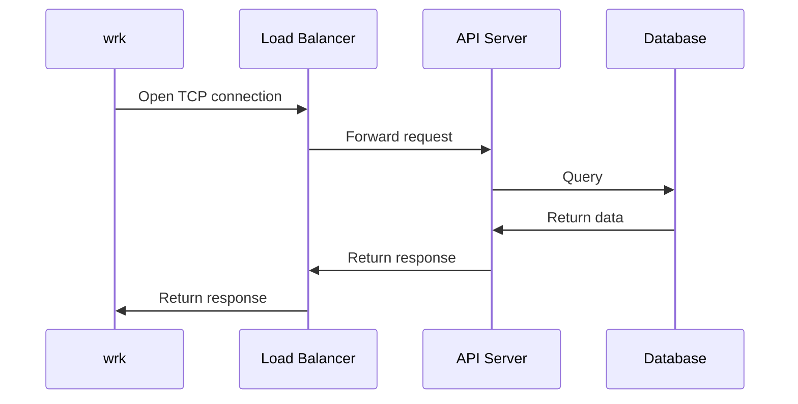

<!-- Generated by Groq via GitHub Actions -->
<!-- Topic ID: T233 -->
<!-- Category: Performance Engineering -->
<!-- Generated at UTC: 2026-11-20T08:45:40.653572+00:00 -->

# wrk

## 1. What problem does this solve?

wrk is a modern HTTP benchmarking tool that measures how many requests per second a web service can handle under load.  
It helps you answer:

- **Throughput**: How many requests can the system process per second?  
- **Latency**: What is the distribution of response times under stress?  
- **Bottlenecks**: Where does the system slow down (CPU, I/O, database, network)?

### Why the problem matters

- **Capacity planning**: Knowing the limits lets you provision the right number of instances.  
- **Performance regression detection**: A new deployment should not drop below a baseline.  
- **Service level objectives (SLOs)**: You can verify that latency percentiles meet SLA targets.  

### Consequences of not using a load tester

- **Undersized infrastructure** → sudden outages under real traffic.  
- **Over‑provisioned resources** → wasted cost.  
- **Unidentified bottlenecks** → sub‑optimal code or architecture.  

### Where it appears in real backend systems

- **CI/CD pipelines**: Run wrk tests after each build to catch regressions.  
- **Pre‑deployment checks**: Verify that a new version meets performance thresholds.  
- **Capacity planning**: Simulate expected traffic patterns to decide scaling strategy.  

---

## 2. Mental model

### Analogy

Think of wrk as a *traffic police* for your web service.  
Just as a traffic officer counts cars, measures speed, and identifies jams, wrk sends a steady stream of HTTP requests, records how fast the server responds, and highlights where the traffic slows down.

### Precise engineering model

wrk is a **single‑process, multi‑threaded** load generator that:

1. **Spawns worker threads** (default 2 × CPU cores).  
2. **Each thread opens a pool of TCP connections** to the target host.  
3. **Sends HTTP requests** according to a user‑defined Lua script or simple command line.  
4. **Collects metrics** (requests/sec, latency percentiles, errors).  

Because it keeps connections open and reuses them, wrk approximates real‑world traffic better than tools that open a new connection per request.

---

## 3. Deep explanation

### Internals

| Component | Role |
|-----------|------|
| **Thread pool** | Parallelism; each thread runs an event loop. |
| **Connection pool** | Keeps TCP connections alive (HTTP keep‑alive). |
| **Lua scripting** | Custom request generation, dynamic headers, payloads. |
| **Metrics collector** | Aggregates per‑thread stats into global counters. |

wrk uses **libuv** (the same event loop used by Node.js) for non‑blocking I/O, which gives it high throughput with low CPU overhead.

### Important terminology

- **RPS (Requests Per Second)** – raw throughput.  
- **Latency percentiles** – e.g., 95th percentile latency.  
- **Concurrency** – number of simultaneous connections.  
- **Keep‑alive** – reusing TCP connections to reduce handshake overhead.  
- **Lua script** – optional script to customize request payloads or headers.

### Trade‑offs

| Aspect | Benefit | Drawback |
|--------|---------|----------|
| **High concurrency** | Approximates real traffic. | May saturate client machine, skewing results. |
| **Keep‑alive** | Reduces TCP overhead. | Can mask connection‑level issues. |
| **Lua scripting** | Flexible request generation. | Adds complexity; harder to maintain. |

### Failure modes

- **Client‑side bottleneck**: If the wrk machine is under‑provisioned, it will limit the load you can generate.  
- **Network saturation**: Over‑loading the network interface can produce misleading latency spikes.  
- **Server‑side errors**: 5xx responses are counted as failures; if your application is rate‑limited, you’ll see many errors.

### Limitations

- **Single machine**: Cannot generate traffic beyond the capacity of one host.  
- **Statelessness**: Does not simulate user sessions unless scripted.  
- **No distributed tracing**: You need external tools to correlate wrk metrics with backend traces.

### Where it fits in a backend architecture

wrk sits **outside** the application stack, acting as an external client. It is typically used in:

- **CI pipelines** → run before merging.  
- **Staging environments** → validate performance under load.  
- **Pre‑production** → confirm that scaling rules hold.

It interacts with:

- **Load balancers**: wrk can target a LB IP to test distribution.  
- **API gateways**: measure gateway overhead.  
- **Databases**: indirectly, by stressing queries.

---

## 4. How it works

1. **Start wrk** with target URL, concurrency, duration, and optional Lua script.  
2. **wrk spawns worker threads** (default 2 × CPU cores).  
3. **Each thread opens a pool of TCP connections** to the target.  
4. **Requests are queued**; each thread pulls from the queue, sends the request, and waits for the response.  
5. **Metrics are collected** per thread and aggregated.  
6. **On completion** (or interruption), wrk prints a summary and optionally writes a JSON report.



---

## 5. Practical implementation

### Node.js + wrk example

Assume you have a FastAPI endpoint `/items` that returns a list of items.  
You want to benchmark it with a realistic payload.

```bash
# Install wrk (Linux example)
sudo apt-get install wrk
```

**wrk command**

```bash
wrk -t4 -c200 -d30s -R1000 \
  -H "Content-Type: application/json" \
  -s post.lua \
  http://localhost:8000/items
```

**post.lua** – Lua script to send a JSON body

```lua
wrk.method = "POST"
wrk.body   = '{"name":"test","value":123}'
wrk.headers["Content-Type"] = "application/json"
```

**Node.js server (FastAPI in Python)** – just for context

```python
# app.py
from fastapi import FastAPI
app = FastAPI()

@app.post("/items")
async def create_item(item: dict):
    # Simulate DB write
    await asyncio.sleep(0.01)
    return {"status": "ok", "id": 42}
```

Run the server:

```bash
uvicorn app:app --host 0.0.0.0 --port 8000
```

Now run the wrk command. You’ll see output like:

```
Running 30s test @ http://localhost:8000/items
  4 threads and 200 connections
  Thread Stats   Avg      Stdev     Max   +/- Stdev
    Latency   12.34ms   3.21ms  45.67ms   68.90%
    Req/Sec   1.23k    200.00    2.00k    95.00%
  1,234,567 requests in 30.00s, 123.45MB read
Requests/sec:  41,152.34
Transfer/sec:      4.12MB
```

### Docker example

If you want to run wrk inside Docker (useful for CI):

```dockerfile
# Dockerfile.wrk
FROM alpine:latest
RUN apk add --no-cache wrk
COPY post.lua /post.lua
CMD ["wrk", "-t4", "-c200", "-d30s", "-s", "/post.lua", "http://host.docker.internal:8000/items"]
```

Build and run:

```bash
docker build -t wrk-test -f Dockerfile.wrk .
docker run --network host wrk-test
```

---

## 6. Production considerations

| Concern | How wrk helps / what to watch |
|---------|--------------------------------|
| **Scalability** | Use multiple wrk instances or a distributed load generator (e.g., k6, Locust) to reach higher RPS. |
| **Reliability** | Run wrk in a separate environment; avoid hitting production directly. |
| **Security** | Do not expose sensitive endpoints to public load tests; use auth tokens or mock data. |
| **Observability** | Combine wrk output with distributed tracing (Jaeger) and metrics (Prometheus) to see where latency originates. |
| **Performance** | Monitor client machine CPU/memory; if wrk saturates the client, results are invalid. |
| **Error handling** | Inspect error rates; high 4xx/5xx may indicate rate limits or bugs. |
| **Resource usage** | Keep concurrency and connections within client limits; use `wrk -t` to adjust threads. |
| **Operational concerns** | Automate wrk in CI; store results in a database for trend analysis. |
| **Failure recovery** | If wrk crashes, ensure it cleans up sockets; use `--timeout` to avoid hanging. |
| **Deployment considerations** | Run wrk against a staging environment that mirrors production (same DB, cache, etc.). |

---

## 7. Common mistakes

| Mistake | Why it’s problematic |
|---------|----------------------|
| **Running wrk on a laptop** | Laptop’s network or CPU limits skew results; use a dedicated test machine. |
| **Ignoring keep‑alive** | Without keep‑alive, you’ll measure TCP handshake overhead, not real traffic. |
| **Using default concurrency** | Too low → under‑estimates capacity; too high → client bottleneck. |
| **Not scripting dynamic payloads** | Static requests miss realistic load patterns (e.g., varying IDs). |
| **Assuming 100% success** | High error rates may indicate rate limiting or authentication issues. |
| **Running against production** | Risk of DoS; always target staging or a dedicated test environment. |
| **Not correlating with backend metrics** | wrk alone can’t tell you *why* latency spikes; combine with tracing. |

---

## 8. Senior engineer perspective

### What changes at scale?

- **Distributed load generation**: Use multiple wrk instances or a cloud‑based tool to reach millions of RPS.  
- **Targeting load balancers**: Test LB health checks, stickiness, and session persistence.  
- **Hybrid protocols**: Combine HTTP with WebSocket or gRPC load tests.  
- **Realistic user simulation**: Use Lua to generate user sessions, authentication flows, and stateful interactions.

### Design decisions

| Decision | Trade‑offs |
|----------|------------|
| **Number of threads** | More threads → higher concurrency but higher CPU usage on client. |
| **Connection pool size** | Larger pool → better throughput but may exhaust server sockets. |
| **Script complexity** | Simple scripts are fast; complex scripts may introduce client‑side latency. |
| **Test duration** | Short tests capture peak throughput; long tests reveal steady‑state behavior. |
| **Target environment** | Staging vs. production; consider data isolation and cost. |

### Bottlenecks to watch

- **TCP backlog** on the server.  
- **Database connection pool exhaustion**.  
- **Cache miss ratios**.  
- **Network latency** between client and server.

### Monitoring

- **Prometheus**: Export wrk metrics via a custom exporter.  
- **Grafana dashboards**: Visualize latency percentiles over time.  
- **Alerting**: Trigger when error rates exceed thresholds.

### Cost/performance

- Running wrk on a powerful VM can cost a few dollars per hour; consider spot instances or on‑prem hardware.  
- For very high RPS, consider cloud services like k6 Cloud or BlazeMeter.

### When NOT to use wrk

- **Stateful protocols** that require session persistence (use specialized tools).  
- **Distributed tracing** needs: wrk doesn’t emit trace IDs.  
- **Multi‑service end‑to‑end tests**: Use a full‑stack test harness.

---

## 9. Interview questions

1. **Beginner**: *What is the purpose of the `-c` flag in wrk?*  
   - **Answer**: Sets the number of concurrent connections (TCP connections) that wrk will maintain.

2. **Beginner**: *Why is keep‑alive important in load testing?*  
   - **Answer**: It reuses TCP connections, reducing handshake overhead and more accurately simulating real traffic.

3. **Senior**: *How would you design a load test for a microservice that uses both HTTP and gRPC endpoints?*  
   - **Answer**: Use separate load generators (wrk for HTTP, `grpcurl` or `k6` for gRPC), run them concurrently, and aggregate metrics. Ensure the test environment mirrors production (same DB, cache).  

4. **Senior**: *Explain how you would detect a database connection pool exhaustion using wrk results.*  
   - **Answer**: Look for a sudden drop in RPS and a spike in 5xx errors, especially `503 Service Unavailable`. Correlate with database metrics (connection count, wait times).  

5. **Scenario/Debugging**: *You run wrk against your API and see a 95th percentile latency of 2 s, but your application logs show no errors. What could be causing this?*  
   - **Answer**: Possible causes:  
     - Database query taking long due to lock contention.  
     - GC pauses in the Node.js runtime.  
     - Network congestion or packet loss.  
     - Backend rate limiting or back‑pressure.  
     Investigate by enabling tracing, checking DB slow query logs, and monitoring system metrics.

---

## 10. Hands‑on task

**Task**: Add a Lua script to wrk that simulates a user session:  
1. **GET /login** → receive a session cookie.  
2. **POST /profile** → send JSON with the cookie.  
3. **GET /logout** → end session.  

Run the test with 100 concurrent connections for 60 s, and record the average latency.  
Compare the results with a simple request (no session) to see the impact of stateful interactions.

*Hints*:  
- Use `wrk.headers["Cookie"] = cookie` after parsing the `Set-Cookie` header.  
- Use `wrk:parse_response` to extract the cookie.  
- Store the cookie in a global variable for subsequent requests.

---

## 11. Quick revision

- `wrk` is a high‑performance HTTP load generator.  
- **Concurrency** (`-c`) = number of simultaneous connections.  
- **Threads** (`-t`) = number of worker threads.  
- **Duration** (`-d`) = test length.  
- **Keep‑alive** reduces TCP overhead; enable with `wrk -k`.  
- **Lua scripts** allow dynamic request generation.  
- **Metrics**: RPS, latency percentiles, error rates.  
- **Client bottleneck**: Ensure test machine can generate the desired load.  
- **Correlation**: Combine wrk with tracing and metrics for root‑cause analysis.  
- **CI integration**: Automate wrk tests to catch regressions.  
- **Distributed testing**: Use multiple wrk instances or cloud tools for very high RPS.  
- **Common pitfalls**: Running on under‑provisioned hardware, ignoring keep‑alive, misinterpreting error rates.

---

## 12. References

- [wrk GitHub repository](https://github.com/wg/wrk)  
- [wrk documentation (README)](https://github.com/wg/wrk#usage)  
- [FastAPI docs – testing](https://fastapi.tiangolo.com/tutorial/testing/)  
- [Prometheus – HTTP metrics](https://prometheus.io/docs/instrumenting/http/)  
- [Jaeger – distributed tracing](https://www.jaegertracing.io/docs/1.21/)  
- [k6 – alternative load testing tool](https://k6.io/docs/)  

---
