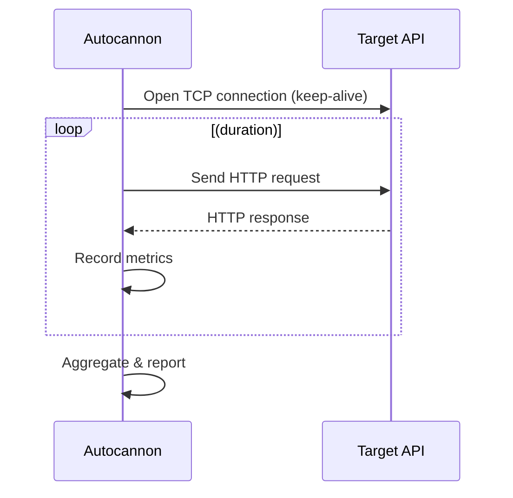

<!-- Generated by Groq via GitHub Actions -->
<!-- Topic ID: T234 -->
<!-- Category: Performance Engineering -->
<!-- Generated at UTC: 2026-11-20T08:45:40.653572+00:00 -->

# autocannon

## 1. What problem does this solve?

**Motivation**  
When you expose an HTTP API, you need to know *how many requests per second* it can handle, *what the latency looks like*, and *where the bottlenecks* are. Without this data you risk over‑provisioning (wasting money) or under‑provisioning (poor user experience).  
`autocannon` is a lightweight, fast load‑testing tool that simulates many concurrent clients hitting your endpoint and reports throughput, latency, error rates, and more.

**What problem exists**  
- Developers often rely on anecdotal performance or manual testing, which gives no repeatable metrics.  
- Cloud providers charge per request or per second of compute; you need to know the sweet spot.  
- Scaling decisions (horizontal vs. vertical) require concrete numbers.

**Why the problem matters**  
- Poor performance leads to timeouts, degraded UX, and lost revenue.  
- Misjudging capacity can cause outages during traffic spikes.  
- Without metrics you cannot prove SLAs or negotiate budgets.

**What happens if this concept is not used**  
- You may deploy a service that appears fine in dev but crashes under load.  
- You cannot detect regressions when refactoring or adding features.  
- You cannot optimize cost vs. performance trade‑offs.

**Where this concept appears in real backend systems**  
- API gateways (e.g., Kong, NGINX) use load testing to tune worker counts.  
- CI pipelines run `autocannon` after each build to catch performance regressions.  
- Performance teams use it to benchmark microservices before rolling out to production.

---

## 2. Mental model

**Analogy**  
Think of your API as a highway. `autocannon` is a traffic simulator that sends a controlled flow of cars (HTTP requests) down the road. By varying the number of cars and how fast they arrive, you can see how many cars the highway can handle before traffic jams (latency spikes) or crashes (errors) occur.

**Engineering model**  
- **Clients**: simulated HTTP connections.  
- **Requests**: HTTP messages sent over those connections.  
- **Server**: the backend you want to test.  
- **Metrics**: throughput (req/s), latency percentiles, error count, connection usage.  
- **Concurrency**: number of simultaneous connections.  
- **Ramp‑up**: gradually increase load to find the breaking point.

---

## 3. Deep explanation

### Internals
- `autocannon` is written in Node.js and uses the native `http`/`https` modules.  
- It creates a pool of TCP connections and reuses them (keep‑alive) to mimic real clients.  
- Each connection runs an event loop that sends requests as soon as the previous one completes, up to a configurable `maxConcurrency`.  
- Results are aggregated in real time and printed to the console or returned as a JSON object.

### Important terminology
| Term | Meaning |
|------|---------|
| **Throughput** | Requests per second (RPS). |
| **Latency** | Time from request sent to response received. |
| **Percentile** | e.g., 95th percentile latency. |
| **Concurrency** | Number of simultaneous connections. |
| **Keep‑alive** | Reusing TCP connections to reduce overhead. |
| **Burst** | Sudden spike in traffic. |
| **Error rate** | Percentage of failed requests (4xx/5xx). |

### Trade‑offs
- **Speed vs. realism**: `autocannon` is fast but does not simulate real user behavior (e.g., think‑time, session state).  
- **CPU vs. I/O**: High concurrency can saturate the CPU if the test harness is the bottleneck.  
- **Network overhead**: Using keep‑alive reduces TCP handshake cost but may mask connection‑setup latency.

### Failure modes
- **Connection limits**: OS limits on open file descriptors can cause test failures.  
- **Server overload**: The target may start rejecting connections, leading to high error rates.  
- **Network throttling**: Cloud providers may throttle traffic from the same IP, skewing results.

### Limitations
- Only tests HTTP(S) endpoints; does not support WebSockets or gRPC out of the box.  
- No built‑in support for authentication flows (you must supply headers).  
- Results are single‑point measurements; for distributed systems you need multiple runs.

### Where it fits in a backend architecture
- **CI/CD**: Run after each build to catch regressions.  
- **Performance testing**: Part of a broader suite that includes load, stress, and endurance tests.  
- **Monitoring**: Compare against production metrics to validate that the environment is representative.

### Interaction with related concepts
- **Auto‑scaling**: Use results to set thresholds for scaling policies.  
- **Rate limiting**: Test how your API behaves under bursty traffic.  
- **Caching**: Measure the impact of cache warm‑up vs. cold start.  
- **Observability**: Correlate `autocannon` metrics with tracing and logging to pinpoint bottlenecks.

---

## 4. How it works

1. **Initialize**: `autocannon` parses CLI or API options (URL, concurrency, duration).  
2. **Create connection pool**: Opens `concurrency` TCP connections with keep‑alive.  
3. **Send requests**: Each connection sends a request immediately after receiving a response.  
4. **Collect metrics**: For each request, record start time, end time, status code, and any errors.  
5. **Aggregate**: Compute throughput, latency percentiles, error rate, and connection usage.  
6. **Report**: Print a live dashboard to the console and optionally output JSON.  
7. **Cleanup**: Close all connections and exit.



---

## 5. Practical implementation

### 5.1 CLI usage

```bash
# Test a Next.js API route
autocannon -c 100 -d 30 https://localhost:3000/api/hello
```

- `-c 100`: 100 concurrent connections  
- `-d 30`: run for 30 seconds

### 5.2 Programmatic API (TypeScript)

```ts
// load-test.ts
import autocannon from 'autocannon';
import { promisify } from 'util';

const url = 'http://localhost:3000/api/hello';
const options = {
  connections: 200,   // concurrency
  duration: 20,       // seconds
  pipelining: 1,
  headers: {
    'Authorization': 'Bearer YOUR_TOKEN',
  },
};

const run = promisify(autocannon);

async function test() {
  console.log(`Running load test against ${url}`);
  const result = await run(url, options);
  console.log('Throughput (req/s):', result.requests.average);
  console.log('Latency (ms) 95th percentile:', result.latency.percentiles[95]);
  console.log('Error rate:', result.errors);
}

test().catch(console.error);
```

**Important lines explained**

- `connections`: number of simultaneous TCP connections.  
- `duration`: how long the test runs.  
- `headers`: inject auth tokens or custom headers.  
- `promisify`: turns the callback API into a promise for async/await.

### 5.3 Dockerized test

```dockerfile
# Dockerfile.test
FROM node:20-alpine
WORKDIR /app
COPY package*.json ./
RUN npm ci
COPY . .
CMD ["node", "load-test.js"]
```

Run with:

```bash
docker build -t autocannon-test .
docker run --network host autocannon-test
```

---

## 6. Production considerations

| Concern | What to watch for | Mitigation |
|---------|-------------------|------------|
| **Scalability** | Test harness can become the bottleneck. | Use multiple machines or increase `connections` gradually. |
| **Reliability** | Network hiccups cause false positives. | Run multiple iterations, average results, use `--latency` flag. |
| **Security** | Sending real auth tokens may expose secrets. | Use test accounts, rotate tokens, store in env vars. |
| **Observability** | Need to correlate test metrics with real traffic. | Emit metrics to Prometheus or a log aggregator. |
| **Performance** | CPU usage of the test client can skew results. | Monitor CPU, use `--max-requests` to cap load. |
| **Error handling** | High error rates may indicate misconfiguration. | Inspect response codes, add retry logic if needed. |
| **Resource usage** | Large `connections` can exhaust file descriptors. | Tune `ulimit -n`, use `--keepalive` wisely. |
| **Operational concerns** | Running tests against prod can cause outages. | Use a staging environment or a dedicated test endpoint. |
| **Failure recovery** | Test script crashes mid‑run. | Wrap in try/catch, log partial results. |
| **Deployment considerations** | Need to integrate into CI. | Add `autocannon` as a dev dependency, run in a Docker job. |

---

## 7. Common mistakes

| Mistake | Why it’s problematic |
|---------|----------------------|
| **Interpreting a single run as definitive** | Variability in network and server load can skew results. |
| **Using too low concurrency** | Under‑estimates real traffic; misses bottlenecks. |
| **Ignoring keep‑alive** | Overestimates CPU cost; real clients reuse connections. |
| **Running against production** | Can trigger rate limits or denial of service. |
| **Not cleaning up connections** | Leaves sockets open, causing resource leaks. |
| **Assuming 95th percentile latency is the only metric** | 99th percentile may reveal tail latency issues. |
| **Not accounting for authentication overhead** | Real traffic may include token validation delays. |
| **Treating error rate as acceptable if <1%** | Even a small error rate can be critical in high‑volume services. |

---

## 8. Senior engineer perspective

### Architecture decisions
- **Test environment isolation**: Use dedicated test clusters or namespaces to avoid contaminating production metrics.  
- **Distributed load testing**: Spin up multiple `autocannon` instances behind a load balancer to simulate global traffic.  
- **Result aggregation**: Store results in a time‑series database (e.g., Prometheus) for trend analysis.

### Trade‑offs
- **Speed vs. realism**: For microservices, a lightweight tool like `autocannon` is fine; for end‑to‑end user flows, consider a higher‑level tool (e.g., k6, Locust).  
- **CPU vs. network**: High concurrency may saturate CPU; balance with network bandwidth.

### Bottlenecks
- **Database queries**: Slow queries will surface as high latency.  
- **External API calls**: Latency from third‑party services can dominate.  
- **Serialization/deserialization**: JSON parsing overhead.

### Failure scenarios
- **Connection pool exhaustion**: OS limits cause test failures.  
- **Rate limiting**: Your own API may throttle test traffic, skewing results.  
- **DNS resolution delays**: If the target hostname resolves slowly, it will inflate latency.

### Monitoring
- **Prometheus metrics**: Export `autocannon` results as custom metrics.  
- **Alerting**: Trigger alerts if latency > SLA or error rate > threshold.  
- **Tracing**: Correlate test requests with distributed traces to pinpoint slow services.

### Cost/performance considerations
- **Compute cost**: Running many concurrent connections can be expensive in cloud.  
- **Data transfer**: Large payloads increase network costs.  
- **Storage**: Persisting detailed logs may incur storage fees.

### When NOT to use
- **Complex user journeys**: `autocannon` is not suited for multi‑step flows with state.  
- **Non‑HTTP protocols**: For gRPC or WebSocket, use specialized tools.  
- **Security‑sensitive endpoints**: Avoid sending real credentials; use mock services.

---

## 9. Interview questions

1. **Beginner**: *What is the difference between throughput and latency in load testing?*  
   **Answer**: Throughput is the number of requests processed per second; latency is the time taken to complete a single request (often reported as percentiles).

2. **Beginner**: *Why does `autocannon` use keep‑alive connections by default?*  
   **Answer**: Keep‑alive reduces TCP handshake overhead, making the test more realistic for HTTP/1.1 clients and improving throughput measurement.

3. **Senior**: *How would you design a load‑testing strategy for a microservice that relies heavily on a Redis cache?*  
   **Answer**: Include scenarios with cache warm‑up, cold cache, and cache miss rates; vary concurrency to see at what point Redis becomes the bottleneck; instrument Redis metrics and correlate with `autocannon` results.

4. **Senior**: *Explain how you would detect and mitigate the “thundering herd” problem when scaling a Node.js API behind a load balancer.*  
   **Answer**: Use sticky sessions or consistent hashing to spread connections; monitor connection counts per instance; implement graceful shutdown; use connection pooling and back‑pressure.

5. **Scenario/Debugging**: *During a load test, you notice the error rate jumps from 0.1 % to 5 % after 10 s, while latency stays stable. What could be causing this, and how would you investigate?*  
   **Answer**: Possible causes: rate limiting, resource exhaustion, or a bug triggered by high concurrency. Investigate by:  
   - Checking server logs for 429/5xx responses.  
   - Monitoring CPU/memory on the server.  
   - Looking at request distribution (e.g., specific endpoints).  
   - Enabling tracing to see where errors originate.

---

## 10. Hands‑on task

**Goal**: Benchmark a simple Next.js API route that returns a random quote and identify the maximum sustainable concurrency.

**Steps**

1. Create a Next.js API route `/api/quote` that returns a JSON object with a random quote.  
2. Spin up the dev server (`npm run dev`).  
3. Write a `load-test.ts` script using `autocannon` to hit `/api/quote` with increasing concurrency (e.g., 50, 100, 200).  
4. Record throughput, 95th percentile latency, and error rate for each run.  
5. Plot the results (e.g., using `gnuplot` or a simple Node script).  
6. Identify the concurrency level where latency starts to rise sharply or error rate spikes.  
7. Explain the bottleneck you suspect (CPU, I/O, network) and propose a mitigation strategy.

**Deliverables**

- `pages/api/quote.ts` (or `app/api/quote/route.ts` for app router).  
- `load-test.ts` script.  
- A markdown file summarizing results and conclusions.

---

## 11. Quick revision

- `autocannon` = fast HTTP load tester for Node.js.  
- **Throughput**: requests per second.  
- **Latency percentiles**: 50th, 95th, 99th.  
- **Concurrency**: number of simultaneous connections.  
- **Keep‑alive**: reuses TCP connections, reduces overhead.  
- **Error rate**: percentage of 4xx/5xx responses.  
- **CLI vs. API**: CLI for quick tests; API for programmatic control.  
- **Common pitfalls**: interpreting single runs, ignoring keep‑alive, running against prod.  
- **Senior considerations**: distributed testing, monitoring, cost, failure scenarios.  
- **Typical workflow**: CI → `autocannon` → metrics → alerting.  
- **When not to use**: complex user flows, non‑HTTP protocols.  
- **Key command**: `autocannon -c 100 -d 30 https://example.com/api`.

---

## 12. References

- [autocannon GitHub repository](https://github.com/mcollina/autocannon)  
- [autocannon npm package](https://www.npmjs.com/package/autocannon)  
- [Node.js HTTP module documentation](https://nodejs.org/api/http.html)  
- [Prometheus Node Exporter](https://prometheus.io/docs/instrumenting/exporters/)  
- [Next.js API Routes](https://nextjs.org/docs/api-routes/introduction)  

---
