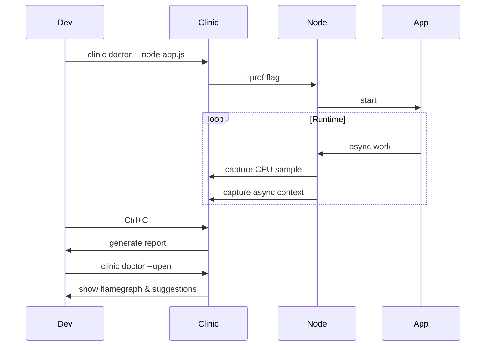

<!-- Generated by Groq via GitHub Actions -->
<!-- Topic ID: T235 -->
<!-- Category: Performance Engineering -->
<!-- Generated at UTC: 2026-11-20T21:25:20.300469+00:00 -->

# Clinic.js

## 1. What problem does this solve?

**Motivation**  
In a production backend you often hear “the service is slow” or “the memory usage keeps growing.”  
Finding the root cause of these symptoms in a complex Node.js codebase is hard because:

- Node’s event loop hides where CPU time is spent.
- Asynchronous code makes it difficult to trace which async operation is blocking.
- Memory leaks can be subtle and only appear after hours of traffic.

**What problem exists**  
- **CPU bottlenecks**: a single function or library hogs the event loop.
- **Memory leaks**: objects are retained longer than necessary, causing heap growth.
- **I/O stalls**: slow database or network calls that block the event loop.
- **Concurrency issues**: mis‑used worker threads or cluster workers.

**Why the problem matters**  
- **Performance degradation** leads to higher latency, lower throughput, and unhappy users.
- **Uncontrolled memory** can cause the process to crash or trigger OOM kills in containers.
- **Resource waste** (CPU, RAM) increases infrastructure costs.

**What happens if this concept is not used**  
- Bugs remain hidden until a production incident.
- Debugging becomes a guessing game, increasing MTTR (Mean Time To Recovery).
- Engineers spend more time writing custom instrumentation instead of focusing on features.

**Where this concept appears in real backend systems**  
- Microservices written in Node.js (Express, Fastify, NestJS).
- Serverless functions (AWS Lambda, Cloudflare Workers) that run Node.js.
- Real‑time services (chat, gaming) where latency is critical.
- Data pipelines that process large volumes of events.

---

## 2. Mental model

**Analogy**  
Think of a Node.js application as a **car engine**.  
- The **CPU** is the engine’s pistons.  
- The **event loop** is the timing belt that keeps everything in sync.  
- **Clinic.js** is a **diagnostic tool** (like an OBD‑II scanner) that tells you which part of the engine is misbehaving: is a piston stuck, is the timing belt slipping, or is there a coolant leak?

**Engineering model**  
Clinic.js collects **runtime telemetry** (CPU samples, heap snapshots, async stack traces) and visualizes it as **flamegraphs** or **bubble charts**.  
- **Flamegraph**: a stack‑based view of CPU time.  
- **Bubbleprof**: a timeline of async events.  
- **Doctor**: an automated analysis that suggests fixes.

---

## 3. Deep explanation

### Internals
- **Node.js built‑in profiler** (`--prof`) records V8 CPU samples and heap snapshots.
- **Clinic.js** wraps this profiler, adds **async hooks** to track async context, and post‑processes data into human‑readable formats.
- Uses **`clinic-flame`** (flamegraph), **`clinic-doctor`** (analysis), and **`clinic-bubbleprof`** (async timeline).

### Important terminology
- **CPU sample**: a snapshot of the call stack at a specific time.
- **Heap snapshot**: a snapshot of all allocated objects.
- **Async hook**: Node’s API to track async resources (promises, timers, I/O).
- **Flamegraph**: a stacked bar chart where each bar represents a function call; width = CPU time.
- **Bubbleprof**: a timeline of async events, useful for I/O bottlenecks.

### Trade‑offs
| Aspect | Benefit | Drawback |
|--------|---------|----------|
| **Accuracy** | High‑resolution CPU and memory data | Requires `--prof`, which adds overhead (~5–10 %) |
| **Ease of use** | CLI commands, visual UI | Must run locally or in CI; not trivial in production |
| **Granularity** | Can pinpoint exact line numbers | Overhead may skew results if profiling a hot path |
| **Async context** | Tracks async stack traces | Some async patterns (e.g., external libraries) may lose context |

### Failure modes
- **False positives**: a function appears hot because of V8 optimizations, not actual work.
- **Missing async context**: if async hooks are disabled or the code uses native addons that bypass Node’s async stack.
- **Profiling overhead**: heavy workloads may be slowed down, altering the behavior.

### Limitations
- Works only for **Node.js** (V8) runtimes.
- Requires **root or elevated privileges** to attach to a running process on some platforms.
- Not suitable for **real‑time production** profiling at scale; better used in staging or CI.

### Where it fits in a backend architecture
- **Development / QA**: run during integration tests or local debugging.
- **CI/CD**: run `clinic-doctor` as part of a nightly build to catch regressions.
- **Staging**: run `clinic-flame` on a replica of production traffic to identify bottlenecks before release.
- **Observability stack**: feed results into dashboards or alerting systems (e.g., Grafana).

### Interaction with related concepts
- **Tracing** (OpenTelemetry): Clinic.js can be used alongside distributed tracing to correlate CPU hotspots with trace spans.
- **Logging**: Use logs to trigger a profiling session when a threshold is exceeded.
- **Container orchestration**: Run profiling inside a Docker container; ensure the container has the `--prof` flag enabled.

---

## 4. How it works

1. **Install Clinic.js**  
   ```bash
   npm install -g clinic
   ```

2. **Run your app under Clinic**  
   ```bash
   clinic doctor -- node app.js
   ```

3. **Generate workload**  
   Send traffic (e.g., via `ab`, `wrk`, or a load‑testing script).

4. **Stop the profiler**  
   Press `Ctrl+C` to terminate; Clinic writes a `.clinic` folder.

5. **Analyze**  
   ```bash
   clinic doctor --open
   ```
   Opens a web UI showing CPU hotspots, memory leaks, and suggested fixes.

6. **Iterate**  
   Fix identified issues, re‑run the profiler, and verify improvements.

### Mermaid diagram



---

## 5. Practical implementation

Below is a realistic Express service with a deliberately slow route.  
We’ll profile it with Clinic.js to find the bottleneck.

```ts
// app.ts
import express from 'express';
import { promisify } from 'util';
import { exec } from 'child_process';

const app = express();
const execAsync = promisify(exec);

app.get('/slow', async (req, res) => {
  // Simulate a blocking CPU task
  const start = Date.now();
  while (Date.now() - start < 200) {
    // busy loop for 200 ms
  }

  // Simulate an async I/O call
  const { stdout } = await execAsync('sleep 0.1 && echo done');
  res.send(`I/O result: ${stdout.trim()}`);
});

app.listen(3000, () => console.log('Server listening on :3000'));
```

**Run the profiler**

```bash
clinic doctor -- node app.js
```

**Generate load**

```bash
ab -n 100 -c 10 http://localhost:3000/slow
```

**Open the report**

```bash
clinic doctor --open
```

You’ll see a flamegraph where the `while` loop dominates CPU time, and a bubbleprof timeline showing the `sleep` command blocking the event loop.

**Fix**

Replace the busy loop with a non‑blocking delay:

```ts
app.get('/slow', async (req, res) => {
  await new Promise(r => setTimeout(r, 200)); // non‑blocking
  const { stdout } = await execAsync('echo done');
  res.send(`I/O result: ${stdout.trim()}`);
});
```

Re‑profile to confirm CPU usage dropped.

---

## 6. Production considerations

| Concern | Recommendation |
|---------|----------------|
| **Scalability** | Run profiling on a **single replica** or a **staging environment**; avoid profiling every instance in production. |
| **Reliability** | Use `clinic doctor` in CI; treat profiling as a **testing step** rather than a runtime feature. |
| **Security** | Profiling data may contain stack traces; store reports securely and purge after analysis. |
| **Observability** | Integrate results with dashboards (Grafana) or alerting (PagerDuty) for regression detection. |
| **Performance** | Profiling adds ~5–10 % overhead; schedule during low‑traffic windows or use `clinic flame` with `--no-async-hooks` for lighter runs. |
| **Error handling** | Ensure the profiler exits cleanly on crashes; use `clinic doctor --exit-on-error`. |
| **Resource usage** | Profiling generates large files (hundreds of MB); clean up `.clinic` directories after analysis. |
| **Operational concerns** | Automate profiling in CI pipelines; store reports in artifact repositories. |
| **Failure recovery** | If a profiler crash occurs, restart the app and re‑run the profiler. |
| **Deployment** | Include `clinic` as a dev dependency; do not ship it to production images. |

---

## 7. Common mistakes

| Mistake | Why it’s problematic |
|---------|----------------------|
| Running Clinic on **all workers** in a cluster | Increases overhead linearly; hard to aggregate results. |
| Ignoring **async context** (e.g., using `--no-async-hooks`) | Misses async stack traces; misidentifies bottlenecks. |
| Interpreting **CPU samples** as “hot code” without considering V8 optimizations | May chase false positives. |
| Profiling **production traffic** without throttling | Alters traffic patterns and can cause outages. |
| Forgetting to **clean up** `.clinic` artifacts | Consumes disk space and may leak sensitive data. |
| Using **Clinic.js** as a replacement for proper monitoring | Profiling is diagnostic, not continuous observability. |

---

## 8. Senior engineer perspective

### What changes at scale?

- **Clustered environments**: need to aggregate data from multiple workers or use a shared profiler.
- **High‑traffic services**: profiling must be performed on a representative load, not a synthetic test.
- **CI/CD pipelines**: integrate `clinic doctor` into nightly builds to catch regressions early.

### Design decisions

| Decision | Trade‑offs |
|----------|------------|
| **Profiling frequency** | More frequent profiling = higher overhead but earlier detection. |
| **Targeted profiling** | Profiling only hot routes reduces cost but may miss hidden issues. |
| **Data retention** | Store reports for audit; but large files increase storage costs. |
| **Instrumentation vs. profiling** | Use lightweight instrumentation (OpenTelemetry) for continuous monitoring; reserve Clinic for deep dives. |
| **Cost** | Running a profiler on a dedicated instance vs. on all instances. |

### Bottlenecks & failure scenarios

- **CPU contention**: Profiling itself can become a bottleneck if many instances run simultaneously.
- **Memory usage**: Heap snapshots can consume gigabytes; risk OOM if not managed.
- **Async context loss**: Native addons or external services may break async tracking, leading to incomplete data.

### Monitoring & alerting

- **Automated regression alerts**: Compare current flamegraph metrics to baseline; alert if CPU time > threshold.
- **Cost dashboards**: Track profiling overhead as a percentage of total CPU usage.

### When NOT to use

- **Micro‑latency services** where profiling overhead cannot be tolerated.
- **Serverless functions** with strict cold‑start budgets.
- **Highly regulated environments** where profiling data cannot be stored.

---

## 9. Interview questions

1. **Beginner** – *What is Clinic.js and why would you use it?*  
   *Answer:* Clinic.js is a Node.js performance profiling tool that captures CPU, memory, and async traces to help identify bottlenecks, memory leaks, and I/O stalls. It’s used to diagnose performance problems that are hard to spot with logs alone.

2. **Beginner** – *How do you run a simple CPU profile with Clinic.js?*  
   *Answer:* `clinic doctor -- node app.js` starts the app under Clinic, collects data, and after stopping it generates a report you can open with `clinic doctor --open`.

3. **Senior** – *Explain how Clinic.js captures async context and why that matters.*  
   *Answer:* It uses Node’s `async_hooks` API to track the lifecycle of async resources (promises, timers, I/O). This allows the profiler to associate CPU samples with the async operation that triggered them, which is essential for diagnosing async bottlenecks and memory leaks.

4. **Senior** – *How would you integrate Clinic.js into a CI pipeline to catch performance regressions?*  
   *Answer:* Run `clinic doctor --node-arg=--inspect` or `clinic flame` with a predefined workload, generate a baseline report, and compare new reports using a diff tool or a custom script. Fail the build if CPU time or memory usage exceeds thresholds.

5. **Scenario/Debugging** – *You notice a Node service’s memory grows steadily over time. How would you use Clinic.js to investigate?*  
   *Answer:*  
   - Run `clinic doctor -- node app.js` while generating typical traffic.  
   - Inspect the heap snapshot in the report to see which objects are retained.  
   - Look for “leaked” objects that keep growing.  
   - Use the suggested fixes or manually trace the allocation stack to find the root cause.  
   - Re‑profile after applying the fix to confirm the leak is gone.

---

## 10. Hands‑on task

**Task**: Add a new endpoint `/compute` to an existing Express app that performs a CPU‑intensive calculation (e.g., computing Fibonacci numbers). Use Clinic.js to:

1. Profile the endpoint under load.  
2. Identify the function that consumes the most CPU.  
3. Refactor the calculation to use an iterative algorithm or memoization.  
4. Re‑profile and confirm CPU usage dropped.

**Hints**  
- Use `ab` or `wrk` to generate load.  
- Compare flamegraphs before and after the refactor.

---

## 11. Quick revision

- Clinic.js is a Node.js performance profiler (CPU, memory, async).
- `clinic doctor` runs the app with `--prof` and async hooks.
- `clinic flame` produces flamegraphs; `clinic bubbleprof` shows async timelines.
- Profiling adds ~5–10 % overhead; run in dev/CI/staging, not all prod instances.
- Use async hooks to keep async context; otherwise you lose stack traces.
- Common pitfalls: profiling all workers, ignoring async context, misreading flamegraphs.
- In production, run profiling on a dedicated instance or in CI; store reports securely.
- Integrate with CI to catch regressions; compare against baselines.
- For memory leaks, look at heap snapshots and “leaked” objects.
- Use `clinic doctor --open` to view interactive reports.

---

## 12. References

- Official website: https://clinicjs.org/
- GitHub repository: https://github.com/clinicjs/clinic
- Node.js async hooks documentation: https://nodejs.org/api/async_hooks.html
- V8 profiler documentation: https://v8.dev/docs/profiler
- Express.js documentation (for example usage): https://expressjs.com/
- OpenTelemetry Node.js instrumentation: https://opentelemetry.io/docs/instrumentation/node/  

---
