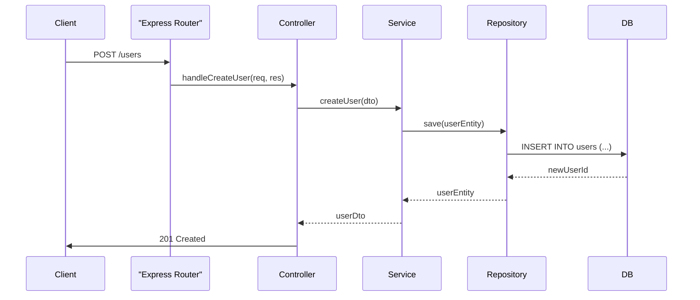

<!-- Generated by Groq via GitHub Actions -->
<!-- Topic ID: T236 -->
<!-- Category: Architecture Patterns -->
<!-- Generated at UTC: 2026-11-20T21:25:20.300469+00:00 -->

# Layered architecture

## 1. What problem does this solve?

Layered architecture is a design pattern that divides an application into a set of logical layers (e.g., presentation, business, data).  
It solves the **“tight coupling and spaghetti code”** problem that arises when all concerns are mixed together.

- **What problem exists?**  
  In a monolithic codebase, a change in the database schema often forces changes in the HTTP handlers, business rules, and even UI code. Bugs propagate quickly, and developers struggle to reason about the system.

- **Why the problem matters?**  
  - **Maintainability:** A single change can ripple through many files.  
  - **Testability:** Unit tests become hard to write because components depend on each other.  
  - **Team coordination:** Developers cannot work in isolation; they must coordinate on shared code.

- **What happens if this concept is not used?**  
  The codebase becomes a tangled web of cross‑cutting concerns. Adding a new feature may require touching dozens of unrelated modules, increasing defect rates and slowing release cycles.

- **Where this concept appears in real backend systems?**  
  - Traditional MVC frameworks (Rails, Django).  
  - Microservice backends that still keep a clear separation between API layer, service layer, and persistence layer.  
  - Enterprise systems that use a “service façade” to expose business logic to multiple clients.

## 2. Mental model

### Analogy: A restaurant

| Layer | Restaurant role | Responsibility |
|-------|-----------------|----------------|
| **Presentation** | Waiter | Receives orders, shows menu, delivers food |
| **Business** | Chef | Decides what to cook, follows recipes, ensures quality |
| **Data** | Kitchen storage | Holds ingredients, tracks inventory |

Just as a waiter never touches the stove and a chef never serves customers directly, each software layer should only interact with its immediate neighbors. This keeps responsibilities clear and changes localized.

### Engineering model

```
┌─────────────────────┐
│  Presentation Layer │  (HTTP controllers, GraphQL resolvers)
└─────────────┬───────┘
              │
┌─────────────▼───────┐
│  Application Layer  │  (Services, use‑cases, orchestration)
└─────────────┬───────┘
              │
┌─────────────▼───────┐
│  Domain Layer       │  (Entities, value objects, domain services)
└─────────────┬───────┘
              │
┌─────────────▼───────┐
│  Infrastructure Layer│  (Repositories, external APIs, message queues)
└─────────────────────┘
```

Each arrow represents a **dependency direction**: higher layers depend on lower ones, never the other way around.

## 3. Deep explanation

### Internals

- **Layer boundaries** are defined by **interfaces**.  
  The presentation layer depends on an `IUserService` interface; the service layer implements it and depends on an `IUserRepository` interface.
- **Dependency injection (DI)** is the primary mechanism to wire layers together at runtime.
- **Cross‑cutting concerns** (logging, metrics, auth) are usually handled by **middleware** or **decorators** that sit outside the core layers.

### Important terminology

| Term | Definition |
|------|------------|
| **Separation of Concerns (SoC)** | Each layer has a distinct responsibility. |
| **Dependency Inversion Principle (DIP)** | High‑level modules should not depend on low‑level modules; both depend on abstractions. |
| **Facade** | A simplified interface that hides the complexity of underlying layers. |
| **Repository** | Abstraction over data persistence. |
| **Service** | Orchestrates domain logic, may call multiple repositories. |

### Trade‑offs

| Benefit | Cost |
|---------|------|
| **Clear boundaries → easier refactoring** | **More boilerplate** (interfaces, DI containers). |
| **Better testability** | **Potential performance overhead** (extra method calls). |
| **Team autonomy** | **Risk of over‑engineering** if layers are too granular. |

### Failure modes

- **Layer leakage**: A controller directly queries the database, bypassing the service layer.  
- **Circular dependencies**: Two layers depend on each other, breaking the one‑direction rule.  
- **Thin layers**: When a layer only forwards calls, it adds no value and increases complexity.

### Limitations

- **Not a silver bullet**: For small scripts or micro‑services that expose a single function, layering may be overkill.  
- **Monolithic bias**: In a true microservice architecture, each service is already a “layer” in itself; internal layering may be unnecessary.  
- **Performance**: Extra indirection can hurt latency in high‑throughput systems unless carefully optimized.

### Where it fits in a backend architecture

- **Monoliths**: Provides a natural division of concerns.  
- **Microservices**: Each service can internally adopt layered architecture to keep its codebase maintainable.  
- **Serverless functions**: Often a single function is a thin presentation layer; layering can still help if the function orchestrates multiple domain operations.

### Interaction with related concepts

- **Domain‑Driven Design (DDD)**: The domain layer aligns with DDD entities and value objects.  
- **Hexagonal (Ports & Adapters)**: Layered architecture can be seen as a specific implementation of hexagonal, where the outermost layer is the adapter.  
- **CQRS**: Read and write sides can be separate layers, each with its own persistence strategy.

## 4. How it works

### Step‑by‑step flow for a “Create User” request

1. **HTTP request** arrives at the Express router.  
2. The **controller** validates the payload and calls `userService.createUser(dto)`.  
3. `userService` performs business rules (e.g., password hashing, email uniqueness check).  
4. `userService` calls `userRepository.save(userEntity)`.  
5. `userRepository` translates the entity into a SQL `INSERT` statement and executes it via a PostgreSQL client.  
6. The database returns the new user ID.  
7. `userRepository` returns the persisted entity to the service.  
8. The service returns a DTO to the controller.  
9. The controller sends a JSON response back to the client.



## 5. Practical implementation

Below is a minimal, runnable example of a layered “User” service in TypeScript/Node.js using Express, TypeORM, and PostgreSQL.

```ts
// src/domain/entities/User.ts
export class User {
  constructor(
    public id: number | null,
    public email: string,
    public hashedPassword: string,
  ) {}
}

// src/domain/services/UserService.ts
import { IUserRepository } from '../repositories/IUserRepository';
import { User } from '../entities/User';
import * as bcrypt from 'bcrypt';

export class UserService {
  constructor(private readonly repo: IUserRepository) {}

  async createUser(email: string, plainPassword: string): Promise<User> {
    // Business rule: email must be unique
    if (await this.repo.findByEmail(email)) {
      throw new Error('Email already in use');
    }

    const hashed = await bcrypt.hash(plainPassword, 10);
    const user = new User(null, email, hashed);
    return this.repo.save(user);
  }
}

// src/domain/repositories/IUserRepository.ts
import { User } from '../entities/User';

export interface IUserRepository {
  findByEmail(email: string): Promise<User | null>;
  save(user: User): Promise<User>;
}

// src/infrastructure/repositories/UserRepository.ts
import { IUserRepository } from '../../domain/repositories/IUserRepository';
import { User } from '../../domain/entities/User';
import { getRepository } from 'typeorm';

export class UserRepository implements IUserRepository {
  private ormRepo = getRepository(User);

  async findByEmail(email: string): Promise<User | null> {
    return this.ormRepo.findOne({ where: { email } }) ?? null;
  }

  async save(user: User): Promise<User> {
    const saved = await this.ormRepo.save(user);
    return new User(saved.id, saved.email, saved.hashedPassword);
  }
}

// src/presentation/controllers/UserController.ts
import { Request, Response } from 'express';
import { UserService } from '../../domain/services/UserService';
import { UserRepository } from '../../infrastructure/repositories/UserRepository';

export class UserController {
  private readonly service: UserService;

  constructor() {
    const repo = new UserRepository();
    this.service = new UserService(repo);
  }

  async create(req: Request, res: Response) {
    try {
      const { email, password } = req.body;
      const user = await this.service.createUser(email, password);
      res.status(201).json({ id: user.id, email: user.email });
    } catch (err: any) {
      res.status(400).json({ error: err.message });
    }
  }
}

// src/index.ts
import express from 'express';
import { UserController } from './presentation/controllers/UserController';
import { createConnection } from 'typeorm';

async function bootstrap() {
  await createConnection(); // reads ormconfig.json

  const app = express();
  app.use(express.json());

  const userCtrl = new UserController();
  app.post('/users', (req, res) => userCtrl.create(req, res));

  app.listen(3000, () => console.log('Server running on :3000'));
}

bootstrap();
```

**Key points**

- The controller only knows about the `UserService` interface.  
- The service contains business logic and delegates persistence to the repository.  
- The repository uses TypeORM to talk to PostgreSQL.  
- All layers are **inverted**: the high‑level service depends on the low‑level repository interface, not the concrete implementation.

## 6. Production considerations

| Concern | Layered‑specific notes |
|---------|------------------------|
| **Scalability** | Each layer can be scaled independently (e.g., cache layer in front of DB). |
| **Reliability** | Layer boundaries make it easier to add circuit breakers or retries at the repository level. |
| **Security** | Authentication/authorization middleware sits in the presentation layer; sensitive data handling is confined to the domain layer. |
| **Observability** | Instrument each layer separately: request tracing in controllers, business metrics in services, DB query logs in repositories. |
| **Performance** | Avoid unnecessary layers for hot paths; consider in‑memory caching in the repository. |
| **Error handling** | Propagate domain‑specific errors upward; translate them to HTTP status codes in the controller. |
| **Resource usage** | Keep repositories lightweight; avoid holding DB connections in the service layer. |
| **Operational concerns** | Separate deployment of services (e.g., microservice) can be aligned with layers if needed. |
| **Failure recovery** | Use idempotent service methods; repository should handle transient DB failures gracefully. |
| **Deployment** | CI pipelines can test each layer independently; Docker images can expose only the presentation layer. |

## 7. Common mistakes

| Mistake | Why it’s problematic |
|---------|----------------------|
| **Controllers doing business logic** | Blurs responsibilities, makes unit tests harder. |
| **Repositories accessing domain entities directly** | Tight coupling; changes in domain break persistence code. |
| **Skipping interfaces** | Hard to swap implementations (e.g., mock DB for tests). |
| **Cross‑layer imports** | Violates the one‑direction dependency rule, leading to circular dependencies. |
| **Over‑engineering layers** | Adds boilerplate without clear benefit; can hurt performance. |
| **Ignoring error propagation** | Swallows errors, making debugging difficult. |
| **Not isolating external calls** | Makes tests flaky; increases latency. |

## 8. Senior engineer perspective

### What changes at scale?

- **Layered boundaries become contract contracts**: Each layer’s interface is a versioned API that other teams rely on.  
- **Governance**: Code reviews enforce layer rules; automated linting checks for cross‑layer imports.  
- **Performance tuning**: Profiling shows that the repository layer is the bottleneck; adding a read‑through cache or query optimization becomes a priority.  
- **Observability**: Distributed tracing (e.g., OpenTelemetry) is added to each layer to see request latency across services.  
- **Deployment**: The presentation layer may be deployed as a separate container behind a load balancer, while the service and repository layers run in a dedicated cluster.

### Design decisions

- **Choose the right granularity**: Too many layers can hurt performance; too few can hurt maintainability.  
- **Interface versioning**: Use semantic versioning for repository interfaces to allow independent evolution.  
- **Data access patterns**: Decide whether to use a single repository per aggregate or a repository per entity.  
- **Cross‑cutting concerns**: Decide whether to use middleware, decorators, or aspect‑oriented programming.  
- **Testing strategy**: Unit tests for services, integration tests for repositories, end‑to‑end tests for controllers.

### Bottlenecks & failure scenarios

- **Repository latency**: Slow DB queries can cascade up the stack.  
- **Service orchestration complexity**: A service that calls many repositories can become a single point of failure.  
- **Layer violation**: If a controller starts calling the repository directly, the whole architecture collapses.  

### Monitoring & cost

- **Metrics per layer**: Request count, error rate, latency.  
- **Cost of extra layers**: Each layer may add a container, increasing infra cost.  
- **When NOT to use**: For ultra‑fast, single‑function services (e.g., a Lambda that just reads a key from Redis), layering may be unnecessary overhead.

## 9. Interview questions

1. **Beginner** – *What is the main benefit of separating an application into layers?*  
   *Answer:* It reduces coupling, improves maintainability, and makes unit testing easier.

2. **Intermediate** – *How does the Dependency Inversion Principle relate to layered architecture?*  
   *Answer:* High‑level layers depend on abstractions (interfaces) rather than concrete implementations, allowing lower layers to change without affecting higher ones.

3. **Senior** – *Describe a scenario where adding a caching layer between the service and repository could introduce a new failure mode. How would you mitigate it?*  
   *Answer:* Cache staleness could return outdated data; mitigate with cache invalidation strategies, TTLs, or write‑through caching.

4. **Senior** – *When would you choose a hexagonal architecture over a classic layered architecture?*  
   *Answer:* When you need to support multiple adapters (e.g., REST, gRPC, CLI) that interact with the same core domain logic, hexagonal gives a cleaner separation of ports and adapters.

5. **Scenario/Debugging** – *A user reports that creating a new account takes 5 seconds. The stack trace shows the request hits the controller, then the service, then the repository, and finally the database. What steps would you take to diagnose and fix the issue?*  
   *Answer:*  
   - Add instrumentation to measure time spent in each layer.  
   - Check DB query logs for slow queries.  
   - Verify indexes on the email column.  
   - Profile the service for expensive operations (e.g., password hashing).  
   - Consider adding a connection pool or caching the uniqueness check.

## 10. Hands‑on task

**Task:** Extend the example above to add a “Get User” endpoint that retrieves a user by ID.  
Requirements:

1. Create a `UserService.getUser(id: number)` method that validates the ID and returns a DTO.  
2. Add a repository method `findById(id: number)` that returns `null` if not found.  
3. Implement a controller route `GET /users/:id`.  
4. Write a unit test for the service that mocks the repository.  
5. Add a simple integration test that starts the Express server and queries the endpoint.

**Hints:**  
- Use Jest for testing.  
- Use `supertest` for integration tests.  
- Keep the repository interface minimal.

## 11. Quick revision

- Layered architecture separates concerns into distinct layers (presentation, application, domain, infrastructure).  
- Dependencies flow **downward**; higher layers depend on abstractions, not concrete implementations.  
- Interfaces (e.g., `IUserRepository`) enable loose coupling and testability.  
- Common layers: Controller → Service → Repository → Database.  
- Trade‑offs: added boilerplate vs. maintainability and testability.  
- Failure modes: layer leakage, circular dependencies, thin layers.  
- Production concerns: observability per layer, caching, circuit breakers, graceful degradation.  
- Senior‑level decisions: interface versioning, cross‑cutting concern handling, monitoring granularity.  
- Avoid layering when the codebase is trivial or the performance cost outweighs benefits.

## 12. References

- [Node.js Express Documentation – Routing](https://expressjs.com/en/guide/routing.html)  
- [TypeORM Documentation – Repository Pattern](https://typeorm.io/#/repository-pattern)  
- [Dependency Inversion Principle – SOLID](https://en.wikipedia.org/wiki/SOLID)  
- [OpenTelemetry – Distributed Tracing](https://opentelemetry.io/docs/)  
- [Hexagonal Architecture – Alistair Cockburn](https://alistair.cockburn.us/hexagonal-architecture/)  
- [Microservices Patterns – Chris Richardson](https://microservices.io/patterns/)
