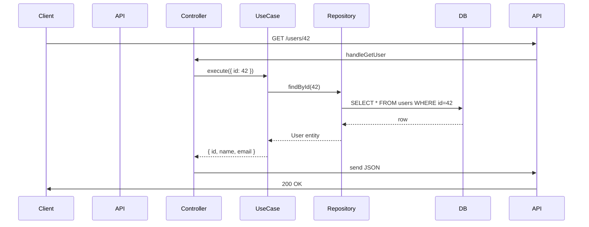

<!-- Generated by Groq via GitHub Actions -->
<!-- Topic ID: T237 -->
<!-- Category: Architecture Patterns -->
<!-- Generated at UTC: 2026-11-21T08:27:49.956472+00:00 -->

# Clean Architecture

## 1. What problem does this solve?

**Motivation**  
When a backend grows, the code that implements business rules gets tangled with infrastructure concerns (HTTP, databases, message queues, logging, etc.). This makes it hard to:

- **Change a technology** (e.g., swap PostgreSQL for MongoDB) without touching core logic.
- **Test** business rules in isolation.
- **Scale** parts of the system independently (e.g., run a heavy analytics service without pulling the whole API).
- **Maintain** the codebase over many years and teams.

**Problem that exists**  
Monolithic codebases often have a single “service layer” that directly calls database drivers, HTTP handlers, and third‑party SDKs. As new features arrive, the same files grow with more dependencies, making refactoring brittle.

**Why it matters**  
- **Technical debt**: Every new feature adds more coupling, increasing the cost of future changes.
- **Testing friction**: Unit tests must mock many external systems, leading to fragile tests.
- **Deployment risk**: A bug in a database query can break the entire API because the logic is not isolated.

**What happens if it’s not used**  
- Rapid feature churn leads to a “spaghetti” codebase.
- On‑call engineers spend more time debugging cross‑cutting issues.
- Scaling becomes a monolithic operation (you must scale the whole service even if only the cache layer needs more resources).

**Where it appears in real backend systems**  
- Large e‑commerce platforms (e.g., Shopify, Amazon) separate domain logic from adapters.
- Micro‑service architectures often use Clean Architecture inside each service to keep the core independent of infrastructure.
- AI‑backend pipelines (e.g., feature extraction, model inference) keep business rules (e.g., scoring thresholds) isolated from data ingestion and model serving layers.

---

## 2. Mental model

**Analogy**  
Think of a car. The *engine* is the core logic that makes the car move. The *body*, *wheels*, and *electronics* are infrastructure. You can swap the body for a sports car body or change the wheels without touching the engine. Clean Architecture is like designing the car so the engine is a separate module that only talks to the body through a well‑defined interface.

**Engineering model**  
- **Entities** (core business objects) live at the center.
- **Use‑cases** (application services) orchestrate entities.
- **Interface adapters** (controllers, gateways, presenters) translate between the outer world and the inner layers.
- **Frameworks & Drivers** (HTTP, DB, message brokers) sit at the outermost layer and implement the adapters.

The key rule: **Dependencies can only point inward**. Outer layers depend on inner layers, never the other way around.

---

## 3. Deep explanation

### Internals
- **Entities**: Plain objects or classes that encapsulate business rules. No external dependencies.
- **Use‑cases / Interactors**: Coordinate entities to perform a specific operation. They receive input DTOs, call entities, and return output DTOs.
- **Interface Adapters**:  
  - *Controllers* (e.g., Express route handlers) receive HTTP requests, validate, and call use‑cases.  
  - *Gateways* (repository interfaces) define CRUD operations for entities.  
  - *Presenters* format output for the UI or API.
- **Frameworks & Drivers**: Concrete implementations of gateways (e.g., Prisma, Mongoose), HTTP servers, message brokers, etc.

### Important terminology
- **Dependency Rule**: Code in a layer can only depend on layers closer to the center.
- **Ports**: Interfaces exposed by inner layers (e.g., `UserRepository`).
- **Adapters**: Concrete implementations that satisfy ports (e.g., `PostgresUserRepository`).
- **Inversion of Control**: Inner layers are unaware of the concrete adapters; they depend on abstractions.

### Trade‑offs
| Benefit | Trade‑off |
|---------|-----------|
| **Testability** | More boilerplate (interfaces, DTOs). |
| **Decoupling** | Requires discipline; can be overkill for small services. |
| **Performance** | Slight overhead from abstraction layers, but negligible in most cases. |
| **Learning curve** | Developers must understand layers and dependency direction. |

### Failure modes
- **Circular dependencies**: Violating the dependency rule leads to import cycles.
- **Over‑engineering**: Introducing layers for trivial logic increases maintenance cost.
- **Misplaced concerns**: Putting business logic in adapters or frameworks defeats the purpose.

### Limitations
- Not a silver bullet for all problems (e.g., UI concerns, simple scripts).
- Requires consistent discipline across teams; otherwise layers become blurred.

### Where it fits in a backend architecture
- **Monolith**: Clean Architecture can be applied to the entire service, keeping the core independent of Express, Prisma, etc.
- **Micro‑services**: Each service can adopt Clean Architecture internally, while communication between services uses gRPC, REST, or Kafka.
- **Serverless**: The core logic can be packaged as pure functions, with adapters for AWS Lambda, API Gateway, DynamoDB, etc.

### Interaction with related concepts
- **Domain‑Driven Design (DDD)**: Clean Architecture often pairs with DDD; entities and value objects are the same.
- **CQRS**: Use‑cases can be split into commands and queries, each following the same layering.
- **Event‑Sourcing**: Adapters can persist events; the core remains agnostic to event storage.

---

## 4. How it works

### Step‑by‑step flow for a typical request

1. **HTTP request** arrives at an Express route (`/users/:id`).
2. **Controller** validates the request, constructs an input DTO, and calls the `GetUserUseCase`.
3. **Use‑case** receives the DTO, calls the `UserRepository` port to fetch a domain `User` entity.
4. **Repository adapter** (`PostgresUserRepository`) queries PostgreSQL via Prisma, maps rows to a `User` entity.
5. **Use‑case** processes the entity (e.g., checks permissions), builds an output DTO.
6. **Presenter** (often part of the controller) serializes the DTO to JSON and sends the HTTP response.



---

## 5. Practical implementation

Below is a minimal but realistic Node.js/TypeScript example that follows Clean Architecture for a “Get User” use‑case.

### Directory layout

```
src/
  entities/
    User.ts
  usecases/
    getUser/
      GetUserUseCase.ts
      GetUserInputDTO.ts
      GetUserOutputDTO.ts
  interfaces/
    repositories/
      UserRepository.ts
  adapters/
    repositories/
      PostgresUserRepository.ts
  controllers/
    UserController.ts
  server.ts
```

### 5.1 Entities

```ts
// src/entities/User.ts
export class User {
  constructor(
    public readonly id: string,
    public readonly name: string,
    public readonly email: string,
    public readonly isActive: boolean
  ) {}

  // Business rule example
  deactivate() {
    if (!this.isActive) throw new Error('User already inactive');
    this.isActive = false;
  }
}
```

### 5.2 Use‑case

```ts
// src/usecases/getUser/GetUserInputDTO.ts
export interface GetUserInputDTO {
  id: string;
}

// src/usecases/getUser/GetUserOutputDTO.ts
export interface GetUserOutputDTO {
  id: string;
  name: string;
  email: string;
  isActive: boolean;
}

// src/usecases/getUser/GetUserUseCase.ts
import { UserRepository } from '../../interfaces/repositories/UserRepository';
import { GetUserInputDTO, GetUserOutputDTO } from './';

export class GetUserUseCase {
  constructor(private readonly userRepo: UserRepository) {}

  async execute(input: GetUserInputDTO): Promise<GetUserOutputDTO> {
    const user = await this.userRepo.findById(input.id);
    if (!user) throw new Error('User not found');

    // Domain logic could go here
    return {
      id: user.id,
      name: user.name,
      email: user.email,
      isActive: user.isActive,
    };
  }
}
```

### 5.3 Repository port

```ts
// src/interfaces/repositories/UserRepository.ts
import { User } from '../../entities/User';

export interface UserRepository {
  findById(id: string): Promise<User | null>;
  // other CRUD methods...
}
```

### 5.4 Adapter (Prisma)

```ts
// src/adapters/repositories/PostgresUserRepository.ts
import { UserRepository } from '../../interfaces/repositories/UserRepository';
import { User } from '../../entities/User';
import { PrismaClient } from '@prisma/client';

export class PostgresUserRepository implements UserRepository {
  private prisma = new PrismaClient();

  async findById(id: string): Promise<User | null> {
    const row = await this.prisma.user.findUnique({ where: { id } });
    if (!row) return null;
    return new User(row.id, row.name, row.email, row.isActive);
  }
}
```

### 5.5 Controller

```ts
// src/controllers/UserController.ts
import { Request, Response } from 'express';
import { GetUserUseCase } from '../usecases/getUser/GetUserUseCase';
import { GetUserInputDTO } from '../usecases/getUser/GetUserInputDTO';
import { PostgresUserRepository } from '../adapters/repositories/PostgresUserRepository';

export class UserController {
  private getUserUC = new GetUserUseCase(new PostgresUserRepository());

  async getUser(req: Request, res: Response) {
    const input: GetUserInputDTO = { id: req.params.id };
    try {
      const output = await this.getUserUC.execute(input);
      res.json(output);
    } catch (err) {
      res.status(404).json({ error: err.message });
    }
  }
}
```

### 5.6 Server bootstrap

```ts
// src/server.ts
import express from 'express';
import { UserController } from './controllers/UserController';

const app = express();
const userCtrl = new UserController();

app.get('/users/:id', (req, res) => userCtrl.getUser(req, res));

app.listen(3000, () => console.log('Server listening on 3000'));
```

> **Note**: In a real project you would inject dependencies via a container (e.g., Inversify) and use async error handling middleware.

---

## 6. Production considerations

| Concern | How Clean Architecture helps | Practical tips |
|---------|------------------------------|----------------|
| **Scalability** | Core logic is isolated; you can deploy multiple instances of adapters (e.g., multiple DB replicas) without touching business rules. | Use connection pooling; keep adapters stateless. |
| **Reliability** | Unit tests cover use‑cases without external systems. | Add integration tests that spin up a test DB. |
| **Security** | Business rules (e.g., authorization) live in use‑cases, not in adapters. | Centralize auth checks in use‑cases; avoid putting them in controllers. |
| **Observability** | Use‑cases can emit domain events; adapters can log at the boundary. | Instrument adapters with tracing (OpenTelemetry). |
| **Performance** | Minimal overhead; adapters can batch DB calls. | Profile adapter methods; avoid N+1 queries. |
| **Error handling** | Centralized error handling in use‑cases; adapters translate DB errors to domain errors. | Use custom error classes; propagate meaningful messages. |
| **Resource usage** | Adapters manage connections; core logic is lightweight. | Close Prisma client on shutdown. |
| **Operational concerns** | Clear separation makes it easier to update adapters (e.g., migrate DB) without redeploying core. | Use feature flags to roll out new adapters. |
| **Failure recovery** | Use‑cases can be retried independently of adapters. | Implement retry logic in adapters, not in use‑cases. |
| **Deployment** | Deploy adapters as separate services if needed (e.g., a separate DB service). | Containerize adapters; use CI/CD to test adapters separately. |

---

## 7. Common mistakes

| Mistake | Why it’s problematic |
|---------|----------------------|
| **Putting business logic in controllers** | Makes tests brittle; violates single responsibility. |
| **Tight coupling between adapters and use‑cases** | Swapping a DB becomes impossible; violates dependency rule. |
| **Skipping DTOs** | Directly passing raw request objects into use‑cases leads to validation leaks. |
| **Over‑engineering small services** | Adds unnecessary boilerplate; reduces developer velocity. |
| **Not handling async errors** | Unhandled promise rejections crash the process. |
| **Using global state in adapters** | Causes race conditions in concurrent environments. |

---

## 8. Senior engineer perspective

### What changes at scale

- **Layered deployment**: You might deploy the core logic as a shared library across services, while adapters are service‑specific.
- **Governance**: Define strict interface contracts; use code generation or schema‑driven adapters.
- **Performance tuning**: Profile adapter layers; cache results at the adapter level to reduce DB load.
- **Observability**: Instrument each layer separately; use distributed tracing to see cross‑layer calls.
- **Security**: Centralize policy enforcement in use‑cases; keep adapters free of auth logic.

### Design decisions

| Decision | Trade‑off |
|----------|-----------|
| **Monolithic vs micro‑service** | Monolith simplifies deployment but can become monolithic; micro‑services give isolation but add network overhead. |
| **Synchronous vs asynchronous adapters** | Sync adapters are simpler; async (e.g., Kafka) improve scalability but add complexity. |
| **Repository pattern granularity** | Fine‑grained repositories (one per aggregate) improve domain clarity but increase boilerplate. |
| **DTO vs domain objects** | DTOs decouple external contracts; domain objects keep business logic pure. |
| **Testing strategy** | Unit tests for use‑cases; integration tests for adapters; end‑to‑end tests for the whole stack. |

### Bottlenecks & failure scenarios

- **Adapter bottleneck**: Slow DB queries can stall use‑cases. Mitigate with connection pooling, query optimization, and caching.
- **Dependency inversion violation**: If an adapter imports a use‑case, you create a circular dependency. Use dependency injection containers to enforce direction.
- **Schema drift**: If the DB schema changes but adapters aren’t updated, use‑cases may receive incomplete data. Use migrations and schema validation.

### When NOT to use Clean Architecture

- Very small scripts or prototypes where the overhead outweighs benefits.
- Legacy monoliths where refactoring all layers is impractical.
- Projects with extremely tight deadlines and minimal future maintenance expectations.

---

## 9. Interview questions

1. **Beginner**: *What is the Dependency Rule in Clean Architecture?*  
   **Answer**: Dependencies can only point inward; outer layers depend on inner layers, never vice versa.

2. **Beginner**: *Why do we use DTOs between layers?*  
   **Answer**: DTOs decouple external contracts from internal domain objects, enabling validation and versioning.

3. **Senior**: *How would you handle a situation where a new feature requires a new database column that is only used by one use‑case?*  
   **Answer**: Add the column via migration, update the repository adapter to map it, and keep the domain entity unchanged if the column is not part of the business logic. If the column is part of the domain, extend the entity and update the use‑case accordingly, ensuring the change is isolated.

4. **Senior**: *Explain how you would test a use‑case that depends on an external service (e.g., payment gateway) in a Clean Architecture setup.*  
   **Answer**: Define an interface (port) for the payment gateway. In unit tests, inject a mock implementation that simulates success/failure. In integration tests, use a test double or sandbox environment. The use‑case remains agnostic to the concrete implementation.

5. **Scenario/Debugging**: *A production deployment shows that all requests to `/users/:id` are timing out after 5 seconds, but the database is healthy. What could be wrong in a Clean Architecture implementation?*  
   **Answer**: Likely the adapter (repository) is blocking or misconfigured (e.g., connection pool exhausted, query timeout). Check the Prisma client configuration, ensure connection pooling is enabled, and add logging to the repository to see where the delay occurs. Also verify that the controller isn’t awaiting a long‑running operation inadvertently.

---

## 10. Hands‑on task

**Task**: Extend the example to add a “Create User” use‑case.

1. Create `CreateUserUseCase` with input DTO (`name`, `email`, `password`) and output DTO (`id`, `name`, `email`).
2. Add a `UserRepository` method `create(user: User): Promise<User>`.
3. Implement `PostgresUserRepository.create` using Prisma.
4. Add a POST `/users` route that uses the new use‑case.
5. Write a unit test for `CreateUserUseCase` that mocks the repository.

**Goal**: Demonstrate that the core logic (validation, hashing password) stays inside the use‑case, while the adapter handles persistence.

---

## 11. Quick revision

- Clean Architecture separates **Entities → Use‑cases → Interface adapters → Frameworks**.
- **Dependency Rule**: Outer layers depend on inner layers; no reverse dependencies.
- **Ports**: Interfaces defined by inner layers; adapters implement them.
- **DTOs**: Transfer objects that decouple external contracts from domain objects.
- **Benefits**: Testability, technology agnosticism, independent scaling.
- **Common pitfalls**: Mixing concerns, violating dependency rule, over‑engineering.
- **Testing**: Unit tests for use‑cases, integration tests for adapters.
- **Deployment**: Core logic can be shared; adapters can be swapped per environment.

---

## 12. References

- [Clean Architecture – Robert C. Martin (Uncle Bob)](https://www.unclebob.com/UncleBob/Blog/2008/08/13/clean-architecture)
- [Prisma Docs – Client API](https://www.prisma.io/docs/concepts/components/prisma-client)
- [OpenTelemetry – Distributed Tracing](https://opentelemetry.io/docs/)
- [Express.js – Routing](https://expressjs.com/en/guide/routing.html)
- [TypeScript – Interfaces](https://www.typescriptlang.org/docs/handbook/interfaces.html)
