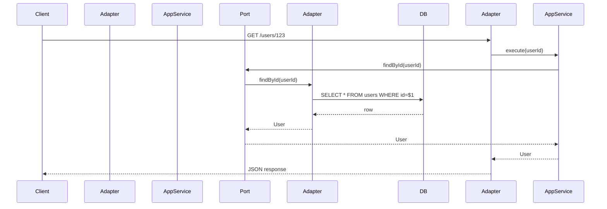

<!-- Generated by Groq via GitHub Actions -->
<!-- Topic ID: T238 -->
<!-- Category: Architecture Patterns -->
<!-- Generated at UTC: 2026-11-21T08:27:49.956472+00:00 -->

# Hexagonal Architecture

## 1. What problem does this solve?

### Motivation
Modern back‑end services often juggle many concerns: database access, external APIs, message queues, caching, authentication, and business logic. When these concerns are tangled, a change in one area (e.g., switching from PostgreSQL to MongoDB) forces a cascade of refactors across the codebase, making maintenance brittle and testing hard.

### The problem
- **Tight coupling** between business logic and infrastructure (DB drivers, HTTP clients, etc.).
- **Hard to test**: unit tests must stub or mock external systems, leading to brittle test suites.
- **Low agility**: adding a new persistence layer or replacing a third‑party service requires touching core code.
- **Poor separation of concerns**: developers cannot focus on domain rules without worrying about I/O.

### Why it matters
- **Time to market**: Frequent refactors slow feature delivery.
- **Reliability**: Coupled code is harder to reason about; bugs in infrastructure can leak into business logic.
- **Team productivity**: Developers spend more time wiring adapters than implementing domain rules.

### Consequences of not using it
- **Monolithic code** that grows unmanageable.
- **Inconsistent testing**: integration tests dominate, unit tests become fragile.
- **Vendor lock‑in**: Switching databases or services becomes a major project.

### Real‑world appearance
- Microservices that expose a REST API but internally use a clean‑architecture style.
- Serverless functions that use adapters for DynamoDB, SQS, and Cognito.
- Monoliths that separate “domain” modules from “infrastructure” modules.

---

## 2. Mental model

### Analogy
Think of a **restaurant**.  
- The **kitchen** (core domain) prepares dishes based on recipes (business rules).  
- The **wait staff** (ports) receives orders and delivers dishes.  
- The **delivery driver** (adapters) brings ingredients from the supplier and takes orders to the kitchen.  
No matter which supplier you use or whether you add a new delivery service, the kitchen stays the same.

### Engineering model
- **Core**: Domain entities, value objects, use‑case services. Pure business logic, no I/O.
- **Ports**: Interfaces that the core expects (e.g., `UserRepository`, `EmailSender`). They define *what* the core needs.
- **Adapters**: Concrete implementations of ports (e.g., `PostgresUserRepository`, `SendGridEmailSender`). They translate between the core and external systems.

The core never knows *how* data is stored or *how* emails are sent; it only knows *what* it can do.

---

## 3. Deep explanation

### Internals
- **Domain layer**: Entities, value objects, domain services, application services (use‑cases).
- **Ports**: Interfaces in the domain layer. Example: `interface UserRepository { findById(id: string): Promise<User>; }`.
- **Adapters**: Implementations that live in an “infrastructure” package. They may use ORMs, HTTP clients, message queues, etc.

### Important terminology
| Term | Meaning |
|------|---------|
| **Port** | An interface exposed by the core. |
| **Adapter** | Concrete implementation of a port, wired to the outside world. |
| **Application Service** | Orchestrates domain logic, coordinates ports. |
| **Domain Service** | Pure business logic that doesn’t fit in an entity. |
| **Infrastructure Layer** | Contains adapters, database drivers, external APIs. |

### Trade‑offs
| Benefit | Drawback |
|---------|----------|
| **Testability** | More layers → more boilerplate. |
| **Decoupling** | Requires disciplined interface design. |
| **Performance** | Indirection can add overhead (but usually negligible). |
| **Learning curve** | Developers must understand separation of concerns. |

### Failure modes
- **Over‑engineering**: Adding ports for trivial adapters (e.g., a simple logger) can clutter the code.
- **Misplaced logic**: Putting business rules in adapters breaks the core’s purity.
- **Interface bloat**: Ports with too many methods make adapters hard to implement.

### Limitations
- **Not a silver bullet**: Still needs good design practices (e.g., SOLID, DDD).
- **Complexity for small services**: For a tiny utility, hexagonal architecture may be overkill.
- **Requires discipline**: Teams must enforce the boundary; otherwise, adapters leak into the core.

### Where it fits
- **Microservices**: Each service can be a hexagon, exposing REST or gRPC ports.
- **Monoliths**: Domain modules can be hexagonal, with adapters for database, cache, etc.
- **Serverless**: Functions can act as adapters; the core remains pure.

### Interaction with related concepts
- **DDD**: Hexagon is often the architectural foundation for DDD.
- **CQRS**: Read/write adapters can be separate ports.
- **Event‑driven**: Event handlers are adapters that implement a `Subscriber` port.
- **Testing**: Unit tests target the core; integration tests target adapters.

---

## 4. How it works

### Step‑by‑step flow

1. **Client** sends a request (HTTP, gRPC, message queue).
2. **Adapter** (e.g., `HttpUserController`) receives the request.
3. Adapter calls an **Application Service** (`GetUserUseCase`).
4. Application Service calls a **Port** (`UserRepository`).
5. **Adapter** implements the port (`PostgresUserRepository`) and queries the database.
6. Data is returned to the Application Service, which may invoke **Domain Services**.
7. Result is passed back to the Adapter, which serializes it and sends the response.



---

## 5. Practical implementation

Below is a minimal but realistic Node.js/TypeScript example of a user service using hexagonal architecture.

### Directory layout

```
src/
  domain/
    entities/
      User.ts
    ports/
      UserRepository.ts
    services/
      GetUserUseCase.ts
  infrastructure/
    adapters/
      postgres/
        PostgresUserRepository.ts
      http/
        UserController.ts
  config/
    db.ts
  app.ts
```

### Domain entity

```ts
// src/domain/entities/User.ts
export class User {
  constructor(
    public readonly id: string,
    public readonly email: string,
    public readonly name: string,
  ) {}
}
```

### Port interface

```ts
// src/domain/ports/UserRepository.ts
import { User } from '../entities/User';

export interface UserRepository {
  findById(id: string): Promise<User | null>;
}
```

### Application service (use‑case)

```ts
// src/domain/services/GetUserUseCase.ts
import { UserRepository } from '../ports/UserRepository';

export class GetUserUseCase {
  constructor(private readonly repo: UserRepository) {}

  async execute(id: string) {
    const user = await this.repo.findById(id);
    if (!user) throw new Error('User not found');
    return user;
  }
}
```

### PostgreSQL adapter

```ts
// src/infrastructure/adapters/postgres/PostgresUserRepository.ts
import { UserRepository } from '../../domain/ports/UserRepository';
import { User } from '../../domain/entities/User';
import { Pool } from 'pg';

export class PostgresUserRepository implements UserRepository {
  constructor(private readonly pool: Pool) {}

  async findById(id: string): Promise<User | null> {
    const res = await this.pool.query(
      'SELECT id, email, name FROM users WHERE id = $1',
      [id],
    );
    if (res.rowCount === 0) return null;
    const row = res.rows[0];
    return new User(row.id, row.email, row.name);
  }
}
```

### HTTP adapter (controller)

```ts
// src/infrastructure/adapters/http/UserController.ts
import express, { Request, Response } from 'express';
import { GetUserUseCase } from '../../../domain/services/GetUserUseCase';
import { PostgresUserRepository } from '../postgres/PostgresUserRepository';
import { Pool } from 'pg';

export const createUserRouter = () => {
  const router = express.Router();
  const pool = new Pool(); // use env vars for connection
  const repo = new PostgresUserRepository(pool);
  const useCase = new GetUserUseCase(repo);

  router.get('/users/:id', async (req: Request, res: Response) => {
    try {
      const user = await useCase.execute(req.params.id);
      res.json(user);
    } catch (e: any) {
      res.status(404).json({ error: e.message });
    }
  });

  return router;
};
```

### Application bootstrap

```ts
// src/app.ts
import express from 'express';
import { createUserRouter } from './infrastructure/adapters/http/UserController';

const app = express();
app.use(express.json());
app.use('/', createUserRouter());

const PORT = process.env.PORT ?? 3000;
app.listen(PORT, () => console.log(`Listening on ${PORT}`));
```

### Running

```bash
# install deps
npm i express pg
# compile TS
npx tsc
# start
node dist/app.js
```

You can now `GET http://localhost:3000/users/1` and see the JSON response.

---

## 6. Production considerations

| Concern | How hexagonal helps | Practical tips |
|---------|---------------------|----------------|
| **Scalability** | Adapters can be swapped for more scalable back‑ends (e.g., Redis cache, sharded DB). | Use connection pools, async/await, batch queries. |
| **Reliability** | Core logic is isolated; failures in adapters can be retried or circuit‑broken without affecting business rules. | Wrap adapters with retry logic, use `opossum` for circuit breakers. |
| **Security** | Ports expose only the minimal contract; adapters handle auth/validation. | Validate inputs in adapters, use middleware for auth. |
| **Observability** | Each adapter can emit metrics (e.g., DB latency). | Integrate with Prometheus, log adapter entry/exit. |
| **Performance** | Indirection is negligible; focus on efficient queries. | Use indexes, prepared statements, connection pooling. |
| **Error handling** | Domain errors propagate cleanly; adapters translate to HTTP status codes. | Define custom error classes (`NotFoundError`). |
| **Resource usage** | Adapters manage resources (DB connections, sockets). | Close connections on shutdown, use graceful exits. |
| **Operational concerns** | Clear boundaries simplify deployment (e.g., deploy adapters separately). | Use Docker Compose for local dev, separate containers for DB. |
| **Failure recovery** | Adapters can retry or fallback to alternative services. | Implement fallback adapters (e.g., in-memory cache). |
| **Deployment** | Adapters can be versioned independently of core. | Use semantic versioning for adapters, keep core stable. |

---

## 7. Common mistakes

| Mistake | Why it hurts |
|---------|--------------|
| **Putting business logic in adapters** | Breaks core purity; makes logic hard to test and reuse. |
| **Over‑engineering ports** | Too many methods make adapters bulky and fragile. |
| **Ignoring dependency injection** | Hard to swap adapters; leads to tight coupling. |
| **Not handling async errors** | Unhandled promises crash the process. |
| **Using global state in adapters** | Violates isolation; makes unit tests flaky. |
| **Skipping interface segregation** | A single port with many responsibilities becomes a bottleneck. |
| **Not documenting port contracts** | New developers misunderstand what the core expects. |

---

## 8. Senior engineer perspective

### When used at scale
- **Multiple services** share the same domain model; adapters can be reused across services.
- **Cross‑service contracts** become well‑defined ports, easing integration.
- **Governance**: Centralized domain logic reduces duplication.

### Design decisions
- **Port granularity**: Decide between coarse‑grained (e.g., `UserRepository`) vs fine‑grained (e.g., `UserReadRepository`, `UserWriteRepository`).
- **Adapter placement**: In a monolith, adapters may live in the same process; in microservices, they can be separate services.
- **Event sourcing**: Adapters can publish events; ports can expose an `EventPublisher` interface.
- **Testing strategy**: Unit tests for core, integration tests for adapters, contract tests for ports.

### Bottlenecks
- **Adapter performance**: Poorly written adapters can become the slowest part.
- **Port evolution**: Adding new methods to a port forces all adapters to change.

### Failure scenarios
- **Adapter crash**: Circuit breaker prevents cascading failures.
- **Port mismatch**: Runtime errors if adapter returns unexpected shape; use TypeScript’s structural typing to catch at compile time.

### Monitoring
- **Metrics per adapter**: Query latency, error rates.
- **Health checks**: Expose `/health` that pings adapters.

### Cost/performance
- **Connection pooling**: Avoid per-request connections.
- **Batching**: Reduce round‑trips for bulk operations.

### When NOT to use
- **Tiny scripts**: Overkill for a one‑off CLI tool.
- **High‑frequency, low‑latency services**: The extra layer may add measurable latency; weigh against testability gains.

---

## 9. Interview questions

1. **Beginner**: *What is the main purpose of a port in hexagonal architecture?*  
   *Answer:* A port defines an interface that the core domain expects; it declares *what* the domain needs without specifying *how* it is implemented.

2. **Beginner**: *How does hexagonal architecture improve testability?*  
   *Answer:* By isolating the core from external dependencies, you can unit‑test the core with mock implementations of ports, avoiding real DB or network calls.

3. **Senior**: *Explain how you would refactor a legacy service that mixes database access and business logic into a hexagonal architecture.*  
   *Answer:* Identify core business rules, extract them into domain entities/services, define ports for persistence and external calls, implement adapters that use the existing code, and wire them together via dependency injection. Discuss migration strategy and backward compatibility.

4. **Senior**: *What trade‑offs arise when you split a monolith into hexagonal modules?*  
   *Answer:* You gain modularity and testability but introduce deployment complexity, potential performance overhead, and the need for clear contract definitions. Discuss versioning, CI/CD pipelines, and monitoring.

5. **Scenario/Debugging**: *A production deployment shows a sudden spike in latency for user lookup requests. The code uses a hexagonal architecture with a `PostgresUserRepository` adapter. What steps would you take to diagnose and resolve the issue?*  
   *Answer:*  
   - Check adapter logs for query times.  
   - Verify connection pool size and health.  
   - Inspect PostgreSQL metrics (wait events, lock contention).  
   - Look for recent schema changes or missing indexes.  
   - Consider adding a read‑replica or caching layer.  
   - If the spike is due to a slow query, rewrite or add an index.  
   - Use distributed tracing to see if the latency originates in the DB or the adapter.

---

## 10. Hands‑on task

**Goal**: Add a new *email notification* feature that sends a welcome email when a user registers.

**Steps**

1. **Define a new port** `EmailSender` in `src/domain/ports/EmailSender.ts`.
2. **Create a domain service** `SendWelcomeEmailUseCase` that depends on `EmailSender` and `UserRepository`.
3. **Implement an adapter** `SendGridEmailSender` in `src/infrastructure/adapters/email/SendGridEmailSender.ts` (use a mock or a real SendGrid SDK).
4. **Wire the adapter** into the HTTP controller (`UserController`) so that after a successful user creation, the use‑case is executed.
5. **Write unit tests** for `SendWelcomeEmailUseCase` using a mock `EmailSender`.
6. **Deploy locally** and verify that the email is sent (or logged) when you POST to `/users`.

*Hints*: Use environment variables for API keys, keep the adapter stateless, and handle errors gracefully.

---

## 11. Quick revision

- Hexagonal architecture separates **core domain** from **infrastructure** via **ports** and **adapters**.
- **Ports** are pure interfaces; **adapters** implement them.
- Core never knows *how* data is stored or sent; it only knows *what* it can do.
- Improves **testability**, **maintainability**, and **flexibility**.
- Common pitfalls: mixing business logic into adapters, over‑engineering ports.
- In production: use connection pools, circuit breakers, metrics per adapter.
- When scaling: consider port granularity, shared domain models, and versioning.
- Interview focus: purpose of ports, benefits for testing, refactoring strategy, trade‑offs.

---

## 12. References

- [Hexagonal Architecture – Alistair Cockburn](https://alistair.cockburn.us/hexagonal-architecture/)
- [Domain‑Driven Design – Eric Evans](https://www.domainlanguage.com/)
- [Node.js – Express](https://expressjs.com/)
- [pg – PostgreSQL client for Node.js](https://node-postgres.com/)
- [Prometheus – Monitoring](https://prometheus.io/docs/introduction/overview/)
- [opossum – Circuit breaker for Node.js](https://github.com/nodeshift/opossum)
