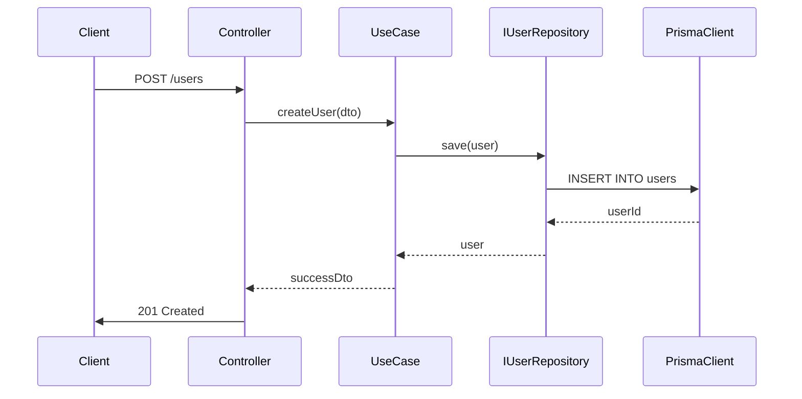

<!-- Generated by Groq via GitHub Actions -->
<!-- Topic ID: T239 -->
<!-- Category: Architecture Patterns -->
<!-- Generated at UTC: 2026-11-21T20:11:44.254549+00:00 -->

# Onion Architecture

## 1. What problem does this solve?

**Motivation**  
In a typical monolithic backend you often end up with a single “big” module that mixes business rules, database access, HTTP handling, and third‑party integrations. When the codebase grows, the following problems surface:

| Problem | Why it matters | Consequence if ignored |
|---------|----------------|------------------------|
| **Tight coupling** | Business logic depends on concrete frameworks (Express, Prisma, Redis). | Hard to swap a framework or test the domain in isolation. |
| **Low testability** | Unit tests must spin up a database or HTTP server. | Tests become slow, flaky, and hard to write. |
| **Hard maintenance** | A change in the persistence layer forces changes in business code. | Increased bug surface area and regression risk. |
| **Poor scalability** | All concerns share the same process boundaries. | Scaling a specific part (e.g., caching) is impossible. |

**Where it appears in real systems**  
Large e‑commerce platforms, SaaS backends, and micro‑service stacks often adopt a layered or onion‑style separation to keep the core domain pure and decoupled from infrastructure. It is a common pattern in .NET, Java, and increasingly in Node.js/TypeScript projects that want to stay test‑friendly and maintainable.

---

## 2. Mental model

**Analogy**  
Think of a city’s traffic system. The **core** (city center) contains the essential services (hospital, fire station). Around it are concentric rings: the **business layer** (city council), the **application layer** (transport department), and finally the **infrastructure layer** (roads, traffic lights). Each ring only knows about the ring inside it, not the outer rings. If you need to upgrade the roads (infrastructure), you can do so without touching the city council’s policies.

**Engineering model**  
```
┌───────────────────────┐
│  Frameworks & Drivers  │  (Express, Prisma, Redis, HTTP, Kafka)
├───────────────────────┤
│  Interface Adapters    │  (Controllers, Repositories, Gateways)
├───────────────────────┤
│  Application (Use‑Cases)│  (Business rules, orchestrators)
├───────────────────────┤
│  Domain (Entities)     │  (Pure business objects, invariants)
└───────────────────────┘
```
- **Domain** is the heart: pure TypeScript classes/interfaces, no external imports.
- **Use‑Cases** orchestrate domain objects and call adapters.
- **Adapters** translate between the world of the framework and the domain.
- **Frameworks** are the outermost shell that actually talks to HTTP, DB, etc.

---

## 3. Deep explanation

### Internals
- **Domain Layer**: Entities, Value Objects, Domain Services. No dependencies on external modules.
- **Application Layer**: Use‑Case classes that coordinate domain objects. They depend only on interfaces defined in the domain.
- **Interface Adapters**: Concrete implementations of those interfaces (e.g., `UserRepository` using Prisma). They also adapt external data formats to domain objects.
- **Frameworks & Drivers**: Express controllers, Prisma client, Redis client, etc.

### Important terminology
- **Entity**: A business object with an identity (e.g., `User`).
- **Value Object**: Immutable object without identity (e.g., `Email`).
- **Repository Interface**: Abstract persistence contract (`IUserRepository`).
- **Use‑Case**: A single business operation (`CreateUserUseCase`).
- **Adapter**: Implementation of an interface that talks to the outside world.

### Trade‑offs
| Benefit | Drawback |
|---------|----------|
| **Testability** | More files, more boilerplate. |
| **Decoupling** | Requires discipline to keep layers pure. |
| **Performance** | Extra mapping layers can add overhead. |
| **Learning curve** | New developers need to understand the pattern. |

### Failure modes
- **Circular dependencies**: Domain imports infrastructure accidentally.
- **Over‑engineering**: Adding layers for trivial concerns (e.g., a simple logger).
- **Misplaced logic**: Putting business rules in adapters instead of use‑cases.

### Limitations
- Not a silver bullet for micro‑services; still a monolith unless split into bounded contexts.
- Requires consistent naming and folder structure; otherwise the layers blur.

### Where it fits
- **Monoliths**: Keeps a large codebase maintainable.
- **Micro‑services**: Each service can be its own onion; the pattern scales horizontally.
- **Serverless**: Use‑cases can be mapped to Lambda functions, adapters to API Gateway.

### Interaction with related concepts
- **Domain‑Driven Design (DDD)**: Onion is the architectural foundation; DDD adds strategic design (bounded contexts, aggregates).
- **CQRS**: Use‑cases can be split into command and query sides, still respecting the onion.
- **Event‑Sourcing**: The domain layer emits events; adapters persist them.

---

## 4. How it works

### Step‑by‑step flow for a `CreateUser` request

1. **HTTP Request** → Express controller (outer layer).
2. Controller validates payload → passes DTO to `CreateUserUseCase`.
3. `CreateUserUseCase` creates domain entities (`User`, `Email`).
4. Use‑case calls `IUserRepository.save(user)` (interface).
5. Adapter (`PrismaUserRepository`) implements `save` → Prisma client writes to PostgreSQL.
6. Repository returns persisted entity → use‑case returns success DTO.
7. Controller sends HTTP 201 response.



---

## 5. Practical implementation

### Project structure

```
src/
├─ domain/
│  ├─ entities/
│  │  └─ User.ts
│  ├─ valueObjects/
│  │  └─ Email.ts
│  └─ interfaces/
│     └─ IUserRepository.ts
├─ application/
│  └─ useCases/
│     └─ CreateUserUseCase.ts
├─ infrastructure/
│  ├─ repositories/
│  │  └─ PrismaUserRepository.ts
│  └─ prisma/
│     └─ schema.prisma
├─ adapters/
│  └─ controllers/
│     └─ UserController.ts
├─ server.ts
```

### Domain: `User.ts`

```ts
// src/domain/entities/User.ts
export class User {
  constructor(
    public readonly id: string,
    public readonly email: Email,
    public readonly name: string,
    public readonly createdAt: Date = new Date()
  ) {}
}
```

### Value Object: `Email.ts`

```ts
// src/domain/valueObjects/Email.ts
export class Email {
  private constructor(public readonly value: string) {}

  static create(email: string): Email {
    if (!/^[^\s@]+@[^\s@]+\.[^\s@]+$/.test(email)) {
      throw new Error('Invalid email');
    }
    return new Email(email);
  }
}
```

### Repository interface

```ts
// src/domain/interfaces/IUserRepository.ts
import { User } from '../entities/User';

export interface IUserRepository {
  save(user: User): Promise<User>;
  findById(id: string): Promise<User | null>;
}
```

### Use‑case

```ts
// src/application/useCases/CreateUserUseCase.ts
import { IUserRepository } from '../../domain/interfaces/IUserRepository';
import { User } from '../../domain/entities/User';
import { Email } from '../../domain/valueObjects/Email';
import { v4 as uuidv4 } from 'uuid';

export class CreateUserUseCase {
  constructor(private readonly repo: IUserRepository) {}

  async execute(dto: { email: string; name: string }): Promise<User> {
    const email = Email.create(dto.email);
    const user = new User(uuidv4(), email, dto.name);
    return this.repo.save(user);
  }
}
```

### Adapter: Prisma repository

```ts
// src/infrastructure/repositories/PrismaUserRepository.ts
import { PrismaClient } from '@prisma/client';
import { IUserRepository } from '../../domain/interfaces/IUserRepository';
import { User } from '../../domain/entities/User';
import { Email } from '../../domain/valueObjects/Email';

export class PrismaUserRepository implements IUserRepository {
  constructor(private readonly prisma: PrismaClient) {}

  async save(user: User): Promise<User> {
    const dbUser = await this.prisma.user.create({
      data: {
        id: user.id,
        email: user.email.value,
        name: user.name,
        createdAt: user.createdAt,
      },
    });
    return new User(dbUser.id, Email.create(dbUser.email), dbUser.name, dbUser.createdAt);
  }

  async findById(id: string): Promise<User | null> {
    const dbUser = await this.prisma.user.findUnique({ where: { id } });
    if (!dbUser) return null;
    return new User(dbUser.id, Email.create(dbUser.email), dbUser.name, dbUser.createdAt);
  }
}
```

### Controller

```ts
// src/adapters/controllers/UserController.ts
import { Request, Response } from 'express';
import { CreateUserUseCase } from '../../application/useCases/CreateUserUseCase';
import { PrismaUserRepository } from '../../infrastructure/repositories/PrismaUserRepository';
import { PrismaClient } from '@prisma/client';

export class UserController {
  private readonly createUserUC: CreateUserUseCase;

  constructor() {
    const prisma = new PrismaClient();
    const repo = new PrismaUserRepository(prisma);
    this.createUserUC = new CreateUserUseCase(repo);
  }

  async create(req: Request, res: Response) {
    try {
      const user = await this.createUserUC.execute(req.body);
      res.status(201).json({ id: user.id, email: user.email.value, name: user.name });
    } catch (err) {
      res.status(400).json({ error: err.message });
    }
  }
}
```

### Server bootstrap

```ts
// src/server.ts
import express from 'express';
import { UserController } from './adapters/controllers/UserController';

const app = express();
app.use(express.json());

const userCtrl = new UserController();
app.post('/users', (req, res) => userCtrl.create(req, res));

app.listen(3000, () => console.log('Server running on :3000'));
```

> **Note**: The controller only knows about the use‑case, never about Prisma or the database schema.

---

## 6. Production considerations

| Concern | How Onion helps / what to watch |
|---------|---------------------------------|
| **Scalability** | Each layer can be scaled independently (e.g., cache layer in Redis). |
| **Reliability** | Clear boundaries make it easier to isolate failures (e.g., a DB outage only affects adapters). |
| **Security** | Domain layer never touches external APIs; validation can be centralized in use‑cases. |
| **Observability** | Instrument use‑cases for business metrics; adapters for infrastructure metrics. |
| **Performance** | Avoid unnecessary mapping; keep adapters thin. |
| **Error handling** | Use‑cases throw domain errors; adapters translate to HTTP status codes. |
| **Resource usage** | Separate services (e.g., a dedicated cache service) can be containerized. |
| **Deployment** | Each layer can be built into its own Docker image if you split the monolith into micro‑services. |
| **Failure recovery** | Retry logic lives in adapters; use‑cases can orchestrate compensating actions. |

---

## 7. Common mistakes

| Mistake | Why it’s problematic |
|---------|----------------------|
| **Domain depends on Prisma** | Breaks testability; you can’t unit‑test domain logic without a DB. |
| **Controllers contain business logic** | Violates separation; makes controllers bloated and hard to test. |
| **Using global singletons for repositories** | Creates hidden state and makes dependency injection hard. |
| **Over‑splitting layers** | Too many tiny modules increase cognitive load and build times. |
| **Ignoring interface segregation** | A repository interface that exposes too many methods forces adapters to implement unused ones. |

---

## 8. Senior engineer perspective

### At scale
- **Bounded contexts**: Each onion can represent a bounded context; services can be split into separate repositories.
- **Event‑driven integration**: Use‑cases emit domain events; adapters publish to Kafka or Dapr.
- **Transactional boundaries**: Use‑cases manage transactions; adapters expose `beginTransaction/commit/rollback`.

### Design decisions
- **Repository abstraction**: Should it return domain objects or DTOs? Prefer domain objects for purity.
- **Caching strategy**: Where to cache? In adapters or in a separate cache layer? Consider cache‑aside patterns.
- **Error handling policy**: Domain errors vs. infrastructure errors; decide on a global error handling middleware.
- **Monitoring**: Instrument use‑cases for business KPIs; adapters for latency and error rates.

### Bottlenecks
- **Repository calls**: If the DB is slow, the whole request stalls. Use async/await and connection pooling.
- **Mapping overhead**: Converting between DB rows and domain objects can be costly; use lightweight mappers.

### Failure scenarios
- **Adapter crash**: Use health checks; graceful degradation (e.g., fallback to in‑memory cache).
- **Domain violation**: Enforce invariants in constructors; reject invalid data early.

### When NOT to use Onion
- **Simple scripts or micro‑services with trivial logic**: The overhead outweighs benefits.
- **Rapid prototyping**: Too much boilerplate can slow iteration.

---

## 9. Interview questions

1. **Beginner**: *What is Onion Architecture and why do we separate layers?*  
   *Answer*: It separates core business logic from infrastructure to improve testability, maintainability, and decoupling.

2. **Beginner**: *Which layer contains the database access code?*  
   *Answer*: The Interface Adapters layer (repositories, gateways).

3. **Senior**: *How would you handle a cross‑cutting concern like logging in an Onion Architecture?*  
   *Answer*: Use middleware or decorators in the adapters or application layer; keep the domain layer free of logging code.

4. **Senior**: *Describe how you would unit‑test a use‑case that depends on a repository.*  
   *Answer*: Mock the repository interface, inject the mock into the use‑case, and assert the business logic without touching the DB.

5. **Scenario/Debugging**: *A request to create a user returns a 500 error, but the database shows the user was inserted. What could be wrong?*  
   *Answer*: Likely the controller or use‑case throws an exception after persistence (e.g., validation error). Check error handling paths and ensure the response is sent only after successful completion.

---

## 10. Hands‑on task

**Build a “Product” CRUD service using Onion Architecture.**

1. Create a `Product` entity with fields `id`, `name`, `price`, `createdAt`.
2. Implement `IProductRepository` and a Prisma adapter.
3. Add use‑cases: `CreateProductUseCase`, `GetProductUseCase`, `UpdateProductUseCase`, `DeleteProductUseCase`.
4. Expose REST endpoints via Express controllers.
5. Add Redis caching in the adapter: cache `GetProduct` results for 60 s.
6. Write unit tests for the use‑cases using Jest and mock the repository.

Push the code to a GitHub repo and run `npm test` to verify all tests pass.

---

## 11. Quick revision

- Onion Architecture = concentric layers: Domain → Application → Interface Adapters → Frameworks.
- Domain layer: pure business logic, no external imports.
- Use‑cases orchestrate domain objects; depend only on domain interfaces.
- Repositories are interfaces in the domain; adapters implement them.
- Controllers call use‑cases; never contain business logic.
- Keeps code testable, maintainable, and decoupled.
- Common pitfalls: domain ↔ infrastructure coupling, bloated controllers, over‑engineering.
- In production: watch for mapping overhead, transaction boundaries, and proper error handling.
- Senior considerations: bounded contexts, event sourcing, monitoring, cost of scaling each layer.
- Interview focus: layer responsibilities, dependency injection, testing strategy.

---

## 12. References

- [Martin Fowler – Onion Architecture](https://martinfowler.com/eaaDev/OnionArchitecture.html)
- [Prisma – Official Docs](https://www.prisma.io/docs/)
- [Node.js – Official Docs](https://nodejs.org/en/docs/)
- [Redis – Official Docs](https://redis.io/docs/)
- [Express – Official Docs](https://expressjs.com/)
- [DDD – Domain‑Driven Design Book](https://www.amazon.com/Domain-Driven-Design-Tackling-Complexity-Software/dp/0321125215) (for deeper context)
